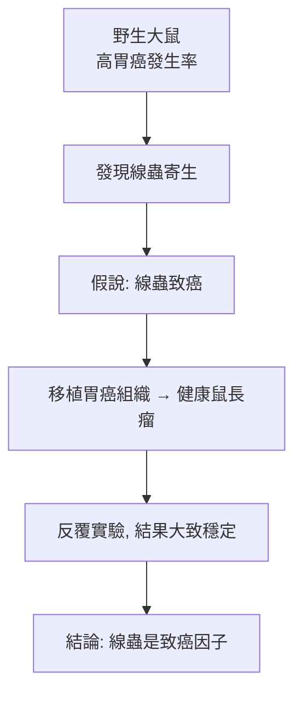

# 1926 · 鼠癌錯案：菲比格的線蟲與諾貝爾史上最著名的誤判

> **1926 諾貝爾生理學或醫學獎**：約翰尼斯·菲比格（Johannes Andreas Grib Fibiger，丹麥）— 表彰「發現鼠癌」（"for his discovery of the Spiroptera carcinoma"）。此獎於 1927 年追贈，並被卡羅琳斯卡醫學院於 2010 年公開評定為「本院史上最大誤判之一」。

## 懸案（案情提要）

菲比格在哥本哈根大學病理解剖學研究所當了十四年教授，1907 年起他在**野生大鼠（ Norway rat）**體內發現一種此前未知的圓形線蟲，並命名為 **Spiroptera carcinoma**（現已知其正確名稱為 *Gongylonema neoplasticum*）。他觀察到：受感染的鼠，胃癌的發生率遠高於未感染的鼠。

疑點按序排列：

1. 這條線蟲與胃癌何干？是**因果**（線蟲致癌），還是**共現**（同為環境因素的受害者）？
2. 若是因果，機制為何？
3. 能不能在**其他動物**身上重複這個實驗？重複性是科學的底线。
4. 若是人為可控的致癌因子，癌症研究將從「描述病理」躍升為「實驗科學」——這誘惑力太大。

這樁案件的實質是：**一個觀察被包裝成一個機制，再被包裝成一個醫學里程碑。**

## 前因

| 年份 | 事件 |
| --- | --- |
| 1907 | 菲比格在野生大鼠的食道與胃壁中發現新線蟲 *Gongylonema neoplasticum*，命名為 *Spiroptera carcinoma*（意即「癌狀螺旋蟲」）。 |
| 1913 | 菲比格報告：把線蟲感染的大鼠的胃癌組織移植到健康大鼠，可誘發胃癌——這是他「實驗致癌」的第一份證據。 |
| 1915 | 日本病理學家 **山極喜八郎（Katsusaburō Yamagiwa）** 以煤焦油反覆塗抹兔耳內膜，成功誘發上皮癌——這是化學致癌的第一樁鐵證。 |
| 1916 | 菲比格在《維也納臨床年報》報告其實驗；學界反應兩極：許多人認為他打開了癌症實驗研究的大門。 |
| 1926 | 菲比格獲提名，但委員會認為他與 Yamagiwa「不夠資格」（deserving）；1927 年菲比格單獨被追補獲獎。 |
| 1927–1930s | 菲比格在學界壓力下繼續研究，並推廣「人工誘癌」方法。 |
| 1950–1960s | 獨立研究逐步發現真相：線蟲本身**不致癌**。 |
| 2010 | 瑞典皇家科學院常務秘書、卡羅琳斯卡病毒學教授 Erling Norrby 公開評定：此獎為「卡羅琳斯卡學院史上最大的錯誤之一」。 |

## 調查

### 第一幕：菲比格的證據鏈

菲比格提出的實驗與觀察大致如下：

每一環看似都成立，甚至被《Nature》等期刊正面引述為「癌化學說的曙光」。

### 第二幕：錯在哪裡——三層拆解

**第一層：混淆「必需條件」與「充分條件」。** 帶線蟲的大鼠胃癌多，這只說明線蟲感染是胃癌的**必要伴隨條件**，或兩者同受第三因子支配。菲比格把「共現」推論為「因果」，這是最典型的相關—因果謬誤。

**第二層：組織移植實驗的缺陷。** 菲比格的「移植」是把**已癌變的組織**移植到健康鼠，癌自然長出來——這並不能區分「線蟲造成癌」與「癌細胞本身具有移植性」。事後看，他其實可以（卻未）做的關鍵實驗是：把**不含癌**的線蟲單獨移植到健康鼠、或先用藥殺蟲再觀察癌是否停止發展——這類對照在 1930 年代之後已被視為基本要求。

**第三層：線蟲致瘤的真正機制。** 現代研究揭示 *Gongylonema neoplasticum* 會在食道與胃壁形成**纖維性包囊（fibrous capsule）**，造成慢性機械性刺激與發炎；而真正的致癌因子是**維生素 A 缺乏**——野生大鼠、尤其在飼料缺乏維生素 A 的季節，正是維生素 A 缺乏合併線蟲感染的群體，其胃癌發生率升高。當實驗動物改為飼養於維生素 A 充足的環境，胃癌消失。

### 第三幕：委員會的裁決與翻案

諾貝爾委員會在 1926 年的審查中留下一段耐人尋味的記錄：他們認為菲比格與 Yamagiwa 的工作「尚未達到獲獎的資格」，卻在隔年（1927）以追補方式把獎給了菲比格單人——這造成一種「委員會原本不信任、卻又給了獎」的尷尬。1940–1960 年代的重新評估（包括把所有菲比格的實驗鼠重做、並對照維生素 A 充足/缺乏的飼料）確認：

| 菲比格的結論 | 現代裁決 |
| --- | --- |
| 線蟲（Spiroptera carcinoma）引起胃癌 | 線蟲不致癌；*Gongylonema neoplasticum* 只是機械性刺激與發炎的來源 |
| 腫瘤為「癌」 | 部分被誤判；部分確為上皮增生而非浸潤性癌 |
| 可用線蟲建立致癌實驗模型 | 模型不成立；致癌模型改用煤焦油、苯丙嘧啶等化學致癌物 |
| 實驗方法學開創 | 唯一留下的正面遺產：**受控的飼養條件與對照組設計**在此案後被制度化 |

## 理論裁決

1. **致癌的三大充分條件假說**：現代癌症生物學以「基因突變 + 促進增殖的訊號 + 逃避免疫」三要素描述致癌（Hanahan–Weinberg，2000s）。菲比格的模型一項都沒有，卻被當作里程碑——這說明當時**「方法學示範」的吸引力可以壓過機制驗證**。
2. **化學致癌的正確模型**：Yamagiwa 的煤焦油實驗（1915）才是真兇線索——致癌物需**反覆、持續、局部**作用於上皮，且有**潛伏期**。這套模型隨後由肯尼思・揚（Kenneth Yamaguchi 與 Ivan Berenblum）的「兩階段致癌模型（two-stage model）」形式化：

   $$\text{發癌率} \propto \text{致癌劑劑量} \times \text{促進劑劑量}$$

   單次暴露不足致癌，必須「啟始（initiation）＋促進（promotion）」兩階段，是今日化學致癌與癌化學預防的核心框架。

3. **機會與必要條件的統計學區分**：本案可視為對「 $P(\text{癌}\vert\text{線蟲})$ 高」與「 $P(\text{線蟲}\vert\text{癌})$ 高」不可互換的示範——這正是因果推斷（causal inference）在醫學統計中的核心教訓，也是今日觀察性研究「混雜因子控制」的歷史教練案例。
4. **機制驗證的底線**：菲比格案例之後，諾貝爾委員會與科學界更重視「機制是否被驗證」而非「效應是否被觀察到」。這也是為什麼 1926 年委員會最初的保留意見，事後看反倒是合理的。

## 追查支線（未結之謎）

- 維生素 A 缺乏致胃癌的機制（導致上皮分化異常與 DNA 甲基化異常）直到 20 世紀末才被完整描述；
- 化學致癌領域的「兩階段模型」由 Yamaguchi 與 Berenblum 奠基，是菲比格案的正面替代繼承者；
- 諾貝爾獎「追補頒獎」的先例（1914 年物理獎遲至 1920 年代才頒、1938 年獎延至 1939）皆與戰事相關，1926 年獎的 1927 年追補卻是少見案例；
- 委員會 2010 年的公開自我批判，開啟了諾貝爾獎「歷史性錯誤檢討」的公共討論（與 2020 年表彰斯文·派迪森遲了 80 年道歉一案同屬歷史修正的浪潮）；
- 「野外動物模型」在現代仍廣泛用於癌症研究（犬、貓的自發性腫瘤），但今日必須以對照組與分子標記嚴格界定。

## 證物與數據（偵查卷宗摘錄）

| 證物 | 數值／內容 | 偵查意義 |
| --- | --- | --- |
| 線蟲命名 | *Spiroptera carcinoma*（實為 *Gongylonema neoplasticum*） | 命名中即預設了因果 |
| 野生鼠胃癌率 | 帶蟲鼠顯著高於無蟲鼠 | 共現，非因果 |
| 組織移植實驗（1913） | 移植已癌組織→長癌 | 無法區分因果與移植性 |
| 維生素 A 對照實驗（1960s） | 充足維生素 A 飼料下胃癌消失 | 真實致癌因子 |
| 煤焦油致癌（1915） | 兔耳內膜反覆塗抹誘發癌 | 化學致癌的真模型 |
| 委員會評語（1926） | 「尚不夠資格」 | 事後看反倒是清醒判斷 |
| 2010 年 Norrby 評語 | 「卡羅琳斯卡史上最大誤判之一」 | 官方認錯 |

## 後果

| 領域 | 影響 |
| --- | --- |
| 實驗病理學 | 正面遺產是「受控飼養與對照組」的推廣；負面遺產是「相關不等於因果」的教材。 |
| 癌症研究 | 誤導了以寄生蟲為模型的致癌研究數十年，資源投入與文獻影響巨大。 |
| 維生素學 | 意外推動維生素 A 與上皮分化的研究，並使「維生素缺乏致瘤」成為維生素學的重要章節（見 [1929-維生素](1929-維生素.md)）。 |
| 諾獎制度 | 成為歷史上被官方公開認錯的代表性案例，促進了對諾貝爾獎評審標準的持續檢討。 |
| 科學倫理 | 「名望壓過驗證」的典型案例，被廣泛用於研究生訓練與科普。 |

## 關聯

- [1929-維生素](1929-維生素.md) — 維生素 A 缺乏的真相，以及維生素時代的開端。
- [1905-結核桿菌與柯霍法則](1905-結核桿菌與柯霍法則.md) — 柯霍法則正是菲比格案最該遵守的規則。
- [1913-過敏反應](1913-過敏反應.md) — 同一時代的另一樁「機制觀察被過度推論」的案例對照。
- [1966-腫瘤病毒與激素療法](1966-腫瘤病毒與激素療法.md) — 真正被驗證的致癌因子（病毒）與抗癌機制的後續篇章。
- [1976-B肝病毒與庫魯病](1976-B肝病毒與庫魯病.md) — 傳染性致癌因子的確認，修正了致癌學的版圖。
