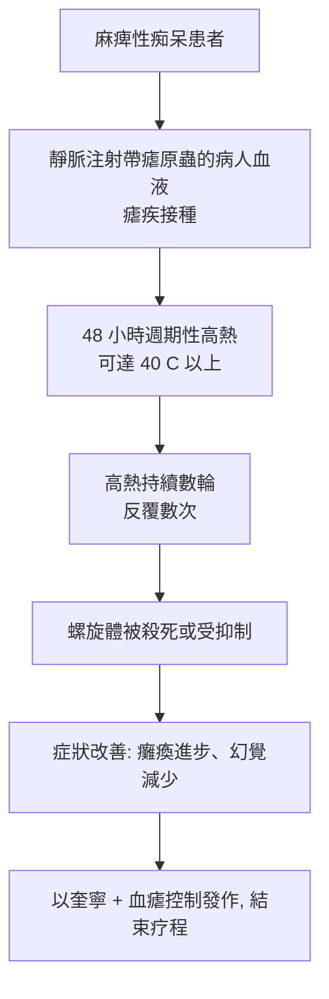

# 1927 · 瘧疾發熱療法：瓦格納-堯雷格用「發燒」對付「發瘋」

> **1927 諾貝爾生理學或醫學獎**：朱利葉斯·瓦格納-堯雷格（Julius Wagner-Jauregg，奧地利）— 表彰「發現在治療麻痺性痴呆過程中瘧疾接種療法的治療價值」（"for his discovery of the therapeutic value of malaria inoculation in the treatment of dementia paralytica"）。他是史上首位獲此獎的精神科醫師。

## 懸案（案情提要）

「麻痺性痴呆（dementia paralytica）」是 19 世紀末神經梅毒末期的臨床名稱：患者經歷years-long的進行性癱瘓、精神錯亂、幻覺，大小便失禁，最終死亡。這是一種**無法治療**的疾病——水銀與砷劑無效，牢中瘋人院裡的病患只是等待死亡。

而同期醫學界剛好掌握了一件事：**瘧疾能製造可控的高熱**。

瓦格納-堯雷格的假設大膽得驚人：如果梅毒螺旋體怕高溫（梅毒螺旋體在 $37\ \mathrm{C}$ 尚能存活，但螺旋體對溫度的敏感性遠高於人体組織），那麼**讓病人得一次瘧疾、發動 $40\ \mathrm{C}$ 高熱，或許能把螺旋體燒死**。

這是諾貝爾獎史上最具爭議的治療之一——也是唯一以「故意致病」為手段獲獎的案例。

## 前因

| 年份 | 事件 |
| --- | --- |
| 1903 | 沙茨基（Sergei Korsakoff）與psychiatrist 描述「麻痺性痴呆」的臨床分期。 |
| 1903 | 瓦格納-堯雷格注意到：進展期麻痺性痴呆患者**很少有梅毒性貧血（tabes dorsalis）**——兩種病似乎互斥。 |
| 1905 | 賈爾迪（Alberto Italians）與其他人注意到間日瘧原蟲有性生殖週期約 48 小時，可用於**定時發熱**（見 [1902-瘧疾傳播鏈](1902-瘧疾傳播鏈.md)、[1907-原生動物致病](1907-原生動物致病.md)）。 |
| 1912 | 諾格（Hugo Noguchi）分離出梅毒螺旋體 *Treponema pallidum*。 |
| 1917 | 瓦格納-堯雷格開始以**瘧疾血液接種（malaria inoculation）**治療麻痺性痴呆，並提出「治療性瘧疾（therapeutic malaria）」的系統方法。 |
| 1919 | 他的第一篇臨床報告發表。 |
| 1920s | 瓦格納-堯雷格以瘧疾接種治療「general paresis（全面性麻痺）」，並在 1927 年之前累積了數百例的觀察。 |
| 1948 | 盤尼西林問世，神經梅毒有了真正有效的治療；此後發熱療法迅速式微。 |

## 調查

### 第一幕：從「兩種病互斥」到「以毒攻毒」

瓦格納-堯雷格的推理起點是一項流行病學觀察：進展期麻痺性痴呆患者極少有 tabes dorsalis（脊髓痨）與梅毒性心血管病，而其他晚期梅毒患者則常有——兩者互斥。這個互斥性提示：讓病人「再感染一次活動性螺旋體」，可能改變病程。

他的方法極為具體：

### 第二幕：為何挑「瘧疾」而不是別的熱源

比較可行的替代方案包括：熱水浴、人工發熱（注入致熱物質）、放射菌毒素。但瓦格納-堯雷格選擇瘧疾的理由有三：

1. **可控制**：瘧疾的發熱有週期性（間日瘧 48 小時一輪），可預先排程；
2. **可用藥物終止**：奎寧（chloroquine 之前的年代用奎寧）能迅速壓制發作，一旦達到治療目標即可中止；
3. **有內源性抗體**：病人發熱後會產生抗瘧原蟲抗體，反而有助於抵抗再次發作——「治療本身留下保護」。

### 第三幕：臨床結果與統計

瓦格納-堯雷格報告的療效數字隨時代與選案標準而異，但關鍵結果包括：治療後約 $1/3$ 的病人症狀顯著改善（行走恢復、幻覺與妄想減退、回到工作）；發熱次數與療效呈正相關（發熱輪次越多，改善越明顯）；並有相當比例的病人死亡（部分死於瘧疾本身、部分死於病情）。

更關鍵的是，他發現了一個重要的**生物學副產物**：治療後病人的**梅毒血清學檢查（瓦瑟曼反應）轉陰**——這是螺旋體被清除的客觀證據。他甚至以此反證了「麻痺性痴呆並非梅毒引起的」這一行之見的假說：**治療後症狀改善且血清轉陰，反過來證明了神經梅毒與螺旋體的因果關係**。這是本案最被低估的理論貢獻。

### 第四幕：方法的推廣與濫用

瓦格納-堯雷格的技術迅速擴散到整個歐洲與美國的神經科與精神科病房：法國的瘧疾站（malaria stations）、英國的治療中心，一度有數以萬計的病人接受發熱療法。**副作用的代價是真實的**：瘧疾本身死亡率可達數個百分點，黃疸、肝損傷、腎臟病變、高熱癲癇發作，以及黑水熱（惡性瘧的血漿溶血）都在等待名單上。

## 理論裁決

1. **溫度作為抗微生物手段**：梅毒螺旋體在宿主體內的最適溫度接近 $37\ \mathrm{C}$ ，而短暫升至 $42\ \mathrm{C}$ 會造成蛋白質變性與螺旋體代謝崩壞。發熱療法的熱預算可寫成：

   $$D_{\text{thermal}} = \int_{t_0}^{t_1} \left(T(t) - T_{\text{thresh}}\right) dt$$

   有效的治療需要累積足夠的「超閾值時間」，這解釋了為何需要反覆多輪發熱，也解釋了為何每位病人的療程長短不一。

2. **以病治病的邏輯**：這是免疫學「疫苗策略」的先驅——**用可控的弱病原激發免疫反應來對抗強病原**。今日的減毒活菌疫苗（卡介苗、脊髓灰質炎疫苗、口服傷寒疫苗）正是這條思路的安全化版本。瓦格納-堯雷格的方案則是「反向疫苗」：用一種會致死的病去殺另一種病。

3. **梅毒病因學的因果證明**：以治療結果反推病因，是「治療即實驗（therapeutic trial as causal probe）」的經典案例。其邏輯結構為：

   $$T(X) \rightarrow Y \text{ 改善} \Rightarrow X \text{ 為 } Y \text{ 的病因}$$

   這一推理與 Koch 法則互補：柯柯從病原追到病，本案從治療追到病因。

4. **臨床試驗方法史的伏筆**：菲比格在白喉的實驗中設計了對照組（見 [1926-鼠癌錯案](1926-鼠癌錯案.md)），瓦格納-堯雷格則因缺乏嚴格對照、療效報告偏樂觀而成為隨機對照試驗（RCT）興起前的反面教材——麥克馬洪（Metcalf）在 1940 年代的演講正是以此為主要靶子。

5. **治療的風險—效益不等式**：以當時的數據看，發熱療法的「期望效益」
   $$E = p_{\text{改善}} \cdot V_{\text{改善}} - p_{\text{死亡}} \cdot V_{\text{死亡}}$$
   在缺乏有效替代療法的年代可能是正值；1948 年盤尼西林問世後，同一算式必然轉負——**治療價值的評估必須放在當時的選項集合中**，這是本案最深的教訓。

## 追查支線（未結之謎）

- 瓦格納-堯雷格本人的科學信譽毀譽參半：他在神經梅毒上的貢獻是實實在在的，但其精神醫學的其他主張（如「免疫學解釋精神病」）被後世視為過度延伸；
- 發熱療法在 1927–1940 年代造成的死亡總數從未被完整統計，是現代醫學史研究的一塊空白；
- 1948 年後熱療器材（熱水浴箱）迅速被閒置，許多歐洲醫院保留至今，成為「被淘汰的治療技術」的考古層；
- 「以病治病」的倫理框架在今日仍爭議：卡介苗、減毒活疫苗、Malaria Vaccine（2015 年獲諾獎）延續了同一邏輯，但安全門檻高得多；
- 神經梅毒的自然史（1920–1940 年的臨床追蹤）為日後評估治療效果提供了珍貴的「自然實驗」資料。

## 證物與數據（偵查卷宗摘錄）

| 證物 | 數值／內容 | 偵查意義 |
| --- | --- | --- |
| 互斥性觀察 | 麻痺性痴呆罕併 tabes dorsalis | 假說的起點 |
| 發熱排程 | 間日瘧 48 小時週期 | 可預測的治療工具 |
| 治療性瘧疾 | 反覆發熱多輪，以奎寧控制 | 以病治病的完整方案 |
| 血清轉陰 | 瓦瑟曼反應由陽轉陰 | 螺旋體被清除的客觀證據 |
| 療效報告 | 約 $1/3$ 病人症狀改善 | 早期臨床數據（缺乏對照） |
| 併發症 | 黃疸、肝腎損傷、高熱驚厥、黑水熱 | 治療的代價 |
| 1948 年 | 盤尼西林問世 | 發熱療法退場的決定性事件 |

## 後果

| 領域 | 影響 |
| --- | --- |
| 神經梅毒 | 確立麻痺性痴呆的感染病因，並在盤尼西林問世前提供了唯一的治療手段。 |
| 免疫學 | 「以可控感染激發免疫」的思路預告了疫苗策略，也預示了減毒活菌與DNA 疫苗的倫理討論。 |
| 臨床試驗方法 | 成為隨機對照試驗興起前的反面教材，直接推動了 1940–1960 年代的方法學革命。 |
| 熱帶醫學 | 推動瘧疾的臨床研究、瘧疾站體系的建立，間接加深了對瘧原蟲生活史的理解。 |
| 其他諾獎 | 與 [2015-青蒿素與阿維菌素](2015-青蒿素與阿維菌素.md) 同屬抗瘧譜系，但方向相反（治療 vs 防治）。 |

## 關聯

- [1902-瘧疾傳播鏈](1902-瘧疾傳播鏈.md) — 瘧原蟲生活史與可控發熱的生物學基礎。
- [1907-原生動物致病](1907-原生動物致病.md) — 瘧原蟲的發現，是本案工具的來源。
- [1926-鼠癌錯案](1926-鼠癌錯案.md) — 同時代另一樁被機制證驗追問的案例，可對照閱讀。
- [1945-青黴素](1945-青黴素.md) — 真正有效的抗梅毒藥，終結了本案的時代。
- [2015-青蒿素與阿維菌素](2015-青蒿素與阿維菌素.md) — 百年後，瘧疾的工具箱徹底翻新版。
