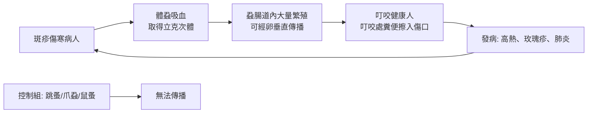

# 1928 · 斑疹傷寒與體蝨：尼可爾把一場戰爭的流行病學變成體蝨的 DNA 檢驗

> **1928 諾貝爾生理學或醫學獎**：夏爾·尼可爾（Charles Jules Henri Nicolle，法國）— 表彰「在斑疹傷寒研究上的工作」（"for his work on typhus"）。

## 懸案（案情提要）

1918–1919 年，一場被稱為「西班牙流感」的大流行席捲全球，死亡人數估計兩千萬至五千萬。然而在這場浩劫的縫隙裡，另一場流行病正在軍營、工廠與監獄中悄悄蔓延：**斑疹傷寒（typhus）**——它比流感致命得多，會帶來高熱、皮疹、肺炎、昏迷，並以數十倍的效率奪走年輕壯年的性命。

當時的醫學界對斑疹傷寒的「作案手法」幾乎一無所知：

1. 斑疹傷寒究竟由什麼傳播？空氣？食物？飲水？還是**人傳人**？
2. 若在人與人之間傳播，為什麼戰爭、監獄、監獄船這些「擁擠場所」的疫情格外兇猛？
3. 為什麼醫護與軍官（常住在營區、與士兵同處）的發病率遠低於士兵？
4. 有沒有辦法在沒有實驗室的情況下切斷傳播？

尼可爾的答案是：**體蝨（body louse）**。

## 前因

| 年份 | 事件 |
| --- | --- |
| 1900 | 流行病學家 Alexander Yersin 在越南調查腺鼠疫（見 [1905-結核桿菌與柯霍法則](1905-結核桿菌與柯霍法則.md)），注意到斑疹傷寒並不隨鼠而動。 |
| 1909 | 克里克（Howard T. Ricketts）與韋爾科克斯（G. M. Wilcox）在墨西哥研究斑疹傷寒，發現其病原**不能**用細菌濾器濾過，因而提出「病毒」的先驅概念。 |
| 1913 | 克里克在研究中感染斑疹傷寒逝世，年僅 30 歲。 |
| 1918–1921 | 一戰與後續的歐洲動盪，斑疹傷寒在東歐、俄羅斯與波蘭造成數百萬人死亡。 |
| 1919 | 尼可爾在北非的法國軍隊中觀察到一項關鍵對照：**斑疹傷寒的疫情嚴重程度與軍隊的「體蝨存在與否」高度相關**。 |
| 1921 | 尼可爾發表《斑疹傷寒的流行病學》（Épidémiologie du typhus），提出體蝨為傳播媒介。 |
| 1922 | 尼可爾轉任巴士德研究所（Institut Pasteur）所長。 |

## 調查

### 第一幕：追蹤「不跟著老鼠走的病」

1913–1918 年，尼可爾在北非與法國軍隊中系統比較了兩條傳播鏈：

| 觀察 | 腺鼠疫（鼠疫） | 斑疹傷寒 |
| --- | --- | --- |
| 動物宿主 | 褐家鼠 | 無（人與人傳播） |
| 媒介 | 跳蚤 | ？ |
| 與擁擠的關係 | 弱 | 極強 |
| 與老鼠的關係 | 極強 | 無 |

尼可爾注意到斑疹傷寒病例在空間上呈現**沿著軍隊宿營地、戰俘營、監獄、流動勞工隊的移動而移動**的模式——這些場所的共同特徵是：**擁擠 + 大量人群反覆流動 + 冬季 + 缺乏洗衣與更換衣物的條件**。

### 第二幕：實驗證據——餵蝨實驗（1920s）

尼可爾與其合作者進行了決定性的傳播實驗：

1. 從患斑疹傷寒的病人身上採集**體蝨**（*Pediculus humanus corporis*），在實驗室以病人血液餵養；
2. 數日後，這些體蝨的腸道內出現大量**立克次體（Rickettsia prowazekii）**，並可經卵傳代（vertical transmission）；
3. 用這些受感染的蝨子叮咬健康豚鼠與人，可誘發典型的斑疹傷寒發熱與皮疹；
4. **關鍵對照**：以爪蝨（bedbug）、跳蚤、鼠蚤餵養，無法傳播；只有體蝨有效。

這一組實驗滿足了 Koch 法則的移植版本：**病原可分離、可培養於昆蟲、可實驗傳播、並能再分離**。

### 第三幕：流行病學的「自然實驗」

尼可爾以「體蝨控制」驗證了媒介假說。1918–1922 年間，推行**更換衣物、煮沸床單、體蝨滅除**（包括以蒸汽處理衣物、以油膏塗抹體表）的軍隊，斑疹傷寒的发病率急劇下降；而未推行者疫情持續高昂。他並以 1920 年摩洛哥的實驗性比較進行了非隨機但具說服力的觀察：**有體蝨控制措施的分隊，無一發病**。

### 第四幕：病原的確認

尼可爾的同事與後續工作者完成了病原確認：1913 年克里克已描述「立克次體」；1930 年代 French 與美國團隊確認 **Prowazek**（為紀念尼可爾的老師與合作者 Ferdinand von Piotrowski? 實為紀念 investigating 該病原的捷克科學家），最終命名為 ***Rickettsia prowazekii***，用以紀念**克立克與普瓦澤克（Von Prowazek）**。1930 年代electron microscopy 與 1930s 的 **Weigl** 研發的「蝨腸道培養法」使立克次體得以大量製備；**1948 年 Plotz 等人發現的立克次體的抗原性**，更使 **1940 年代的** **Weil–Felix 試驗**成為可行的診斷法。

### 第五幕：最具決定性的一步——疫苗與抗生素

1940 年代，**Spotted fever vaccine（立克次體疫苗）**問世；**1948 年氯黴素（chloramphenicol）**（由鮑克（Paul Burkholder）在土壤樣本中發現）成為第一種治療斑疹傷寒的抗生素——其療效極為驚人，死亡率從數十個百分點驟降至數個百分點。**這是抗生素史上第一次「治療傳染病直接改變自然史」的案例**，也開啟了「抗生素治療感染性疾病的黃金年代」。

## 理論裁決

1. **媒介傳播的數學模型**：斑疹傷寒屬「人—媒介—人」循環，其基本再生數可寫為

   $$R_0 = m a^2 b c \frac{e^{-g n}}{r g}$$

   其中 $m$ 為每名病人的蝨數、 $a$ 為每人被叮咬率、 $b$ 、 $c$ 為雙向傳染效率、 $g$ 為蝨死亡率、 $n$ 為蝨體內病原成熟時間。**擁擠提高 $m$ 與 $a$ 、擁擠且不換衣降低 $g$**（蝨存活更久、繁殖更多），因此 $R_0$ 急升——這正是軍營與戰俘營的疫情為何最猛烈的定量解釋。
2. **非人際傳播的重要性**：尼可爾的貢獻不只於找出媒介，更在於指出斑疹傷寒**不是**典型的「人傳人」疾病，而是一種「媒介傳播疾病」。這一分類上的區分徹底改變了防疫策略：不是「隔離病人」（對空氣傳播有效），而是「消滅蝨子」（對媒介傳播有效）。
3. **公共衛生的操作化**：體蝨控制是少數「便宜、可行、可大規模執行」的措施——洗燙衣物是平民也能做到的預防法。這一邏輯與 1902 年羅斯的瘧疾媒介控制（見 [1902-瘧疾傳播鏈](1902-瘧疾傳播鏈.md)）形成姊妹篇：兩案共同建立了「**媒介控制**」作為公共衛生三大支柱之一的地位（媒介控制 + 疫苗 + 治療）。
4. **抗生素治療傳染病的典範**：氯黴素對斑疹傷寒的療效，確立了「抗生素可降低傳染病死亡率」的量化證據，也刺激了藥廠的抗生素篩選熱潮（引出 [1952-鏈黴素](1952-鏈黴素.md) 的鏈黴素發現）。
5. **立克次體的分類學位置**：立克次體是專性細胞內寄生菌，地位介於細菌與病毒之間——這解釋了為何它們能通過細菌濾器、又無法在無細胞培養基上生長（直到 1930 年代才被破解），並為後來的「病毒—細菌分界」提供了重要案例。

## 追查支線（未結之謎）

- 瓦格納-堯雷格的發熱療法也曾在斑疹傷寒病人身上試用（利用高熱對立克次體），是同一時代的「以熱攻病」思路的另一應用；
- 尼可爾對「斑疹傷寒與鼠疫傳播模式之別」的洞見，在當時遭微生物學界普遍忽視；
- 立克次體的**vertical transmission（經卵傳播）**是媒介生物學的重要發現——它意味著蝨群本身就是病原的「倉庫」，這在後續的病原儲存庫研究中屢被重演；
- 二戰期間集中營的斑疹傷寒疫情（1941–1945，死亡數十萬人）說明「知道原因」與「能否執行」之間的殘酷落差；
- 立克次體與蜱（tick）媒介的落基山斑點熱、恙蟲病的相關性，是本案分出的另一支偵查線。

## 證物與數據（偵查卷宗摘錄）

| 證物 | 數值／內容 | 偵查意義 |
| --- | --- | --- |
| 鼠疫 vs 斑疹傷寒對照 | 前者隨鼠走、後者不隨鼠走 | 媒介假說的起點 |
| 營區觀察 | 疫情與體蝨存在與否高度相關 | 流行病學自然實驗 |
| 餵蝨實驗 | 蝨腸道內立克次體大量繁殖 | 病原分離與傳播證明 |
| 對照媒介 | 跳蚤、爪蝨、鼠蚤皆無法傳播 | 排除其他途徑 |
| 卵傳（vertical） | 病原可經卵代際傳遞 | 蝨群為病原倉庫 |
| 體蝨控制措施 | 有措施分隊幾乎無病例 | 預防有效性的現場驗證 |
| 氯黴素（1948） | 死亡率由數十%降至數% | 抗生素治療傳染病的首個決定性案例 |
| 媒介傳播 $R_0$ | $m a^2 b c e^{-gn}/(rg)$ | 擁擠如何放大疫情 |

## 後果

| 領域 | 影響 |
| --- | --- |
| 流行病學 | 「媒介傳播疾病」成為獨立類別，媒介控制確立為公共衛生基本策略。 |
| 公共衛生 | 洗燙衣物、清潔與滅蝨成為戰時與戰後的標準措施，直接降低戰爭死亡。 |
| 抗生素史 | 氯黴素開啟抗生素治療傳染病的紀元，並帶動抗生素產業擴張。 |
| 微生物學 | 立克次體的發現開啟了專性細胞內寄生菌的研究方向。 |
| 其他諾獎 | 與 [1902-瘧疾傳播鏈](1902-瘧疾傳播鏈.md)、[1907-原生動物致病](1907-原生動物致病.md) 同為「媒介傳播」譜系。 |

## 關聯

- [1902-瘧疾傳播鏈](1902-瘧疾傳播鏈.md) — 媒介傳播模型的開創者。
- [1907-原生動物致病](1907-原生動物致病.md) — 病原分類學的先行者。
- [1952-鏈黴素](1952-鏈黴素.md) — 抗生素產業的黃金年代由此拉開序幕。
- [1913-過敏反應](1913-過敏反應.md) — 同一個北非法國軍隊體系的另一樁傳染病偵查（瓦格納-堯雷格）。
- [1927-瘧疾發熱療法](1927-瘧疾發熱療法.md) — 高溫對付病原的思路與本案同源。
