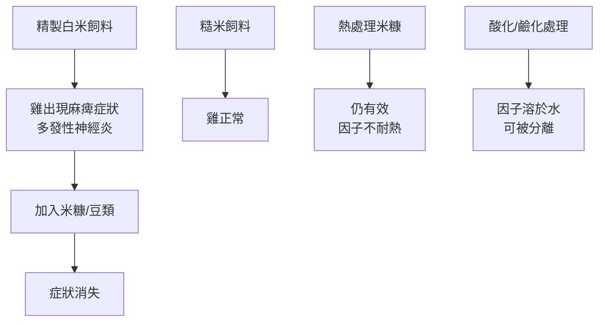

# 1929 · 維生素的發現：艾克曼與霍普金斯讓食物裡有了「看不見的必需品」

> **1929 諾貝爾生理學或醫學獎**（共享）：克里斯蒂安·艾克曼（Christiaan Eijkman，荷蘭）— 表彰「發現抗神經炎的維生素」；弗雷德里克·戈蘭德·霍普金斯（Sir Frederick Gowland Hopkins，英國）— 表彰「發現刺激生長的維生素」。

## 懸案（案情提要）

1910 年前後，兩樁看似不相干的謎案同時懸在桌面上：

**案件甲（東印度群島的怪病）**：爪哇、爪哇的監獄裡，犯人與家畜同時出現一種怪病——腳麻痺、肌肉萎縮、水腫、心跳加快、抽搐，患者臥床不起，死亡率可達三成。當地華人已經知道解法：**吃糙米**。1873 年統計發現，吃白米（精製米）的監獄中发病率是 37.5%，吃糙米的僅 0.1%。

**案件乙（英國的孤兒實驗室）**：1911 年起，Elstree 實驗室裡的小鼠（Frederick Gowland Hopkins 團隊）在以**純化酪蛋白、豬油與酵母**為主的飼料上「停止生長」——不是生病，而是停滯；一旦加入少量Casein 之外的真實食物（如蔬菜），牠們便繼續成長。**究竟食物中除了蛋白質、脂肪、糖、鹽、水、無機鹽與維生素之外，還有什麼在起作用？**

兩案在 1920 年代交會：同一族物質——**維生素**。

## 前因

| 年份 | 事件 |
| --- | --- |
| 1880s | 克里斯蒂安·艾克曼在爪哇（印尼）任軍醫，目睹腳氣病（beriberi）在監獄、軍隊與家畜中流行。 |
| 1890 | 艾克曼發現：食用糙米（含胚芽與糠層）的雞不會發病；改餵精製白米則發病。**他甚至用雞做模型成功了。** |
| 1896 | 艾克曼發現抗神經炎因子**溶於水、可被高溫破壞**（不耐熱），並能治腳氣病；與此同時，腳氣病也可用發酵大豆（維生素 B 含量高）治療。 |
| 1897 | 艾克曼的後續實驗顯示，某些細菌能**製造**這種抗神經炎因子——這為「維生素可由腸道菌合成」的觀念埋下伏筆。 |
| 1901 | 霍普金斯發現**色胺酸（tryptophan）**為小鼠生長所必需，是從食物中鑑定的第一個胺基酸。 |
| 1906–1912 | 霍普金斯在 Elstree 的實驗證明：即使給予足量的純化蛋白質（酪蛋白）、脂肪（豬油）與糖，小鼠仍不生長；加入少量「含維生素的食物」即恢復生長。 |
| 1911 | 卡西米（Cassimir Funk）從米糠中分離出抗神經炎因子，因含胺基而命名為 **vitamine（維生素）**——當時人們以為所有這類因子都是胺類（此命名沿用至今，但「胺」的解釋是錯的）。 |
| 1926 | 艾克曼與霍普金斯的兩條線正式匯流，維生素的時代開啟。 |

## 調查

### 第一幕：艾克曼的雞模型

艾克曼的偵查方法極為精準：他把腳氣病從人類移到**雞**身上。實驗設計精巧：

關鍵結論：**抗神經炎因子既非蛋白質、亦非脂肪、亦非醣類、亦非礦物質**，而是當時分類學無法歸位的一類新物質。

### 第二幕：艾克曼的細菌學洞見

1897 年他發現：雞腸道中的某些細菌能**合成**抗神經炎因子；若給雞服用使腸道菌受抑制的藥物（防腐劑），維生素缺乏症便會出現。這說明：

1. 維生素是**可被微生物合成的有機物**；
2. 人類與雞的疾病來源不同（人類主要是**攝取不足**——精製米取代糙米；雞則可能是**吸收或菌群失衡**）。

這一洞見在 40 年後被 Elvehjem（1937）定名為**維生素 $\mathrm{B}_{3}$ （菸鹼酸／niacin）**並成為抗糙皮病因子時得到完美兌現。

### 第三幕：霍普金斯的「兩種食物」實驗

霍普金斯的實驗設計是生物化學史上最乾淨的對照之一：

- **組別 A**：酪蛋白（純化蛋白質）＋豬油（純化脂肪）＋糖＋鹽類＋水 + **少量含維生素的補充食物**（如蔬菜 extract）→ 正常生長；
- **組別 B**：同上但**不含**任何天然食物 → 停止生長。

這兩組的差異，就是「維生素」的**存在性證明**。他由此提出一個革命性的概念：**食物中含有一類無法用當時已知的化學分類刻畫的微量必需物質**。

這與當時的主流醫學理論形成尖銳對立——**「維生素論」挑戰的是「蛋白質中心論（protein-centric nutrition）」**。生理學家曾認為，只要蛋白質、脂類、醣類、礦物質與水齊備，營養就完整；霍普金斯證明這是錯的。

### 第四幕：命名與發現競賽

1920 年代末，一場跨國競賽展開：

| 年份 | 發現 | 物質 | 提出者 |
| --- | --- | --- | --- |
| 1926 | 維生素 A | 視黃醇類 | 霍普金斯與瓦爾布 |
| 1926 | 維生素 $\mathrm{B}_{1}$ | 硫胺素（thiamine） | 楊（Janssen）与多特（Donath） |
| 1928 | 維生素 C | 抗壞血酸 | 森特-戈爾吉（Szent-Györgyi，見 [1937-生物氧化與維生素C](1937-生物氧化與維生素C.md)） |
| 1932 | 維生素 D | 抗佝僂病因子 | 斯皮爾曼（Spielmann）等人 |
| 1937 | 維生素 $\mathrm{B}_{3}$ | 菸鹼酸 | Elvehjem |
| 1938 | 維生素 $\mathrm{B}_{2}$ | 核黃素 | 布洛德（Broderick）與斯特恩（Stern） |

維生素的定義也被霍普金斯式的實驗逐步形式化：一種**微量即能維持正常生理功能、缺乏時產生特定疾病、且不能由其他已知營養素替代的有機物**。今日的維生素定義不過是這一實驗邏輯的標準化。

## 理論裁決

1. **生化缺乏的數學模型**：以生長速率對營養素濃度作圖，若某物質為必需且呈 Michaelis–Menten 型飽和：

   $$\frac{dW}{dt} = W_{\max} \cdot \frac{[V]}{K_d + [V]}$$

   對維生素而言， $K_d$ 極小（微摩尔級以下），因此 $K_d \ll [V] \ll K_{\max}$ 的區間極寬——這解釋了為何只需要極微量的維生素，也解釋了為何「缺乏」與「足量」之間有明確界線。
2. **限制因子定律（Liebig's law of the minimum）**：霍普金斯的實驗實質上證明了**限制因子思想**——生長速率受限於最缺乏的那一個因子。這一定律後來發展為「Liebig 最小定律」的現代版本（Blackman 的限制因子定律），並是養殖與營養學的核心。
3. **抗壞血酸的還原化學**：維生素 C 的作用機制在 1930 年代由森特-戈爾吉推導：它是某些氧化還原酶的輔因子，參與膠原蛋白合成中的羥化步驟：

   $$\text{Proline} + \mathrm{O}_2 + \alpha\text{-ketoglutarate} \xrightarrow{\text{ vitamin C}} \text{Hydroxyproline} + \text{succinate} + \mathrm{CO_2}$$

   缺乏時膠原蛋白無法正常交聯——這解釋了壞血病的牙齦出血與傷口癒合不良。
4. **維生素與酵素的關係**：霍普金斯的學生與後人發現，多數維生素是**輔酶的前驅物**（如 B 群是 NAD、FAD、CoA 的組成成分），這一發現把營養學與酵素學縫合成一個體系——這也是 1953 年李普曼獲獎的CoA 發現的科學脈絡（見 [1953-檸檬酸循環](1953-檸檬酸循環.md)）。
5. **胺基酸的定向發現**：霍普金斯 1901 年發現**色胺酸**是必需的胺基酸，為必需胺基酸的概念提供了第一個實例，也開啟了「以小鼠做生長試驗」的標準方法論——這套方法後來被用來鑑定所有二十種必需胺基酸。

## 追查支線（未結之謎）

- 艾克曼在 1900 年代後期與高上的（H. E. Armstrong）、揚（Casimir Funk）就「該因子是否為胺」發生爭議，1926 年的諾獎同時頒給他與霍普金斯，實質是對「實驗發現」與「理論詮釋」分離的一次制度性承認；
- 維生素 $\mathrm{B}_{1}$ 的化學結構與人工合成要等到 1936 年才完成（Eijkman 的學生 W. H. Jansen 找到硫胺素；R. R. Williams 於 1936 年合成）；
- 維生素 D 與佝僂病、以及日照—維生素 D—鈣代謝的關係，是 1910 年代由赫爾（Huldschinsky）用紫外線實驗接續的另一支線（見 [1903-光線治療狼瘡](1903-光線治療狼瘡.md)）；
- 艾克曼自 1898 年起即被諾貝爾委員會提名，終其一生獲提名九次，1929 年終於獲獎——史上被提名次數與獲獎落差最大的案例之一；
- 維生素 A 缺乏與菲比格「線蟲致癌」案的關係（見 [1926-鼠癌錯案](1926-鼠癌錯案.md)）是維生素學與癌症學交叉處的一樁著名誤判。

## 證物與數據（偵查卷宗摘錄）

| 證物 | 數值／內容 | 偵查意義 |
| --- | --- | --- |
| 爪哇監獄糙米 vs 白米 | 發病率 0.1% vs 37.5% | 流行病的決定性對照 |
| 雞模型 | 精製米→麻痺；糙米→正常 | 腳氣病首次有實驗模型 |
| 熱穩定性試驗 | 因子不耐熱 | 排除蛋白質 |
| 水溶性 | 因子溶於水 | 與脂溶性維生素分流 |
| 細菌合成實驗（1897） | 腸道菌可製造抗神經炎因子 | 維生素 $\mathrm{B}_{3}$ 的伏筆 |
| 霍普金斯兩組實驗 | 加天然食物→生長；不加→停滯 | 維生素存在性的證明 |
| 色胺酸（1901） | 第一個被鑑定的必需胺基酸 | 「必需」概念的第一例 |
| 命名（1911） | Funk 的「vitamine」 | 維生素家族的正式誕生 |

## 後果

| 領域 | 影響 |
| --- | --- |
| 營養學 | 從「吃飽」到「吃對」的轉型；食物強化（食鹽加碘、麵粉加維生素 B）成為公共衛生政策。 |
| 醫學 | 腳氣病、壞血病、佝僂病、糙皮病從「神秘地方病」變成「可預防可治療」的疾病。 |
| 工業化 | 維生素製藥成為產業；維生素 C 的工業合成（1930s）使大规模生產普及。 |
| 實驗方法論 | 「以小鼠做生長試驗」成為營養學、藥理學與毒理學的標準工具，國際標準化方法（A.O.A.C. 等）由此建立。 |
| 其他諾獎 | 與 [1937-生物氧化與維生素C](1937-生物氧化與維生素C.md)、[1943-維生素K](1943-維生素K.md) 同屬維生素系列。 |

## 關聯

- [1903-光線治療狼瘡](1903-光線治療狼瘡.md) — 紫外線與維生素 D 的前傳。
- [1926-鼠癌錯案](1926-鼠癌錯案.md) — 維生素 A 缺乏才是真正致癌因子，菲比格案的反面教材。
- [1937-生物氧化與維生素C](1937-生物氧化與維生素C.md) — 維生素 C 與生物氧化的交會。
- [1953-檸檬酸循環](1953-檸檬酸循環.md) — B 群維生素作為輔酶的舞台。
- [1943-維生素K](1943-維生素K.md) — 維生素家族的下一位成員。
