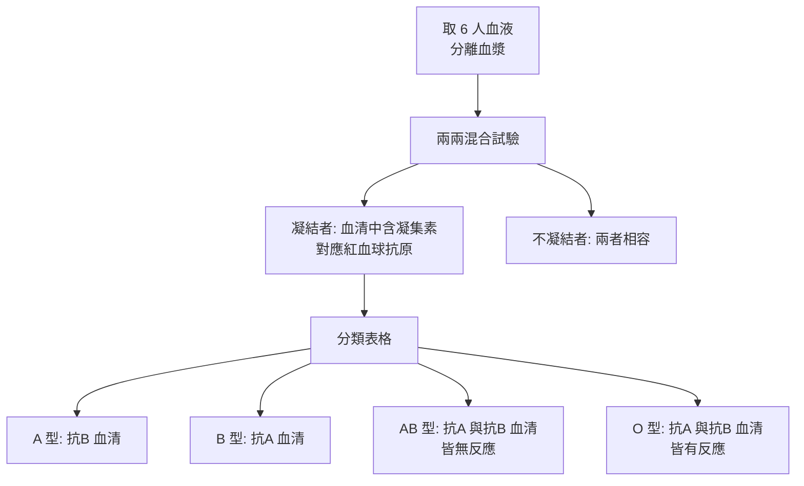

# 1930 · 人類血型：蘭德施泰納用三份凝結的血液畫出人類的分類地圖

> **1930 諾貝爾生理學或醫學獎**：卡爾·蘭德施泰納（Karl Landsteiner，奧地利；1930 年時已入美國籍，於洛克菲勒研究所任職）— 表彰「發現人類的血型」（"for his discovery of human blood groups"）。

## 懸案（案情提要）

1890 年代，輸血是一場豪賭。醫師將 ABO 血型系統尚未存在時，病人與捐血者的血液隨機配對——**有時成功、有時失敗**。1870–1880 年代，許多醫院記錄下這類戲劇性的失敗：有時受血者在輸血後當場死亡，有時出現劇烈寒戰與血尿。更令人費解的是，**同樣的血，有時能給、有時不能給；有時同樣的血，在某人身上能給、在另一人身上不能給**。

疑點有三：

1. 血液為何會「不相容」？是不相容的成分在攻擊什麼？
2. 這種不相容是隨機的嗎？還是受某種可分類的規則支配？
3. 能否建立一套分類，使得「不相容」可以事前預測、輸血可以事前配對？

蘭德施泰納在 1900 年用**六名健康男性**的血液，做出了一張把人類分為三類的表格——這是人類血型系統的開端，也是今日全球每一家血庫的基礎。

## 前因

| 年份 | 事件 |
| --- | --- |
| 1660–1670 | 牛津的 Richard Lower 與法國的 Jean-Baptiste Denis 分別進行了史上最早的動物與人類輸血實驗。 |
| 1818–1825 | James Blundell 首次成功進行人類對人類的輸血（產婦出血），並首度提出「輸血前必須檢驗相容性」的必要性。 |
| 1864–1870 | 蘭德施泰納在維也納大學醫學院取得醫學博士學位，師從生理學家 Ernst von Bezold 與Karl von Noorden。 |
| 1898–1900 | 蘭德施泰納在維也納的化學研究所（與 Uhlenhut 合作用），研究不同種族的血液與溶血反應。 |
| 1900 年 12 月 | 蘭德施泰納發表《論人類血液的差異》（Über die不同iations des menschlichen Blutes），報告發現三種血型標記：A、B、AB（當時稱 A、B、C）。 |
| 1901 | 蘭德施泰納與學徒 H. Finkelstein 發表《血液的免疫學意義》，並提出「免疫體（immune bodies）」的說法。 |
| 1910 | 蘭德施泰納與 Popper 發現第四種血型 **AB 型**（當時稱 AB 或 O 型）。 |
| 1921 | O 型被列為第四類，O 型被認定為「萬能供血者」，AB 型為「萬能受血者」。 |
| 1937 | 蘭德施泰納與 Wiener 發現 **Rh 因子**（恒河猴因子），解決第二類不相容問題。 |
| 1930 | 獲諾貝爾生理學或醫學獎。 |

## 調查

### 第一幕：凝結反應的「指紋」

蘭德施泰納的偵查起點是一個極簡單的現象：**把兩份血液混合，有時凝結、有時不凝結**。他以分離血漿（去除血球）來做實驗，避免血球本身的干擾——這一步「去掉多餘變因」的做法本身就極具方法論價值。

他抽取了六名健康男性（自稱「我的同事與我」）的血液，逐一配對混合，觀察凝結：

### 第二幕：凝集反應的機制

蘭德施泰納提出了極為清晰的免疫學解釋：紅血球表面帶有**抗原（凝集原，agglutinogen）**，血清中含有**抗體（凝集素，agglutinin）**，當相對應的抗原與抗體相遇即發生凝集：

| 血型 | 紅血球抗原 | 血清抗體 | 可接受的血 | 可 donate 的血 |
| --- | --- | --- | --- | --- |
| A | A | 抗 B | A、O | A、AB |
| B | B | 抗 A | B、O | B、AB |
| AB | A + B | 無 | 全部 | 僅 AB |
| O | 無 | 抗 A + 抗 B | 僅 O | 全部 |

由於在人類血中，抗 A 與抗 B 抗體的產生是**自然發生**的（並非因接觸 A 或 B 抗原），且新生兒的抗體尚未形成——這解釋了當時「為何 O 型新生兒幾乎不受抗體影響」的臨床事實，也預告了後來的「新生兒溶血病（hemolytic disease of the newborn）」機制。

### 第三幕：Popper 與 AB 型——遺漏物證的教訓

1900 年的原始實驗只用了六個人，樣本太小，遺漏了 AB 型。直到 1910 年，蘭德施泰納的學生 Popper 採到一份既不被 A 型血清凝集、也不被 B 型血清凝集的血液，才補上第四類。這是統計學上的教科書案例：**用有限樣本定義類別，必然留下未歸類的殘差**。今日血型系統擴展到 43 種血型抗原組合（ISBT 系統），每一步擴張都遵循同一個偵查邏輯。

### 第四幕：Rh 因子——第二道不相容的牆

1937 年，蘭德施泰納與 Wiener 發現 **Rh 抗原（D 抗原）**，命名自供血者——恆河猴（rhesus macacus）的紅血球。這解釋了為何有些「同為 A 型」的病人仍會發生輸血反應：**ABO 相同不代表 Rh 相同**。Rh 陰性母親與 Rh 陽性胎兒之間的免疫反應，造成新生兒溶血病（Rh 病），這在 1960 年代由Rh 免疫球蛋白的問世所預防（被譽為「醫學上最成功的預防措施之一」）。

### 第五幕：法庭上的血型

蘭德施泰納的另一項獨特貢獻是**親子鑑定**。1909 年他發表《法庭上的血型檢驗》，主張血型可作為排除親子關係的證據（不能證明，但可排除）。此後數十年，血型（及後來的 DNA 指紋）一直是歐美親子訴訟的常規工具——直到 1980 年代 DNA 分型技術出現，才讓血型退出歷史舞台。蘭德施泰納也因此被譽為「**法醫血型學之父**」。

## 理論裁決

1. **凝集反應的量化**：以抗血清的稀釋度做滴定，凝集反應可用免疫學的結合平衡描述：

   $$K_a = \frac{[A{\cdot}Ag]}{[A][Ag]}$$

   在高濃度抗原下，抗體被「過量沉澱」；而在低濃度抗體下，則出現**帶區（prozone）**與**前帶（postzone）**現象——這是血凝試驗判讀的標準注意事項，也是 1900 年代後來才被認知的「免疫學陷阱」。

2. **相容性的代數化**：以抗體滴度表示相容性，可寫成相容性分數：

   $$\text{Compatibility} = \prod_{i} \left(1 - \frac{[A_i][Ag_i]}{K_{a,i} + [A_i][Ag_i]}\right)$$

   這一乘積形式正是今日交叉配血（crossmatch）與血漿不相容性計算的原型。

3. **免疫發育的時序**：抗 A、抗 B 抗體在出生後數月內出現，濃度隨年齡增長——這解釋了新生兒的 ABO 不相容反應較輕微，也說明為何「萬能供血者」在實務上是「相對的」而非絕對。

4. **抗體的「自然發生」問題**：為何人類天生就有抗 A、抗 B，卻沒有抗 Rh？答案是**微生物交叉反應（cross-reactivity）**——某些腸道菌的抗原與 A、B 抗原相似，免疫系統在對抗它們時「順手」產生了抗 A、抗 B 抗體；而 Rh 抗原只存在於靈長類，因此人類沒有抗 Rh，除非懷孕時經胎盤接觸。這條「交叉反應」的解釋，是免疫學「天然抗體」理論的核心。

## 追查支線（未結之謎）

- 蘭德施泰納是奧地利猶太裔，1930 年代在德國的納粹迫害下流亡美國；他在 1940 年代被誣告為「逃兵」，1930 年的獎項亦曾被納粹視為政治目標；
- 費城的一項血液（H1 血型系統中的分類）在數十年中被大型研究團隊（2019 年 Gopalakrishnan 等）證實為假血型——「血型系統持續修正」的實例；
- 新生兒溶血病的預防（Rh 免疫球蛋白）與其背後的免疫學，是本案最成功的臨床延伸；
- 血型與疾病關聯（A 型胃癌、B 型肝硬化等）的統計學發現，源於 20 世紀中期的疾病登記研究；
- DNA 分型取代血型在親子鑑定中的地位，讓蘭德施泰納的方法成為歷史；但 DNA 指紋正是以「特異性的化學識別」為核心原理的延伸。

## 證物與數據（偵查卷宗摘錄）

| 證物 | 數值／內容 | 偵查意義 |
| --- | --- | --- |
| 六人配對實驗（1900） | 凝結與否形成分類表 | 人類血型系統的誕生 |
| 血漿 vs 全血 | 去除血球以排除干擾 | 方法學的關鍵一步 |
| A、B、O、AB 四型 | 抗原—抗體對應表 | 全球血庫的通用語言 |
| Popper 的 AB 型（1910） | 樣本殘差補全 | 有限樣本的教訓 |
| Rh 因子（1937） | D 抗原，命名自恒河猴 | 第二道不相容的牆 |
| 親子鑑定（1909 始） | 血型可排除親子關係 | 法醫血型學的開端 |
| 天然抗體理論 | 微生物交叉反應產生抗 A、抗 B | 免疫發育的解釋 |
| 1921 年「萬能供血／受血」 | O 型 donate、AB 型 receive | 臨床配血規則 |

## 後果

| 領域 | 影響 |
| --- | --- |
| 輸血醫學 | 輸血由「賭命」變為「配對」；血庫、血型卡片、Rh 免疫球蛋白成為制度。 |
| 外科與產科 | 剖腹產、器官移植、大出血搶救皆因輸血安全而徹底改變面貌。 |
| 法醫學 | 血型成為親子與血跡鑑定的基礎工具。 |
| 免疫學 | 提供了「抗原—抗體對應」最清晰的教學模型，直接支撐埃利希的側鏈學說（見 [1908-免疫雙雄](1908-免疫雙雄.md)）。 |
| 其他諾獎 | 與 [1901-白喉血清療法](1901-白喉血清療法.md) 同為「免疫化學用於臨床」的開路案。 |

## 關聯

- [1908-免疫雙雄](1908-免疫雙雄.md) — 抗體的側鏈模型在此得到最清晰的實例。
- [1901-白喉血清療法](1901-白喉血清療法.md) — 免疫血製品臨床化的先行者。
- [1919-補體與免疫](1919-補體與免疫.md) — 凝集反應之外的另一種免疫反應測量法。
- [1931-呼吸酶](1931-呼吸酶.md) — 同為奧地利裔得主在美國的科學生涯。
- [1972-抗體結構](1972-抗體結構.md) — 抗體分子結構的諾獎答案，補完本案的血清學基礎。
