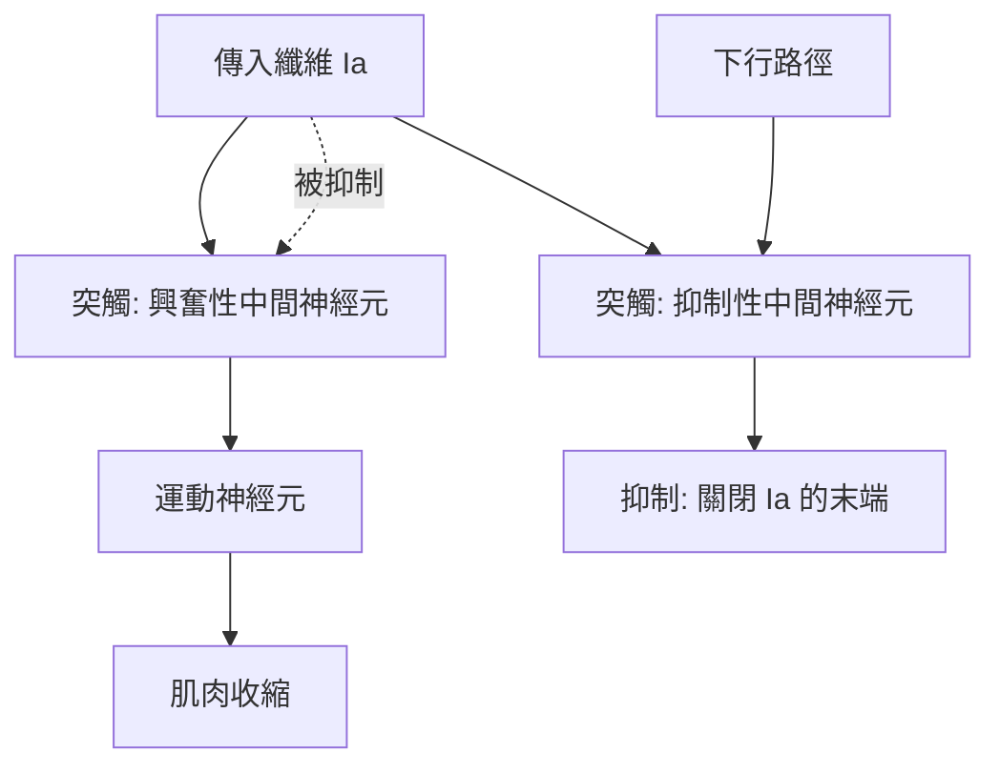

# 1932 · 神經元的功能：謝靈頓提出「突觸」，阿德里安量出神經元的「全或無」

> **1932 諾貝爾生理學或醫學獎**（共享）：查爾斯·斯科特·謝靈頓（Sir Charles Scott Sherrington，英國）— 表彰「發現神經元的相關功能」；埃德加·阿德里安（Edgar Douglas Adrian，英國）— 同上。

## 懸案（案情提要）

1900 年代初，神經生理學有兩個巨型謎團：

**謎團甲：反射是怎麼「接線」的？** 膝反射、瞳孔反射、吞嚥反射——這些反射動作成為精密而快速，顯然不是靠「靈魂」下達指令，而是某種自動的接線。但反射弧的組成單位是什麼？興奮如何從一個細胞傳到下一個？是**電**流直接灌過去，還是**化學**物質在接點處傳遞？

**謎團乙：神經衝動的「強度」在哪裡？** 肌肉收縮有強弱之分（見 [1922-肌肉產熱與糖酵解](1922-肌肉產熱與糖酵解.md)），那麼神經衝動呢？若神經纖維以「全有全無」的方式放電，那麼**強弱的差別究竟由什麼承載**——是放電頻率、是 recruited 的神經元數目、還是別的？

這兩樁案子共享同一套偵查工具：謝靈頓以**脊髓反射的生理學實驗**追問「接線」，阿德里安以**單一感覺神經元的電位記錄**追問「編碼」。

## 前因

| 年份 | 事件 |
| --- | --- |
| 1880s | 謝靈頓在西班牙生理學家 Santiago Ramón y Cajal 的形態學影響下，轉向以實驗研究神經系統（見 [1906-神經元學說](1906-神經元學說.md)）。 |
| 1890s | 謝靈頓在倫敦大學（後為牛津）建立生理學實驗室，開始以脊髓反射為模型研究神經整合。 |
| 1897 | 謝靈頓創造 **synapse（突觸）** 一詞——用以指稱神經元之間的「接觸面」；此詞源於希臘語 *synapsis*（接合）。 |
| 1900–1906 | 謝靈頓發表大量反射生理學研究，並於 1906 年出版《神經系統的整合作用》（The Integrative Action of the Nervous System），被視為現代神經生理學的奠基作。 |
| 1904 | 謝靈頓獲得皇家學會科普利獎章（Copley Medal）。 |
| 1906 | 布拉姆（Edgar Adrian）自劍橋畢業，進入謝靈頓在牛津的實驗室，開始以**毛細血管靜電計（capillary electrometer）**記錄神經元電位。 |
| 1920s | 阿德里安以**弦線電流計（string galvanometer）**與**陰極射線示波器**完成單神經元的電位記錄（工具的演進直接承接 [1924-心電圖](1924-心電圖.md) 與 [1944-神經纖維分化](1944-神經纖維分化.md)）。 |
| 1932 | 兩人共享諾貝爾生理學或醫學獎。 |

## 調查

### 第一幕：謝靈頓的反射解剖學

謝靈頓的方法是**逐步切斷與刺激**：在脊髓的不同高度切斷、切除特定神經根、刺激單一传入或传出纤维，觀察反射是否消失。這套「切除—刺激—觀察」的方法，使他能夠**逐個地建構反射弧的組成**，並得到幾個關鍵的否定性結論：

1. **反射需要完整的腦幹/脊髓中樞**：切斷腦幹後反射消失；
2. **反射需要完整的周邊通路**：切斷特定背根或腹根，反應消失；
3. **反射不是「應激」的整體反應，而是被精密調配的整合**——同一刺激在不同動物、不同強度下引發完全不同的反應模式（**反射的「模式恆定性」與「輻射（irradiation）」現象**）。

這裡最關鍵的觀察是：當反射的抑制與興奮同時存在時，**抑制往往獲勝**（謝靈頓稱之為「Suppression」）。這意味著中樞並非被動的導線，而是一個**能主動選擇性地調配輸出的計算器官**——這就是「整合作用（integration）」一詞的由來。

### 第二幕：突觸——一個被造出來的概念

謝靈頓最不朽的概念貢獻是 **synapse**：他提出神經元之間的傳遞**不是**電流的直接連續（因為神經元之間的間隙處沒有可供電流通過的介質），而是經由某種**可擴散的中間機制**。他並區分了兩種傳遞方向：

- **突觸前興奮（presynaptic excitation）**：使後一神經元更易放電；
- **突觸前抑制（presynaptic inhibition）**：使後一神經元更難放電。

後者是謝靈頓在 1900 年代中期最具革命性的發現之一：在某些反射弧中，抑制性中間神經元會「關掉」抑制性傳入纖維本身的活動——也就是**對抑制的抑制**。這種「閘門控制（gating）」觀念的提出，比控制論與人工神經網路早了半個多世紀。

### 第三幕：阿德里安的單神經元記錄

阿德里安的偵查起點是一個純技術問題：如何記錄**單一**感覺神經元的電位？他先把記錄單位縮小（用毛細管靜電計），再隨弦線電流計與示波器的普及，最終得到清晰的紀錄——1920 年代他錄下的是**感覺神經元的動作電位**與**腦皮層的「感覺性皮層波」**。

他的三項關鍵發現：

1. **全或無律（all-or-none law）**：單一神經元的動作電位，其幅度與波形**不隨刺激強度改變**——刺激弱時放電頻率低，強時頻率高，但每個動作電位本身一樣大。
2. **強度編碼靠頻率**：因此神經系統傳遞「強度」的方式是**放電頻率**與**募集（recruitment）**的組合：

   $$r = r_{\max}\,\left(1 - e^{-kI}\right)$$

   這是神經元編碼的基本形式；阿德里安本人還以**適應（adaptation）**說明靜止刺激下頻率會逐漸下降：

   $$r(t) = r_0 e^{-t/\tau}$$

3. **感覺適應的現象學**：他發現受持續刺激的感覺受器放電頻率逐漸下降，甚至停止——這解釋了「持續不變的刺激會被感知為消失」（例如持續觸碰衣服的感覺會消失），是感覺生理學的核心現象。

阿德里安更發現**感覺受器的分級**：皮膚上有各種特化受器（對溫度、對壓力、對疼痛），由不同類型的傳入纖維服務——他以纖維直徑與放電模式區分「A 與 C 纖維」；這套分類被 Erlanger 與 Gasser 系統化（見 [1944-神經纖維分化](1944-神經纖維分化.md)）。

### 第四幕：抑制的量化

謝靈頓並未止於定性描述。他以「反射的時間預算」推導出突觸延遲：

$$\text{總反射時間} - \text{神經傳導時間} = \text{突觸延遲} \times \text{突觸數目}$$

此法以多次測量的平均值估計單一突觸延遲約 $0.5\text{–}1\ \mathrm{ms}$ ，這是史上第一次用**數學方法測量突觸**。他也以「中樞延遲（central delay）」的差值，反過來計算一條反射弧中的突觸數目——神經迴路的「算術」由此開始。

## 理論裁決

1. **神經元的計算模型**：阿德里安的全或無律加上謝靈頓的整合作用，奠定了現代神經元計算模型的骨架。以最簡單的 McCulloch–Pitts 模型表之：

   $$y = \theta\left(\sum_{i} w_i x_i - \theta_{\text{thr}}\right)$$

   這正是今日人工神經網路的基本單元——生物神經科學與計算機科學的共同祖先。
2. **突觸傳遞的化學本質**：謝靈頓提出「化學傳遞」假說，但證明它的是勒維與戴爾（見 [1936-神經化學傳遞](1936-神經化學傳遞.md)）；1921 年 Otto Loewi 的心臟灌流實驗開了第一槍。
3. **中樞整合的數學**：謝靈頓以「反射弧的代数」定義了運動神經元的募集與整合，開啟了運動控制的系統生理學。
4. **感覺的編碼原則**：全或無 + 頻率編碼 + 適應 + 受器特化，三條原則合起來構成「**神經元如何把物理世界轉成資訊**」的完整答案的第一版。
5. **節律性與群體活動**：謝靈頓對動物姿態的「節律性協調（rhythmical coordination）」研究，與 Adrian 對腦波（alpha、beta 波）的觀測，共同開啟了神經系統的「振盪與節律」研究方向——這一路通向 1950 年代的 EEG 與 2010 年代的神經科學。

## 追查支線（未結之謎）

- 突觸延遲的精確機制（是釋放、擴散還是受體動力學）直到 1950 年代的微電極與 1990 年代的分子影像才被拆解；
- 「抑制的抑制」在脊髓的可塑性作用，今日是鎮痛與痙攣治療的重要機制（甘胺酸與 GABA 受體）；
- 感覺適應的分子基礎與神經節律障礙的關係，是今日神經科學的前沿；
- 謝靈頓是 1932 年諾貝爾生理學或醫學獎得主，1952 年亦獲皇家學會科普利獎章，是獲諾獎後又獲最高科學榮譽的少數人之一；
- 阿德里安 1932 年獲獎後持續研究感覺生理至 1960 年代，並轉任剑桥丘吉（Churchill）學院院長。

## 證物與數據（偵查卷宗摘錄）

| 證物 | 數值／內容 | 偵查意義 |
| --- | --- | --- |
| 突觸一詞（1897） | synapse | 神經元接合點的命名 |
| 反射模式恆定性 | 同一刺激→固定反應模式 | 中樞為計算器官而非導線 |
| 突觸前抑制 | 對抑制傳入纖維的抑制 | 閘門控制觀念的先聲 |
| 中樞延遲測算法 | 單突觸延遲約 $0.5\text{–}1\ \mathrm{ms}$ | 用數學測量突觸 |
| 突觸數目推算 | 由延遲差值反推迴路結構 | 神經迴路的「算術」 |
| 單神經元動作電位 | 幅度恆定、波形不變 | 全或無律 |
| 頻率—強度關係 | $r = r_{\max}(1-e^{-kI})$ | 強度編碼的數學 |
| 適應 | $r(t) = r_0 e^{-t/\tau}$ | 持續刺激被感知為消失 |
| 腦皮層感覺波 | alpha/beta 波的早期記錄 | 腦電活動的開端 |

## 後果

| 領域 | 影響 |
| --- | --- |
| 神經科學 | 突觸成為神經科學的核心概念；整合作用模型統治了 20 世紀的神經生理學。 |
| 臨床神經學 | 反射檢查（深腱反射、陣攣）成為神經科床邊評估的標準；抑制機制的異常（肌張力低下、痙攣）有了理論框架。 |
| 計算機科學 | McCulloch–Pitts 神經元與 Hebb 學習規則，建立神經網路的生物學合法性。 |
| 生理學工具 | 弦線電流計與示波器的普及，使電生理學成為生理學的主流方法。 |
| 其他諾獎 | 與 [1936-神經化學傳遞](1936-神經化學傳遞.md)、[1963-離子機制](1963-離子機制.md) 構成神經科學的三部曲。 |

## 關聯

- [1906-神經元學說](1906-神經元學說.md) — 卡哈爾的形態學給了謝靈頓「神經元是單元」的信念。
- [1936-神經化學傳遞](1936-神經化學傳遞.md) — 謝靈頓的化學傳遞假說在此被證實。
- [1963-離子機制](1963-離子機制.md) — 動作電位的離子機制，讓全或無律有了物理學解釋。
- [1944-神經纖維分化](1944-神經纖維分化.md) — 阿德里安的纖維分類被 Erlanger 與 Gasser 系統化。
- [1981-視覺皮層](1981-視覺皮層.md) — 謝靈頓的整合思想在視覺皮層的加工中再度登場。
