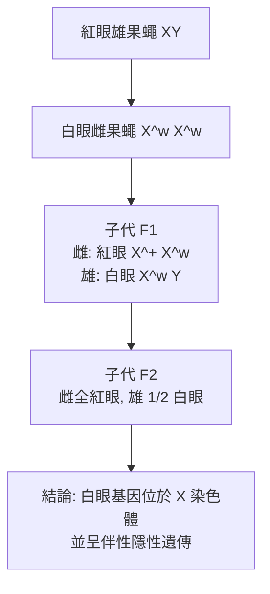

# 1933 · 染色體與遺傳：摩根在「果蠅房」裡把孟德爾因子釘在染色體上

> **1933 諾貝爾生理學或醫學獎**：托馬斯·亨特·摩根（Thomas Hunt Morgan，美國）— 表彰「發現遺傳中染色體所起的作用」（"for his discoveries concerning the role played by the chromosome in heredity"）。

## 懸案（案情提要）

1900 年，孟德爾 35 年前的工作被德弗里斯、科林斯、丘爾馬克三人重新發現，遺傳學驟然複甦。但立刻浮現一個致命的缺口：

**孟德爾說的「因子」究竟物理上是什麼？** 它們在細胞裡何處？何時被傳遞給子代？為什麼父母的因子「不在同一條染色體上」時會出現 $3:1$ 的分離比，而不是 $1:1$ ？為什麼有些性狀會「連鎖」成整塊一起遺傳？

另一邊，細胞學家也在追問：**染色體在減數分裂時的行為，與孟德爾因子的分離行為是否同步？** 兩條線索若能對上，孟德爾的抽象因子就會被指認為一個可見的實體。

摩根在紐約哥倫比亞大學的「果蠅房（Fly Room）」裡，用四年時間與數千隻果蠅，把這兩條線索焊成一體。

## 前因

| 年份 | 事件 |
| --- | --- |
| 1865 | 孟德爾在布爾諾的豌豆雜交實驗發表，確立分離律與獨立分配律。 |
| 1880s | 魏斯曼（August Weismann）以「種質（germ plasm）」的永續性解釋遺傳，暗示遺傳物質在染色體上。 |
| 1900 | 孟德爾法則被重新發現；霍爾丹（Haldane）、貝特森（Bateson）與 Punnett 推導出**連鎖與重組**的數學。 |
| 1902 | Sutton（後來獲諾貝爾獎未果，1946 年被追認為「遺傳學染色體理論之父」）以蝗蟲精母細胞的細胞學觀察，提出染色體行為與孟德爾因子「平行」的推論，但當時被忽視。 |
| 1904 | 摩根在哥倫比亞大學的動物學系開始以**果蠅（Drosophila melanogaster）**作為研究材料。 |
| 1905 | 摩根尚未接受染色體遺傳說；他的實驗起點是「用德國生物學家 Goldschmidt 的觀點去驗證染色體遺傳說」。 |
| 1907 | 摩根的助手**凱瑟琳·布里奇斯（Katharine Brehbridge Calton）**（後來成為他的妻子）開始共同研究。 |
| 1908–1910 | 摩根轉向果蠅研究；1910 年 1 月起，他與研究生 Hugo Kaczerowski 等開始系統搜尋突變。 |
| 1910 年 4 月 | 學生 **C. B. Bridges** 發現**白眼突變（white eye, $w$ ）**——第一個可用的遺傳標記。 |
| 1910 年 5 月 | 摩根證明白眼基因**位於 X 染色體上**（伴性遺傳），並預言「性別比例異常」——1913 年 Bridges 以「逆轉家系（reverse cross）」完成預言的實驗驗證。 |
| 1915–1916 | 摩根以「基因」取代「因子」，並出版《Sex and Heredity》（1916）與《A Critique of the Theory of Evolution》（1916），確立基因論。 |
| 1919–1921 | 摩根發表《Physical Basis of Heredity》，正式提出染色體遺傳說。 |
| 1933 | 獲諾貝爾生理學或醫學獎。 |

## 調查

### 第一幕：選對兇手——果蠅

摩根一開始用小鼠做實驗，但小鼠的世代間隔長、突變率低、染色體數目多且形態相似。**果蠅**卻是完美的偵查工具：

| 特性 | 數值 | 意義 |
| --- | --- | --- |
| 世代間隔 | 約 10 天 | 一個研究生一年可做十幾代 |
| 產卵量 | 每隻數百 | 大樣本統計 |
| 染色體數 | 4 對 | 簡單，易於分析 |
| 幼蟲染色體 | **巨大**（多線染色體） | 可直接目視遺傳物質的交換 |
| 突變率 | 高，且突變多為**眼色** | 標記物一眼可辨 |

摩根的學生 Bridges 與 Morgan 的妻子凱瑟琳是搜尋突變的實際主力——「果蠅房」成為世界第一個大型遺傳學實驗室。

### 第二幕：白眼突變與 X 染色體

1910 年，發現白眼突變後，摩根做了著名的「逆轉交配（reverse cross）」實驗：

由此，摩根确立了染色體遺傳說的核心：**基因位於染色體上**，且染色體在減數分裂時的行為（分離、互換）與孟德爾因子完全對應。

### 第三幕：連鎖與重組——遺傳學的定量革命

1910–1913 年，摩根及其學生繪出第一張**遺傳連鎖圖（linkage map）**：

1. **連鎖（linkage）**：位於同一染色體的基因傾向一起遺傳；
2. **重組（recombination）**：偶爾會出現「非 parental」的組合——這是減數分裂前期同源染色體**互換（crossing over）**的後果；
3. **重組率**可量化遺傳距離：

   $$r = \frac{\text{重組子代數}}{\text{總子代數}}, \qquad \text{遺傳距離}(\mathrm{cM}) \approx 100\,r$$

這套數學使「不可見的基因」第一次有了**空間座標**——基因被排列在一條線性的地圖上，距離以百分之一摩根單位（cM）計。1913 年由 **Sturtevant** 繪出的果蠅性連鎖圖，是遺傳學的第一張「地圖」，也是今日基因組圖譜的先驅。

### 第四幕：多基因性狀——數量的基因

1915 年起，摩根與學生提出**多基因遺傳（polygenic inheritance）**：許多數量性狀（如體色深淺、翅脈數）不是由單一基因決定，而是由多個基因累加，每個基因的效應微小：

$$P \text{（表型）} = \sum_{i} \alpha_i g_i + \varepsilon$$

這個模型解釋了為什麼身高、血壓等連續變異呈**近似常態分佈**（中央極限定理），並把人類的「多因子遺傳疾病」（如先天性心臟病、唇齶裂、糖尿病）納入可計算的框架——這是 20 世紀遺傳學最實用的概念之一。

### 第五幕：基因的「位置」是化學的還是物理的？

摩根常被問道：基因是「看得見的染色體上的一小段」，還是「染色體上的一個化學分子」？他主張是後者，並在《Physical Basis of Heredity》中主張基因必須是**大的化學分子（酵素類）**，具有自體催化與變異的能力——這是「基因即蛋白質」的早期主張，1940 年代被 Schröder 的噬菌體實驗與 Avery 的 DNA 發現所顛覆（見 [1962-DNA 雙螺旋](1962-DNA雙螺旋.md)）。

## 理論裁決

1. **染色體遺傳說的數學骨架**：摩根把染色體作為「配對分離」的物理裝置引入孟德爾法則。對單一基因對，減數分裂的兩次分裂給出：

   $$P(\text{基因型分離}) = \frac{1}{2^n}$$

   $n$ 為同源染色體對數（果蠅 $n=4$ ，含性染色體）。這解釋了為何二倍體生物的孟德爾比例是 $3:1$ （ $F_2$ 世代）而非其他數字。

2. **重組率作為遺傳距離**：重組率在短距離內近似線性，長距離則因多次互換而「飽和」（上限 $50\%$ ）。這是重組圖譜估計的統計學基礎，也是今日連鎖分析（linkage analysis）遺傳疾病基因的技術源頭。

3. **多基因遺傳的正態分佈**：若多個基因獨立、各自效應近似常態，總表型即趨近常態分佈：

   $$\sigma_P^2 = \sum_i \alpha_i^2 \sigma_{g_i}^2$$

   這解釋了為何「正常身高」是一個連續分布而非類別，以及「多因子遺傳疾病」的再發風險（ $2\text{–}5\%$ ）隨親屬關係層級變化。

4. **伴性遺傳與性別比例**：伴 X 遺傳可由「X 染色體的隨機失活（Lyapunovization， Lyon 假說，1961）」解釋雌性表型；摩根預言的「性別比例異常」則由 Bridges 的「非交叉（non-disjunction）」實驗（1913–1916）證實——染色體不分離可產生 XO、XXY 個體。這是染色體遺傳說最華麗的一次預測成功。

## 追查支線（未結之謎）

- 1933 年諾貝爾委員會評語中，學界普遍認為當年應頒給 Sutton 或摩尔根的同事——命名的榮耀幾乎全歸摩根，這樁「榮譽分配」議題至今仍是科學社會學的教材；
- 摩根晚年反對「分子遺傳學」過度解釋演化，並在 1930 年代與「突變論者」及神創論者往來，立場相當保守；
- 多基因遺傳的模型在 20 世紀末被基因組學的 GWAS 大幅修正（從「少數主基因」到「數千個小效應變異」）；
- 果蠅作為模式生物的地位延續至今（2010 年代完成了其完整神經連接組），從摩根的果蠅房到今天的「電子果蠅」是科學的長線；
- 染色體的「基因」在 1930 年代被懷疑是否為蛋白質，這一疑問的解答歷時 30 年，構成 [1944-X 射線誘發突變](1946-X射線誘發突變.md) 與 [1962-DNA 雙螺旋](1962-DNA雙螺旋.md) 的接力線索。

## 證物與數據（偵查卷宗摘錄）

| 證物 | 數值／內容 | 偵查意義 |
| --- | --- | --- |
| 果蠅世代間隔 | 約 10 天 | 讓「大量世代」可行 |
| 多線染色體 | 幼蟲的巨大染色體 | 可直接目視互換 |
| 白眼突變（1910） | $w$ 基因，眼睛白色 | 第一個遺傳標記 |
| 逆轉交配 | 白眼雌 × 紅眼雄 | 證明 X 聯遺傳 |
| 性染色體不分離 | Bridges 1913–1916 | 染色體遺傳說的預言驗證 |
| 重組率 | $r = \frac{\text{重組子代}}{\text{總子代數}}$ | 遺傳距離的度量 |
| 連鎖圖（1913，Sturtevant） | 遺傳距離以 cM 計 | 遺傳學的第一張地圖 |
| 多基因模型 | $P = \sum \alpha_i g_i + \varepsilon$ | 數量性狀的遺傳學 |

## 後果

| 領域 | 影響 |
| --- | --- |
| 遺傳學 | 從「因子」到「基因」，基因圖譜成為可操作的座標系。 |
| 醫學遺傳學 | 伴性遺傳的疾病（血友病、杜興肌營養不良、色盲）被辨識；連鎖分析成為定位致病基因的方法。 |
| 演化生物學 | 突變與重組率的量化，使選擇模型（費爾曼、Maynard Smith）得以建立。 |
| 科學制度 | 摩根創立的「系譜學（genealogy）」式研究風格——以「果蠅房」的集體協作與標記命名制度——成為遺傳學的標準方法論。 |
| 其他諾獎 | 與 [1910-細胞核化學](1910-細胞核化學.md)（核酸的化學）、[1962-DNA 雙螺旋](1962-DNA雙螺旋.md)（基因的分子身分）構成同一條線的三段。 |

## 關聯

- [1910-細胞核化學](1910-細胞核化學.md) — 科塞爾在化學層面找到遺傳物質的候選者。
- [1962-DNA 雙螺旋](1962-DNA雙螺旋.md) — 基因的分子身分終於確認。
- [1933-染色體遺傳](1933-染色體遺傳.md) — 本篇本身的索引頁。
- [1946-X 射線誘發突變](1946-X射線誘發突變.md) — 馬勒讓突變率躍升數千倍，把這張圖擴張到整個生物界。
- [1983-轉座子](1983-轉座子.md) — 麥克林托克證明基因可以「搬家」，修正了基因圖譜的靜態觀。
