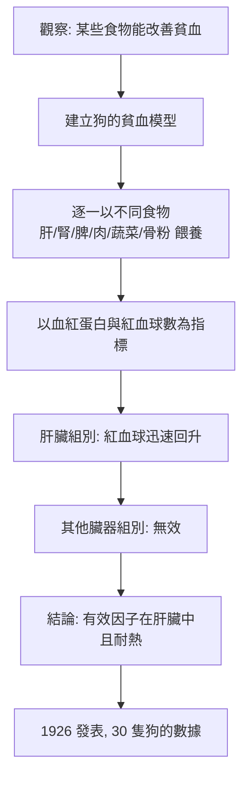

# 1934 · 惡性貧血的肝療法：惠普爾用一隻狗的肝臟破解了一個吃人的惡疾

> **1934 諾貝爾生理學或醫學獎**（共享，共享者三人皆為美國人）：喬治·霍伊特·惠普爾（George Hoyt Whipple）— 表彰「發現貧血的肝臟治療法」；喬治·理查茲·邁諾特（George Richards Minot）與威廉·帕里·莫菲（William Parry Murphy）— 同上。

## 懸案（案情提要）

1920 年代的紐約，Mount Sinai 醫院的病房裡躺著一群人：他們面色蒼白得像蠟紙、心悸、氣促、乏力到無法行走，嚴重者因心臟衰竭而水腫；**血紅蛋白低到只有正常值的三分之一**，紅血球巨大（巨紅血球性貧血）。他們多半年輕人——而這是一種**絕症**：沒有有效治療，多數在數年內死亡。

更詭異的是線索：**這群人的血液裡充滿了一種未知的巨大紅血球（megaloblast），而骨髓裡的造血前驅細胞停滯在「幼稚」階段無法成熟**。骨髓在忙著製造，卻造不出能用的成品——這像是生產線卡在最後一道工序。

三大疑點：

1. 為什麼巨幼紅血球無法成熟？缺乏的是什麼？
2. 既然骨髓在「拼命」，說明原料是夠的——那麼**缺的可能不是原料，而是「最後一公里」的催化劑**。
3. 有沒有一種食物能補上它？

惠普爾的答案是：**肝臟**。但他並非先知——他是一隻一隻餵狗，才把答案「煮」出來。

## 前因

| 年份 | 事件 |
| --- | --- |
| 1850s | Thomas Addison 描述「惡性貧血」（pernicious anaemia）的臨床面貌。 |
| 1872 | 紐約醫師 Edward Klein 觀察到巨型紅血球（megaloblast），但未確定其與貧血的因果。 |
| 1892 | 匈牙利醫師 Arnold Biermer 描述「進行性惡性貧血」，確立疾病單位。 |
| 1906 | 倫敦的 William Gulland 與 George Minot 發現：**惡性貧血的病人胃液中缺少一種「胃酸結合因子」**。 |
| 1909 | 慕尼黑的 Friedrich von Müller 描述「缺乏性貧血」與「惡性貧血」的差別。 |
| 1920s | 惠普爾在羅切斯特大學以狗為模型，進行長達十年的「因子尋找實驗」；他同時在日常臨床中觀察到：某些貧血病人吃了肝臟後紅血球迅速回升。 |
| 1926 | 惠普爾在 1926 年 8 月於美國生理學會發表《肝臟對貧血的療效》（The Effect of Liver on the Anaemias）。 |
| 1928 | 邁諾特與莫菲（以及科恩與|Minot 的合作者 William Murphy）以**惡性貧血病人自身的紅血球數量與血紅蛋白濃度**為指標，進行嚴謹的臨床對照，證實「每日 200 克肝臟」可迅速逆轉病情。 |
| 1929 | Minot 與 Murphy 進一步證明：**紅血球數量正常化所需時間，與肝臟攝取量成反比**，這是治療劑量學的經典。 |
| 1932 | 惠普爾的學生 **George Richards Minot**（實際上是 Minot 的助手 William Murphy 提出用紅血球數為指標）完成了臨床驗證。 |
| 1930s | 哈佛的 George Minot 與 William Murphy 以「肝臟 + 胃酸」的組合治療取得突破。 |
| 1948 | 維生素 $\mathrm{B}_{12}$ 被分離並確認為治療因子；此年決定的「惡性貧血 = 維生素 $\mathrm{B}_{12}$ 缺乏」被諾貝爾委員會追認為「已於 1934 年獲獎的研究」的完成。 |

## 調查

### 第一幕：惠普爾的「狗實驗室」

惠普爾的方法極為笨拙卻有效——他被稱為「狗的飼養員」，因為他**以狗為模型，一餵就是十年**。他的推理鏈如下：

惠普爾實驗的嚴謹處在於：**他不只記錄血紅蛋白，還記錄網狀紅血球（reticulocyte）數與骨髓的細胞組成**——這讓他能在數日內看出造血的恢復，而非等數月看終點。現代回頭看，這套方法已是標準的「血液學 panel」。

### 第二幕：邁諾特與莫菲的臨床對照——把「有效」變成「劑量—反應關係」

邁諾特與莫菲的貢獻是把惠普爾的觀察轉化為**可複製的臨床治療**：

1. **明確的量化指標**：以**網狀紅血球計數**（reticulocyte count）為主要指標——治療後 5–7 天，網狀紅血球會先急劇上升（這是骨髓造血恢復的最早訊號），隨後紅血球數與血紅蛋白上升。
2. **劑量學**：每日攝入肝臟量越大，紅血球恢復越快。Minot 與 Murphy 提出「每日 200 克鮮肝」的標準劑量，並顯示以肝臟提取物（liver extract）可大幅減少攝取量。
3. **治療的時程**：紅血球數在數週內恢復正常，血紅蛋白約需 2–3 個月。
4. **合併胃酸的必要性**：單吃肝臟不夠，必須**同時給予胃酸**——這個觀察是理解本案機制的鑰匙。

### 第三幕：對照組與「反對治療」的觀察

莫菲還注意到一個戲劇性的現象：**少數病人在治療初期病情反而惡化**——網狀紅血球急升後，血紅蛋白卻下降，病情惡化到幾週後才反轉。當時無法解釋；1950 年代才明白：這是**網狀紅血球大量釋放造成血鉀急驟下降**（hypokalemia），加上高血紅蛋白被快速合成消耗了血清鉀。這是「治療初期惡化」的經典鑑別，也開啟了維生素 $\mathrm{B}_{12}$ 治療的監測規範。

### 第四幕：Factor X 與內在因子的線索

惠普爾的實驗把「有效因子」定位在肝臟，但留下三個待解的問題：

1. 因子在肝臟中**耐熱**（高溫處理不失活性）——這排除了許多酵素；
2. 因子需要**胃酸同時存在**才有效——為什麼？
3. 因子在**小腸吸收**時需要**內在因子（intrinsic factor）**——為什麼？

這三條線索在 1920 年代被費利克斯（Felix）與 H. Murphy 等人逐步逼近：**胃酸使食物中的因子（後稱維生素 $\mathrm{B}_{12}$ ）釋出，內在因子（胃壁分泌的糖蛋白）護送它通過迴腸末端吸收**。最終由哈佛的 Karl Folkers 與其團隊於 1948 年分離出**維生素 $\mathrm{B}_{12}$ （cyanocobalamin）**，並由 E. L. Smith 與 Gloria Magyar 證明其能完全逆轉惡性貧血——1948 年諾貝爾生理學或醫學獎頒給 Folkers 團隊的分子生物學工作，但科學界普遍視之為 1934 年工作的追認。

## 理論裁決

1. **「缺乏—治療」典範的建立**：本案建立了現代醫學最強大的推理模板：

   $$\text{缺乏某物} \Rightarrow \text{特定病變};\qquad \text{補充該物} \Rightarrow \text{病變逆轉}$$

   這不僅是治療學的邏輯，也是**維生素概念**的實驗基礎（見 [1929-維生素](1929-維生素.md)）。

2. **DNA 合成與 $\mathrm{B}_{12}$ 的耦合**：惡性貧血的巨幼紅血球是 **DNA 合成受阻**的表型——細胞無法完成 DNA 複製，細胞核增大、分裂受阻。維生素 $\mathrm{B}_{12}$ 是**甲硫胺酸合成酶（methionine synthase）**與**甲基malonyl-CoA mutase**的輔酶：

   $$\text{Homocysteine} + \text{Methyl-THF} \xrightarrow{\text{B}_{12}} \text{Methionine} + \text{THF}$$

   $\mathrm{B}_{12}$ 缺乏 → 葉酸（THF）再生受阻 → dTMP 合成不足 → DNA 合成停滯 → 巨幼紅血球。**「甲基陷阱（methyl trap）」**是本案最深層的機制裁決，也是今日 $\mathrm{B}_{12}$ 缺乏診斷（甲基malon酸升高、同型半胱胺酸升高）的生化依據。

3. **網狀紅血球作為造血的即時指標**：治療反應的時間尺度為

   $$\frac{dR}{dt} = k \cdot \left(\frac{\text{B}_{12}}{\text{B}_{12} + K_m}\right)$$

   網狀紅血球在給藥後第 5 天達峰（reticulocyte peak），是臨床判定治療有效的標準時程；同時它也是**紅血球生成時間（erythropoiesis kinetics）**模型的實驗基礎。

4. **吸收生理的三段式模型**：本案最終導出的「肝臟（食物來源）— 胃酸（釋出）— 內在因子（運輸）— 迴腸（吸收）」四段鏈，是消化生理學吸收機制的經典教學案例，也預示了後來「鈣鐵—維生素 D—內因子」等吸收因子體系的研究模式。

## 追查支線（未結之謎）

- 「惡性貧血」的肝臟療法在 1926–1948 年間需要每天吃 200 克肝臟，是一則令病人與醫師都難以忍受的治療； $\mathrm{B}_{12}$ 的發現與合成（1948–1972）徹底改變了這一切；
- 內在因子的基因（*GIF*）與「遺傳性內在因子缺乏症」至今仍是遺傳性疾病的教科書範例；
- 惡性貧血患者「黑心臟」的病理（hyperpigmented myocardium）與高膽紅素血症的關聯，是本案診斷史的細節；
- 莫菲本人在 1934 年因肺炎去世（同年 11 月，年僅 49 歲），是諾獎史上最令人惋惜的得主之一；
- 惠普爾是羅切斯特大學校長（1921–1934），也是美國第一位諾貝爾生理學或醫學獎得主。

## 證物與數據（偵查卷宗摘錄）

| 證物 | 數值／內容 | 偵查意義 |
| --- | --- | --- |
| 巨紅血球 | 紅血球體積增大、核質疏鬆 | 造血停滯在 DNA 合成關卡 |
| 狗的肝臟實驗（10 年） | 肝臟組紅血球回升、其他臟器無效 | 有效因子的器官定位 |
| 網狀紅血球指標 | 治療後第 5 天達峰 | 造血恢復的即時偵測 |
| 標準劑量 | 每日 200 克鮮肝 | 臨床劑量學的建立 |
| 劑量—反應 | 摄入愈多，恢復愈快 | 治療的量效關係 |
| 胃酸的必要性 | 肝臟 + 胃酸才有效 | 內在因子假說的起點 |
| 治療初期惡化 | 網狀紅血球暴增後血鉀驟降 | 今日的鑑別診斷知識 |
| $\mathrm{B}_{12}$ （1948） | 甲硫胺酸合成酶輔酶 | 1934 年工作的終點 |

## 後果

| 領域 | 影響 |
| --- | --- |
| 血液學 | 惡性貧血由絕症變為可完全控制的疾病；血液學成為以細胞生成為模型的學科。 |
| 營養學 | 維生素 $\mathrm{B}_{12}$ 的發現補齊維生素家族最後一塊拼圖，也開啟了「吸收因子」研究。 |
| 消化生理學 | 內在因子的發現確立了「主動吸收需運輸蛋白」的範式。 |
| 公共衛生 | 「肝臟作為營養補充」的實踐，在戰時營養學中影響深遠。 |
| 其他諾獎 | 與 [1929-維生素](1929-維生素.md)、[1943-維生素K](1943-維生素K.md) 同屬維生素與代謝系列。 |

## 關聯

- [1929-維生素](1929-維生素.md) — 缺乏—治療典範與維生素概念的母體。
- [1909-甲狀腺外科](1909-甲狀腺外科.md) — 內分泌腺體的替代治療先例。
- [1943-維生素K](1943-維生素K.md) — 維生素家族的同期姊妹篇。
- [1953-檸檬酸循環](1953-檸檬酸循環.md) — $\mathrm{B}_{12}$ 作用於甲硫胺酸循環的代謝地圖。
- [1922-肌肉產熱與糖酵解](1922-肌肉產熱與糖酵解.md) — 代謝缺陷的另一種「治療—逆轉」典範。
