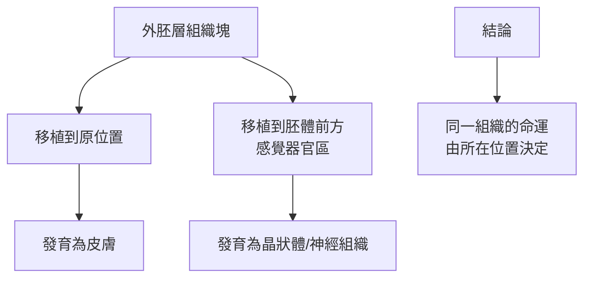

# 1935 · 胚胎的組織者：斯佩曼用一條背唇改寫了整個身體的藍圖

> **1935 諾貝爾生理學或醫學獎**：漢斯·斯佩曼（Hans Spemann，德國）— 表彰「發現胚胎發育的組織者效應」（"for his discovery of the organizer effect in embryonic development"）。他將學生希爾德·芒戈爾德（Hilde Mangold）的發現署名於自己名下，芒戈爾德曾對此表示異議。

## 懸案（案情提要）

受精卵是單一細胞，它如何變成有頭、有尾、有四肢、有器官的複雜動物？這是生物學最古老的謎題之一。二十世紀初胚胎學面臨的核心難題：

1. 胚胎的器官是由**已分化的細胞**「組裝」而成，還是由**尚未分化的細胞**被「誘導」而成？
2. 如果是誘導，那麼**誰**在誘導？誘導的「指令」是什麼物質？
3. 移植的組織是決定發育命運，還是被移植位置的環境決定？
4. 相同基因的細胞，為何能發育成完全不同的組織？

斯佩曼用**兩棲類的胚胎移植實驗**，給出了答案：胚胎的某一小塊區域，會**組織**（organize）周圍的組織走向特定命運——他稱之為「組織者（organizer）」。

## 前因

| 年份 | 事件 |
| --- | --- |
| 1880s | 斯佩曼在柏林以兩棲類（青蛙、蠑螈）胚胎做「胚芽移植」實驗，發現皮膚與神經的分化取決於移植位置。 |
| 1890s | 斯佩曼以「胚芽移植實驗」證明：早期胚胎的細胞具有**發育命運的可塑性（potency）**，命運由位置決定。 |
| 1900s | 斯佩曼在蘇黎世，以助手 **希爾德·芒戈爾德（Hilde Mangold，1906 年生）** 進行系統的「背唇（blastopore lip）」實驗。 |
| 1921–1922 | 芒戈爾德完成關鍵實驗：把**背唇組織**從一個胚胎移植到另一個胚胎的腹側，腹側區域被誘導形成**第二套完整的身體**——包含一個完整的神經管與脊索。 |
| 1924–1925 | 斯佩曼將此現象命名為「組織者效應（organizer effect）」，並於 1926 年出版《《誘導與組織者》（Induktion und Organisatoren）》。 |
| 1926 | 斯佩曼在《科學》雜誌發表〈兩棲類胚的組織者〉，成為 20 世紀胚胎學最具影響力的論文之一。 |
| 1932 | 芒戈爾德在完成博士論文後不久因結核病去世（年僅 25 歲）。 |
| 1935 | 斯佩曼獲諾貝爾生理學或醫學獎。 |

## 調查

### 第一幕：胚芽移植實驗——「位置決定命運」

斯佩曼的前期實驗是「胚芽（blastula）移植」：把一塊早期胚胎的外胚層移到另一胚胎的不同位置，觀察它發育成什麼。

這確立了**胚胎的「位置決定命運（positional determination）」**概念，但也留下了一個尖銳的悖論：如果命運由位置決定，那麼「位置」本身的物質是什麼？身體裡是否有某種物質沿身體軸分布，形成濃度梯度？

### 第二幕：背唇移植——組織者的發現

這是芒戈爾德的決定性實驗。兩棲類胚胎的發育有一個獨特的「軸」：

芒戈爾德的做法：

1. 從一個原腸胚的**背唇**取下一小塊組織（此時它已開始形成脊索與神經板）；
2. 移植到另一個**同階段**胚胎的**腹側**（本該形成腹部肌肉與血球的地方）；
3. 觀察：**腹側出現了一整套背側結構**——一個第二條脊索、一個第二條神經管、以及一整套次級身體（通常朝向相反方向）。

也就是說，被移植的背唇並沒有只發育成它自己（脊索），而是**把周圍的宿主組織組織成一套完整的身體**。它就像一位「施工總指揮」。

### 第三幕：組織者分級——誘導能力的階梯

芒戈爾德進一步做了**組織者不同區域的異體移植**，發現誘導能力有梯度：

| 移植組織 | 誘導強度 | 誘導出的結構 |
| --- | --- | --- |
| 脊索前板 / 脊索 | 最強 | 完整的身體軸 |
| 背唇中部 | 中 | 部分身體結構 |
| 背唇前端 | 較弱 | 頭部構造為主 |
| 背唇後端 | 較弱 | 尾部構造為主 |

這說明**背唇不是一個均質的「開關」，而是一個具有空間梯度的訊號系統**：背唇前端的細胞「知道」自己該做頭部，後端的該做尾部。**位置資訊必須以某種形式存在於細胞內。**

### 第四幕：非誘導性組織的對照

芒戈爾德也做了關鍵對照：移植**其他區域**（例如已分化的表皮、間充質）的組織，**不會**誘導宿主形成任何新結構——只有背唇有這種「組織」能力。這排除了「任何移植組織都會擾亂局部環境」的替代解釋，把效應歸因於背唇本身的性質。

### 第五幕：化學本質的追尋（未完成）

斯佩曼提出了極具野心的問題：**組織者裡的「誘導物質」是什麼？** 他與 Holfreter 在 1930 年代以移植實驗與顯微操作追尋，得到幾項重要發現：

1. 誘導具有**非專一性**——許多不同種類的組織都能誘導出脊索；
2. 誘導物質**可擴散相當距離**（可達 $0.5\text{–}1\ \mathrm{mm}$ ），說明它是**可擴散的化學物質**而非細胞接觸；
3. 誘導在某些情況下需要**與宿主細胞直接接觸**（如骨骼與神經的誘導），顯示可能涉及細胞表面的訊號。

**誘導物質的分子身分直到 1990 年代才被揭曉**：Nodal、Chordin、Follistatin、BMP 等**細胞外訊號蛋白**構成「組織者信號系統」，分別抑制或誘導 BMP 訊號，從而決定背側—腹側的命運。斯佩曼的直覺完全正確，只是他手上沒有基因體與重組蛋白的工具。

## 理論裁決

1. **誘導的數學表述**：誘導作用可建模為一個濃度場問題——誘導物質的擴散與降解遵循反應—擴散方程：

   $$\frac{\partial c}{\partial t} = D\,\nabla^2 c - k\,c + S$$

   組織者區域是源項 $S$ ，濃度梯度即位置資訊的物理載體。當濃度跨越閾值 $c^*$ 時，細胞命運改變：

   $$\text{命運} = \begin{cases} \text{背側結構}, & c > c^* \\ \text{腹側結構}, & c < c^* \end{cases}$$

   這正是 1990 年代 Nodal 梯度模型的思想源頭。

2. **「位置—命運」的資訊論**：斯佩曼實驗確立了身體是**由位置決定命運**，而非由血統決定命運。這一命題的現代版本是「形態素（morphogen）」模型——Conklin、Wolpert、Gilbert 等人的工作把「梯度即資訊」發展成完整的發育生物學框架。

3. **誘導的雙向性**：被誘導的宿主細胞必須**自身具備回應能力**才能被組織——這意味著誘導並非「移植一塊組織過來」，而是「解開宿主潛能」的開關。斯佩曼由此提出發育的「競爭性（potency）」概念：每個細胞有多種潛能，誘導因子只是把它推向其中一條。

4. **自組織性（self-organization）**：實驗顯示，被誘導的次級身體甚至可以在**沒有完整背唇**的情況下部分形成，且各部分的大小比例會自我調整——這預示了 20 世紀末的「自組織」理論（與 von Bertalanffy、Prigogine、Stuart Kauffman 的複系統理論相通）。

## 追查支線（未結之謎）

- 芒戈爾德在 25 歲時因結核病去世，諾獎卻頒給了斯佩曼——這樁「學生的成果給了導師」的案例，是諾獎史上最受關注的歸屬爭議之一（斯佩曼確實是研究計畫的設計者與長期主導者，但關鍵實驗由芒戈爾德完成）；
- 「誘導物質」的分子身分直到 1990 年代才真相大白（Spemann–Mangold 組織者的信號路徑）；
- 誘導現象的哲學意義至今仍有爭議：它是「形態發生」還是「資訊傳遞」？Steinhardt 的「組織者與非胚胎細胞」實驗（2010s）重新挑戰了細胞命運的不可逆轉變性；
- 幹細胞與 iPS 細胞的出現（見 [2012-iPS 細胞](2012-iPS細胞.md)）在某種意義上「復辟」了胚胎學的誘導問題：既然細胞的命運可以被重新指定，誘導物質是否可以被外加？
- 現代的「身體軸」模型（Shh、Wnt、FGF 梯度）把斯佩曼的直覺完整數學化，是發育生物學的核心語言。

## 證物與數據（偵查卷宗摘錄）

| 證物 | 數值／內容 | 偵查意義 |
| --- | --- | --- |
| 胚芽移植 | 同組織因位置而異 | 位置決定命運 |
| 背唇移植（1921–22） | 腹側形成第二套身體 | 組織者效應的發現 |
| 誘導強度分級 | 脊索 > 背唇 > 兩端 | 位置資訊以梯度存在 |
| 誘導的非專一性 | 多種組織皆可誘導脊索 | 誘導物質可擴散 |
| 擴散距離 | 約 $0.5\text{–}1\ \mathrm{mm}$ | 化學訊號而非細胞接觸 |
| 對照組 | 其他組織移植無誘導效應 | 排除替代解釋 |
| 1932 | 芒戈爾德因結核病去世（25 歲） | 歸屬爭議的核心事實 |
| 1990s | Nodal/Chordin/FGF 梯度的確認 | 誘導物質的分子身分 |

## 後果

| 領域 | 影響 |
| --- | --- |
| 發育生物學 | 誘導與組織者成為發育生物學的基本詞彙，開啟「胚胎如何被建構」的現代研究。 |
| 幹細胞生物學 | iPS 細胞的誘導重編程可視為「外加誘導」的現代版延伸。 |
| 癌症生物學 | 「正常與異常的細胞命運決定」在腫瘤生物學中的地位（幹細胞模型）可回溯至此。 |
| 形態學說 | 「位置—資訊—命運」的思路影響了形態發生學與演化發育生物學（evo-devo）。 |
| 科學倫理 | 諾獎歸屬的處理方式成為學術榮譽分配的討論素材。 |

## 關聯

- [1906-神經元學說](1906-神經元學說.md) — 卡哈爾的形態學提供了「分化可被觀察」的思路。
- [2012-iPS 細胞](2012-iPS細胞.md) — 成熟細胞命運可被重寫，是本案最直接的現代回應。
- [1995-胚胎發育基因](1995-胚胎發育基因.md) — 同源異形盒基因的發現，把組織者信號的分子語言補完。
- [1952-鏈黴素](1952-鏈黴素.md) — 同時代生物學的另一個突破維度（細菌的發現）。
- [1910-細胞核化學](1910-細胞核化學.md) — 遺傳物質的化學身分，是「指令」的可能載體。
