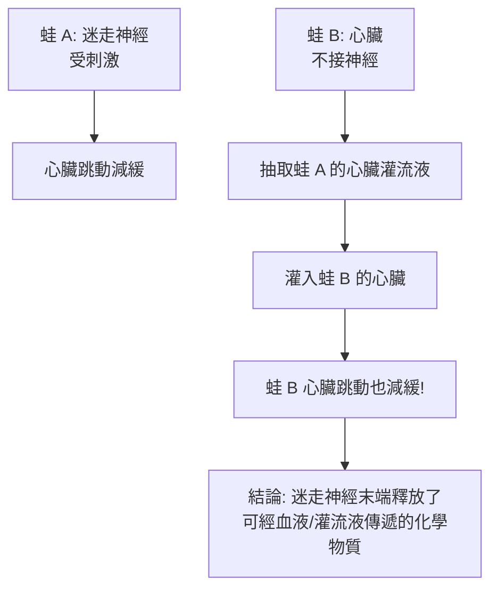

# 1936 · 神經的化學傳遞：勒維的「雙蛙心」實驗讓神經元開始說化學語言

> **1936 諾貝爾生理學或醫學獎**（共享）：亨利·哈利特·戴爾爵士（Sir Henry Hallett Dale，英國）— 表彰「神經衝動的化學傳遞的相關發現」；奧托·勒維（Otto Loewi，奧地利）— 同上。

## 懸案（案情提要）

1920 年代末，神經生理學已確立「突觸」這個概念（見 [1932-神經元功能](1932-神經元功能.md)），但一個根本問題仍未解決：

**興奮如何從一個神經元「跳」到下一個神經元？** 若如當時主流想法，突觸處是**電**的直接傳導——那麼神經衝動在整條反射弧上的速度與傳導方式就應完全一致。然而1930 年代的實驗卻發現，某些突觸的傳遞有明顯**延遲**、**對藥物敏感**、且**方向單一**。這些現象強烈暗示：突觸處存在化學的轉換。

1921 年，奧托·勒維做了一個後來被稱為生理學史上最漂亮的實驗——**雙蛙心實驗**——直接抓到了「化學傳遞物質」。

## 前因

| 年份 | 事件 |
| --- | --- |
| 1902 | 勒維在倫敦大學恩斯特·斯塔林（Ernest Starling）的實驗室結識亨瑞·戴爾，兩人成為終生好友與思想搭檔。 |
| 1904 | 勒維在維也納大學取得醫學博士學位（其父為諾貝爾醫學獎得主，且曾是他就讀的醫學院院長——見本篇「追查支線」）。 |
| 1909–1910 | 勒維在 Graz 的藥理研究所工作，提出「**自律神經系統（autonomic nervous system）**」的整體框架，把交感與副交感分為促進與抑制作用。 |
| 1921 年 7 月 | 勒維在 Graz 完成「**迷走神經物質（Vagusstoff）**」的實驗——後人稱之為「雙蛙心實驗」。 |
| 1926 | 勒維發表《傳遞物質的生物化學研究》（Untersuchungen über die humoralen Übertragung der Nervenwirkung）。 |
| 1930s | 戴爾在倫敦以**器官灌流（organ bath）**技術追蹤多種自律神經的效應物質，並確立「**Dale 效應**」（一物質對同一組織的作用方向固定）。 |
| 1932 | 戴爾發現刺激交感神經時釋放的物質作用於不同效應器方向相反（一者收縮、一者舒張），他以「**拮抗（antagonism）**」解釋，並以「乙醯膽鹼」作為可能的候選。 |
| 1936 | 勒維與戴爾共享諾貝爾生理學或醫學獎。 |

## 調查

### 第一幕：雙蛙心實驗（1921）

勒維的實驗設計極為簡潔，卻是實驗科學的典範：

**關鍵在 F 步**：蛙 B 的心臟並未被直接刺激，卻在接收到「來自另一隻蛙的液體」後出現同樣的變化。這排除了「電流直接傳導」——因為液體中沒有神經元，也沒有可通過的電路。

勒維稱這個物質為 **Vagusstoff（迷走神經物質）**。

### 第二幕：戴爾的「Dale 效應」與藥理證據

戴爾在倫敦的實驗室裡展開了更精細的偵查。他收集不同神經的灌流液，測試它們對各種器官的作用，並發現一個極重要的規律性：

> **同一種物質，在同一組織上，其作用方向是固定的**——這就是「Dale 效應」。

例如，某一物質對心臟是抑制的、對腸胃道是興奮的（或是反之）。這意味著「加速心跳」與「減慢心跳」**不是同一種物質的兩種用法，而是兩種不同物質**。這是「化學傳遞具有**專一性**」的第一個證據。

他與同事 Henry Dale（他自己）確認：**交感神經末梢釋放的是「去甲腎上腺素（noradrenaline）」，副交感神經末梢釋放的是「乙醯膽鹼（acetylcholine, ACh）」**。1936 年，戴爾提出 ACh 才是「迷走神經物質」的候選。

### 第三幕：化學身分鑑定

1930–1940 年代，Loewi 與 Dale 的學生、以及其他實驗室完成了身分鑑定：

- **乙醯膽鹼**：Loewi 與 Navratil（1939）從迷走神經的灌流液中分離出 ACh，並證明其具生物活性；
- **去甲腎上腺素**：Loewi 與同事分離並命名。

### 第四幕：藥理學的證實——「箭毒」與「阿托品」

最關鍵的驗證來自**藥理阻斷實驗**：

1. **阿托品（atropine）**：能阻斷副交感（迷走）神經對心臟的抑制作用，但**不影響交感神經**的作用——證明兩者確實使用不同的物質（此即「Dale 效應」的經典實驗版）。
2. **箭毒（curare）**：能阻斷運動神經對骨骼肌的作用，同樣證明神經肌肉接點使用化學傳遞。
3. **毒蕈鹼（muscarine）、菸鹼（nicotine）**：能 mimic（模擬）ACh 的作用，證明 ACh 作用於特定受體。

這些阻斷實驗構成了一條完整的邏輯鏈：

$$\text{阻斷某一物質的作用} \Rightarrow \text{該效應必經由該物質}$$

這套「用藥物反推內源物質」的推理方式，是 20 世紀藥理學最常用的偵查工具（今日用於逆轉錄酶抑制劑、NMDA 拮抗劑等的原理完全一致）。

## 理論裁決

1. **化學突觸的動力學模型**：神經末梢的釋放並非連續，而是以**量子（quanta）**為單位。ACh 的釋放量可寫成：

   $$m = n\,\frac{\text{vesicles}}{\text{synaptic bouton}}$$

   每個囊泡含約 $10^4$ 個 ACh 分子；釋放概率 $p$ 極小，突觸後電位的大小正比於 $m$ 。這解釋了為什麼**定量刺激不是連續變化，而是階梯式的（stochastic）**——這正是 1950 年代 Katz 與 Miledi 的「量子假說」的先聲（見 [1970-神經遞質](1970-神經遞質.md)）。

2. **受體與藥效的對數關係（Clark 方程）**：戴爾效應在定量上可寫成藥理學的標準形式：

   $$E = \frac{E_{\max}\,[D]}{K_D + [D]}$$

   藥物效應隨濃度呈飽和型，是 20 世紀藥理學的共同語言，也是埃利希側鏈理論的定量後裔（見 [1908-免疫雙雄](1908-免疫雙雄.md)）。

3. **一氧化氮的旁生線索**：勒維的雙重貢獻常被忽略——他後來（1926 年起）發現**胃腸道與生殖器官的自律神經傳遞並非 ACh，而是**一氧化氮**（NO）。這項發現直到 1980 年代才被確認，並在 1998 年獲諾貝爾生理學或醫學獎（見 [1998-一氧化氮](1998-一氧化氮.md)）。**同一個人，提前了七十年命中兩個答案。**

4. **受體藥理學的建立**：ACh 的兩類受體（**毒蕈鹼型 m 受體**與**菸鹼型 n 受體**）在 1930–1960 年代逐步分離，開啟了藥理學的「受體亞型」時代——今日的 $\beta_1$ 、 $\beta_2$ 阻斷劑、 $M_1\text{–}M_5$ 、 $5\text{-HT}_1\text{–}5\text{-HT}_5$ 皆源於此。

5. **神經—內分泌的統一**：勒維在 1909 年提出的「自律神經系統」框架，把交感、副交感與內分泌系統並列為三套「化學訊號系統」，這是「細胞間通訊」統一框架的早期版本。

## 追查支線（未結之謎）

- 諾貝爾委員會在 1936 年的評語中特別強調戴爾「未與勒維合作」，並列舉了戴爾的貢獻；這樁對貢獻分配的措辭，是諾獎史上的著名文本；
- 勒維的父親 Otto Loewi 也是諾貝爾生理學或醫學獎得主（1904 年，表彰胃的迷走神經支配），父子同獲此獎的巧合在諾獎史上僅此一例；
- 勒維本人是猶太裔，1933 年後流亡美國，1939 年他的實驗室被一家美國學會接管；他在紐約的岁月裡仍繼續研究，並於 1946 年出版《傳遞物質的化學傳遞》；
- ACh 的「囊泡量子釋放」由 Katz、Miledi 與 Huxley 在 1950 年代確立，1980 年代 $\mathrm{Ca}^{2+}$ 通道與 SNARE 複合體的發現補上分子細節；
- 勒維 1961 年去世，享年 88 歲；他在生命最後幾年仍發表關於「大腦化學傳遞」與「睡眠—覺醒調節」的實驗。

## 證物與數據（偵查卷宗摘錄）

| 證物 | 數值／內容 | 偵查意義 |
| --- | --- | --- |
| 雙蛙心實驗（1921） | 蛙 B 心臟因蛙 A 灌流液而減緩 | 化學傳遞的直接證明 |
| Vagusstoff | 迷走神經的化學介質 | 內源傳遞物質的命名 |
| Dale 效應 | 同一物質對同一組織方向固定 | 專一性與多傳遞物質 |
| 阿托品阻斷 | 只阻斷副交感效應 | 兩套化學物質的證成 |
| 箭毒阻斷 | 阻斷神經肌肉傳遞 | 神經肌肉接點的化學性 |
| 毒蕈鹼 mimic | 模擬 ACh 作用 | 受體存在的推論 |
| ACh 分離（1939） | Loewi 與 Navratil | 化學身分的鑑定 |
| NO 發現（1926） | 胃腸道自律神經的介質 | 七十年後的諾獎續篇 |

## 後果

| 領域 | 影響 |
| --- | --- |
| 藥理學 | 受體藥理學的根基；箭毒、阿托品、毒蕈鹼成為標準實驗工具。 |
| 臨床 | 抗膽鹼藥、β 阻斷劑、肌松劑、局部麻醉藥的機制全部由此確立。 |
| 神經科學 | 突觸傳遞由「電學謎題」變成「化學訊號傳遞」，並促成 1950–60 年代的分子神經科學。 |
| 心臟病學 | 副交感（迷走）張力對心臟的影響成為心律失常藥理學的核心。 |
| 其他諾獎 | 與 [1932-神經元功能](1932-神經元功能.md)、[1970-神經遞質](1970-神經遞質.md)、[1998-一氧化氮](1998-一氧化氮.md) 構成神經傳遞物質的完整長線。 |

## 關聯

- [1932-神經元功能](1932-神經元功能.md) — 謝靈頓提出突觸，並預告化學傳遞的可能。
- [1970-神經遞質](1970-神經遞質.md) — 釋放機制的諾獎答案（囊泡量子釋放）。
- [1998-一氧化氮](1998-一氧化氮.md) — 勒維提前七十年命中的第二個答案。
- [1908-免疫雙雄](1908-免疫雙雄.md) — 埃利希的受體理論在神經藥理學中的實現。
- [1963-離子機制](1963-離子機制.md) — 突觸後電位的離子基礎。
