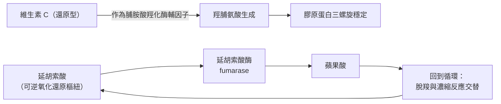

# 1937 · 生物氧化與維生素 C：森特-戈爾吉從腎上腺皮質裡挖出「修補匠」

> **1937 諾貝爾生理學或醫學獎**：聖捷爾吉·阿爾伯特（Albert Imre Szent-Györgyi，匈牙利）— 表彰「與生物燃燒過程有關的發現，特別是關於維生素 C 和延胡索酸的催化作用」（"for his discoveries in connection with the biological combustion processes, with special reference to vitamin C and the catalysis of fumaric acid"）。

## 懸案（案情提要）

1930 年代的生物化學有兩樁未結的案子：

**案子甲（維生素 C）**：1928 年起，人們已知維生素 C 能治療壞血病（見 [1929-維生素](1929-維生素.md)），但它是什麼分子、怎麼作用，仍然不明。有一條線索卻很奇怪：腎上腺皮質的**肝醣（glycogen）**含有大量還原性物質，這些物質在化學上很像維生素 C。

**案子乙（生物燃燒）**：細胞如何燃燒？瓦爾堡已揭示呼吸鏈的電子傳遞（見 [1931-呼吸酶](1931-呼吸酶.md)），但碳原子從有機物一路走到 $\mathrm{CO_2}$ 的**中間步驟**仍是黑箱。瓦爾堡曾提出「活性碳」的假說——一個含糊的說法，缺少可驗證的分子。

森特-戈爾吉的偵查把這兩樁案子接在了一起：**維生素 C 是生物燃燒鏈上的一個酵素輔因子**，而延胡索酸是碳骨架在循環中轉手的樞紐。

## 前因

| 年份 | 事件 |
| --- | --- |
| 1907–1910 | 森特-戈爾吉在布達佩斯從事生物化學研究，與生化的 Adolf Windaus 學派相關；他在義大利與劍橋接受訓練。 |
| 1928 | 森特-戈爾吉從**腎上腺皮質**中分離出一種還原性物質，命名為「**己糖醛酸（hexuronic acid）**」。 |
| 1930 | 匈牙利 Szent-Györgyi 把己糖醛酸與維生素 C 對應；Svirbely 與 Szent-Györgyi 在 adrenal gland 的產物中找到抗壞血酸活性。 |
| 1932 | 森特-戈爾吉在 Szeged 主持生化研究所（匈牙利最著名的科學機構），並獲得匈牙利政府的支持成為世界上第一個「維生素研究所」的原型。 |
| 1935 | 森特-戈爾吉在美國的實驗室（與 Joseph Murray 合作）分離出**純的維生素 C**（hexuronic acid），並以化學合成確認結構。 |
| 1937 | 諾貝爾委員會原本考慮頒給他「維生素 $\mathrm{B}_{1}$ 」的燃燒相關工作（他曾研究「維生素 $\mathrm{B}_{1}$ + 琥珀酸」作為生物催化的輔因子），後改以生物燃燒與維生素 C、延胡索酸表彰。 |
| 1937–1938 | 森特-戈爾吉提出**「生物催化劑（biocatalyst）」**的廣義理論，並在《生物化學的作用方式》中論述。 |
| 1940s | 森特-戈爾吉研究**肌凝蛋白（myosin）**的「延胡索酸酶（succinic dehydrogenase）」活性，並在肌肉收縮的「延胡索酸效應（succinic acid effect）」上做重要實驗。 |

## 調查

### 第一幕：腎上腺皮質的線索

森特-戈爾吉的偵查起點是一個異常的觀察：**腎上腺皮質**是維生素 C 含量最豐富的組織之一，且其含量隨應激（stress）而波動。他從這裡分離出己糖醛酸，並證明它就是維生素 C。

關鍵的驗證是**還原性（reducing power）的量化**——維生素 C 的化學本質就是還原劑：

$$\text{Dehydroascorbate} + 2H^+ + 2e^- \rightleftharpoons \text{Ascorbate} + 2H^+$$

$$E^{\circ'} =+0.35\ \mathrm{V}$$

這個氧化還原電位使抗壞血酸成為體內強大的還原劑——這為它在胶原合成中的角色提供了化學基礎。

### 第二幕：維生素 C 的機制——羥化酶的輔因子

在 1930 年代末至 1950 年代，人們逐步確認：**維生素 C 是脯胺酸與離胺酸羥化酶的輔因子**，而這些羥化酶是**膠原蛋白成熟**的關鍵：

$$\text{Proline} + \mathrm{O_2} + \alpha\text{-ketoglutarate} \xrightarrow{\text{vitamin C}} \text{Hydroxyproline} + \text{succinate} + \mathrm{CO_2}$$

沒有維生素 C，羥脯氨酸無法形成，膠原蛋白的三螺旋無法穩定交聯——這就是壞血病的分子機制：牙齦出血（毛細血管脆性）、傷口癒合不良、關節疼痛（骨與軟骨基質受損）、皮下出血（血管壁膠原缺陷）。

**這裡出現了一個極具化學價值的巧合**：羥化反應的副產物正是**延胡索酸（fumaric acid）**！這一點把兩樁案子拉到了一起。

### 第三幕：延胡索酸——循環中的樞紐

森特-戈爾吉與同事（包括 Anna Szent-Györgyi、Savage 與 Bach）在 1930 年代中期發現：**在無氧條件下，肌肉組織加入延胡索酸能恢復收縮能力**；而 **Fumarase（延胡索酸酶）**催化延胡索酸與蘋果酸之間的可逆轉換：

$$\text{Fumarate} + \mathrm{H_2O} \rightleftharpoons \text{Malate} \qquad (\text{fumarase})$$

這看似只是酵素學的小事，卻揭示了一個深遠的結構事實：**延胡索酸是「可逆氧化還原樞紐」**——它可以接受氫（成為蘋果酸），也可以失去氫（回到延胡索酸），因此是碳骨架在循環中轉手的理想節點。

這正是 1937 年克雷布斯提出**檸檬酸循環**時的起點——克雷布斯當時正是以森特-戈爾吉的延胡索酸工作為跳板（見 [1953-檸檬酸循環](1953-檸檬酸循環.md)）。克雷布斯自己也說過，這條思路是受森特-戈爾吉的啟發。

### 第四幕：生物催化劑的廣義理論

森特-戈爾吉在 1937 年的諾貝爾演講中提出了大膽的概括：**在生物體內的燃燒過程中，催化劑不是酵素本身，而是酵素加上它的輔因子（cofactor）構成的整體**——他把酵素、輔酶與維生素統一稱為「biocatalyst（生物催化劑）」。這是**酵素學向「輔因子中心論」過渡**的關鍵一步，也是後來「酵素 = 蛋白質 + 金屬/有機輔因子」這一教科書公式的思想源頭。

同時他強調：**生物催化劑是「耗氧」與「放能」的耦合點**——脫氫酶把氫交給 $\mathrm{NAD}^{+}$ ，呼吸鏈把電子交給氧並把能量存進 ATP，這套耦合是「生物燃燒」的核心。他甚至在 1937 年就提出：**ATP 是「高能磷酸鍵」的儲能形式**——在能量論上超前於同時代多年。

### 第五幕：肌肉收縮的「延胡索酸效應」

森特-戈爾吉另有一項被低估的貢獻：他發現**延胡索酸能恢復疲勞肌肉的收縮能力**，並提出這可能與「細胞內的可利用能量」有關。1940 年代 Szent-Györgyi 與同事分離出**肌凝蛋白（myosin）**，證明它具有 ATPase 活性——這是「肌肉收縮的分子機制」這條通向 1954 年諾貝爾獎的路徑上的重要一站。

## 理論裁決

1. **生物燃燒的完整鏈條**：把本案各段拼起來，得到 20 世紀中葉生物化學的完整代謝圖景：

   $$\text{底物} \xrightarrow{\text{脫氫酶}} \text{NADH} + H^+ \xrightarrow{\text{呼吸鏈}} \mathrm{O_2} + \mathrm{H_2O} + \text{ATP}$$

   碳骨架則在檸檬酸循環中轉手：

   $$\text{Acetyl-CoA} + \text{Oxaloacetate} \to \text{Citrate} \to \cdots \to \text{Malate} \rightleftharpoons \text{Fumarate}$$

2. **輔因子中心論**：維生素 C（有機輔因子）、 $\mathrm{NAD}^{+}$ （核苷酸輔因子）、血基質 Fe（金屬輔因子）、FAD 與 FMN（黃素輔因子）——森特-戈爾吉的「生物催化劑」概念把所有這些統一成一個體系：**脫氫反應靠輔因子搬運電子，氧化還原反應靠酵素與輔因子配對完成**。
3. **能量耦聯的熱力學**：脫氫與氧化的自由能差被轉存為 ATP 的磷酸鍵：

   $$\Delta G_{\text{總}} = \Delta G_{\text{脫氫}} + \Delta G_{\text{氧化}} + \Delta G_{\text{ATP 合成}} < 0$$

   這是「生物燃燒」四字的嚴格含義。
4. **抗壞血酸的抗氧化定位**：維生素 C 作為可逆的氧化還原緩衝系統，參與膠原合成與多酚氧化酶反應；其體內濃度 $\approx 50\text{–} 80\ \mu\mathrm{M}$ ，是血漿中最豐富的小分子抗氧化劑之一。

## 追查支線（未結之謎）

- 森特-戈爾吉的政治生涯充滿爭議：1930 年代他在匈牙利被猶太裔與非猶太裔的「種族衛生學」洗腦；在二戰期間移居美國；1961 年曾競選國會議席，1964 年再次參選時落選，1970 年因反對蘇聯入侵捷克斯洛伐克而被捕並遭毆打——他在 90 歲時還到匈牙利國會大廈前示威，抗議遭逮捕；
- 維生素 C 的大劑量預防感冒之說（1970 年代 Linus Pauling 的倡導）至今在科學上仍有爭議，是「營養學主張 vs 隨機試驗證據」的教科書案例；
- 維生素 C 與膠原蛋白羥化的機制直到 1950–1960 年代才完全確認，與 [1934-惡性貧血肝療法](1934-惡性貧血肝療法.md) 同屬「維生素—酵素輔因子」的典範；
- 森特-戈爾吉的「生物催化劑」與「ATP 為高能磷酸鍵」的主張，預告了 1940–1950 年代的生物能量學革命；
- 他對**維生素 $\mathrm{B}_{1}$ （硫胺素）作為生物催化輔因子**的早期研究，是 $\mathrm{B}_{1}$ ₋ 醣氧化還原酶機制的先聲。

## 證物與數據（偵查卷宗摘錄）

| 證物 | 數值／內容 | 偵查意義 |
| --- | --- | --- |
| 腎上腺皮質己糖醛酸（1928） | 高還原性物質 | 維生素 C 的分離起點 |
| 己糖醛酸 = 維生素 C（1930–32） | 活性對應 | 兩條線索會合 |
| 純維生素 C（1935） | Szeged／美國實驗室分離 | 結構與功能的確定 |
| 還原電位 | $E^{\circ'} \approx +0.35\ \mathrm{V}$ | 強還原劑的量化 |
| 羥化反應 | Proline + $\mathrm{O}_{2}$ + α-KG → HydroProline + succinate + $\mathrm{CO}_{2}$ | 壞血病的分子機制 |
| 延胡索酸酶 | Fumarate ⇌ Malate（可逆） | 循環中「可逆樞紐」的發現 |
| 延胡索酸效應 | 疲勞肌肉收縮能力恢復 | 肌肉能量代謝的線索 |
| 生物催化劑理論 | 酵素＋輔因子＝催化單位 | 輔因子中心論的源頭 |

## 後果

| 領域 | 影響 |
| --- | --- |
| 生物化學 | 維生素 C 的結構與功能確立；「生物催化劑」概念統一酵素與輔因子研究。 |
| 代謝生物學 | 延胡索酸的工作直接催生了檸檬酸循環的發現（克雷布斯於 1937 年完成該發現）。 |
| 營養學 | 壞血病的預防（食物強化、柑橘類）成為公共衛生標配。 |
| 肌肉生理學 | 肌凝蛋白與 ATPase 活性研究，開啟收縮機制的分子時代。 |
| 其他諾獎 | 與 [1953-檸檬酸循環](1953-檸檬酸循環.md)、[1931-呼吸酶](1931-呼吸酶.md) 為同一條代謝主線。 |

## 關聯

- [1931-呼吸酶](1931-呼吸酶.md) — 電子傳遞鏈的前作；瓦爾堡的「活性碳」說正是被本案修正的對象。
- [1953-檸檬酸循環](1953-檸檬酸循環.md) — 延胡索酸工作直接導向的循環發現。
- [1929-維生素](1929-維生素.md) — 維生素家族的整體背景。
- [1934-惡性貧血肝療法](1934-惡性貧血肝療法.md) — 維生素作為酵素輔因子的另一實例。
- [1954-脊髓灰質炎病毒](1954-脊髓灰質炎病毒.md) — 同期實驗室方法的另一突破。
