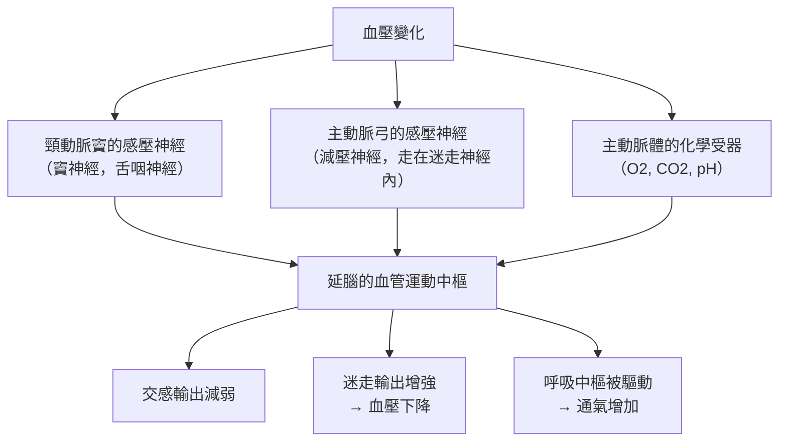

# 1938 · 竇與主動脈的壓力感受器：海門斯證明身體用血管壁當「血壓計」

> **1938 諾貝爾生理學或醫學獎**：柯奈爾·讓·弗朗索瓦·海門斯（Corneille Jean François Heymans，比利時）— 表彰「發現竇和主動脈機制在呼吸調節中所起的作用」（"for the discovery of the role played by the sinus and aortic mechanisms in the regulation of respiration"）。

## 懸案（案情提要）

1930 年代，生理學已能精確測量血壓、心輸出量與氧合血紅蛋白。但有一組現象一直無法解釋：

1. **為什麼血壓會波動？** 為什麼情緒激動、疼痛、暈厥會讓血壓瞬間改變？這些變化不像心臟本身的產出，來自哪裡？
2. **為什麼呼吸會影響血壓？** 深吸氣時血壓為何下降？咳嗽時為何升高？
3. **動脈硬化、高血壓的病人，為何特別容易發生「壓力感受器失效」**——他們的反射變鈍，因此血壓波動幅度更大？
4. **感壓的神經末梢到底長什麼樣？** 它如何把「壓力」翻譯成「神經衝動」？

海門斯的答案是：人體的**頸動脈竇**與**主動脈弓**壁上有專門的壓力感受器，它們同時監測血壓與血氧，並且**同時參與呼吸調節**——這條「竇—主動脈機制」正是他 1938 年獲獎的內容，也是 20 世紀自主神經生理學的里程碑。

## 前因

| 年份 | 事件 |
| --- | --- |
| 1733 | Stephen Hales 首次以玻璃管插入馬的動脈測得血壓。 |
| 1866 | 柳比爾（Hering）以神經 Cutting 實驗提出頸動脈竇與呼吸運動的反射性關聯（"Hering's reflex"）。 |
| 1906 | 歐洲生理學家 Ivan von Cyon 與 M. Ewald 描述頸動脈竇的感壓神經（竇神經，Hering's nerve），並初步提出其對血壓的調節作用。 |
| 1920s | 關於「呼吸與循環交互作用」的機制爭議不解：到底是中樞（延腦呼吸中心）驅動了心臟與血管的變化，還是機械性的（胸腔壓力變化直接傳到血管）？ |
| 1930–1932 | 海門斯在**魯汶大學**建立實驗室，與 Belgian colleagues 展開一 系列「去神經（denervation）」與「重神經化（reinnervation）」實驗。 |
| 1933 | 海門斯的學生把「竇神經」與「迷走神經（主動脈弓神經）」分離並分別刺激，觀察呼吸與血壓的反應。 |
| 1935 | 海門斯的學生 **J. P. D. Retzlaff** 等在顯微鏡下直接找到竇壁內的感壓神經末梢。 |
| 1938 | 海門斯獲諾貝爾生理學或醫學獎。 |

## 調查

### 第一幕：問題的精確化——呼吸與血壓，到底誰指揮誰？

1930 年代的爭議可以寫成一個二選一：

- **假說甲（機械假說）**：呼吸運動改變胸腔內壓，壓力經血管壁「傳」到動脈，血壓因此被動波動；
- **假說乙（反射假說）**：變化由感壓神經→中樞→反射性地調整血管張力與呼吸節律所產生。

**分辨兩者的實驗設計**極為漂亮：若把某條神經**切斷**（去神經），機械性的耦合**仍應存在**（因為血管與胸腔的物理連結未被破壞），但反射性的耦合**必定消失**。海門斯正是靠這組「去神經 vs 神經完整的對照」定案的。

### 第二幕：分開兩條神經

關鍵的解剖操作是：**把竇神經（頸動脈竇，Hering's nerve）與主動脈弓神經（depressor nerve，走在迷走神經內）分開**。分開後的結果：

| 刺激對象 | 血壓反應 | 呼吸反應 |
| --- | --- | --- |
| 頸動脈竇神經（傳入） | 血壓**下降**（反射性血管擴張） | 呼吸**加快、加深** |
| 主動脈弓神經（傳入） | 血壓下降 | 呼吸加快加深 |
| 迷走神經（切斷頸部） | 呼吸停止或改變 | 切斷主動脈弓與竇反射 |

這就證明了**竇與主動脈機制同時控制血壓與呼吸**——這是海門斯獲獎的直接理由。

### 第三幕：化學性感受——竇不只量壓，也量氧

海門斯實驗室的另一項關鍵發現是：**把頸動脈竇同時暴露於低氧、二氧化碳高張、以及血液酸鹼度變化**，會引起不同的通氣反應：

- **低氧**（ $P_{O_2} \downarrow$ ）→ 通氣增加；
- **$P_{CO_2} \uparrow$** → 通氣增加（這是 Halenda 與 Adrian 1937 年發現的中央化學受體）；
- **血液 pH 下降** → 通氣增加（**周邊化學受體**）。

由此海門斯提出：**頸動脈竇是同時感受「壓力」與「化學」的複合受體**。這一發現把周邊化學受體（主要在頸動脈體與主動脈體）推上歷史舞台——當然，當時人們還不清楚它們其實是**獨立的化學受器**，與竇內的壓力受器只是解剖上相鄰。

### 第四幕：顯微鏡下的「感壓小體」

海門斯的學生在 1930 年代中期於竇壁中直接找到感壓神經末梢：**樹狀末梢包覆著感壓小體（baroreceptor corpuscles）**，其終端被一層膜與血管腔隔開。這解釋了「為什麼壓力不是直接被神經末梢『看到』，而是被一層膜『傳導』後才變形刺激神經」——這正是後來「壓力—膜張力—神經拉伸」機制的原型。

### 第五幕：高血壓中的「重置現象」

海門斯的實驗揭示了一個極重要的病理學現象：在**高血壓病人**（以及慢性實驗性高血壓動物）中，竇的感壓神經末梢**發生退行性變化**，導致反射閾值「重置」到更高的壓力水平——

$$\bar{P}_{\text{reset}} \uparrow \quad \Rightarrow \quad \text{反射帶變寬，但低血壓時的反應減弱}$$

這解釋了為什麼高血壓患者的** baroreceptor 反射緩衝功能變差**：血壓的短期波動幅度加大、更容易發生「藥物性低血壓與直立性低血壓」。這也解釋了藥理學上的「**降壓藥的耐受（tachyphylaxis）**」現象——長期高血壓使反射閾值重置，藥物降低血壓後，竇反射不再有效反應。

## 理論裁決

1. **負回饋控制系統的數學**：竇—主動脈機制是一個典型的負回饋控制器。輸出（血壓）經傳入纖維回饋，與參考值比較，產生誤差訊號：

   $$\Delta P = P_{\text{set}} - P_{\text{actual}}, \qquad \text{反應} \propto -\Delta P \cdot g$$

   其中 $g$ 為迴路增益。迴路增益隨血壓上升而下降（高血壓時反射變鈍），這正是「重置」現象的數學描述。
2. **Buckingham 與高血壓的「設定點」**：Baroreceptor 在血壓控制中的角色是「短期調節器」（數秒到數分鐘），而**長期血壓由腎臟決定**（鈉水平衡與 RAAS 系統）。海門斯的實驗確立了「竇反射不能長期決定血壓」這一邊界，這一分工觀念在 20 世紀 60 年代由 Guyton 系統化。
3. **通氣的化學控制方程**：海門斯與後人建立的通氣反應式：

   $$\dot{V}_E = \dot{V}_0 + K\left(P_{CO_2} - P_{CO_2,\text{set}}\right) + \alpha\left(P_{O_2,\text{set}} - P_{O_2}\right) + \beta\,[H^+]$$

   這是睡眠呼吸中止症（阻塞性與中枢性）診斷與治療的理論基礎。
4. **受器的「雙重身分」**：竇既量壓又量化學——這提示了受器功能的多樣性，今日已知頸動脈體的周邊化學受器其實是**獨立的細胞群**（type I 主細胞與 type II 支持細胞），它們以釋放 ATP、腎上腺素、多巴胺的方式傳遞訊號，並由 **Cochlear 的氧敏感鉀通道（K_ATP 通道，即 TASK-1/Task-3）** 參與——這一分子機制要等到 2000 年代的結構研究才釐清。
5. **反射的臨床應用**：頸動脈竇按摩（carotid sinus massage）可誘發迷走反射以中止室上性心動過速，是今日急診室仍常用的床邊操作；這項技術的生理學基礎正是海門斯的工作。

## 追查支線（未結之謎）

- 海門斯與學生們還發現了**「降壓反射」對抗「升壓反射（pressor reaction）」**的對抗關係，這在 20 世紀中期是解釋急性血壓變化的核心概念；
- 頸動脈體腫瘤（carotid body tumor）與高黃原酸症（慢性缺氧環境的牧民）——皆源自對周邊化學受器的臨床觀察，是海門斯工作的直接後代；
- 海門斯實驗室的另一項重要貢獻是「**交叉循環實驗（cross-circulation）**」——將兩隻動物的循環系統對接以研究體液性因子，這套技術是後來器官移植與透析研究的先聲（見 [1912-血管縫合與器官移植](1912-血管縫合與器官移植.md)）；
- 2015 年的心臟病學研究指出「壓力感受器反射（baroreflex）」的增益可用以預測心臟衰竭患者的預後，成為本案的當代延伸；
- 長期以來壓力感受器被視為「高血壓的因」，今日共識已轉為「果」（即高血壓造成反射重置）——這一因果方向的翻案，直接源於海門斯的實驗。

## 證物與數據（偵查卷宗摘錄）

| 證物 | 數值／內容 | 偵查意義 |
| --- | --- | --- |
| 竇神經與主動脈弓神經分離 | 分別刺激，產生不同反應 | 解剖—生理的解耦 |
| 去神經對照 | 切斷後機械耦合仍在、反射消失 | 區分機械耦合與反射 |
| 竇神經刺激 | 血壓下降 + 呼吸加快加深 | 雙重效應的發現 |
| 低氧刺激 | 通氣增加 | 周邊化學受器的發現 |
| 感壓小體顯微影像 | 樹狀末梢 + 膜隔離結構 | 壓力轉導機制的形態學 |
| 高血壓中的重置 | 反射閾值上移、增益下降 | 藥理性耐受的機制 |
| 頸動脈竇按摩 | 誘發迷走反射中止 SVT | 床邊臨床應用 |
| 通氣反應式 | $\dot{V}_E = \dot{V}_0 + K\Delta P_{CO_2} + \alpha\Delta P_{O_2} + \beta[H^+]$ | 呼吸控制的量化 |

## 後果

| 領域 | 影響 |
| --- | --- |
| 自主神經生理學 | 竇—主動脈反射成為血壓調節的經典模型。 |
| 呼吸生理學 | 周邊化學受器的發現確立了「氧、二氧化碳、酸鹼度」三重調控輸入。 |
| 高血壓研究 | 反射重置現象改變了對高血壓病因與藥理學的理解。 |
| 臨床 | 頸動脈竇按摩、頸動脈體腫瘤的識別、睡眠呼吸中止症的機制模型。 |
| 移植研究 | 交叉循環實驗為血管外科與透析技術鋪路。 |
| 其他諾獎 | 與 [1920-毛細血管調節](1920-毛細血管調節.md) 同屬循環調節譜系；[1998-一氧化氮](1998-一氧化氮.md) 則是血管舒張的分子版圖。 |

## 關聯

- [1920-毛細血管調節](1920-毛細血管調節.md) — 克羅的微循環調節與海門斯的宏觀反射互補。
- [1938-竇與主動脈反射](1938-竇與主動脈反射.md) — 本篇索引。
- [1998-一氧化氮](1998-一氧化氮.md) — 血管張力的分子調節機制。
- [1912-血管縫合與器官移植](1912-血管縫合與器官移植.md) — 交叉循環實驗的技術譜系。
- [1956-心臟導管術](1956-心臟導管術.md) — 血壓與血流的臨床測量技術。
