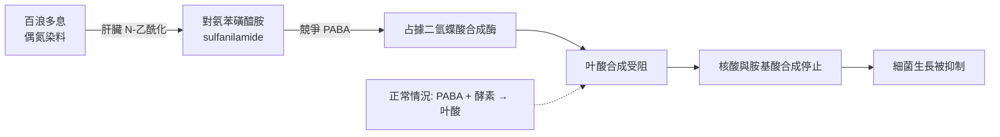

# 1939 · 百浪多息：多馬克的磺胺藥打開了抗生素時代的大門，卻被納粹關在境外

> **1939 諾貝爾生理學或醫學獎**：格哈德·約翰尼斯·保羅·多馬克（Gerhard Johannes Paul Domagk，德國）— 表彰「發現百浪多息（一種磺胺類藥物）的抗菌效果」（"for the discovery of the antibacterial effects of prontosil"）。納粹政府禁止他接受獎項；他於 1947 年補領獎章與證書，但拒領獎金。

## 懸案（案情提要）

1932 年，德國 IG Farben 實驗室的化學家費里茨·米茨（Mietzsch）與約瑟夫·克拉勒（Klarer）合成出一種橘紅色的偶氮染料（azo dye）——**百浪多息（Prontosil）**。病理學家多馬克奉命在該公司實驗室篩選藥物，他發現一件奇怪的事：

**這染劑能殺死鏈球菌。**

但它為什麼能殺？多馬克自己也不完全清楚——直到 1935 年他的女兒希爾德加德（Hildegarde）因感染鏈球菌、性命垂危，他用這藥物救回了她的手臂與性命，此事迫使 IG Farben 加速研究，並使該藥成為全球第一個商品化的抗生素。

1939 年，多馬克被選為諾貝爾生理學 or 醫學獎得主——但**納粹政府禁止他領獎**。這樁案子牽涉三層偵查：藥物為何有效（化學機制）、科學如何被政治劫持（歷史）、以及一種藥如何改變世界（後果）。

## 前因

| 年份 | 事件 |
| --- | --- |
| 1910 | 化學家 Paul Ehrlich 提出「選擇性毒性」與「側鏈」藥理學說（見 [1908-免疫雙雄](1908-免疫雙雄.md)）——藥物像「魔彈」只攻擊病原不傷宿主。 |
| 1910s–1920s | 砷凡納明（606，Salvarsan）由 Ehrlich 與 Hata 開發，治梅毒，是第一種有效的抗菌化學藥物。 |
| 1927 | 德國拜耳的 Gerhard Domagk 被 IG Farben（後為 Bayer）聘請，主持藥物篩選工作。 |
| 1932 | 米茨與克拉勒合成百浪多息（Prontosil，KL730）；多馬克發現其對溶血性鏈球菌有抑制作用。 |
| 1935 | 多馬克的女兒 Hildegarde 因割傷感染鏈球菌，瀕死；他以百浪多石治療，救回她的手臂。此事迫使公司加速推進臨床研究。 |
| 1935 | 多馬克發表《白喉、肺炎與產後敗血症的化學療法》（Chemotherapie der Infektionskrankheiten）——他主張百浪多息可用於人類，並公開呼籲。 |
| 1935 | 英國牛津的 **Leonard Rogers** 等將百浪多石用於治療鏈球菌性敗血症，成功。 |
| 1935–1937 | 法國與德國學者 Jacques and Thérèse Tréfouël、Daniel Bovet、 Federico Nitti 揭示百浪多斯的**代謝產物對位氨苯磺醯胺（sulfanilamide, p-aminobenzenesulfonamide）**才是真正的活性成分，並證明是**競爭性拮抗**細菌的對氨苯甲酸（PABA）。 |
| 1937 | 百浪多石在美國由 Sharp & Dohme 大量生產，俗稱「磺胺藥」。 |
| 1939 | 多馬克被授予諾貝爾生理學 or 醫學獎；納粹政府禁止他接受。 |
| 1943–1945 | 戰爭期間，百浪多石成為前線藥品，救下大量生命。 |
| 1947 | 多馬克補領獎章與證書；獎金部分捐給慈善。 |

## 調查

### 第一幕：化學偵查——「染劑為何能殺菌」

多馬克最初的發現純屬篩選實驗的副產品。真正的機制追查由**崔福埃（Tréfouël）與博韋（Bovet）**完成：

1. 百浪多石本身**在試管中並無直接殺菌作用**——它必須被**肝臟**中的酵素代謝才產生活性；
2. 活性代謝產物是**對氨苯磺醯胺（sulfanilamide）**；
3. 其作用機制是**競爭性拮抗**：磺胺類的分子結構與細菌合成叶酸所需的**對氨苯甲酸（PABA）**相似，因而被誤認為 PABA 進入二氫蝶酸合成酶：

   $$\text{PABA} + \text{dihydropteroate synthase} \to \text{dihydrofolate} \xrightarrow{\text{NADPH}} \text{folate}$$

   磺胺類偽裝成 PABA 占據活性位，使細菌**無法合成叶酸**，因而無法合成核酸與胺基酸，細菌停止生長死亡——這是**第一個被完全闡明的抗生素作用機制**，也是「抗代謝物（antimetabolite）」概念的原型。

### 第二幕：1940 年代臨床的大轟炸

1935–1940 年代的臨床數據改寫了醫學史：

- **產後敗血症（puerperal sepsis）**：產褥熱是當時孕產婦的首位死因。磺胺藥使其死亡率下降數十個百分點——這是磺胺類最早的重大勝利；
- **腦膜炎雙球菌性腦膜炎**：死亡率從接近 100% 降至約 20%；
- **鏈球菌性肺炎、丹毒、猩紅熱**：療效顯著；
- **傷寒**：1938 年後療效亦佳。

但代價慘重：磺胺藥有**副作用**——**氮質症（sulfanilamide nephrosis）**、結晶尿、血球破壞、methemoglobinemia、以及最嚴重的**「磺胺piracy 症（Sulfapyridine fever）」**。藥理學家因此急迫地尋找更好的藥物——這直接推動了**藥物化學（medicinal chemistry）**的崛起，也催生了 1939–1945 年間的抗鏈球菌新藥 **sulfapyridine 與 sulfathiazole**。

### 第三幕：政治偵查——納粹的禁令

1939 年 10 月，諾貝爾委員會決定把獎項頒給多馬克。**德國納粹政府以「元首不需要獎項」為由拒絕他接受**（官方理由是當時德國法律規定德國人不得接受外國榮譽）。多馬克被迫回絕，並於 1947 年在幾乎被視為反納粹的氛圍下收到獎章與證書——同時拒領了一半獎金（另一半由挪威方面代為捐給慈善）。這樁案例在諾獎史上留下三個註腳：

1. **諾貝爾委員會無法保證得主能出席頒獎**（1939 年物理與化學獎同樣被阻）；
2. **科學獎與政治權力在二戰期間的尖銳衝突**；
3. **戰後的「追補頒獎」先例**：多馬克於 1947 年補領，使許多諾獎史資料把 1939 年醫學獎標為「1947 年補領」。

### 第四幕：這扇門後面是整個抗生素時代

磺胺藥打開了「**化學治療**」的概念：大分子藥物不行，小分子藥物可以。Florey 與 Chain 在牛津正是沿著這條思路，於 1938–1940 年轉向**青黴素**（見 [1945-青黴素](1945-青黴素.md)），並在 1941–1945 年將其推向臨床。抗生素時代的整條技術路線——藥物化學家設計分子、病理學家篩選、臨床試驗、工業量產——都在百浪多石的陰影下成型。

## 理論裁決

1. **競爭性拮抗的動力學**：磺胺類抑制 PABA 競爭性結合酵素，可用標準的競爭性抑制方程式描述：

   $$v = \frac{V_{\max}\,[S]}{K_m\left(1 + \frac{[I]}{K_i}\right) + [S]}$$

   其特徵是：**提高受質濃度可部分逆轉抑制**（競爭性抑制），這在藥理學教學中是最經典的辨識線索。

2. **選擇性毒性的化學基礎**：磺胺之所以能「選擇性」攻擊細菌，是因為細菌合成叶酸（無folate reductase pathway）而人類從飲食取得叶酸——這是**物種生化差異**被用作藥物選擇依據的第一個完整實例，直接延伸了 Ehrlich 的「魔彈」理想（見 [1908-免疫雙雄](1908-免疫雙雄.md)）。

3. **前藥（prodrug）的概念**：百浪多石本身無活性、需肝臟活化才成磺胺——這是**前藥理學（prodrug pharmacology）**的開端，後續的化學前藥（Enalapril、Codeine、Azathioprine）皆循此設計。

4. **抗菌譜與耐藥性的量化**：磺胺類對鏈球菌有效、對多數桿菌無效——「抗菌譜（spectrum）」成為臨床選藥的基本概念；其耐藥機制（靶點改變 PABA 的合成酶、 plasmids 攜帶 sul 基因）則是日後基因轉移與抗藥性基因組學研究的源頭。

## 追查支線（未結之謎）

- 多馬克的實驗室工作環境極為特殊：他必須在 IG Farben 內部為競爭對手（拜耳）開發藥物——這段「僱傭科學家的產業壓力」是科學史與產業史交會的案例；
- 1940–1945 年間磺胺藥的廣泛使用，伴隨嚴重的副作用與死亡案例，這推動了 1947–1948 年**隨機對照試驗（streptomycin trial, 1948）**的建立——這是現代臨床試驗方法論的分水嶺；
- 磺胺藥與 **1943 年百浪多石引發的「Eli Lilly 的 Elixir Sulfanilamide」災難（107 人死亡）**催生了 1938 年美國食品藥物管理局的嚴格監管，是公共衛生法的重要里程碑；
- 磺胺類藥物至今仍是全球使用量最大的抗生素類別之一（特別是與甲氧苄啶Trimethoprim 組合），耐藥性問題仍是公共衛生重點；
- 二戰期間磺胺藥在戰場上的廣泛應用，使「化學治療」一詞進入醫學主流——這是 20 世紀醫學最重要的範式轉移之一。

## 證物與數據（偵查卷宗摘錄）

| 證物 | 數值／內容 | 偵查意義 |
| --- | --- | --- |
| 百浪多息（1932） | 偶氮染料 KL730 | 篩選中的意外發現 |
| 女兒希爾德加德的感染（1935） | 瀕死，藥物搶救 | 加速臨床化的催化劑 |
| 活性代謝物 | 對氨苯磺醯胺（sulfanilamide） | 「前藥」机制的發現 |
| 競爭對象 | 對氨苯甲酸（PABA） | 抗代謝物的分子邏輯 |
| 產後敗血症 | 死亡率大幅下降 | 磺胺類最早的重大勝利 |
| 副作用 | 氮質症、methemoglobinemia、Sulfapyridine fever | 推動藥物化學 |
| 1939 年禁令 | 納粹政府禁止領獎 | 科學與政治的正面衝突 |
| 1947 年補領 | 領獎章與證書，拒領部分獎金 | 戰後追補頒獎先例 |
| 競爭性抑制方程式 | $v = \frac{V_{\max}[S]}{K_m(1+[I]/K_i)+[S]}$ | 辨識競爭性拮抗 |

## 後果

| 領域 | 影響 |
| --- | --- |
| 藥理學 | 「化學治療」成為醫學主流；抗代謝物、選擇性毒性、前藥三個概念同時誕生。 |
| 傳染病學 | 細菌性疾病的死亡率在 1930 年代起急劇下降，「抗生素時代」的序幕。 |
| 藥物化學 | 藥理學家與化學家聯手設計藥物成為產業模式（此後的降壓藥、抗結核藥皆循此）。 |
| 監管科學 | 1938 年美國 FD&A 法案與英國 1947 年《藥品法》的推動，源於磺胺藥的災難事件。 |
| 諾獎史 | 1939 年的政治禁令與 1947 年的追補，開啟了諾獎與戰爭政治交織的記錄。 |

## 關聯

- [1908-免疫雙雄](1908-免疫雙雄.md) — 埃利希的「魔彈」理想，本案是它的第一個實現。
- [1945-青黴素](1945-青黴素.md) — 磺胺打開大門後走進來的是青黴素。
- [1952-鏈黴素](1952-鏈黴素.md) — 第一個對抗結核病的抗生素，延續化療藥的勝利。
- [1939-磺胺藥物](1939-磺胺藥物.md) — 本篇索引。
- [1936-神經化學傳遞](1936-神經化學傳遞.md) — 同時代藥理學的另一個方向（受體與拮抗劑）。
