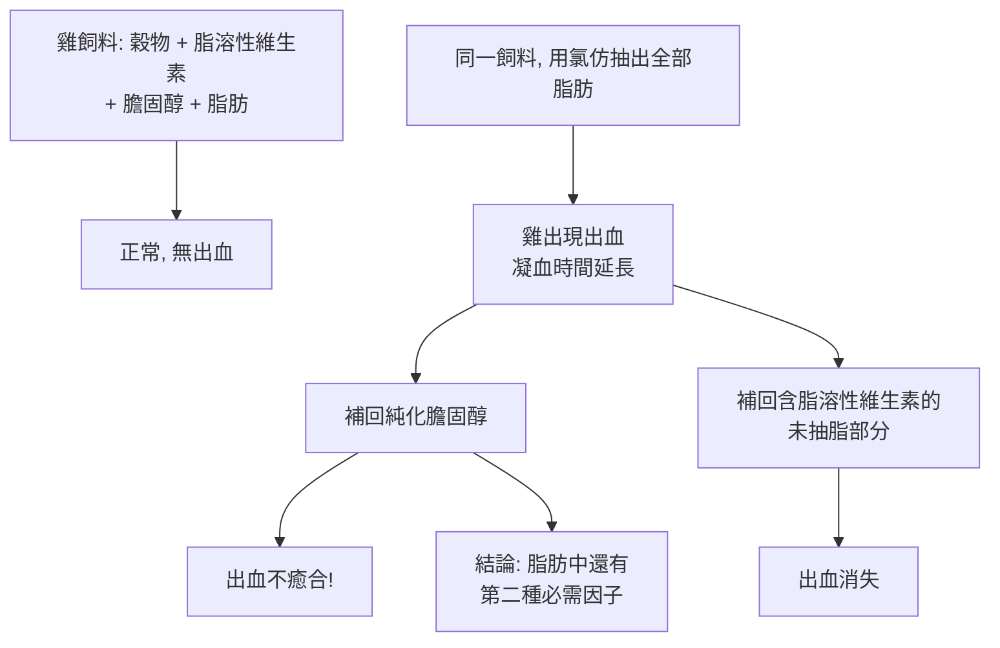

# 1943 · 維生素 K：達姆用「把脂肪抽掉」這一招，抓到凝血的第四個因子

> **1943 諾貝爾生理學或醫學獎**（共享）：卡爾·彼得·亨里克·達姆（Carl Peter Henrik Dam，丹麥）— 表彰「發現維生素 K」；愛德華·阿德爾伯特·多伊西（Edward Adelbert Doisy，美國）— 表彰「發現維生素 K 的化學性質」。

## 懸案（案情提要）

1929 年，維生素 A、B、C 陸續被發現，維生素家族的餐桌上還缺一席。有一類疾病卻一直無法歸因：

**出血不止。** 尤其在**膽道阻塞**的病人身上——他們的膽汁無法進入腸道，糞便顏色變白、維生素吸收全面崩潰，於是出血不止。1920–1930 年代，醫學界已知道「維生素 K 與凝血有關」這個模糊的說法（甚至已經有醫師在手術前給病人注射維生素 K 以降低出血風險），但：

1. 維生素 K 到底是什麼分子？
2. 它如何參與凝血？凝血因子有六個以上，為何偏偏需要它？
3. 缺乏它時，哪一個凝血因子出了問題？

達姆的偵查起手式是一個極其樸素卻致命的實驗設計：**把雞飼料裡的脂肪「抽掉」。**

## 前因

| 年份 | 事件 |
| --- | --- |
| 1909 | 霍爾（H. Holst）與 Frølich 發現飼養豚鼠若缺乏綠葉蔬菜會得壞血病，開啟了維生素研究的動物模型。 |
| 1921 | 霍爾發現豚鼠肝臟有抗壞血酸活性。 |
| 1929 | 達姆在哥本哈根的生理化學研究所（Krogh 門下）開始研究維生素 K。 |
| 1935–1936 | 達姆重做安大略農業學院（Ontario Agricultural College, OAC）McFarlane、Graham 與 Richardson 的實驗：他們發現用**氯仿抽掉脂肪**的雞飼料會造成出血——但當時只把這當作脂肪缺乏的現象。 |
| 1929–1934 | 達姆重做並推進該實驗，證明：即使補回純化的膽固醇，出血**仍不癒合**——說明還有**第二種物質**與膽固醇一同被抽掉了。 |
| 1935 | 荷蘭的 B. C. P. Dam 與 Schmidt 進行維生素 K 的化學研究。 |
| 1936 | 荷蘭的_rw? 荷蘭的 H. W. H. 麥克勒（Mccoll）與同事分離出維生素 $\mathrm{K}_{1}$ ；美國的多伊西分離出維生素 $\mathrm{K}_{2}$ 並確定其結構。 |
| 1937 | 達姆將該因子命名為 **Vitamin K**——「K」取自德文 **Koagulationsvitamin（凝血維生素）**。 |
| 1939–1942 | 美國的 **Edwards、Doisy** 等完成維生素 K 的分離、化學結構確定與合成。 |
| 1943 | 達姆與多伊西共享諾貝爾生理學或醫學獎（因戰時交通不便，頒獎延至 1944 年）。 |

## 調查

### 第一幕：把脂肪「抽掉」的邪門實驗

達姆重做了 OAC 的實驗，並且加上了一個關鍵的**分割對照**：

E 步是本案的核心推理：**既然補回膽固醇無效，那麼缺少的一定是「隨膽固醇一起被溶劑抽走的、但不是膽固醇本身」的東西**。化學家面前的問題變得非常明確：**這種物質溶於有機溶劑、耐熱、與膽固醇共沉澱，但化學上不同於膽固醇。**

### 第二幕：追蹤那個「跟著走的東西」

達姆用一系列化學操作逐步追蹤活性物質：

1. 用**皂化**（鹼水解）破壞脂質 —— 活性仍保留；
2. 用**酸化**析出脂肪酸 —— 活性仍留在非皂化部分；
3. 用**色層分析**分離非皂化部分 —— 活性集中於數條黃色色帶；
4. **活性帶經光照後失效**——這是第一個重大線索：**該物質是光敏的**。

第 4 步極為關鍵：**維生素 K 對光敏感**。這把檢索範圍縮小到具有特定吸收光譜與光敏性的天然產物——最終指向**萘醌（naphthoquinone）類**結構。1930–1934 年荷蘭與美國的化學家完成結構確定：維生素 $\mathrm{K}_{1}$ 為 **2-甲基-3-植基-1,4-萘醌（phylloquinone）**， $\mathrm{K}_{2}$ 為**阿托醌（menaquinone）**（由腸道細菌合成）。

### 第三幕：凝血因子問題的破解

維生素 K 結構確定後，最後一塊拼圖是：**它到底作用在哪個凝血因子上？** 這要等到 1950–1970 年代的凝血因子命名與免疫學研究才完成（見 [1962-DNA 雙螺旋](1962-DNA雙螺旋.md) 時代的蛋白質研究方法），答案是：

- 維生素 K 是**維生素 K 依賴性 γ-羧化酶**的輔因子；
- 它參與凝血因子 **II（凝血酶原）、VII、IX、X 與蛋白質 C、S 的 γ-羧化反應：

  $$\text{Glu{-}X} + \mathrm{CO_2} + \mathrm{O_2} + \text{Vit K (H)} \xrightarrow{\text{GGCX}} \text{Gla{-}X} + \text{Vit K (ox)}$$

- **γ-羧化**使穀氨酸側鏈多出一個羧基，使其能鈣離子螯合，進而結合磷脂表面（磷脂依賴性凝血因子需要 $\mathrm{Ca}^{2+}$ 結合磷脂）。

因此，缺乏維生素 K 時，**凝血因子 II、VII、IX、X 無法被羧化而失活**，凝血 cascade 中斷——這正是出血的分子機制。

### 第四幕：維生素 K 與抗生素的戰時奇蹟

1940 年代，維生素 K 的發現遇上磺胺藥的普及，產生了戰時醫學的一則插曲：病人在使用**磺胺藥**後出現出血（因磺胺抑制腸道細菌合成維生素 K），於是維生素 K 成為術前常规用藥。另一個關鍵發現是：**維生素 K 是某些肝臟疾病中凝血障礙的關鍵**——直到 1930 年代，維生素 K 才被用於肝功能不全的病人，開啟了肝病的營養支持治療。

## 理論裁決

1. **凝血的級聯模型**：凝血是一條級聯酵素反應，維生素 K 作用在「多個因子的共同成熟步驟」上：

   $$\text{因子 X（未成熟）} \xrightarrow{\text{維生素 K + 酵素}} \text{因子 Xa（活性）}$$

   這解釋了為何缺乏維生素 K 時會**同時**影響多個因子（凝血酶原時間 PT 延長最明顯），而非只影響單一因子。

2. **維生素 K 循環（Warburg cycle）**：維生素 K 在反應中由還原型（維生素 K hydroquinone）被氧化成環氧化物（VK epoxide），再由**維生素 K 環氧化物還原酶（VKORC1）**還原回來——這是一個獨立的循環，與電子傳遞鏈無關：

   $$\text{VK (醌型)} \xrightarrow{\text{GGCX}} \text{VK (環氧化物)} \xrightarrow{\text{VKORC1}} \text{VK (氫醌型)}$$

   **這條循環正是「華法林（warfarin）」的作用靶點**——華法林抑制 VKORC1，使維生素 K 無法再生，凝血因子無法羧化。抗凝藥的開發（1940–1950 年代）源自 1940 年代牛的內出血疫情（見下方「追查支線」）。

3. **脂質運輸的教訓**：維生素 K 是脂溶性的，必須靠**膽鹽**（膽汁酸）在腸道中形成微膠粒才能被吸收——這解釋了為何**膽道阻塞病人會出血**（膽汁無法進入腸道 → 維生素 K 無法吸收），也解釋了為何維生素 K 必須**注射**而非口服給藥。這一「吸收—疾病」的因果鏈，是消化與凝血交叉的經典案例。

4. **光敏性的生物學**：維生素 K 對光敏感，這在實際臨床上有直接後果——**新生兒黃疸**（維生素 K 不足）與「光照治療」黃疸（phototherapy for neonatal jaundice）會互相干擾：光療會加速維生素 K 的降解，因此光療中的新生兒需額外補充維生素 K。

## 追查支線（未結之謎）

- **「甜苜蓿病（Sweet Clover Disease）」**：1920 年代末，美國與加拿大的畜牧業發現，餵食發霉的苜蓿（甜苜蓿）的牛會莫名出血不止。1940 年代的追查終於揭曉：發霉苜蓿中含有 **4-hydroxycoumarin**，正是**華法林（warfarin）**的前體。今日華法林是全球使用最廣的口服抗凝藥之一，這樁「牛的出血疫情」因此成為人類抗凝治療的起點；
- **維生素 K 的發現曾是諾獎史上被拖延的案例之一**——因二戰交通受阻，1943 年獎項直到 1944 年 10 月才頒發；
- 達姆是在 Krogh 的生理化學研究所受訓的，他與 [1920-毛細血管調節](1920-毛細血管調節.md) 的得主同門——哥本哈根生理學派在 20 世紀前半葉的黃金傳統；
- 新生兒出血症（hemorrhagic disease of the newborn）的預防（出生時注射維生素 K）是全球新生兒照護的標準措施，源於 1950–1960 年代的觀察；
- 今日對維生素 K 的爭議（是否應在每一位新生兒身上施打）仍在部分國家進行，這是本案最直接的當代政策辯論。

## 證物與數據（偵查卷宗摘錄）

| 證物 | 數值／內容 | 偵查意義 |
| --- | --- | --- |
| 氯仿抽脂飼料 | 雞出血、凝血時間延長 | 案發現場 |
| 補回膽固醇 | 出血不癒合 | 排除脂肪缺乏，鎖定第二因子 |
| 補回未抽脂部分 | 出血消失 | 因子在脂質部分 |
| 皂化與酸化 | 活性保留於非皂化部分 | 排除脂質本身 |
| 色層分析 | 活性集中於黃色色帶 | 化學富集 |
| 光照失效 | 對光敏感 | 指向萘醌類結構 |
| 結構（1934–36） | $\mathrm{K}_{1}$ = 2-甲基-3-植基-1,4-萘醌 | 化學身分確定 |
| 「K」之命名 | Koagulationsvitamin（德文） | 名稱由來 |
| γ-羧化反應 | Glu-X → Gla-X（需 Vit K、 $\mathrm{CO}_{2}$ 、 $\mathrm{O}_{2}$ ） | 凝血機制 |

## 後果

| 領域 | 影響 |
| --- | --- |
| 凝血生理學 | 維生素 K 依賴性凝血因子（II、VII、IX、X、C、S）的發現，確立了凝血的多因子模型。 |
| 臨床 | 肝膽疾病與新生兒出血的預防；術前維生素 K 給藥成為常规。 |
| 藥理學 | 華法林與維生素 K 拮抗劑（維生素 $\mathrm{K}_{1}$ 製劑）成為抗凝治療的兩極；口服抗凝藥開啟了血栓疾病的長期管理。 |
| 營養學 | 維生素家族補齊最後一塊（K、A、B、C、D 之後）。 |
| 其他諾獎 | 與 [1929-維生素](1929-維生素.md)、[1943](1943-維生素K.md) 同屬維生素系列，並為 1960 年代凝血因子研究鋪路。 |

## 關聯

- [1929-維生素](1929-維生素.md) — 維生素家族的母案。
- [1931-呼吸酶](1931-呼吸酶.md) — 同門的 Krogh 學派傳統；生物催化的氧化還原原理。
- [1943](1943-維生素K.md) — 本篇索引。
- [1962-DNA 雙螺旋](1962-DNA雙螺旋.md) — 凝血因子結構研究工具的源頭。
- [1909-甲狀腺外科](1909-甲狀腺外科.md) — 維生素與外科病人管理的另一條線。
