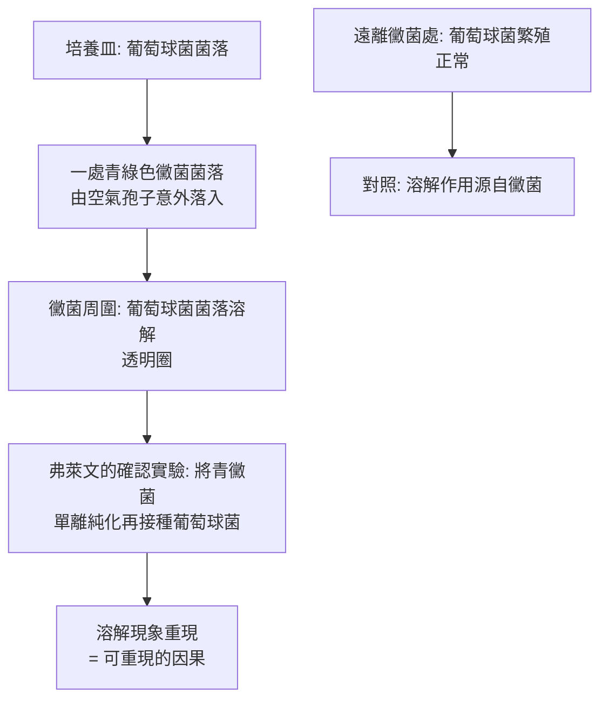

# 1945 · 青黴素：弗萊明的「汙點」如何變成人類史上最有效的藥

> **1945 諾貝爾生理學 or 醫學獎**（共享三人）：亞歷山大·弗萊明爵士（Sir Alexander Fleming，英國）— 表彰「發現青黴素及其對各種傳染病的療效」；恩斯特·伯利斯·柴恩（Sir Ernst Boris Chain，英國／德國出生）與霍華德·瓦爾特·弗洛里爵士（Sir Howard Walter Florey，澳洲）— 同上。

## 懸案（案情提要）

1928 年 9 月，倫敦聖瑪麗醫院（St Mary's Hospital）的微生物實驗室裡，蘇格蘭醫師亞歷山大·弗萊明正在研究**葡萄球菌**。他注意到一個汙點：

在培養皿上，有一團青綠色的黴菌（*Penicillium*）污染了金黃色葡萄球菌的菌落——**黴菌周圍的葡萄球菌被溶解了**。而沒有黴菌的區域，葡萄球菌繁殖旺盛。

這是史上第一樁「細菌被另一種微生物殺死」的觀察——**抗生素時代的第一份物證**。

但弗萊明隨即做了兩個讓這樁發現**沉睡了十年**的決定：

1. 他無法穩定培養這種黴菌（無法量產）；
2. 他在 1929 年發表論文後不久就**轉向溶菌酶（lysozyme）**的研究，把青黴素擱置。

於是案子轉交給了另一群人：**牛津大學的弗洛里與柴恩**（與 Norman Heatley 合作），他們在 1938–1945 年間把青黴素從一個「汙點」變成**能救人命的藥物**。

## 前因

| 年份 | 事件 |
| --- | --- |
| 1877 | Louis Pasteur 證明空氣中的微生物可致疾病，「病原說」的全面勝利。 |
| 1922 | 弗萊明發現**溶菌酶（lysozyme）**：他的鼻腔分泌物能溶解細菌，他並以「溶菌素」發表（見下）。 |
| 1928 年 9 月 | 弗萊明在聖瑪麗醫院發現青黴菌株（後命名 *Penicillium rubens*）能溶解葡萄球菌；1929 年發表。 |
| 1935 | 柴恩（來自納粹德國的猶太裔化學家）逃離德國抵達英國，被牛津的弗洛里聘為研究助理；二人組成團隊。 |
| 1938–1939 | 弗洛里、柴恩與 Norman Heatley 系統研究青黴菌的**液體培養與萃取**，取得初步的粗製青黴素（「 penicillin broth」）。 |
| 1940 年 | 柴恩在老鼠身上證明青黴素對肺炎鏈球菌有效。 |
| 1941 年 5 月 | 弗洛里在牛津 **Radcliffe 觀察病院** 治療一名被葡萄球菌與鏈球菌混合感染、瀕死的警察 Albert Alexander——他確實好转，但因產量不足，數月後仍去世。 |
| 1941 年 10 月 | 弗洛里在倫敦的瓦roxford 與 St Mary's 發表首篇臨床報告。 |
| 1942–1943 | 美國的 **Florey 團隊與美國製藥業界**（Pfizer、Merck 等）大規模量產；沃森（Watson）與布蘭寧（Brunning）等在美國進行臨床試驗。 |
| 1943 年 5 月 | 紐約一場私人晚宴上，一位醫師以長尾小龍蝦燉湯慶祝「青黴素問世」，在座 12 人中有 11 人當夜死亡——這是耐藥菌株的殘酷預警。 |
| 1944 年 3 月 | 諾貝爾委員會決定頒獎予弗萊明、柴恩與弗洛里，**並提議將榮譽頒給弗萊明單人**——委員會認為柴恩與弗洛里「只是把弗萊明的發現做成藥」，且批評他們**未分享獎金**。 |
| 1945 年 12 月 | 柴恩與弗洛里致函委員會指出上述批評「不符合事實」，並指出美國的量產工作正是靠他們的方法才得以展開；委員會最終改為**三人共享**。 |
| 1945 年 | 戰爭結束；青黴素成為戰後醫療的支柱。 |

## 調查

### 第一幕：弗萊明的菌株與「汙點」的嚴謹

弗萊明的關鍵貢獻不只在於「看到汙點」，而在於**他做了對照**：

這一步——**把污染轉化為可重現的實驗**——正是科學偵查的關鍵。1929 年，弗萊明甚至在《實驗室報告》發表《關於青黴菌對細菌生長的影響：特別是對化膿性細菌的溶解作用》。

### 第二幕：弗萊明為何無法量產

弗萊明的難題是技術性的：

1. **產量極低**：他使用的是固體培養基表面的黴菌，萃取效率低；
2. **培養不穩定**：菌株在反覆移植中容易喪失產孢能力；
3. **提煉困難**：青黴素在水中極難溶，且**極不穩定**（酸、溫度、酵素皆可破壞它）。

弗萊本的實際貢獻是**提供了菌株**——正是這株 *Penicillium rubens*（後來稱為「弗萊明菌株」）成為後來所有工業量產的起點。

### 第三幕：弗洛里與柴恩的突破——「液體培養 + 冷凍乾燥」

牛津團隊的關鍵改進有三：

1. **液體培養**（用含葡萄糖與酪蛋白水解物的培養基）取代固體培養，讓黴菌在液體中大量生長，製得**粗製青黴素液**；
2. **萃取流程**：以乙醚或氯仿從水相萃取出青黴素（利用其脂溶性），再以**鹼水（pH 6 的碳酸氫鈉）反萃取**——這是現代萃取技術的原型；
3. **冷凍乾燥**（Heatley 的貢獻）：將Extract濃縮並冷凍乾燥，使**穩定存放在瓶中成為可能**，不必在製得的當天使用。

柴恩更在 1940 年以**小鼠**做實驗，證明青黴素對肺炎鏈球菌感染有效——這是藥物治療的第一份動物證據。

### 第四幕：臨床驗證與「第一個病人」

1941 年 5 月，牛津 Radcliffe 觀察病院的警察 Albert Alexander 面部感染化膿（葡萄球菌 + 鏈球菌），傷口已擴散至全身，並繼發骨與骨髓感染。弗洛里每天以 **300 單位**的青黴素（早期製劑含量極低，後來達到每天 1,200 單位）給他注射，病人奇蹟般好轉，但因產量不足、無法持續，最終因感染復發而死亡。

同年 10 月，Florey 與 Chain 在《Clinical Science》發表首篇臨床報告——**在藥物史上，這是「藥」正式誕生的一刻**。

### 第五幕：戰爭工業與「科學—工業」協作

美國的量產由 Florey 團隊的**方法**與美國產業的**能力**共同完成：Florey 與 Heatley 於 1942 年抵達美國，他們在華盛頓的**戰時生產委員會（War Production Board）**遊說各大藥廠，最後由 Pfizer（後來以 penicillin 的成功改變了公司的命運）、Merck、Squibb 等公司以深槽發酵罐大量生產，並解決了**凍乾製劑**的技術問題。1943–1945 年間，美國生產的青黴素足以覆蓋盟軍傷員。

這段歷史開創了今天「**大學—產業—政府**」三方協作的生物製藥模式，也是現代 mRNA 疫苗（見 [2023-mRNA 疫苗](2023-mRNA疫苗.md)）與基因治療產業的先聲。

### 第六幕：諾貝爾委員會的「歸屬風波」

1944 年的初版決議是一樁科學史上的著名插曲：

- 委員會認為：**弗萊明單獨獲獎**，理由是「他的發現構成了整個研究工作的基礎」；
- 委員會對柴恩與弗洛里的批評有兩條：一是他們「只是把弗萊明的發現轉化為可用的藥物」，二是**他們未把獎金分給弗萊明**。

柴恩與弗洛里在 1945 年 10 月的致函中逐條反駁，強調**量產方法正是他們開發、並且拯救了數百萬條生命**。委員會最終於 1945 年 12 月 10 日改為三人共享獎金。這樁「委員會差點讓真正的功臣落空」的案例，是諾獎史上文件最豐富的一段。

## 理論裁決

1. **抗生素的作用機制（1940–1950 年代逐步破解）**：青黴素抑制**轉肽酶（transpeptidase，PBP）**，阻斷細菌細胞壁肽聚醣的交聯：

   $$\text{肽聚醣前驅物} \xrightarrow{\text{轉肽酶}} \text{交聯肽聚醣}$$

   青黴素與轉肽酶的活性位形成**不可逆的共價醯基—酵素複合物**（D-丙氨酸-D-丙氨酸的模擬物），使細菌無法合成細胞壁，在生長中**溶解**（bacteriolysis）。這解釋了為何青黴素對**正在分裂的細菌**最有效（對靜止菌無效），也解釋了為何它對**革蘭氏陽性菌**（外層無外膜屏障）特別有效。

2. **選擇性毒性的量化**：以最低抑菌濃度（MIC）與最低殺菌濃度（MBC）量化抗生素效力，並以**血漿蛋白結合率**解釋半衰期：

   $$f_{\text{free}} = 1 - f_{\text{bound}}, \qquad \text{有效濃度} \propto f_{\text{free}}$$

   這套藥動學語言至今仍是抗生素處方的核心。

3. **半合成青黴素的數學**：6-APA（6-氨青黴烷酸）核心的發現，使藥化學家能「嫁接」不同的側鏈——這開啟了**半合成抗生素**的龐大家族（甲氧西林、氨苄西林、克拉維酸等），並最終導致 1980–2000 年代的「後抗生素時代」耐藥困境。

4. **酵素的競爭性抑制**：青黴素的作用被建模為受質的競爭性抑制（以 D-Ala-D-Ala 競爭），其效力用 $\mathrm{IC}_{50}$ 表述——這是藥理學中「以機制推導藥效」的完整範本。

## 追查支線（未結之謎）

- **弗萊明的落寞**：1945 年 12 月，他在領獎演說中把全部功勞歸給弗洛里與柴恩，說「不是我發現了青黴素，是弗洛里與柴恩發現了它的治療價值」；此後數十年，歷史學者才逐漸修復三人的相對位置；
- **1943 年紐約晚宴的 12 人**：這是耐藥菌株與社區傳播的最早警示，也預告了今日的 MRSA 與抗生素管理（antimicrobial stewardship）；
- **弗萊明 1922 年的溶菌酶發現**才是他真正的第一項重大發現——溶菌酶是「抗生素之前」的抗生素，也是 1945 年諾貝爾演說的主題之一；
- **青黴素過敏與「無交叉反應青黴素」**的開發，是本案在免疫學上的延伸（見 [1913-過敏反應](1913-過敏反應.md)）；
- 今日的抗生素管線危機（新型抗生素研發不足）被視為「弗萊明—弗洛里時刻」的終結：1945–1970 年的黃金期後，新抗生素的產出急劇下降。

## 證物與數據（偵查卷宗摘錄）

| 證物 | 數值／內容 | 偵查意義 |
| --- | --- | --- |
| 葡萄球菌培養皿 | 青黴菌周圍的溶解圈 | 抗生素時代的第一份物證 |
| 菌株 | *Penicillium rubens*（弗萊明菌株） | 所有工業量產的起點 |
| 純化再接種實驗 | 溶解現象可重現 | 由汙點轉為因果 |
| 液體培養 + 乙醚萃取 | 粗製青黴素 | 工業方法的雛形 |
| 冷凍乾燥（Heatley） | 製劑可穩定存放 | 製劑科學的關鍵 |
| 1940 動物實驗 | 小鼠肺炎鏈球菌感染被抑制 | 藥效的第一份證據 |
| 1941 病人 Albert Alexander | 首例臨床治療，短暫好轉後死亡 | 臨床試驗的第一課：產量就是生命 |
| 1944 委員會初版決議 | 擬僅頒弗萊明 | 歸屬風波 |
| 1945 致函 | 柴恩與弗洛里逐條反駁 | 改為三人共享 |
| 機制 | 抑制轉肽酶 PBP，阻斷肽聚醣交聯 | 首個完整解明的抗生素機制 |

## 後果

| 領域 | 影響 |
| --- | --- |
| 傳染病學 | 肺炎、腦膜炎、傷寒、淋病等 bacterial 感染的可治化；外科感染控制的革命。 |
| 藥業 | 現代製藥產業的第一個億萬美元產品，也開啟了「大學—產業」合作模式。 |
| 公共衛生 | 抗生素與疫苗、洗手、公共衛生措施並列，是 20 世紀人口學轉折的主因之一。 |
| 醫學倫理 | 「誰該拿獎」的 1944–1945 年風波，成為諾獎史與科學獎治理的案例。 |
| 其他諾獎 | 與 [1939-磺胺藥物](1939-磺胺藥物.md)（化療時代的開端）、[1952-鏈黴素](1952-鏈黴素.md)（抗結核）構成抗生素三部曲。 |

## 關聯

- [1939-磺胺藥物](1939-磺胺藥物.md) — 化學治療的門檻已被打開，青黴素是其門內的第一件武器。
- [1952-鏈黴素](1952-鏈黴素.md) — 抗生素譜系的下一站。
- [1913-過敏反應](1913-過敏反應.md) — 青黴素過敏是本案最重要的臨床副產品之一。
- [1905-結核桿菌與柯霍法則](1905-結核桿菌與柯霍法則.md) — 病原偵查方法學的源頭。
- [2023-mRNA 疫苗](2023-mRNA疫苗.md) — 「科學—產業—政府」三方協作模式的現代版。
