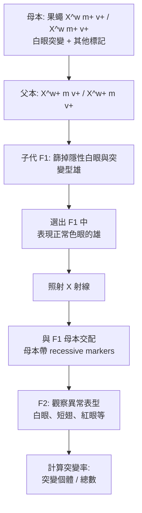

# 1946 · X 射線誘發突變：馬勒讓遺傳變異的產生速度躍升數千倍

> **1946 諾貝爾生理學或醫學獎**：赫爾曼·約瑟夫·馬勒（Hermann Joseph Muller，美國）— 表彰「發現用 X 射線輻射的方法能夠產生突變」（"for the discovery of the production of mutations by means of X-ray irradiation"）。

## 懸案（案情提要）

1930 年代，摩根的果蠅房已經把孟德爾因子定位在染色體上（見 [1933-染色體遺傳](1933-染色體遺傳.md)），但一樁根本的問題浮出水面：

**突變從哪裡來？** 物種的演化需要新的變異來供自然選擇篩選，但人類與果蠅的自發突變率極低——估計每個基因每代約 $10^{-5}\text{–}10^{-6}$ 。要在實驗室裡產生足夠多的突變個體來研究突變的性質、與基因作用，需要一座「**突變工廠**」。

馬勒的問題因此是：**能不能用物理手段，主動、大量地製造突變？**

答案是肯定的，而且他選用的工具是所有人都以為「只是用來拍照」的**X 射線**。

## 前因

| 年份 | 事件 |
| --- | --- |
| 1895 | 倫琴發現 X 射線（見 ../物理學獎/1901-倫琴與X射線.md）。 |
| 1909–1910 | 馬勒在哥倫比亞大學獲得博士學位（師從 Morgan），開始研究突變。 |
| 1922–1923 | 馬勒在歐洲（倫敦、巴黎、柏林）接觸 X 光機與放射性物質，並開始思考「物理射線能否改變遺傳因子」。 |
| 1925–1926 | 馬勒在哥倫比亞完成「**X 射線對果蠅突變率的影響**」的博士論文：果蠅在 X 射線下突變率顯著上升，但因 **Parker 與 Uhlenbeck 的「基因是蛋白質」的理論**占優勢，他未敢公開發表。 |
| 1927 | 摩爾根實驗室（以 Muller 為首的七人，包括 P. A. Lewis、E. N. Castle 等）以**果蠅 × 果蠅的「血友病—白眼」複合 X 染色體突變**為系統，發表系列論文確認 X 射線可大幅提高突變率：**「 Muller effect」**。 |
| 1928 | 馬勒發表《The Production of Mutations by X-ray Irradiation》，確立方法論。 |
| 1930s | 馬勒在莫斯科與歐洲研究病毒與基因；1933–1937 年在蘇聯科學院工作。 |
| 1937–1940 | 馬勒在愛丁堡（愛丁堡大學動物生理學實驗室）工作，並加入「**Delbrück 小組**」——一群研究病毒的物理學家，馬勒在此接触到放射物理的嚴謹方法。 |
| 1940–1945 | 二戰期間馬勒在哥倫比亞與安默斯特；他在 1944 年於《美國遺傳學雜誌》發表〈Malaria and the Atom〉一文，主張原子時代需要遺傳學家的素養。 |
| 1946 | 獲諾貝爾生理學 or 醫學獎。 |

## 調查

### 第一幕：難題——如何在幾十萬隻果蠅裡「認出」突變者

馬勒面對的第一個技術難題是**篩選效率**。突變是罕見事件（即使在 X 射線下，處理後的突變率也僅約百分之一到千分之一量級），因此必須有一套能在海量個體中快速辨認突變者的方法。他設計的是**「特殊基因（specific gene）系統」**：

這套系統的精妙在於：**母本攜帶多個隱性標記**，因此子代一旦出現隱性性狀，就代表父本那條 X 染色體上發生了突變。這是「以遺傳標記反推突變」的經典設計，也是後來**反向遺傳學（reverse genetics）**的雛形。

### 第二幕：劑量—反應曲線——本案的核心數據

馬勒最重要的定量貢獻，是測出**突變率隨 X 射線劑量變化的曲線**。他的實驗顯示：

$$\mu = k\,D^{\,\alpha}$$

其中 $\mu$ 為突變率、 $D$ 為劑量、 $k$ 為比例常數、 $\alpha$ 為指數。馬勒發現 $\alpha$ 大致在 1 與 2 之間——**突變率隨劑量增加而超線性上升**（在低劑量區近似線性，在高劑量區則因「劑量率效應」與細胞殺傷而偏離）。

這條曲線極重要，因為它意味著：

1. **X 射線是有效的突變原（mutagen）**；
2. 劑量可以**定量控制**突變率；
3. 但高劑量同時殺死細胞，因此存在一個**最佳劑量窗口**——這正是今日輻射遺傳學與放射治療中「劑量—突變—殺傷」三重效應的核心。

### 第三幕：X 射線如何改變基因——物理化學的推理

馬勒的機制解釋建立在當時的物理化學上：

1. X 射線能量高，能從原子內殼層打出高速電子；
2. 高能電子沿其軌跡產生**游離輻射（ionizing radiation）**與**次級電子**；
3. 次級電子與 DNA 中的水分子反應，產生**自由基（free radicals）**，特別是羥基自由基 $\mathrm{OH}^{\bullet}$ ：

   $$\mathrm{H_2O} \xrightarrow{\text{radiation}} \mathrm{H_2O^+} + e^- \to \mathrm{OH}^{\bullet} + \mathrm{H}^+$$

4. 自由基攻擊 DNA 鹼基，造成**脫氧核糖—鹼基鍵的斷裂、鹼基的氧化與 DNA 主鏈的斷裂**；
5. 若修復錯誤或修復後留下錯誤配對，即成為**永久的基因突變**（點突變、缺失、倒位、轉位）。

這套「**游離輻射 → 自由基 → DNA 損傷 → 突變**」的因果鏈，構成了 20 世紀的**輻射遺傳學**框架，並在 1980–1990 年代隨 DNA 修補機制（切除修復、光復活、錯配修復）的發現而被完整補上。

### 第四幕：從果蠅到病毒——馬勒的第二場戰役

1936–1947 年，馬勒把輻射突變的技術轉移到**病毒**，特別是噬菌體。他發現：X 射線對噬菌體的殺傷效率呈「**多命中（multi-hit）**」曲線——即一次電離輻射事件不足以殺死噬菌體，需要**多個獨立命中**才致命：

$$\text{存活率} = e^{-\alpha D}\ \text{（單靶）} \quad \text{vs} \quad e^{-\alpha D^n}\ \text{（多靶）}$$

其中 $n$ 即**「靶數（target number）」**，直接反映單一噬菌體中「必須被破壞的獨立關鍵區域」的數目。馬勒由此推論噬菌體內部有**多份基因組拷貝（冗餘）**——這是遺傳學中「多副本（polyploidy）」概念在病毒上的應用，也是 1946 年諾貝爾演說的核心論點之一。

這條線最終通向 1969 年的噬菌體遺傳諾獎（見 [1969-噬菌體遺傳](1969-噬菌體遺傳.md)）——德爾布呂克、盧瑞亞與赫希，正是馬勒在 Delbrück 小組的同僚與後任。

### 第五幕：馬勒在 Delbrück 小組的「遺傳學 vs 物理學」論戰

馬勒回憶錄中記載了 1937–1940 年在愛丁堡與 Delbrück 小組的激烈論戰：**物理學家認為基因是純粹的資訊分子（可用 Schrödinger 方程描述），生物學家則認為基因是蛋白質**。這場論戰最終以分子生物學的答案告終——基因是 DNA（見 [1962-DNA 雙螺旋](1962-DNA雙螺旋.md)）。

## 理論裁決

1. **突變率的劑量律**： $\mu = k D^{\alpha}$ 是輻射遺傳學的基本關係式，也是 Ames 測試（1970s）等**突變檢出法**的理論基礎。
2. **標記基因與反向遺傳學**：馬勒的「以隱性標記反推突變」設計，是今日 CRISPR 篩選與基因功能研究的直系祖先——**先有表型篩選，再回推基因**這條路徑他已走通。
3. **游離輻射的自由基機制**：把 X 射線的生物效應歸因於水分解產生的自由基，使「輻射生物學」有了化學基礎，並在 1950 年代催生「自由基生物學」領域（Fridovich、Stryer 等的 SOD 研究，見 [1976-B肝病毒與庫魯病](1976-B肝病毒與庫魯病.md) 時代的氧化應激研究）。
4. **多靶存活曲線**： $\text{Survival} = e^{-\alpha D^n}$ 的分析成為**放射生物學與輻射防護的標準工具**，也用於化學致癌劑的「多靶模型」分析。
5. **誘變劑的分類**：X 射線（電離輻射）與後來的**亞硝基胍（MNNG）、EMS、紫外線**並列為四大類誘變劑，它們的作用機制分別為鹼基錯配、烷化與形成嘧啶二聚體——這套分類至今仍是遺傳學實驗室的基本知識。

## 追查支線（未結之謎）

- 馬勒是「**和平主義者 + 遺傳學家**」的獨特組合：他在 1946 年獲獎，卻在 1950 年代因反對核試驗與主張和平使用原子能而辭去國家科學院院士職務，並於 1960 年出版《Out of the Nucleus》，主張基因與人類價值同樣不可被政治利用；
- 馬勒的另一樁著名主張是「**太空人（Space Girl）**」——1960 年代他與女兒在《Saturday Evening Post》連載漫畫，主張人類應在太空中繁殖以延續文明，1967 年出版專著；
- 1930 年代的蘇聯時期，馬勒在基因學研究上受到蘇聯「李森科事件」的直接影響——李森科主張遺傳受環境決定、否定基因的存在，而馬勒曾被捲入這場政治科學風暴；
- X 射線誘發突變使「輻射防護」從軍用到民用（醫療 X 光、放射治療、原子能），也催生了「**正當理由（justification）與最優化（optimization）**」的輻射防護原則；
- 馬勒的方法在 1940–1950 年代被用於**哺乳類的誘變育種**（小鼠、綿羊），是「輻射育種」時代的開端。

## 證物與數據（偵查卷宗摘錄）

| 證物 | 數值／內容 | 偵查意義 |
| --- | --- | --- |
| 「Parker–Uhlenbeck 假說」 | 基因是蛋白質（1927 主流） | 馬勒延後發表的理由 |
| Muller effect（1927） | X 射線下突變率大幅上升 | 突變工廠的開端 |
| 特殊基因系統 | 母本多重隱性標記 | 反向遺傳學的雛形 |
| 劑量—反應 | $\mu = k D^{\alpha}$ ， $\alpha \approx 1\text{–} 2$ | 突變可定量控制 |
| 游離輻射 | $\mathrm{H_2O} \to \mathrm{OH}^{\bullet} + \mathrm{H}^+$ | 突變的化學機制 |
| 噬菌體多靶曲線 | $\text{Survival} = e^{-\alpha D^n}$ | 靶數的推算 |
| 1944 〈Malaria and the Atom〉 | 原子時代需要遺傳學素養 | 科學政策的介入 |
| 1960 《Out of the Nucleus》 | 基因不可被政治利用 | 和平主義者的主張 |

## 後果

| 領域 | 影響 |
| --- | --- |
| 遺傳學 | 突變研究從「稀有事件的觀察」變成「可大量生產的實驗材料」。 |
| 分子生物學 | 輻射突變成為基因功能篩選（insertional mutagenesis）的工具，是基因組學時代遺傳學的骨架。 |
| 腫瘤生物學 | 輻射致癌的體外模型（以 X 射線誘發細胞轉化）是致癌研究的核心工具。 |
| 放射生物學 | 存活曲線、靶理論、劑量修正因子成為臨床放射學的基礎。 |
| 公共衛生與和平 | 核試驗 fallout 與遺傳風險的評估，引發 1950–1960 年代的全球遺傳學者反核運動。 |
| 其他諾獎 | 與 [1946](1946-X射線誘發突變.md)（本篇）、[1969-噬菌體遺傳](1969-噬菌體遺傳.md)（Delbrück 小組的後續）、[1956-B肝病毒與庫魯病](1976-B肝病毒與庫魯病.md)（輻射致癌與病毒致癌的比較）構成同一條線。 |

## 關聯

- [1933-染色體遺傳](1933-染色體遺傳.md) — 馬勒的老師摩根的果蠅房，突變研究的舞臺。
- [1969-噬菌體遺傳](1969-噬菌體遺傳.md) — Delbrück 小組的第二場戰役，病毒遺傳學的諾獎。
- [1962-DNA 雙螺旋](1962-DNA雙螺旋.md) — 突變的靶子到底是什麼，最終由分子生物學回答。
- [1983-轉座子](1983-轉座子.md) — 誘變插入的「落點」其實可控——轉座子標記技術。
- [1910-細胞核化學](1910-細胞核化學.md) — 核酸鹼基的化學目錄，是自由基損傷的靶點清單。
