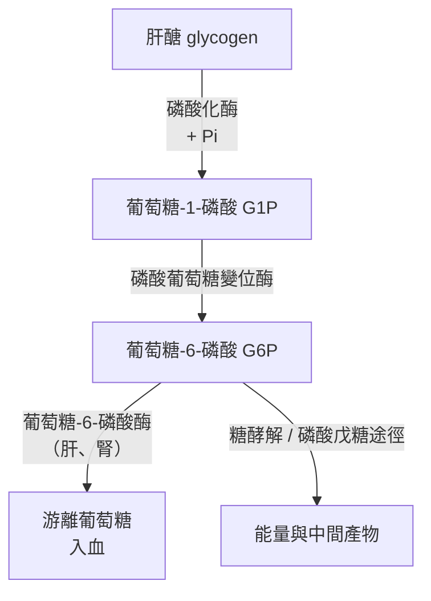
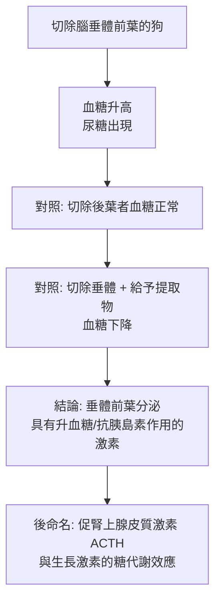

# 1947 · 肝糖的催化轉化與腦垂腺激素：科里夫妇拆開糖原的開關，霍賽證明垂體前葉能製造糖尿病

> **1947 諾貝爾生理學 or 醫學獎**（三人共享，格蒂·科里是史上第一位與丈夫共享諾獎的女性）：卡爾·斐迪南·科里（Carl Ferdinand Cori，美國）與格蒂·特蕾莎·科里（Gerty Theresa Cori，捷克斯洛伐克出生、美國）— 表彰「發現肝糖的催化轉化原因」；貝爾納多·奧賽（Bernardo Houssay，阿根廷）— 表彰「發現腦垂腺前葉激素在糖代謝中的作用」。

## 懸案（案情提要）

1920–1930 年代的糖尿病研究有兩塊拼圖：

**拼圖甲（肝糖是怎麼被分解的？）** 肝醣（glycogen）是身體的「糖倉」，但它是被什麼「拆開」的？當時人們只知道肝醣能被分解成葡萄糖、能量被釋放，卻不知道**催化過程的步驟與酵素**——因為在活體內追蹤化學步驟幾乎不可能。

**拼圖乙（切除垂體的狗為何會得糖尿病？）** 一個反直覺的臨床觀察：**切除腦垂腺的動物，其血糖竟會升高（出現糖尿病）**。而糖尿病在當時的印象是「胰島素不足」造成的——切除胰臟會得糖尿病，為何切除另一個腺體也會？

科里夫妇解答了拼圖甲（**科里循環**），霍賽解答了拼圖乙（**垂體前葉的抗胰島素作用**）。

## 前因

| 年份 | 事件 |
| --- | --- |
| 1857–1860 | Claude Bernard 提出「肝醣」（glycène）概念，並論證肝臟是血糖的來源（1857 年的「穿刺試驗」）。 |
| 1904 | 1904 年，Bernardo Houssay 在阿根廷的布宜諾斯艾利斯，於切除腦垂體的狗身上觀察到高血糖，並證明是**垂體前葉**而非後葉所致。 |
| 1920s | Carl Cori 與 Gerty Cori（1920 年在布拉格相識，1921 年移居美國，1924 年進入華盛頓大學）系統研究肝醣代謝的酵素。 |
| 1927 | 科里夫妇發現**葡萄糖-1-磷酸（glucose-1-phosphate）**在肝醣磷酸化酶作用下由肝醣生成；又發現**磷酸葡萄糖變位酶（phosphoglucomutase）**。 |
| 1929 | 科里夫妇證明**葡萄糖-1-磷酸 → 葡萄糖-6-磷酸**的轉換，並確立這是肝醣分解的關鍵步驟。 |
| 1931 | 科里夫妇報告**尿中出現葡萄糖-1-磷酸（尿磷酸化酶缺失症）**——這是第一个人类**代謝性酵素缺陷病**的發現，開啟了「酵素缺陷病」的醫學。 |
| 1935 | 科里夫妇完成完整的肝醣代謝圖譜，並發現**磷酸（無機磷酸）在肝醣分解中的關鍵角色**。 |
| 1937–1943 | 霍賽在阿根廷持續研究垂體前葉激素（後命名為「生長激素」與「促腎上腺皮質激素 ACTH」）。 |
| 1947 | 三人共享諾貝爾生理學 or 醫學獎（因戰時交通不便，頒獎延至 1948 年）。 |

## 調查

### 第一幕：科里循環的重建

科里夫妇的偵查方法是「**逐步追蹤中間產物**」：在肝臟抽出液中加入不同底物，測定何者被消耗、何者被生成，逐步畫出反應序列。他們的最終圖景是：

這就是**科里循環（Cori cycle）**，是肝醣代謝的核心。而他們的決定性實驗是**磷酸的作用**：發現肝醣分解必須有**無機磷酸**參與，產物是**葡萄糖-1-磷酸**而非游離葡萄糖——這推翻了先前「肝醣直接水解為葡萄糖」的朴素模型，並立刻解釋了一個生理學難題：**肝臟中葡萄糖-6-磷酸不能自行穿過細胞膜**，所以肝醣在肝中分解時必須先轉為游離葡萄糖，而催化這一步的**葡萄糖-6-磷酸酶**是肝臟與腎臟的特異酵素。

### 第二幕：磷酸的「循環催化」——科里循環的另一層

科里夫妇發現，肝醣分解所釋出的**無機磷酸**並未消失，而是被重新用回——因為**葡萄糖-1-磷酸 → 葡萄糖-6-磷酸**的反應把磷酸轉移到了 $6$ 位碳上，之後在糖酵解的**甘油醛-3-磷酸去氫酶**步驟中，磷酸又被交給 ADP 生成 ATP。於是磷酸形成了一個**循環**：

$$\text{G1P} \xrightarrow{\text{變位酶}} \text{G6P} \xrightarrow{\text{糖酵解}} \text{1,3-BPG} \xrightarrow{\text{去氫酶}} \text{3-PG} + \text{ATP}$$

這就是「**科里循環**」這個名字的由來，也是生物體中**無機磷酸再生**機制的第一次系統描繪。

### 第三幕：尿磷酸化酶缺失症——第一個人類酵素缺陷病

1931 年，科里夫妇在檢查一名小女孩的尿液時發現大量**葡萄糖-1-磷酸**，卻幾乎沒有葡萄糖。這位小朋友有**肝醣累積症（von Gierke disease）**：她缺少**葡萄糖-6-磷酸酶**，肝醣無法被釋出為游離葡萄糖，因而在肝臟大量堆積，並因磷酸流失而造成**佝僂病與生長遲緩**。

這樁發現開啟了整個**遺傳性代謝病**的研究領域：**酵素缺陷 → 代謝物堆積 → 疾病**的因果鏈從此確立。1950–1960 年代的「生化遺傳學」（Beadle 與 Tatum 的一基因一酵素學說，見 [1958-一基因一酶](1958-一基因一酶.md)）正是以此為基礎。

### 第四幕：霍賽的「垂體糖尿病」

霍賽的偵查起點是一個反直覺的觀察。已知：

- 切除**胰臟** → 糖尿病（胰島素缺乏）；
- 切除**腦垂體前葉** → **也**出現糖尿病（血糖升高）。

霍賽證明了後者的機制，並以一系列精妙的實驗建立證據鏈：

更關鍵的是他的**「垂體—肝臟」實驗**：把垂體提取物給予正常動物，會引起高血糖；而若**先把肝臟切除**，則升血糖效應消失——證明**垂體激素是透過肝臟（促進肝醣分解與糖質新生）而發揮作用**的。

這樁發現把內分泌學與糖代謝徹底接上了：腦垂腺前葉的「抗胰島素作用」激素，1960 年代被確認為**生長激素（GH）**（生長激素具抗胰島素效應，與胰島素相反），而 ACTH 則經由**皮質醇**間接影響糖代謝。

### 第五幕：霍賽的方法論辯護——「科學需要實驗材料」

霍賽是 20 世紀最傑出的**實驗動物研究方法論**倡導者。1940–1950 年代，醫學界曾流行「以臨床觀察取代實驗」的主張（尤其在「以人為主」的風氣下），霍賽寫下著名的論文〈以生理學研究對抗以臨床觀察〉，主張：

> **醫學的進步取決於能在人體外重複驗證的實驗；每一個治療都必須先在動物身上確立其機制與劑量。**

他的實驗室在布宜諾斯艾利斯培養出數百代的**鼠與狗**實驗族群（著名的「Houssay 種系」），成為全世界生理學研究的標準材料。他主張**不能用實驗室外的偶發觀察**來替代受控實驗——這段論辯至今仍是醫學研究方法論的經典。

## 理論裁決

1. **肝醣代謝的完整圖譜**（科里循環）：

   $$\text{Glycogen}_{n} + \mathrm{P_i} \xrightarrow{\text{phosphorylase}} \text{G1P} \xrightarrow{\text{ phosphoglucomutase}} \text{G6P} \xrightarrow{\text{G6Pase}} \text{Glucose}$$

   這是 20 世紀生物化學最具代表性的一張「反應地圖」，也是肝醣儲積症（I 型 von Gierke、II 型 Pompe、III 型 Cori、IV 型 Andersen）四型的生化基礎。

2. **磷酸的催化循環**：磷酸化酶反應並非單純水解，而是**磷酸解（phosphorolysis）**——切斷的是糖苷鍵，同時把無機磷酸加到產物上。這使磷酸得以在循環中再生，避免了 ATP 的額外消耗，是生物化學中「催化循環」概念的第一個實例。

3. **肝醣的動態平衡**：肝醣的合成與分解是兩個方向相反但共享中間產物（G1P、G6P）的途徑：

   $$\frac{dG}{dt} = k_{\text{synth}}\,[\text{G6P}] - k_{\text{lyst}}\,[G]$$

   這條公式描述了肝醣在空腹與飽食之間的調控，與胰島素／升糖素對肝醣合成的調控（見 [1923-胰島素](1923-胰島素.md)）直接相接。

4. **內分泌的雙向調節**：霍賽證明了「血糖調控不是單向的」——胰島素降糖、垂體激素升糖，兩者共同維持血糖恆定：

   $$\frac{dB}{dt} = R_{\text{liver}}(GH \uparrow, \text{glucagon} \uparrow) - R_{\text{tissue}}(\text{insulin} \uparrow)$$

   這個「雙向天平」的觀念，是今日糖尿病病理生理學（胰島素阻抗 vs 相對缺乏）的源頭。

5. **生化遺傳學的因果律**：科里夫妇的尿磷酸化酶缺失症案例確立了：

   $$\text{基因} \to \text{酵素} \to \text{代謝途徑} \to \text{疾病}$$

   這條四段式因果鏈在 1950–1960 年代由 Beadle、Tatum、Lederberg、Horowitz 系統化（見 [1958-一基因一酶](1958-一基因一酶.md)），是遺傳學與生物化學的合流。

## 追查支線（未結之謎）

- 格蒂·科里是史上第一位與丈夫共享諾貝爾生理學或醫學獎的女性（她於 1947 年獲獎，1948 年正式頒發；1965 年被選入美國科學院第一位女性院士）；
- 霍賽在阿根廷的實驗室長期處於經費不足的邊緣科學環境，卻訓練出大批後來在世界各地擔任要職的生理學家（許多諾獎得主出自他的實驗室網絡）；
- 「生長激素的抗胰島素作用」直到 1960 年代用純化的生長激素才被最終確認，是本案延續了二十年的尾巴；
- 胰島素與生長激素之間的「升糖—降糖」張力，是今日生長激素治療（小兒生長遲緩）需謹慎監測血糖的原因；
- 科里循環與糖尿病的關係，現代已延伸至**代謝綜合症、胰島素阻抗與脂肪肝**的病理機制研究。

## 證物與數據（偵查卷宗摘錄）

| 證物 | 數值／內容 | 偵查意義 |
| --- | --- | --- |
| 葡萄糖-1-磷酸（1927） | 肝醣分解的產物 | 「磷酸解」而非水解 |
| 磷酸葡萄糖變位酶 | G1P ⇌ G6P | 循環的第二步 |
| 葡萄糖-6-磷酸酶 | G6P → 游離葡萄糖 | 肝臟特異，解释不能穿膜 |
| 磷酸再生 | 糖酵解中 1,3-BPG → 3-PG 生成 ATP | 「科里循環」之名由來 |
| 尿磷酸化酶缺失症（1931） | 尿中 G1P 大量堆積 | 第一個人類酵素缺陷病 |
| 垂體切除狗（1904） | 高血糖與尿糖 | 反直覺的關鍵觀察 |
| 垂體前葉 vs 後葉對照 | 前葉致病 | 定位到前葉 |
| 肝臟切除對照 | 升血糖效應消失 | 垂體激素經肝臟作用 |
| Houssay 種系 | 數百代標準實驗動物 | 方法論的制度化 |

## 後果

| 領域 | 影響 |
| --- | --- |
| 生物化學 | 肝醣代謝圖譜與磷酸循環，確立「代謝途徑地圖」的典範。 |
| 遺傳性代謝病 | 肝醣儲積症系列疾病開啟了「分子疾病」的診斷與研究。 |
| 內分泌學 | 腦垂腺前葉激素的升血糖作用，確立垂體—肝臟—胰島素三方關係。 |
| 實驗醫學 | 霍賽確立了實驗動物研究的正當性，是現代實驗醫學的方法論基礎。 |
| 其他諾獎 | 與 [1958-一基因一酶](1958-一基因一酶.md)、[1923-胰島素](1923-胰島素.md)、[1950-腎上腺皮質激素](1950-腎上腺皮質激素.md) 同屬代謝與內分泌主線。 |

## 關聯

- [1923-胰島素](1923-胰島素.md) — 降血糖的另一側力量；兩者構成血糖的雙向天平。
- [1922-肌肉產熱與糖酵解](1922-肌肉產熱與糖酵解.md) — 糖酵解的下游，與磷酸循環直接相接。
- [1958-一基因一酶](1958-一基因一酶.md) — 科里夫妇的酵素缺陷病發現是這條理論的直接前史。
- [1950-腎上腺皮質激素](1950-腎上腺皮質激素.md) — 垂體—腎上腺軸與糖代謝。
- [1953-檸檬酸循環](1953-檸檬酸循環.md) — 糖代謝的另一個核心循環。
