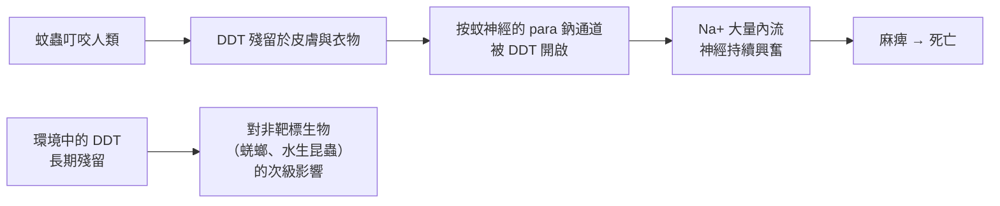

# 1948 · DDT：穆勒把蚊蟲與壁蝨送上戰場，也把一個警世故事留在 20 世紀

> **1948 諾貝爾生理學 or 醫學獎**：保羅·赫爾曼·穆勒（Paul Hermann Müller，瑞士）— 表彰「發現 DDT 是一種高效殺死多類節肢動物的接觸性毒藥」（"for his discovery of the high efficiency of DDT as a contact poison against several arthropods"）。

## 懸案（案情提要）

1930 年代，兩場戰爭同時席捲世界：歐洲的戰爭與全球的**昆蟲戰爭**。第二戰爭的戰場條件讓傳染病的威脅急遽上升：

1. **瘧疾**：美軍在緬甸、爪哇與新幾內亞的戰役中，感染率極高——1943 年南太平洋戰役中，某些部隊的瘧疾發病率達到每千人每日數十人；
2. **斑疹傷寒**：戰俘營與戰場的爆發（見 [1928-斑疹傷寒與體蝨](1928-斑疹傷寒與體蝨.md)）；
3. **_typhus_ 與戰壕裡的恙蟲、蜱**；
4. 傳統的殺蟲劑——**砷製劑、硫磺、尼古丁**——毒性對人畜太大、施用量太大，無法大規模使用。

**殺蟲劑**必須同時滿足：對昆蟲高效、對溫血動物低毒、能殘留在環境中長期有效、能大規模低成本生產。

1939 年，穆勒在瑞士 Basel 的 Geigy 公司實驗室裡篩選了 **約 5000 種化合物**，終於找到二氯二苯三氯乙烷（DDT）。

## 前因

| 年份 | 事件 |
| --- | --- |
| 1874 | 化學家 Othmar Zeidler 首次合成 DDT，但未發現其殺蟲作用。 |
| 1930s | 瑞士 Basel 的 J. R. Geigy 公司大量合成 DDT 作為殺蟲劑原料（如「Gesarol」）。 |
| 1939 年 9 月 | 穆勒在實驗室首次發現 DDT 對**家蠅**具有強烈殺蟲作用；1939 年底在 Basel 召開的**第二屆國際昆蟲學會議**上報告。 |
| 1940 | 穆勒發表完整的殺蟲作用研究，並申請瑞士專利。 |
| 1941–1942 | 穆勒以 DDT 對抗**斑疹傷寒與瘧疾**的實地試驗（瑞士 Basel 的實驗室人員與義大利的軍隊）取得重大成功。 |
| 1942 | 杜邦公司（DuPont）取得美國生產許可；美國War Production Board 開始大量生產。 |
| 1942–1943 | 加州大學的實驗室（以 Dr. Fred Snyder 為主持人）完成 DDT 對**牛虻（ cattle grub）**的控制試驗，死亡率從 60% 降到極低——這是決定性的田間數據。 |
| 1943–1944 | 義大利軍隊與美軍在南義大利以飛機撒播 DDT 粉，成功控制當地斑疹傷寒疫情——**二戰中 DDT 最著名的戰役**。 |
| 1945 年後 | DDT 大量進入農業（殺蟲劑）與公共衛生（滅蚊、滅蝨）。 |
| 1948 | 穆勒獲諾貝爾生理學或醫學獎。 |
| 1950s–1960s | 滴滴涕（DDT）帶來的震撼：1962 年 **Rachel Carson 的《寂靜的春天》**引發公眾與政治轉向；1970 年美國禁用 DDT 農業用途；1980 年瑞典解散。 |
| 2021 | 世界衛生組織（WHO）重新將 DDT 列入「WHO 推薦用於病媒害蟲控制的殺蟲劑」名單（室內噴灑，防治瘧疾與登革熱），並對其環境風險做出限定——這是科學評估與政策演變的又一次轉折。 |

## 調查

### 第一幕：五千種化合物的篩選

穆勒的方法極為系統：他的篩選標準包括**對家蠅的殺蟲率、對哺乳動物的急性毒性、化學穩定性（抗光、抗熱）、在環境與動物體內的殘留能力、以及能否低成本量產**。DDT 在所有維度上都表現優異——這是一種**結構—活性關係**上的驚喜：

$$\text{DDT} = \mathrm{Cl}_2\mathrm{C{-}CCl}_2(p\text{-}Cl\text{-}C}_6\mathrm{H}_4)_2$$

其殺蟲機制（1940 年代後被闡明）是**神經毒**：DDT 會打開昆蟲神經細胞膜上由「DDT 敏感性鈉通道（*para* 鈉通道）」所形成的電壓門控通道，使鈉離子大量內流、造成神經持續興奮與癱瘓（extension palsy）。這解釋了 DDT 為何主要殺死昆蟲而對哺乳動物毒性較低——**昆蟲的鈉通道對 DDT 敏感度遠高於哺乳動物**，這正是「選擇性毒性」在分子層面的基礎（對比 [1939-磺胺藥物](1939-磺胺藥物.md) 的代謝途徑差異、與 Ehrlich 的側鏈理論，見 [1908-免疫雙雄](1908-免疫雙雄.md)）。

### 第二幕：斑疹傷寒的戰場實驗

這是 DDT 最具戲劇性的一役。1943–1944 年，盟軍在南義大利的卡塞塔（Cassino）與周邊城鎮面臨斑疹傷寒疫情。義大利醫師使用 DDT 粉撒在軍營、衣物與營帳上，結果：

- 未撒 DDT 的地區疫情持續；
- 撒 DDT 的地區疫情迅速熄滅。

這種「**消滅媒介 → 切斷傳播**」的邏輯，正是 1902 年羅斯建立的公共衛生模式（見 [1902-瘧疾傳播鏈](1902-瘧疾傳播鏈.md)）在二戰的實戰應用。

### 第三幕：牛虻實驗——田間數據的決定性

加州大學的試驗提供了 DDT 最乾淨的田間證據：

| 組別 | 處理 | 牛虻死亡率 |
| --- | --- | --- |
| 對照 | 未處理 | 約 60%（因牛皮叮咬與疾病） |
| 實驗組 A | DDT 撒布於牛隻 | 近乎 0% |
| 實驗組 B | 環境處理（畜舍、糞便） | 部分下降 |

這證明 DDT 兼具**體表殺蟲**與**環境持效性**，並且成本極低——這是它能被全球推廣的根本原因。

### 第四幕：瘧疾的室內噴灑（1940s–1960s）

WHO 於 1950 年代在印度、非洲與南亞推行「**室內殘效噴灑（IRS）**」，以 DDT 噴灑住屋牆壁，使蚊子停棲時中毒。效果極為顯著——**印度的瘧疾病例數從每年數千萬降至 1960 年代的數萬**，WHO 因此在 1960 年代一度認為「瘧疾是可以被消滅的疾病」。

這段歷史有一個殘酷的註腳：**斯里蘭卡（錫蘭）在 1950–1960 年代推廣 DDT 室內噴灘後，瘧疾患病率驟降至接近零，蚊媒抗藥性卻在不知不覺中累積**；1960 年代末蚊子完全抗藥，1969 年斯里蘭卡發生**大流行**，1970–1971 年的發病數超過 1000 萬，1972 年更達 1200 萬——**比推行 DDT 之前更嚴重**。這是「**逐級加藥（escalating insecticide use）**」模式的經典悲劇。

### 第五幕：穆勒的科學論述與其侷限

穆勒在 1946 年的諾貝爾演講〈對蚊蟲的控制〉中，把 DDT 定位為「**能帶來數千萬人命死亡的疾病的消滅工具**」，並主張用它來「控制非洲的瘧疾」。他的樂觀，部分基於對化學品安全性的信念——這在當時是主流，但也是他個人論述中最薄弱的一環。

## 理論裁決

1. **選擇性毒性的離子機制**：DDT 作用於昆蟲神經的電壓門控鈉通道：

   $$g_{\mathrm{Na}} \uparrow \Rightarrow I_{\mathrm{Na}} \uparrow \Rightarrow V_m \text{ 去極化不復位} \Rightarrow \text{神經癱瘓}$$

   昆蟲與哺乳動物鈉通道的序列差異（幾個胺基酸之差）造就了數百倍的敏感性差異——這是 20 世紀末「節肢動物抗藥性」的分子基礎。

2. **環境半衰期與持久性的數學**：DDT 的環境行為可用一階衰減描述：

   $$\frac{dC}{dt} = -k C, \qquad C(t) = C_0 e^{-kt}$$

   它的持久性（半衰期以年計）、**脂溶性**（在脂肪組織中累積，濃度可為環境的數十萬倍）與**食物鏈放大（生物放大作用，biomagnification）**共同構成其全球污染的物理化學基礎：

   $$C_{\text{top predator}} \approx C_{\text{water}} \prod_{i} \frac{BAF_i}{...}$$

   這條食物鏈放大鏈，終結於 1972 年美國禁止 DDT 農業使用。

3. **媒介控制的最優策略**：從瘧疾防控的數學可導出一個關鍵洞見——**只有在「傳播閾值低於噴灑效果」且「蚊媒未產生抗藥性」的條件下，室內噴灘才有效**；一旦抗藥性使有效傳播係數 $a$ 上升， $R_0$ 重新超過 1，疫情就會爆發（見 [1902-瘧疾傳播鏈](1902-瘧疾傳播鏈.md) 的 Ross 模型）。這解釋了為何「除蟲劑輪替使用 + 疫苗 + 早期治療」的整合策略才是可持續方案。

4. **效應的殘留與族群動態**：DDT 在環境中的長期殘留意味著對蚊媒施加了**持續的選汰壓力**，而 $R_0$ 中 $a$ （叮咬率）隨抗藥性上升，最終使 $\displaystyle R_0 = \frac{m a^2 b c e^{-gn}}{rg}$ 隨 $a$ 上升而急升——**這正是「逐級加藥」的數學破局點**。

## 追查支線（未結之謎）

- **《寂靜的春天》（1962）**由海洋生物學家 Rachel Carson 撰寫，把 DDT 從技術議題推向公眾議題，是 20 世紀最具影響力的科普書之一，直接催生了美國環保署（EPA, 1970）與全球環境運動；
- 1981 年印度、1986 年中國先後宣布禁用 DDT 農業用途；WHO 於 1975 年成立「環境衛生準則」並設定 DDT 的人體每日容許攝入量；
- 2021 年 WHO 重新推薦 DDT 用於「室內殘效噴灑」，並明確限定僅用於病媒害蟲控制、且要求搭配抗藥性管理——這是「風險—效益」框架下的科學政策再平衡；
- 穆勒本人並非狂熱的環境主義反對者，但他在 1940–1950 年代確實低估了持久性污染的長期效應——這是「大科學」時代的普遍盲區；
- 非洲的**DDT 歷史另一面**：WHO 在 1950–1960 年代於多個非洲國家進行的瘧疾噴灘計畫，初期確實大幅降低了死亡率，但同期「抗藥性與耐藥性」議題已在蟲媒控制與公共衛生政策中留下諸多爭議。

## 證物與數據（偵查卷宗摘錄）

| 證物 | 數值／內容 | 偵查意義 |
| --- | --- | --- |
| 篩選規模 | 約 5000 種化合物 | 系統性篩選的典範 |
| 家蠅實驗（1939） | 高效殺蟲 | 首次發現 |
| 化學結構 | $\mathrm{Cl}_2\mathrm{C{-}CCl}_2(p\text{-}Cl\text{-}C}_6\mathrm{H}_4)_2$ | 結構—活性關係 |
| 殺蟲機制 | 開啟 para 鈉通道 | 選擇性毒性的分子解釋 |
| 南義大利（1943–44） | 噴撒 DDT 迅速控制斑疹傷寒 | 二戰最著名的應用 |
| 牛虻田間試驗 | 死亡率 60% → 近 0% | 決定性田間數據 |
| 印度瘧疾（1950s–60s） | 病例由千萬級降至數萬 | WHO 室內噴灘計畫 |
| 斯里蘭卡（1969–72） | 發病數逾 1200 萬 | 抗藥性反噬的悲劇 |
| 《寂靜的春天》（1962） | Carson 的環境警世 | 政策轉向的起點 |
| WHO 2021 | 重新推薦限定使用 DDT | 風險—效益再平衡 |

## 後果

| 領域 | 影響 |
| --- | --- |
| 公共衛生 | 二戰期間斑疹傷寒與瘧疾的控制，使數百萬條生命得救；室內噴灘成為全球瘧疾防治的支柱數十年。 |
| 農業 | DDT 使農藥時代開啟，作物產量大幅提升；同時開啟了環境運動與農藥監管的現代史。 |
| 昆蟲學 | 抗藥性管理成為害蟲防治的核心學科；殺蟲劑輪替與整合防治（IPM）由此發展。 |
| 毒理學 | 「持久性有機污染物（POPs）」概念與《關於POPs的斯德哥爾摩公約》（2001）直接源於 DDT 的歷史。 |
| 其他諾獎 | 與 [1902-瘧疾傳播鏈](1902-瘧疾傳播鏈.md)、[1928-斑疹傷寒與體蝨](1928-斑疹傷寒與體蝨.md) 構成「媒介控制」公共衛生的三部曲。 |

## 關聯

- [1902-瘧疾傳播鏈](1902-瘧疾傳播鏈.md) — 羅斯的媒介控制模型，是 DDT 使用的理論母體。
- [1928-斑疹傷寒與體蝨](1928-斑疹傷寒與體蝨.md) — 尼可爾確立的媒介，DDT 在二戰中最大的戰役對象。
- [1913-過敏反應](1913-過敏反應.md) — 環境暴露與免疫反應的另一面向。
- [1952-鏈黴素](1952-鏈黴素.md) — 同時代「化學對抗生物」的另一條戰線。
- [1945-青黴素](1945-青黴素.md) — 抗生素與殺蟲劑共構 20 世紀的「對抗微生物」時代。
