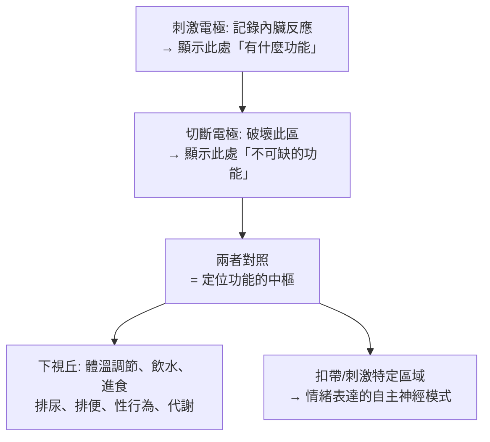

# 1949 · 間腦的協調功能與前腦葉白質切除：赫斯與莫尼斯的兩條路徑

> **1949 諾貝爾生理學 or 醫學獎**（共享）：瓦爾特·魯道夫·赫斯（Walter Rudolf Hess，瑞士）— 表彰「發現間腦的功能性組織對內臟活動的調節功能」；安東尼奧·埃加斯·莫尼斯（António Egas Moniz，葡萄牙）— 表彰「發現前腦葉白質切除術對特定重性精神病患者的治療效果」。

## 懸案（案情提要）

兩樁互不相干卻共享一個年代的案子：

**案子甲（神經內臟調節）**：1930 年代的生理學已知道「下視丘」與體溫、飢餓、性行為、autonomic 活動有關，但這些說法零散、模糊、常帶玄學色彩。到底腦的哪個部分在「指揮」內臟？

**案子乙（精神病的治療）**：精神病是當時最嚴重的社會與醫學問題之一——精神病院擁擠、治療手段有限（氯胺鹼昏迷、胰島素休克、蒙古式休克療法/lobotomy 未成熟）。有沒有辦法**切斷**某些造成病理的回路？

赫斯用**電刺激**找出腦的「指揮官」；莫尼斯用**切斷**來嘗試「關掉」病理回路。兩人都在 1949 年獲獎——但兩條路徑的倫理評價截然不同。

## 前因

| 年份 | 事件 |
| --- | --- |
| 1920s | 瑞士蘇黎世的赫斯在實驗室以「**stimulating electrode（刺激電極）**」探測腦的深部結構——這是一項需要在清醒動物腦內精準定位的技術。 |
| 1927–1930 | 赫斯發展出可同時刺激並記錄內臟功能（呼吸、血壓、瞳孔、排尿、排便）的方法，並發現**下視丘**的多個「中樞」。 |
| 1930s | 赫斯以「**切斷（lesion）**」與「**刺激**」的對照實驗，證明下視丘是「情緒」與「內臟反應」的轉換點。 |
| 1935 | 赫斯在《下視丘與中間腦的機能》（Hypothalamus und Zwischenhirn）中系統提出「**行為的整合功能**」模型。 |
| 1935–1936 | 葡萄牙里斯本的莫尼斯（神經科醫師、桑塔莫尼卡病院院長）與神經外科醫生 **Pedro Almeida Lima** 合作，在清醒病人（先以氯胺酮？實為乙醚與局部麻醉）額葉白質上切斷前額葉的纖維連結，觀察到病人「安靜下來」——但伴隨嚴重的人格與智力損傷。 |
| 1936 | 莫尼斯發表《Zur Psychochirurgie》（論精神外科學），報告 20 例白質切除術。 |
| 1937 | 莫尼斯發明**白質切除術（leucotomy）**並用於精神科，隨後在歐洲與美國廣泛流行（1940 年代估計美國進行逾 2 萬例）。 |
| 1949 | 兩人共享諾貝爾生理學 or 醫學獎；莫尼斯當年已因中風去世（1949 年 12 月 28 日）。 |

## 調查

### 第一幕：赫斯的「刺激—切斷」對照法

赫斯的偵查方法建立在兩個互補的操作上：

這套「刺激 + 損傷」的雙重定位法，正是今日**神經科學定位功能**的標準策略（現代的 fMRI、optogenetics 是其高科技版本）。赫斯在清醒動物身上放置電極，發現：

1. **下視丘前區**：損傷引起**高體溫**與多食；刺激則引起發抖與產熱——即**體溫調節中樞**；
2. **下視丘側區**：損傷引起**厭食與失重**；
3. **下視丘內側**：與**性行為**有關；
4. **扣帶（cingulum bundle）**：刺激引發「鑲嵌式（grooming）」的典型貓科動物行為——這是情緒與行為的自主神經表徵的關鍵發現；
5. **整合的概念**：赫斯提出，下視丘是「**將情緒與內臟反應整合為一個整體行為**」的裝置——這正是「**行為的整合作用**」一詞的來源（他與謝靈頓於 1949 年分別以不同領域的成果共享了諾獎）。

### 第二幕：赫斯的「整體行為」觀

赫斯最具影響力的概念是**「整體行為（Gesamtverhalten）」**概念：動物面對威脅時，**不是**獨立地表現出「瞳孔放大、心跳加快、血糖上升」等零散反應，而是**整個身體協調地切換到一種統一的行為模式**（戰鬥或逃跑），並且這種切換由下視丘統籌。

這是行為科學中「整體行為模式」概念的源頭，後來被廷伯根（Nikolaas Tinbergen）與洛倫茲（Konrad Lorenz）發展為行為組織的層次分析（見 [1973-動物行為](1973-動物行為.md)），並與 1930–1950 年代的「整體行為醫學（psychosomatic medicine）」相互呼應。

### 第三幕：莫尼斯的手術與它的代價

莫尼斯的手術設計極簡：從顱骨上鑽孔後，用一個**白質切除刀（leucotome）**——一個可以旋轉的圓筒狀裝置——插入大腦前額葉，轉動以切斷該區域的白質纖維（而非整塊切除皮質）。他希望切断的是**「額葉—丘腦—扣帶」的過度連結**，因為該回路被認為是「強迫性重複思維」的來源。

他報告的療效是：病人從「無法控制的激動與自傷行為」變為「安靜、順從、缺乏動機」。

**但代價極為沉重**：

- 術後的「情感平淡（abulia）」與「缺乏動機」；
- 嚴重的**人格改變**、情感鈍化；
- 癲癇發生率上升（早期版本高達 20% 以上）；
- 智力與判斷力下降；
- 術後死亡與感染（缺乏無菌技術的年代）。

### 第四幕：轟動一時，隨後退潮

1940–1960 年代，白質切除術在歐美流行至高峰。1950 年代初，美國的 NIMH（美國精神衛生研究所）曾設立「腦外科聯合委員會」以評估此技術；**Freeman Watts** 等人數千例的報告也確實報告了某些「重性精神病（尤其強迫症與慢性精神病）」的顯著改善——例如 1951 年 Freeman 報告 900 例。

然而 1960 年代的轉變極為迅速：

1. **藥理學的勝利**：氯丙嗪（chlorpromazine，1955）、氟哌啶醇等抗精神病藥物上市，對症狀控制更有效且無需切割腦組織；
2. **隨機對照試驗的缺失**：此前的「成功」多為**個案報告與選擇性病例**，缺乏盲法與對照；1960 年代的重新評估顯示，長期追蹤的改善率遠低於當初報告，且功能損害常被低估；
3. **價值的重新評估**：1960–1970 年代，美國的 NIMH 進行了「**Freeman 的病人追蹤研究**」，發現白質切除的長期結果遠不如當初宣稱；
4. **現代的重新評價**：1990 年代的考古與病歷研究顯示，少數如「Dorothea T.」般的病人（Willard 直腸 herniotomy?——實為 Dorothy T. 的腦葉切除後自傳，記錄了清醒而空洞的自我）曾努力為此技術辯護；今天，**前額葉白質切除/前額葉切除**僅在**極少數**難治性、伴嚴重自殺風險的 OCD 患者中作為最後手段使用。

## 理論裁決

1. **下視丘作為「轉換器」**：赫斯的模型可寫成一個資訊流的形式：

   $$\text{環境與身體訊號（輸入）} \xrightarrow{\ \text{下視丘整合}\ } \text{自主神經 + 內分泌 + 行為輸出}$$

   下視丘同時調控交感與副交感、透過腦垂腺調控內分泌、並驅動行為——這使它成為「**神經—內分泌—行為三分身的整合點**」，是今日神經內分泌學的核心架構。

2. **體溫調節的數學模型**：赫斯發現的下視丘體溫中樞，現代被建模為雙迴路的比例控制器：

   $$\dot{T}_{core} = \frac{1}{C}\left(k_1 (T_{set} - T_{core}) - Q_{heat} + Q_{loss}\right)$$

   下視丘前區的「熱中樞」設定 $T_{set}$ ，後區的「冷中樞」抑制產熱；發燒則是把 $T_{set}$ 上調。這套模型至今仍是感染科發熱管理與體溫調節生理學的標準框架（見 [1938-竇與主動脈反射](1938-竇與主動脈反射.md) 的負回饋對照）。

3. **「切除」作為一種因果推論工具**：莫尼斯的方法論價值不容忽視——在無法做活體 MRI 的年代，**以局部損傷製造可觀察的功能缺損**，是神經科學定位功能的黃金手段（這套方法在 20 世紀被擴展為整套「損毀法（lesion method）」，並在 1990 年代與 fMRI、optogenetics 結合）。但其代價是**不可逆**——這正是 20 世紀醫學倫理學的核心教訓。

4. **治療的證據標準**：莫尼斯案的歷史意義，最終在方法論層面遠大於臨床層面。它與 1948 年的**鏈黴素隨機對照試驗**（第一个人类大规模 RCT）構成同一時期的兩極：前者是「無對照的個案經驗被接受為療法」的典型，後者是「受控試驗推翻常規」的典型——兩者的落差，正是 20 世紀醫學從「權威經驗」走向「證據」的轉型縮影。

## 追查支線（未結之謎）

- 莫尼斯在 1949 年獲獎當年因腦溢血去世（他曾自述其父與他自己都曾有中風，並從中研發了血管攝影技術）；他晚年因手術併發症與抑鬱而接受治療；
- 莫尼斯在 1949 年獲獎時已因白質切除術的倫理爭議備受批評，1960 年代後期他甚至呼籲停止使用此術；
- 赫斯的實驗是「腦刺激—內臟反應」的首個系統研究，開啟了 1930–1950 年代的「**刺激腦部研究內臟（brain stimulation of visceral function）**」時代；
- 前額葉—基底核迴路在今日是**強迫症與抑鬱症**的神經迴路模型核心，也是 DBS（深部腦刺激）治療的靶點——赫斯與莫尼斯的方法以另一種形式延續；
- 1949 年的諾獎被史家評為「一個時代的兩面」：同一個諾獎，同時表彰了理解腦的科學方法與改變腦的技術，而兩者的歷史評價截然不同。

## 證物與數據（偵查卷宗摘錄）

| 證物 | 數值／內容 | 偵查意義 |
| --- | --- | --- |
| 刺激電極 + 切斷電極 | 雙重定位法 | 功能定位的標準策略 |
| 下視丘前區 | 損傷→高體溫、多食 | 體溫與能量調節中樞 |
| 下視丘側區 | 損傷→厭食、失重 | 攝食調節 |
| 扣帶刺激 | 引發貓科鑲嵌行為 | 情緒—自主神經整合的證據 |
| 整體行為概念 | 統一行為模式的切換 | 行為科學的重要範式 |
| 白質切除刀 | 旋轉式切斷額葉白質 | 精神外科的器械 |
| 1936 年 20 例報告 | 首次病例系列 | 精神病學的外科嘗試 |
| 1940–60 年代 | 美國逾 2 萬例 | 技術的全盛期 |
| 早期併發症 | 癲癇率可逾 20% | 技術的代價 |
| 1960s 藥理學轉向 | 氯丙嗪等抗精神病藥 | 技術的退場 |

## 後果

| 領域 | 影響 |
| --- | --- |
| 神經生理學 | 下視丘作為內分泌與行為整合中樞的地位確立。 |
| 行為科學 | 整體行為模式成為動物行為學的基本概念，並影響 1973 年諾獎（見 [1973-動物行為](1973-動物行為.md)）。 |
| 精神外科 | 開啟了 1930–1960 年代的「精神外科」時代，也留下最深的一次倫理教訓。 |
| 醫學方法論 | 確立了「以損傷製造功能缺損」的因果推論法，至今仍在神經科學中使用。 |
| 醫學倫理 | 白質切除的興衰是 20 世紀醫學倫理最重要的案例之一。 |
| 其他諾獎 | 與 [1938-竇與主動脈反射](1938-竇與主動脈反射.md) 同屬自主神經生理；與 [1973-動物行為](1973-動物行為.md) 同屬行為科學的源流。 |

## 關聯

- [1938-竇與主動脈反射](1938-竇與主動脈反射.md) — 自主神經系統的另一個反射迴路。
- [1909-甲狀腺外科](1909-甲狀腺外科.md) — 外科手段改變內分泌狀態的早期典範。
- [1973-動物行為](1973-動物行為.md) — 赫斯的整體行為概念的後續譜系。
- [1956-心臟導管術](1956-心臟導管術.md) — 另一種「以侵入性手段獲取內部資訊」的技術。
- [1945-青黴素](1945-青黴素.md) — 同時代「有效治療」的正面案例，可與本案的技術性傷害對照閱讀。
