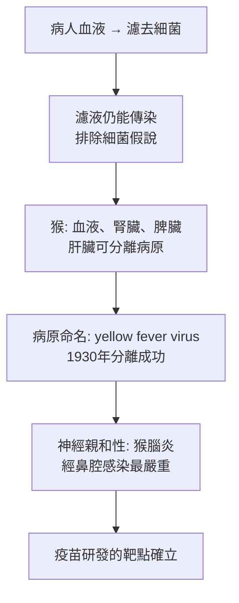

# 1951 · 黃熱病與 17D 疫苗：泰累爾用減毒活疫苗讓「黃熱」不再殺人

> **1951 諾貝爾生理學 or 醫學獎**：馬克斯·泰累爾（Max Theiler，南非）— 表彰「黃熱病及其治療方法上的發現」（"for his discoveries concerning yellow fever and how to combat it"）。

## 懸案（案情提要）

黃熱病（yellow fever）是熱帶美洲最可怕的殺手：一次發病就有 $15\%\text{–}50\%$ 的死亡率，且**死亡率高得離奇**——「黃熱病就是黃昏降臨的死亡」。它沿著**航運路線**擴散：從非洲到美洲（隨奴隸貿易），從加勒比海到紐約（1793 年的費城疫情，費城幾乎癱瘓、美國首都遷至華盛頓）。

疑點：

1. 病原是什麼？為何它對**黃疸、出血（黑熱病）**如此特別？
2. 為何它主要在**熱帶**、且與**水與都市**相關？
3. 媒介是什麼？
4. **最關鍵的**：一種沒有有效治療、死亡率極高的病，能不能做出**安全有效的疫苗**？

泰累爾的答案是：**17D 減毒活疫苗**——第一個人類的減毒活疫苗，也是第一個以**細胞培養**量產的人用疫苗。

## 前因

| 年份 | 事件 |
| --- | --- |
| 1887 | 布魯斯（David Bruce）發現黃熱病的病原可經血液傳播。 |
| 1900 | 瓦格納·盧斯（Carlos Finlay）與胡黃（Reed）與 Agramonte 在古巴證實**蚊子（*Aedes aegypti*）是傳播媒介**——繼 1902 年羅斯破解瘧疾之後的第二樁媒介傳播案（見 [1902-瘧疾傳播鏈](1902-瘧疾傳播鏈.md)）。 |
| 1901 | 瓦格納·盧斯提出病原可能是**細菌**。 |
| 1927 | 紐約的洛克菲勒基金會在非洲（黃熱病高發區）設立研究團隊，由泰累爾主持。 |
| 1927 | 泰累爾以**小鼠腦**培養病毒成功（但這在道德與實務上不可行——需活體腦組織）。 |
| 1930 | 泰累爾將病毒轉移到**豚鼠腦**培養，並發現病毒在**連續通過豚鼠腦**後**毒力下降**（關鍵線索）。 |
| 1936 | 泰累爾以雞胚組織培養病毒，並以**雞胚組織的培養液**（含胚胎組織而非完整胚胎）成功培養並製備疫苗。 |
| 1937 | **17D 減毒株**的選擇完成（源自 **Asibi 株**，經 18 代的組織培養傳代）。 |
| 1937–1939 | 17D 疫苗在巴西的Rio de Janeiro 與哥倫比亞的 Bogota 大規模接種，**巴西的黃熱病疫情迅速被控制**——這是史上第一次人類透過疫苗根除一種急性傳染病的現場實驗。 |
| 1940s | 17D 疫苗成為美國軍隊的標準旅遊免疫（尤其二戰與隨後的全球人員流動）。 |
| 1951 | 泰累爾獲諾貝爾生理學 or 醫學獎。 |

## 調查

### 第一幕：病原的追認與「黃熱病的兩副面孔」

泰累爾在非洲的工作站面對的核心科學問題是：**這病為什麼有兩種完全不同的面貌？**

- **都市型（urban / sylvatic）**：城市中，人—蚊—人的傳播；
- **森林型（sylvatic）**：叢林中的猴—蚊—猴循環，猴與人各自是獨立的宿主（**人不是黃熱病的天然宿主**，這是後來才確立的關鍵事實）。

此外還有一個令人困惑的臨床現象：**「黑熱病（blackwater fever）」**——黃熱病恢復期的病人突然出現嚴重溶血與腎衰竭，血尿使腎臟呈黑色。這一現象在 2000 年代被回溯性地認為**很可能不是黃熱病本身，而是奎寧過敏引起的黑水熱**（historic blackwater fever）——這樁誤記修正，是醫學史修正的典型案例。

### 第二幕：病原的確認（1927–1930）

洛克菲勒團隊的追查過程：

關鍵的技術突破是**1930 年的病毒分離**：研究人員把感染猴的**血清（去血球）**經濾器除菌後，注射到猴的**大腦**（鼻腔內），觀察到腦炎。這證明了病原是**病毒**而非細菌（因為它能通過細菌濾器並且不被抗生素抑制），並確立了它對**神經系統的親和性**——這既解釋了病名中的「黃」與出血表現，也立刻指出了疫苗研發最大的挑戰：**必須減毒到不引起腦炎**。

### 第三幕：減毒——「18 代傳代」的精密工作

泰累爾的核心技術是**連續傳代減毒**。他的做法是：

1. 從一名西非病人的血液中分離病毒（**Asibi 株**，1930 年，來自塞內加爾的 Asibi 村）；
2. 在**猴腦**中連續傳代；
3. 觀察**毒力指標**：猴腦的**病毒滴度（viremia）與神經症狀**，以及**死亡時間**；
4. 當病毒在連續傳代後**不再引起腦炎、且能在人體產生免疫**時，即為「減毒株」。

**1937 年選出的 17D 株**，正是 Asibi 株經過 18 代組織培養傳代後的結果。這個過程需要的不只是耐心，更是**一套能區分「減毒」與「只是變異」的量化指標**——這正是 1950–1960 年代**病毒學定量方法**的成熟（cf. 1946 年 X 射線誘發突變的定量，見 [1946-X 射線誘發突變](1946-X射線誘發突變.md)）。

### 第四幕：雞胚培養——解決「不需活體腦」

**17D 疫苗的生產決定性技術是雞胚組織培養**：把病毒培養在**雞胚的組織碎片（而非完整胚胎）**所製成的培養液中。這一改變的意義極大：

1. **不需解剖活猴腦**（此前的減毒都需猴腦，猴是瀕危動物且成本高昂）；
2. **不需活體胚胎**（早期的方法是把病毒注射入整顆雞胚，產量有限且有污染風險）；
3. 病毒在**非神經組織**中不致產生病理——這正是「組織培養選擇性減毒」的原理，也是 1954 年恩德斯等人讓脊髓灰質炎病毒在非神經組織培養中生長的先聲（見 [1954-脊髓灰質炎病毒](1954-脊髓灰質炎病毒.md)）。

### 第五幕：現場驗證——里約熱內盧與波哥大

1937–1939 年的現場實驗是疫苗史上最重要的一次：

| 地點 | 族群規模 | 結果 |
| --- | --- | --- |
| 里約熱內盧（巴西） | 約 55,000 人接種 | 1928 年疫情 vs 1938–39：病例從數千降至零 |
| 波哥大（哥倫比亞） | 約 85,000 人接種 | 1938–39 疫情幾乎完全消失 |

這是**史上第一次以人類族群為規模、由疫苗根除急性傳染病的現場實驗**，其成功鞏固了疫苗學的地位。此後 17D 疫苗成為：

- 美軍與盟軍在二戰與隨後全球部署的標準免疫（南太平洋戰役沒有出現黃熱病疫情，這是關鍵）；
- 今日全球旅行醫學的核心疫苗（17D 活疫苗）。

## 理論裁決

1. **減毒病毒的選擇原理**：減毒是**在特定組織環境中選擇性適應**的結果——在非神經的組織培養環境中，神經嗜性的病毒（那些在腦中大量複製並致病的基因型）被**反選**，留下的是適應非神經複製的變異株：

   $$P(\text{神經毒力} \mid \text{非神經培養}) \downarrow \quad \text{每代}$$

   累積數十代後，得到**表型安全、基因型多突變**的疫苗株（現代序列分析顯示 17D 株帶有約 60 個核苷酸變異）。

2. **疫苗保護力的量化**：黃熱病疫苗以**中和抗體滴度（PRNT ≥ 10）** 與 **黃熱病野生株的挑戰試驗** 驗證保護力。中和抗體的保護閾值被確認約為 $\mathrm{PRNT} \ge 10$ ，這是全球疫苗免疫學中少數有明確保護相關性（correlate of protection）門檻的疾病之一。

3. **媒介傳播的數學**：黃熱病的 $R_0$ 與 *Aedes aegypti* 的城市密度、積水容器與氣候高度相關；城市型流行可由「**指數增長 + 世代間隔約 12 天**」的模型預測：

   $$\text{病例數}(t) \propto e^{rt}, \qquad r \approx \frac{\ln R_0}{T_g}$$

   而 $T_g$ （12 天）恰好是疫苗完全生效所需時間（10–14 天）——這解釋了為何疫苗接種必須**在疫情發生前**完成才有效，也是 19 世紀紐約（未種疫苗）與今日（普遍接種）差異的數學基礎。

4. **單價疫苗對抗抗原多樣性的成功**：與小兒麻痺（有三型）不同，黃熱病毒只有**單一血清型**，因此單價疫苗即可提供廣泛保護——這是黃熱病疫苗策略得以簡單化的關鍵，也是它成為「人類第一個 17D 疫苗」的重要背景。

## 追查支線（未結之謎）

- **17D 疫苗與小兒麻痺疫苗（OPV）的關聯**：泰累爾的 17D 疫苗曾被用作**脊髓灰質炎疫苗的生產基質**（Sabin 的 OPV 疫苗以 17D 病毒作為減毒骨架來製備）——這是疫苗學史上的一段著名技術關係；
- 17D 疫苗罕見但嚴重的副作用：**YEL-AND（yellow fever vaccine-associated neurotropic disease）與 YEL-AVD（viscerotropic disease）**，多見於嬰幼兒與免疫低下者，是全球疫苗安全的重要議題；
- **「黑熱病」的誤記修正**：2000 年代的重新評估顯示 historic blackwater fever 多為奎寧過敏所致，而非黃熱病的併發症——這是醫學史自我修正的經典；
- 非洲的黃熱病仍呈周期性爆發（2010 年代安哥拉、巴西等），17D 疫苗仍是應對工具，但產能與接種率是瓶頸；
- 泰累爾是史上第一位**完全在非洲度過研究生涯**並獲此獎的得主，也是首位獲此獎的「在美國工作的南非人」。

## 證物與數據（偵查卷宗摘錄）

| 證物 | 數值／內容 | 偵查意義 |
| --- | --- | --- |
| 細菌濾器實驗 | 濾液仍可傳染 | 病原為病毒 |
| 猴腦感染 | 鼻腔感染最易致腦炎 | 神經嗜性的發現 |
| Asibi 株（1930） | 塞內加爾 Asibi 村病人 | 17D 的祖先株 |
| 連續傳代減毒 | 18 代組織培養傳代 | 減毒株的產生 |
| 17D 株（1937） | 神經毒力喪失、免疫原性保留 | 疫苗株的定型 |
| 雞胚組織培養 | 不需活體腦與活胚 | 生產技術的決定性突破 |
| 里約熱內盧 | 約 55,000 人接種 | 疫情由數千降至零 |
| 波哥大 | 約 85,000 人接種 | 疫情幾乎完全消失 |
| 二戰南太平洋 | 無黃熱病疫情 | 軍事應用的驗證 |
| 保護相關性 | PRNT $\ge 10$ | 少數明確的保護門檻 |

## 後果

| 領域 | 影響 |
| --- | --- |
| 疫苗學 | 第一個人類減毒活疫苗、第一批細胞培養疫苗；組織培養減毒的模式被後來的多種疫苗採用。 |
| 公共衛生 | 首次以疫苗在族群層面根除急性傳染病的現場實驗。 |
| 旅行醫學 | 17D 疫苗成為全球旅行免疫的核心品項。 |
| 病毒學 | 「黃熱病病毒」的定義、猴模型與定量毒力指標建立。 |
| 其他諾獎 | 與 [1954-脊髓灰質炎病毒](1954-脊髓灰質炎病毒.md)（組織培養疫苗的姊妹案）、[1902-瘧疾傳播鏈](1902-瘧疾傳播鏈.md)（同一套媒介控制邏輯）構成疫苗與媒介的雙線。 |

## 關聯

- [1902-瘧疾傳播鏈](1902-瘧疾傳播鏈.md) — 蚊媒傳播的模式：羅斯的瘧疾 → 盧斯的黃熱病。
- [1928-斑疹傷寒與體蝨](1928-斑疹傷寒與體蝨.md) — 同類「媒介—傳播—控制」的偵查模板。
- [1954-脊髓灰質炎病毒](1954-脊髓灰質炎病毒.md) — 細胞培養技術的直接延伸與應用。
- [1946-X 射線誘發突變](1946-X射線誘發突變.md) — 病毒毒力的定量與突變語言。
- [1948-DDT](1948-DDT.md) — 媒介控制的化學手段，與疫苗互補。
