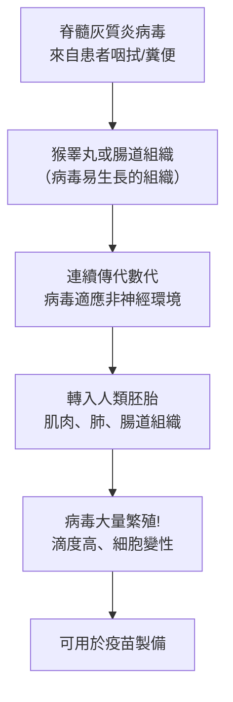

# 1954 · 脊髓灰質炎病毒在組織培養中生長：恩德斯、羅賓斯與韋勒鋪出疫苗之路

> **1954 諾貝爾生理學 or 醫學獎**（共享三人，皆為美國人）：約翰·富蘭克林·恩德斯（John Franklin Enders）— 表彰「發現脊髓灰質炎病毒在各種組織培養基中的生長能力」；弗雷德里克·查普曼·羅賓斯（Frederick Chapman Robbins）與托馬斯·哈克爾·韋勒（Thomas Huckle Weller）— 同上。

## 懸案（案情提要）

1950 年代初，小兒麻痺是發達國家最令人恐懼的疾病：每年數萬名兒童癱瘓，多數在溫帶地區呈**夏季大流行**（peak season 在 7、8 月），死亡與永久癱瘓的比例驚人。**沒有治療、沒有疫苗**——而它是由一個**病毒**造成的。

疫苗研發的卡點極其明確：製造疫苗需要**大量病毒**（每批疫苗需要數十億個病毒顆粒），而當時的技術只能做到：

1. 在**猴腎**或**小鼠腦**中培養病毒——產量低、有神經毒性風險（猴腦中的未減毒病毒可能造成接種者麻痺，這正是 1930 年代兩起「批次污染」事件的來源）；
2. 或用**活猴子的脊髓**（1950–1952 年 Salk 的方法）——繁重、昂貴、危險。

核心疑點：**病毒能不能在「非神經的、非動物的」培養基中大量生長？** 若能，就能徹底擺脫猴子。

恩德斯的答案是：**能**——但需要一個關鍵的技術轉折：**把病毒放進「混合培養」中，讓它「先適應」於非神經組織**。

## 前因

| 年份 | 事件 |
| --- | --- |
| 1908 | 蘭德施泰納（見 [1930-人類血型](1930-人類血型.md)）與 Popper、Levaditi 首次分離出脊髓灰質炎病毒，確認其病毒本性。 |
| 1930s | 1930–1931 年，Salk 等以**甲醛處理神經組織中的病毒**（inactivation）試圖製造疫苗；1935 年的「蘭蘭事件」——用猴脊髓製備的「殺毒」疫苗引發了活病毒污染，造成 1935–1936 年紐約與芝加哥的 79 例麻痺與 6 例死亡——這是疫苗史上最重要的失敗之一。 |
| 1938 | 艾爾森（J. P. Enders）與 Weller 等人發現：**腮腺炎病毒與流感病毒**可以在**雞胚胎的非神經組織（雞胚的羊膜與尿囊腔）**中生長——這是「病毒可在非神經組織培養」的先例，但脊髓灰質炎病毒卻不行。 |
| 1948–1949 | 恩德斯、羅賓斯與韋勒在**波士頓兒童醫院（Boston Children's Hospital）**嘗試在**非神經的組織培養**（人類胚胎的肌肉與肺）中培養脊髓灰質炎病毒，屢遭失敗——病毒不生長，甚至被**中和抗體**殺死。 |
| 1949 年 | 恩德斯的團隊改用**「混合培養」**：把脊髓灰質炎病毒先在**容易生長的組織**（如猴的睪丸、腸道）中「適應」數代，再轉入非神經組織——**成功！** 病毒開始在人類胚胎的肌肉、肺、腸道組織中繁殖。 |
| 1951 年 3 月 | 恩德斯發表《脊髓灰質炎病毒在非神經組織培養中的繁殖》（Cultivation of the Poliomyelitis Virus in Roller Tubes）——**疫苗史上的轉捩點**。 |
| 1952–1953 | 三人因小兒麻痺疫苗的相關工作而獲諾貝爾醫學獎（1954 年頒發；因恩德斯於 1954 年逝世，實際是由他的遺孀接受）。 |
| 1955 年 4 月 12 日 | **Salk 的 IPV（不活化疫苗）**宣布試驗成功——這正是恩德斯的工作所催生。 |
| 1960–1961 年 | **Sabin 的 OPV（口服減毒活疫苗）**上市；口服疫苗因其能產生腸道免疫（阻斷糞口傳播）而在全球大規模使用，逐步取代 IPV。 |

## 調查

### 第一幕：失敗的實驗也是偵查

1948–1949 年恩德斯團隊在非神經組織培養中養不出脊髓灰質炎病毒，這是本案的第一層謎。可能的解釋有三：

1. 培養條件不對（缺什麼營養或因子）；
2. 病人血清中的**中和抗體**把病毒殺了；
3. 病毒**本身不適合**在非神經組織中複製。

團隊逐一檢驗，做了幾個關鍵對照：把來自**猴腎或人胚胎肌肉**的培養液與**病人血清**混合後再加入病毒，發現血清確實有中和作用；於是他們改用**沒有抗體的培養液**（如「沉澱後的馬血清」，或只用消化酵素處理的培養基）。

### 第二幕：關鍵的技術轉折——「混合培養」與「組織適應」

真正的突破是一個看似簡單但原理深遠的技術：**先讓病毒在「它願意生長」的組織中適應，再轉入目標組織**。

**這個方法的深層意義**：病毒的「宿主範圍（host range）」不是固定的，而是**可塑性（plasticity）**。它在原本的宿主（人）與神經組織中的繁殖能力，與它在實驗室條件下的繁殖能力，是**不同的性質**——前者是**演化來的生態適應**，後者是可被選擇的。**減毒**正是這種可塑性的實例（見 [1951-黃熱病疫苗](1951-黃熱病疫苗.md) 的 17D 株）。

### 第三幕：韋勒的關鍵發現——一個意外的「重複」

1950 年，韋勒在處理人胚胎的組織培養時，發現了一個**不該存在的現象**：在**沒有加入脊髓灰質炎病毒的**培養皿中，出現了**類脊髓灰質炎病毒的細胞變性**。

韋勒的直覺是「汙染」，但他沒有丟棄樣本，而是仔細追查——結果發現這些「病毒」其實是：

- **不明病原體**（當時被稱為「韋勒因子（Weller factor）」）引起的細胞變性；
- 這些病原體**能抵抗青黴素與鏈黴素**（後來被識別為**支原體（Mycoplasma）**，今日已知為生殖道支原體等）。

這個「汙染」事件有兩重後果：

1. **它教會了所有人：組織培養必須嚴格防污染**——從此人類細胞培養的診斷標準（抗生素加入培養基、定期污染檢測）成為常規；
2. **它開啟了支原體學**——1953 年以來，支原體被證明是「非典型肺炎」的病因（**1956 年**，即 [1960-B肝病毒與庫魯病](1976-B肝病毒與庫魯病.md) 同時代的感染病學），並在 1980 年代成為**生殖道支原體與非淋菌性尿道炎**的重要病因。

### 第四幕：羅賓斯的臨床橋樑

羅賓斯的貢獻是把**基礎發現接到臨床終點**：他主持了疫苗的**人體試驗**設計，並在 1948–1950 年代以人類胚胎的組織培養進行**病毒的中和試驗與疫苗安全性檢測**。他是三人中唯一具有明確臨床試驗軌跡者，2010 年他以 94 歲高齡去世，是當時最年長的諾貝爾生理學 or 醫學獎得主。

### 第五幕：從組織培養到疫苗的技術鏈

恩德斯的方法直接成為兩種疫苗的技術基礎：

| 疫苗 | 製造 | 優點 | 缺點 |
| --- | --- | --- | --- |
| **Salk IPV**（不活化疫苗，1955） | 在人類胚胎腎細胞培養病毒 → **甲醛不活化** → 佐劑加強 | 不引起疫苗相關麻痺；免疫原性高 | 需多劑注射（含加強針）；成本高 |
| **Sabin OPV**（口服減毒活疫苗，1960） | 在**非神經的人類胚胎細胞**中以**低溫減毒**製得 | 口服、易用、能產生腸道免疫（阻斷糞口傳播）、成本低 | 罕見的疫苗相關麻痺（VAPP, 約每 260 萬劑 1 例）；須冷鏈 |

OPV 之所以能做出來，關鍵正是恩德斯的方法：**病毒在非神經組織（人類胚胎的腸道與腎細胞）中連續減毒傳代**，使其失去神經嗜性。

## 理論裁決

1. **組織培養作為病毒學的平台**：恩德斯的貢獻在方法論上是一次典範轉移——**病毒的「量產」問題被轉化為「細胞生物學的培養條件問題」**。這使得：

   $$\text{疫苗需求} \Rightarrow \text{病毒滴度需求} \Rightarrow \text{培養體積需求} \Rightarrow \text{培養基技術}$$

   成為一條可工程化的鏈條。隨之而來的是**無細胞培養技術（1960s–70s）**與**血清替代物（1980s 後的無血清培養基）**，最終使疫苗生產能在 GMP 級別進行。

2. **病毒宿主範圍的可塑性**：恩德斯的「適應傳代」與泰累爾的 17D 減毒（見 [1951-黃熱病疫苗](1951-黃熱病疫苗.md)）構成同一原理的兩個應用：

   $$P(\text{可在非神經組織複製} \mid \text{選擇性傳代}) \uparrow \ \text{每代}$$

   這是現代**反向遺傳學（reverse genetics）**與**定向減毒（rational attenuation）**的思想源流。

3. **黏膜免疫的數學基礎**：Sabin 的 OPV 之後，免疫學家發現口服疫苗能誘發**腸道分泌 IgA**，這在流行病學上極為關鍵——因為脊髓灰質炎病毒的傳播路徑是**糞口**，阻斷腸道感染即阻斷傳播：

   $$\text{腸道免疫} \Rightarrow \text{排毒率下降} \Rightarrow \text{群體免疫門檻下降}$$

   這解釋了為何 OPV 能從根本上改變傳播動態，而不只是保護個體。

4. **疫苗安全性的系統性風險管理**：IPV 取代 IPV 的歷史清楚展示了「**疫苗的風險必須被系統性量化**」：

   $$P(\text{VAPP} \mid \text{OPV}) \approx 1/2.6 \times 10^6$$

   這個數字直接影響了今日多國「IPV 為主、OPV 為輔」或「全面 IPV」的免疫策略，也是疫苗安全溝通的教科書案例。

## 追查支線（未結之謎）

- **1955 年「Cutter 事件」**：Salk 疫苗上市後，因不活化不完全，有 **200 餘名兒童**（含 10 名死亡、40 名永久麻痺）感染了活性病毒——**這是美國疫苗史上最嚴重的公共衛生災難**，直接導致了 1962 年《國家疫苗injury補償計畫》的成立，也促使疫苗不活化與效價檢驗標準大幅提升；
- 恩德斯於 1954 年 6 月 8 日去世（71 歲），未能親自領獎——其遺孀 Nancy Enders 代替他接受獎章，這是諾獎史上最動人的一幕之一；
- 恩德斯的兒子 **John Enders III** 也成為科學家；他的孫子 **William Enders** 是 1954 年諾獎得主 Thomas Weller 的學生；
- 韋勒的「汙染」最終導致了**支原體學**的建立，而支原體的發現直接催生了 2010 年代「生殖道支原體」疫苗研究與對「自體免疫」的重新評估（EBV 與 MS 的關聯研究）；
- 今日的**小兒麻痺病毒持續野病毒（cVDPV）**問題顯示：只要還有 OPV 使用，疫苗衍生病毒就可能透過未免疫人群擴散——這是恩德斯的技術在 21 世紀留下的新課題。

## 證物與數據（偵查卷宗摘錄）

| 證物 | 數值／內容 | 偵查意義 |
| --- | --- | --- |
| 1935 年蘭蘭事件 | 79 例麻痺、6 例死亡 | 殺毒疫苗失敗的教訓 |
| 1938 年雞胚非神經培養 | 腮腺炎與流感病毒可生長 | 技術先例 |
| 1948–49 非神經培養失敗 | 病毒不生長 | 謎題的提出 |
| 中和抗體排除 | 病人血清殺死病毒 | 排除混淆因子 |
| 1949 混合培養 | 先在睪丸/腸道適應 | 關鍵技術轉折 |
| 1951 年《Roller Tubes》論文 | 非神經組織中繁殖 | 疫苗史的轉捩點 |
| 韋勒因子（1950） | 抗抗生素的污染物 | 支原體學的開端 |
| 1955 年 4 月 12 日 | Salk 疫苗宣布成功 | 恩德斯工作的直接後果 |
| 1960–61 年 | Sabin OPV 上市 | 腸道免疫與根除策略 |
| Cutter 事件（1955） | 200+ 麻痺、10 死亡 | 疫苗安全與監管的轉折 |
| VAPP 風險 | 約 1 / 2,600,000 劑 | 免疫策略的量化依據 |

## 後果

| 領域 | 影響 |
| --- | --- |
| 疫苗學 | 組織培養疫苗成為主流技術，取代動物器官製備。 |
| 病毒學 | 細胞培養技術（後來用於 SARS-CoV-2 疫苗，見 [2023-mRNA 疫苗](2023-mRNA疫苗.md)）的源頭。 |
| 公共衛生 | 小兒麻痺在疫苗國家幾乎絕跡（1980 年 WHO 宣稱全球根除目標），是人類公共衛生史上最成功的成就之一。 |
| 微生物學 | 支原體學的建立。 |
| 監管科學 | 疫苗安全、效價測試與損傷補償制度的成熟。 |

## 關聯

- [1951-黃熱病疫苗](1951-黃熱病疫苗.md) — 減毒與細胞培養技術的前作，同一技術路線的兩站。
- [1946-X 射線誘發突變](1946-X射線誘發突變.md) — 病毒毒力與突變的定量語言。
- [1945-青黴素](1945-青黴素.md) — 抗生素時代的另一支，也是韋勒「汙染」中抵抗抗生素的支原體所在世界的入口。
- [2023-mRNA 疫苗](2023-mRNA疫苗.md) — 細胞培養與病毒量產技術的 21 世紀回響。
- [1930-人類血型](1930-人類血型.md) — 恩德斯的老師蘭德施泰納曾分離出脊髓灰質炎病毒。
