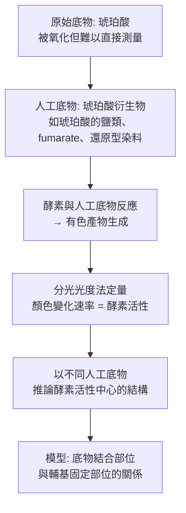

# 1955 · 氧化酶的性質與作用方式：特奧雷爾用「中間體」假說把氧的活化說清楚

> **1955 諾貝爾生理學 or 醫學獎**：阿克塞爾·胡戈·特奧多爾·特奧雷爾（Axel Hugo Theodor Theorell，瑞典）— 表彰「發現氧化酶的性質和作用方式」（"for his discoveries concerning the nature and mode of action of oxidation enzymes"）。

## 懸案（案情提要）

氧化酵素（oxidase）是所有需氧生物的「引擎」——細胞呼吸、光合作用、藥物代謝、解毒都依賴它們。但 1950 年代初，人們對這類酵素的**內部工作方式**幾乎一無所知：

1. 酵素如何「抓住」並活化氧分子？氧是惰性的三重態分子（見 [1931-呼吸酶](1931-呼吸酶.md)），為何能被順利還原？
2. 氧化酵素如何「分辨」要氧化什麼？它的底物專一性從何而來？
3. 酵素與其輔因子的關係是什麼——輔因子是被酵素「固定」在活性位內，還是自由流動？
4. 能否用**人工底物**系統地「拆開」酵素的內部構造？

特奧雷爾的答案是：用**人工合成的有色底物（chromogenic substrate）**，把酵素的「隱形反應」變成可見、可量的變化。他的方法最終把酵素拆成兩個部分：**apoenzyme（蛋白部分）與 prosthetic group（輔基）**。

## 前因

| 年份 | 事件 |
| --- | --- |
| 1890s | 叔本華（Schönbein）與其他人注意到多種酵素需要「某種輔因子」；1920–1930 年代，Warburg 的呼吸酵素研究確立了血基質與黃素在氧化反應中的角色（見 [1931-呼吸酶](1931-呼吸酶.md)）。 |
| 1921 | 特奧雷爾在卡羅琳斯卡醫學院獲得博士學位（研究維生素 C 的酵素氧化，見 [1937-生物氧化與維生素C](1937-生物氧化與維生素C.md)）。 |
| 1930s | 特奧雷爾在斯德哥爾摩的卡羅琳斯卡建立自己的實驗室，研究**細胞色素 c 氧化酶**（cytochrome c oxidase）與**琥珀酸去氫酶**（succinate dehydrogenase）等氧化酵素。 |
| 1935–1937 | 他發展出以**還原型輔基（reduced prosthetic group）在體外還原氧**來測定酵素活性的方法——把「氧化還原反應」與「氧的固定」解耦。 |
| 1950–1954 | 他以**人工合成底物**（如 succinic acid 的衍生物、fumarate、對苯二胺等）系統研究氧化酵素的**專一性與動力學**，確立「**酵素與輔基的結合方式**」的模型。 |
| 1955 | 獲諾貝爾生理學 or 醫學獎。 |
| 1960s–1980s | 細胞色素 c 氧化酶的立體結構（1981–1982 年 Davidson 等人）與電子傳遞機制的解析（1980s），是特奧雷爾模型的最終證實。 |
| 1990s | 米切爾（Graham Mitchell）確認**細胞色素 c 氧化酶是質子幫浦**——氧化與質子轉運的耦合機制，特奧雷爾的未解問題之一。 |

## 調查

### 第一幕：核心難題——「氧在哪裡被抓住？」

一個氧化酵素反應可以拆成兩步：

$$\text{底物} + \mathrm{Ox} \rightleftharpoons \text{氧化底物} + \mathrm{Red} \qquad (\text{氧化還原步驟})$$
$$\text{Red} + \mathrm{O_2} \rightarrow \text{Ox} + \mathrm{H_2O} \qquad (\text{氧固定步驟})$$

**問題在於：這兩步是在同一個活性位內相連發生，還是分開的？** 若分開，則必然有一個**可分離的中間體（reduced prosthetic group）**。

特奧雷爾的實驗設計極為巧妙：他把酵素在**無氧環境**下與底物反應，使酵素被「還原」（輔基處於還原態），然後把樣本**暴露於氧氣**並觀察氧的消耗速率。當他把酵素的**輔基化學上移除**（例如把血基質還原成不具反應活性的形式，或用氰化物抑制），氧的固定就停止了——證明輔基是氧固定的**必需器件**。

### 第二幕：人工底物——把「隱形」的酵素攤開

特奧雷爾最具方法論價值的貢獻是**設計人工底物（model substrates）**，把無法觀察的酵素內部反應轉化為可見的顏色變化：

以人工底物做「酵素的顯影」，是 20 世紀酵素學的標準方法——今日的受體配體結合分析（binding assay）與酵素動力學，仍沿用這套邏輯。

### 第三幕：專一性的圖像——「酵素與輔基的結合方式」

特奧雷爾根據不同氧化酵素的行為，歸納出**輔基與蛋白部分的兩種結合方式**：

1. **緊密結合（tightly bound）**：輔基是酵素蛋白的**永久組成**（integral prosthetic group），如細胞色素 c 氧化酶中的血基質 a 與 Cu；
2. **鬆散結合（loosely bound）**：輔基（輔酶）可**在催化循環後離開並再次結合**，如 $\mathrm{NAD}^{+}$ 、FAD 這類可攜式的輔酶。

他並以「**同源酵素（isoenzymes）**」的研究顯示：同一種輔基可以與不同的蛋白部分結合，形成性質不同的酵素（例如乳酸去氫酶的 5 種同工酶，LDH1–LDH5，各由不同基因編碼，卻共用 $\mathrm{NAD}^{+}$ 輔因子）——這是「**基因決定的酵素專一性**」的第一個分子證據，並直接連到 1958 年的**一基因一酵素學說**（見 [1958-一基因一酶](1958-一基因一酶.md)）。

### 第四幕：動力學的量化——「酵素如何結合底物」

特奧雷爾以米氏方程描述酵素的動力學，並用人工底物的結構變化推論結合模式：

$$\frac{v}{v_{\max}} = \frac{[S]}{K_m + [S]}$$

- **$K_m$ 越小 = 親和力越高**；
- 不同的取代基改變了 $K_m$ 與 $v_{\max}$ ，從而被用來「畫出」活性中心的化學地圖——**這就是「結構—活性關係」在酵素學中的開端**，也是藥物設計的語言。

### 第五幕：預言——細胞色素氧化酶是質子幫浦

特奧雷爾在 1950–1960 年代提出一個大膽的機制預言：細胞色素 c 氧化酶不僅傳遞電子，還**把質子從膜的一側泵到另一側**——即它是一台**質子幫浦**。這個預言直到 1990 年代才被米切爾的實驗與結構研究證實：

$$\mathrm{O_2} + 4e^- + 8H^+_{\text{(matrix)}} \to 2H_2O + 4H^+_{\text{(intermembrane space)}}$$

這是「**氧化與質子轉運的耦合**」——今日線粒體呼吸鏈理論的核心，也讓特奧雷爾的 1955 年工作獲得了一個漂亮的百年後回響。

## 理論裁決

1. **酵素的「二分結構」模型**：

   $$\text{氧化酵素} = \underbrace{\text{apoenzyme（蛋白）}}_{\text{專一性、構形}} + \underbrace{\text{prosthetic group（輔基）}}_{\text{催化、氧化還原}}$$

   這個模型解釋了「為何同一種輔基可以出現在多種酵素中」以及「為何不同的酵素可以催化同一反應」——**專一性在蛋白，催化在輔基**。

2. **氧活化的化學**：血基質鐵（ $\mathrm{Fe}^{2+}$ / $\mathrm{Fe}^{3+}$ ）與銅（Cu）中心能與氧結合並逐步接受電子：

   $$\mathrm{Fe}^{2+} + \mathrm{O_2} \rightarrow \mathrm{Fe}^{3+}{-}\mathrm{O_2}^{-} \rightarrow \mathrm{Fe}^{3+}{-}\mathrm{O}^{2-} \rightarrow \mathrm{Fe}^{3+} + \mathrm{O}^{2-}$$

   這條「逐步氧化」的序列，是理解血基質酵素（細胞色素、P450、觸酶）機制的通用模式，也是瓦爾堡「金屬中心活化氧」假說的最終版本（見 [1931-呼吸酶](1931-呼吸酶.md)）。

3. **同工酶的意義**：LDH1–LDH5 的組織分布（H 型在心肌、M 型在骨骼肌）構成今日**心肌梗塞的酵素診斷**（CK-MB、LDH1 升高）與**腫瘤標記**（如胎盤鹼性磷酸酶）的基礎——這是特奧雷爾的酵素學研究在 20 世紀後半的直接臨床應用。

4. **氧化還原電位的階梯**：不同氧化酵素與輔基的標準還原電位（ $E^{\circ'}$ ）構成一條階梯，決定電子流動的方向：

   $$\mathrm{NADH}\ (-0.32\ \mathrm{V}) \to \text{FAD}\ (-0.22) \to \text{細胞色素 b}\ (+0.07) \to \cdots \to \mathrm{O_2}\ (+0.82\ \mathrm{V})$$

   電子自低電位流向高電位（自發），每一步釋放的能量即為 ATP 的來源——這條階梯把 1931 年的呼吸鏈與 1953 年的循環串成一體。

5. **酵素濃度的定量**：特奧雷爾的方法使「測酵素活性」成為一項精確的臨床檢驗，而酵素活性與疾病（心肌酵素、肝酵素、澱粉酶）的關聯，開啟了今日的「**血液生化指標**」體系。

## 追查支線（未結之謎）

- 特奧雷爾於 1958 年當選為**卡羅琳斯卡醫學院諾貝爾大會主席（1970 年代）**，並是 1960 年代諾貝爾獎體制改革（1969 年將提名審查改為兩階段：提名委員會 + 獨立評審）的主要推動者之一；
- 他與 wife 家人曾長期在斯德哥爾摩郊外的 **Lilla Frösunda 實驗室**工作，該地後成為卡羅琳斯卡的重要研究園區；
- 他對酵素動力學的貢獻，使 Michaelis 與 Menten 的模型（1913 年提出）能在 1950 年代被廣泛應用並標準化；
- 「**細胞色素 c 氧化酶是質子幫浦**」的預言延續了 35 年才獲實證，是科學史上「預言—實證」間隔最長的漂亮案例之一；
- 今日的酵素藥理學（enzyme-targeted drugs，如 ATZ 對抗血管性血友病的凝血因子 VIII  Mimetics）延續了「以酵素為靶」的傳統。

## 證物與數據（偵查卷宗摘錄）

| 證物 | 數值／內容 | 偵查意義 |
| --- | --- | --- |
| 無氧下的酵素還原 | 輔基處於還原態 | 氧化步驟與氧固定步驟可解耦 |
| 移除輔基 | 氧固定停止 | 輔基的必要性 |
| 人工底物 | 可見的顏色變化 | 「把隱形的酵素攤開」 |
| 米氏方程 | $v/v_{\max} = [S]/(K_m+[S])$ | 動力學量化 |
| 人工底物的結構變化 | 改變 $K_m$ 、 $v_{\max}$ | 活性中心化學地圖 |
| 兩種輔基結合方式 | 緊密（輔基）vs 鬆散（輔酶） | 酵素的二分模型 |
| LDH1–LDH5 | 同工酶共用 $\mathrm{NAD}^{+}$ | 基因決定專一性 |
| 還原電位階梯 | $-0.32 \to +0.82\ \mathrm{V}$ | 電子流的方向與能量 |
| 質子幫浦預言（1950s） | 1990 年代獲證 | 35 年預言—實證 |

## 後果

| 領域 | 影響 |
| --- | --- |
| 酵素學 | 人工底物與動力學方法成為酵素結構—功能研究的標準語言。 |
| 臨床生化 | 血中酵素活性測定成為診斷心臟、肝臟、胰臟疾病的基本工具。 |
| 藥理學 | 以酵素為靶的藥物設計（抑制劑、活化劑）成為主流策略。 |
| 分子生物學 | 同工酶的研究是「基因—蛋白質」關係的第一個直接證據之一。 |
| 其他諾獎 | 與 [1931-呼吸酶](1931-呼吸酶.md)、[1953-檸檬酸循環](1953-檸檬酸循環.md)、[1958-一基因一酶](1958-一基因一酶.md) 構成酵素學主線。 |

## 關聯

- [1931-呼吸酶](1931-呼吸酶.md) — 瓦爾堡的氧化酵素假說，本案將其定案。
- [1953-檸檬酸循環](1953-檸檬酸循環.md) — 氧化還原電位階梯的另一端。
- [1958-一基因一酶](1958-一基因一酶.md) — 同工酶研究的理論接續者。
- [1937-生物氧化與維生素C](1937-生物氧化與維生素C.md) — 特奧雷爾早年的維生素 C 酵素氧化研究。
- [1971-第二信使](1971-第二信使.md) — 酵素訊號傳遞的另一面。
