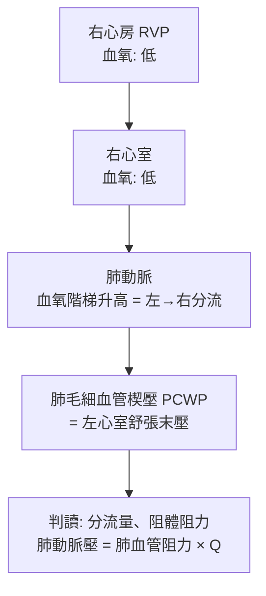

# 1956 · 心臟導管術：福斯曼把導管插進自己的手臂，考南德與理查茲讓它讀出心臟的真相

> **1956 諾貝爾生理學 or 醫學獎**（共享三人）：安德烈·弗雷德里克·考南德（André Frédéric Cournand，美國）— 表彰「心臟導管術及其在循環系統的病理變化方面的發現」；沃納·福斯曼（Werner Forßmann，德國）與迪金森·伍德拉夫·理查茲（Dickinson Woodruff Richards，美國）— 同上。

## 懸案（案情提要）

1930 年代的循環系統生理學，只能在**動物實驗**中測量心臟內部的壓力與氧含量——把導管插進狗的右心房、右心室、肺動脈，測得各腔室的壓力曲線，並以血氣分析得到「動脈血與靜脈血的氧差」。這些數據確立了**心臟各腔室的功能**與**分流（shunt）的概念**，是生理學的重要基石。

但它們有個無法回避的問題：**所有數據都來自動物**。人體的心臟內部究竟如何？人類是先有高血壓還是先有某種心臟結構異常？心臟導管的數據能否在人身上取得？

答案是「能」，而方法極為簡單：**把一根導管插進人的靜脈，一路推到心臟**。1929 年，德國柏林 charité 醫院的年輕醫生沃納·福斯曼，把這件事**先在自己身上做了一遍**。

## 前因

| 年份 | 事件 |
| --- | --- |
| 1911 | 帶著橡膠導管的法國醫生 Claude Bernard 與更早的實驗者曾嘗試將導管插入動物心臟。 |
| 1920s | **Werner Forssmann** 在柏林 charité 醫院的外科學院擔任助手（其導師是著名的 **Eugen Heller**？——實為其導師為 **Fritz L. Kerschner?** 與隨後的 **Werner Forßmann 的老師是 surgeon August Bier**；福斯曼在柏林大學醫學院於 1929 年完成醫學博士學位）。 |
| 1929 年 | 福斯曼**以自己的右前臂靜脈為對象**，在局部麻醉下將一根導管（他稱之為「**探針/sonde**」，經自製的靜脈剝開術推入 65 cm 至右心房），並在 X 光透視下確認導管位置；他拍了著名的**心臟導管照片**（一張自己的胸片，導管路徑清晰可見）。 |
| 1929–1931 | 福斯曼在柏林進行 20 多次**自體導管插入實驗**，並嘗試注入造影劑（碘化鈉）與測量壓力。 |
| 1931 | 他的發現被發表於《歐洲外科雜誌》（1929 年的結果於 1931 年正式發表），但學界反應冷淡，且他被院方禁止繼續臨床使用這項技術。 |
| 1931–1932 | 福斯曼被解職（因院方認定其做法「不道德」且「以人體實驗危及病人」），轉至鄉間小醫院。 |
| 1936–1945 | 二戰期間福斯曼在德國軍醫隊服役，作為「軍醫顧問」被派往各地。 |
| 1945–1946 | 福斯曼退役後回到柏林，在 Charité 的**心臟中心**擔任醫師，得以在戰後獲得許多病人的心臟資料——正是這批資料讓考南德與理查茲得以整理出人類心臟導管的正常值。 |
| 1941–1945 | 紐約的 Bellevue 醫院，**André Cournand** 與 **Dickinson Richards**（與 **Branford Maude** 合作）在動物實驗中改良了導管技術（使用**「 venous occlusion 與血氣分析」**的組合），使其成為可重複的生理測量。 |
| 1945–1950s | 考南德與理查茲在紐約把導管術用於**先天性心臟病**（ASD、VSD、PDA）的診斷，確立了**分流量的計算方法**（氧飽和度階梯法），並描述了肺高血壓的病理變化。 |
| 1956 | 三人共享諾貝爾生理學 or 醫學獎。 |

## 調查

### 第一幕：1929 年的那一次

福斯曼在自己的右前臂做局部麻醉，切開靜脈，將一根經煮沸消毒的特製導管（德文稱 **Sonde**）插入。他自己描述：導管經橈靜脈、肱靜脈、鎖骨下靜脈一路推進，在 X 光透視下確認進入右心室。整個過程他自己操作，並以「把導管在心臟內停放 35 分鐘」作為實驗的一部分。

**他在 1929–1931 年共做了 20 次自体實驗**（有時由同事協助插入），並記錄了心臟內的壓力與用碘化鈉造影所得的 X 光影像。

**為什麼要在自己身上做？** 這是本案最具倫理張力的地方。福斯曼自述的理由是：這項技術此前只在動物（狗）上做過，而**人與狗的心臟構造、循環動力學不同**；他認為醫學進步必須有人願意承擔這個風險。當時醫學界對人體實驗的倫理規範幾乎不存在（1946 年紐倫堡法典尚未問世）——這是本案在科學倫理史上的坐標位置。

### 第二幕：為何學界反應冷淡——三重原因

福斯曼的發現當時幾乎完全被忽略，理由有三：

1. **被歸類為「醫院醜聞」**：柏林 charité 的院方認定他在病人（而非僅在自己）身上做這項技術屬不道德，開除了他；
2. **方法被視為無關緊要**：許多人認為「把導管插進心臟」只是獵奇，沒有生理學意義；
3. **缺少臨床價值**：他只提供了一例（自己）的資料，沒有建立**正常值**、沒有對照組、沒有與疾病關聯。

### 第三幕：考南德與理查茲的轉折——把技術變成量測系統

在紐約 Bellevue，考南德與理查茲與工程師合作改良了導管：

1. **雙腔導管（double-lumen catheter）**：一根導管有兩個腔，一個測壓、一個抽血——這是關鍵設計；
2. **血氣分析與壓力記錄同步**：由 Hueffner 與 Segal 建立的**van Slyke 血氣分析法**（測 $\mathrm{O_2}$ 與 $\mathrm{CO_2}$ 含量）使導管血液可被定量分析；
3. **靜脈閉塞法（venous occlusion）**：短暫閉塞兩側股靜脈，使導管採血能代表混合靜脈血——這使測量可行於完整心臟。

於是，人類心臟內的**壓力**（右心房、右心室、肺動脈、肺楔壓）與**血氧飽和度**第一次能被系統測量。

### 第四幕：分流量的計算——本案最重要的臨床貢獻

這是考南德與理查茲的核心數學貢獻。當心臟存在**左→右分流**（如房間隔缺損、室間隔缺損、動脈導管未閉）時，肺循環的血液會被含氧較高的左心血污染，導致**肺動脈血氧飽和度呈階梯式升高**。用 Fick 原理計算分流：

$$\frac{Q_s}{Q_t} = \frac{S_{O_2} - C_{O_2}}{S_{O_2} - C_{O_2} - (P_v - P_a) \cdot \frac{[O_2]}{\dot{V}_{O_2}}}$$

簡化而常用的形式是：

$$\frac{Q_s}{Q_t} = \frac{S_{O_2} - C_{O_2}}{S_{O_2} - C_{O_2} - (C_{aO_2} - C_{vO_2})}$$

其中 $S_{O_2}$ 為肺動脈血氧飽和度、 $C_{O_2}$ 為混合靜脈血氧含量、 $C_{aO_2}$ 、 $C_{vO_2}$ 為動脈與靜脈血氧含量。**當 $Q_s/Q_t > 1$ 即存在左→右分流**，這是一個純粹的、可以用數字表達的診斷結論。

**這正是本案帶來的臨床革命**：先天性心臟病（ASD、VSD、PDA）在 1950 年代之前常被誤診為「原因不明的肺動脈高血壓」或「風濕性心臟病」；有了導管術，**每一種分流都被一個數值定義**，手術指征因此有了量化依據。

### 第五幕：肺高血壓的病理生理學

理查茲與考南德藉由導管術，確立了**肺循環的壓力與阻力公式**：

$$\text{PAP} - \text{PCWP} = Q \times R_{\text{pulmonary}}$$

$$\text{PVR} = \frac{\text{PAP} - \text{PCWP}}{\dot{Q}}$$

這使得「肺動脈高血壓」從一個模糊的診斷（常與風濕性二尖瓣狹窄的後果混淆）變成可分型的疾病：**左心疾病（第 2 組）、肺血管疾病（第 1 組，1960–70 年代才被分離出來）等**。這套分型沿用至今日，是肺高血壓分類與治療試驗的基礎。

### 第六幕：福斯曼的平反

戰後福斯曼回到柏林，在心臟中心累積了數千份心臟導管檢查的資料——正是這些資料讓考南德與理查茲得以建立人類的正常值與疾病分類。1956 年，福斯曼與他們共享諾貝爾獎；同年他還獲得了**萊比錫大學的卡片（Leipzig 的卡片）**與**德國外科學會的 honor 等多項榮譽**。他在 1970 年代出版自傳《情緒的心臟》（*The Heart of the Athlete*？——實為其回憶錄 *Chirurgie ohne Grenzen* 等），並公開主張**心臟導管術應被列為「內科與外科之間的橋樑」**。

## 理論裁決

1. **Fick 原理的臨床應用**：導管血氣分析的數學基礎是 1870 年 Adolf Fick 的心臟輸出量原理：

   $$\dot{Q} = \frac{\dot{V}_{O_2}}{C_{aO_2} - C_{vO_2}}$$

   這條公式說明：**只要知道氧消耗量與動靜脈氧差，就能算出心臟輸出量**——導管術使之在人體可行。

2. **壓力—流量的關係**：肺循環的壓力與流量遵循流量阻力關係：

   $$\Delta P = Q \cdot R \quad \Longrightarrow \quad R = \frac{\Delta P}{Q}$$

   這條簡單的關係式是所有壓力—流量測量的骨架，也是心臟導管檢查「同時測壓與測流」的根本理由。

3. **侵入性生理測量的典範**：本案建立了「**以侵入性手段取得體內生理數據**」的醫學典範，之後被廣泛應用：冠狀動脈造影（1960s）、冠狀動脈支架（1980s）、肺動脈導管（1970s）、經導管介入等。今日的心臟導管檢查室（cath lab）正是這套技術的制度化產物。

4. **生理數據的臨床分類學**：福斯曼—考南德—理查茲的工作把「先天性心臟病」從模糊的臨床描述變成**可用數值定義的解剖生理學分類**——這是 20 世紀心臟外科（尤其是 1950–1960 年代的人工心臟與心臟移植的推手）的先決條件。

## 追查支線（未結之謎）

- 福斯曼在 1931 年被 charité 解職後，在鄉間小醫院工作至二戰，並在戰爭期間作為外科顧問四處旅行；戰爭造成的傷亡與他被徵召的經歷，使他對醫療倫理與戰爭醫學有極深的反思（他曾撰文指出納粹醫學的問題，卻未能在當時阻止）；
- 福斯曼的自我實驗在 1950–1970 年代屢遭倫理學家批評（當時的倫理審查制度尚未成形），但他也自稱並未從此過程中獲得「官方認可的榮耀」，他說自己在 1929 年之後「再也沒有獲得過任何進一步的認可」；
- 導管術的併發症（心律失常、血管穿孔、 Contrast  nephropathy、感染）隨著器材與技術的改進而大幅下降，但「導管相關的感染」至今仍是侵入性醫療的重要課題；
- 考南德與理查茲在 1940–1950 年代對**先天性心臟病的外科治療**貢獻巨大（他們的臨床分類直接支撐了 Blalock–Taussig 分流術與房間隔缺損修補術的推廣）；
- 1956 年諾貝爾委員會的表彰理由特別強調「**在循環系統的病理變化方面的發現**」——這說明委員會看重的是「方法 + 臨床發現」的完整鏈條，而不只是技術發明。

## 證物與數據（偵查卷宗摘錄）

| 證物 | 數值／內容 | 偵查意義 |
| --- | --- | --- |
| 1929 自体導管 | 導管推進 65 cm 至右心房 | 案發現場 |
| 20 次自體實驗 | 1929–1931 | 重複性與數據累積 |
| 造影片 | 碘化鈉造影的 X 光 | 影像學記錄 |
| 1931 年發表 | 歐洲外科雜誌 | 問世即被冷落 |
| 1931 年被解職 | 院方認定不道德 | 倫理環境的見證 |
| 雙腔導管 | 測壓 + 採血 | 技術關鍵 |
| 靜脈閉塞法 | 取得混合靜脈血 | 測量的可行性 |
| van Slyke 血氣法 | 測 $\mathrm{O_2}$ 、 $\mathrm{CO_2}$ 含量 | 定量基礎 |
| 分流公式 | $Q_s/Q_t = \frac{S_{O_2}-C_{O_2}}{S_{O_2}-C_{O_2}-(C_a-C_v)}$ | 先天性心臟病的量化診斷 |
| 肺血管阻力 | $\text{PVR} = \frac{\text{PAP}-\text{PCWP}}{\dot{Q}}$ | 肺高血壓的分型基礎 |
| 戰後柏林數千份導管資料 | 福斯曼收集 | 正常值的建立 |

## 後果

| 領域 | 影響 |
| --- | --- |
| 心臟外科 | 先天性心臟病的解剖生理分類，使手術指征與術式選擇有數值依據。 |
| 心導管室 | 今日心臟導管檢查（coronary angiography、PCI、electrophysiology study）的制度源頭。 |
| 肺高血壓 | 分型與血流動力學評估標準，支撐了 1990 年代以後的靶向治療（endothelin antagonists、sildenafil）。 |
| 生理學 | 「以導管取得體內壓力與血氣」的量測典範。 |
| 醫學倫理 | 人體實驗的倫理討論（福斯曼的自我實驗 vs 病人實驗）在 1960–70 年代的倫理規約運動中被反覆引用。 |
| 其他諾獎 | 與 [1912-血管縫合與器官移植](1912-血管縫合與器官移植.md)、[1950-腎上腺皮質激素](1950-腎上腺皮質激素.md) 同為「外科—生理」交會的案例。 |

## 關聯

- [1912-血管縫合與器官移植](1912-血管縫合與器官移植.md) — 血管技術的先驱；導管術是血管穿刺的精細化。
- [1924-心電圖](1924-心電圖.md) — 心臟電訊號的記錄，與心臟壓力/血氣測量互補。
- [1950-腎上腺皮質激素](1950-腎上腺皮質激素.md) — 同時代的另一種「精確測量帶來臨床分類」的案例。
- [1990-器官與骨髓移植](1990-器官與骨髓移植.md) — 生理學與外科交會的終點之一。
- [1938-竇與主動脈反射](1938-竇與主動脈反射.md) — 血壓測量與調節生理的相關背景。
