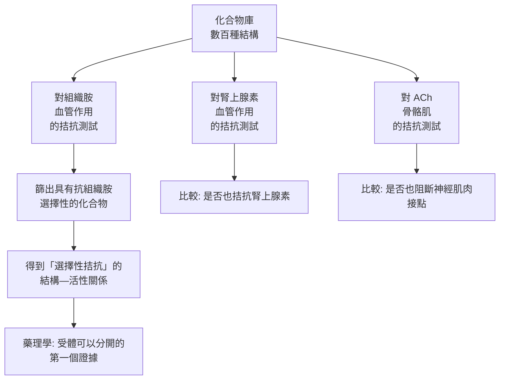

# 1957 · 抗組織胺與藥理學的受體時代：博韋合成出第一個「以化學對抗化學」的藥

> **1957 諾貝爾生理學 or 醫學獎**：達尼埃爾·博韋（Daniel Bovet，義大利）— 表彰「發現抑制某些機體物質作用的合成化合物，特別是對血管系統和骨骼肌的作用」（"for his discoveries relating to synthetic compounds that inhibit the action of certain body substances, and especially their action on the vascular system and the skeletal muscles"）。

## 懸案（案情提要）

1920–1930 年代，幾種「內源性物質」被相繼發現並被認為是疾病的元兇：

- **組織胺（histamine）**：1920 年由哈里斯（H. A. Dale）發現，它能**使血管擴張、血壓下降、引發蕁麻疹與哮喘**；
- **乙醯膽鹼（ACh）**：勒維與戴爾發現其為神經傳遞物質（見 [1936-神經化學傳遞](1936-神經化學傳遞.md)）；
- **血清素（5-HT）**、**腎上腺素**……

但醫生手上幾乎沒有**對抗**這些物質的藥。疑點是：

1. 既然這些物質的效應如此明確，**能否用化學方法合成「結構相似」的分子**，讓它們去占據受體，卻不產生原本的效應？
2. 這把「魔彈」（magic bullet）的想法從**病原體**轉向**內源性物質**——埃利希的夢想能否在藥理学上實現？
3. 藥物的「副作用」究竟從何而來？一個藥能只作用於血管而不影響骨骼肌嗎？

博韋的答案是：**能**。他合成出第一批**抗組織胺藥物**，並用一套精密的生物測定方法，證明藥物的選擇性是可以被量化與設計的。

## 前因

| 年份 | 事件 |
| --- | --- |
| 1910–1911 | 埃利希提出「側鏈」與「選擇性毒性」理論，並在睡眠病治療中發明砷凡納明（606）——藥理學的第一個「魔彈」（見 [1908-免疫雙雄](1908-免疫雙雄.md)）。 |
| 1910 | 哈里斯（Henry Dale）發現**組織胺**能引起血管擴張、低血壓、腸道收縮；1920 年他發現組織胺也參與**過敏與哮喘**的反應（這條線最後通向 [1913-過敏反應](1913-過敏反應.md) 的機制解釋）。 |
| 1920s | 化學家 **Paul Charpentier** 合成出**抗組織胺藥物**系列（特別是 phenothiazine 類），但當時缺乏有效的生物測定方法，難以判定活性。 |
| 1929 | 博韋在瑞士 Basel 的 **Sandoz 實驗室**開始研究化學合成的化合物對組織胺、腎上腺素、ACh 與 5-HT 的作用。 |
| 1930s | 博韋與他的同事（**Nelly Sperling、Irène Bovet、Daniel Bovet 的夫人 Irène**、以及 **Robert Meier** 等）合成並測試了**數百種化合物**，建立了「藥物的化學結構 ↔ 生理效應」的系統資料庫。 |
| 1933 | 博韋發表《藥物對組織胺、腎上腺素與乙醯膽鹼的作用》（Action of Drugs on the Effects of Histamine, Adrenaline and Acetylcholine），報告他們已測試約 500 種化合物，發現**多種結構類型的抗組織胺藥物**。 |
| 1942–1948 | 博韋的團隊（**F. Barger** 等）合成出 **1946 年由法國 Rhone-Poulenc 上市的 chlorphenamine（Chlorpheniramine，撲爾敏）**，成為第一個廣泛使用的口服抗組織胺藥。 |
| 1950s | 博韋轉向研究**中樞神經系統的藥理學**（特別是抗精神病藥物與類精神病藥），並在 1950–1957 年發展了「**reserpine 與 serotonin 的交互作用**」的概念。 |
| 1957 | 獲諾貝爾生理學 or 醫學獎。 |

## 調查

### 第一幕：把「效力」變成可比較的數字

博韋的偵查前提是一個方法學問題：**如何定量比較不同化合物的效力？** 他沿用了當時剛起步的藥理學方法——**生物測定（bioassay）**，並建立了一套標準化的「效價比（potency ratio）」系統：

$$\text{Potency ratio} = \frac{\text{劑量}_{A}}{\text{劑量}_{B}} \quad (\text{在相同效應下})$$

具體做法是：在同一批動物（later 以離體器官灌流為主）中，比較「抑制組織胺引起的血壓下降 50% 所需的劑量」與「抑制腎上腺素引起的升壓所需的劑量」，若某化合物對前者有效而對後者無效，則它的**選擇性（selectivity）**便可被量化。

這正是 **pA2 值（對抗半數有效濃度）**方法的前身——今日藥理學中評估拮抗劑親和力的標準工具。

### 第二幕：化學結構與選擇性的對應

博韋的核心發現是：**抗組織胺作用不需要與組織胺有結構相似性**。他測試的數百種化合物橫跨多個化學類別：

**這個「選擇性」的發現是整個現代藥理學的起點**：既然抗組織胺藥不阻斷腎上腺素、不阻斷神經肌肉傳遞，那就意味著**組織胺、腎上腺素、ACh 各有「自己的」受體**。博韋並不是用「受體」這個詞來表述（受體概念要到 1950–1960 年代才定型），但他以數據證明了它的必要性。

### 第三幕：藥物的副效應從「混亂」變成「資訊」

博韋的團隊發現，一些抗組織胺藥會產生**副作用**，例如：

- 抗組織胺藥對**骨骼肌**的作用（部分化合物阻斷神經肌肉傳遞或直接鬆弛骨骼肌）；
- 對**血管系統**的影響（有的升高血壓，有的降低）。

這些「副作用」在傳統語彙裡是雜訊，在博韋手裡卻是**定位受體的探針**：若一個抗組織胺藥同時阻斷 ACh 對骨骼肌的作用，說明它在 ACh 受體上也有活性——這就開啟了「**藥物的選擇性不是二元的，而是連續的譜系**」的觀念。

### 第四幕：化合物編號系統——「結構—效應」的檔案

博韋團隊的著名做法是給每個測試的化合物編號（著名的 **Bovet 系列**，如 L 系列），並把「結構、拮抗效力、選擇性、急性毒性、給藥途徑」整理成**系統性表格**。這種做法把藥理學從「個別藥物的敘述」提升為「**定量化的比較科學**」——正是今日藥物化學資料庫（如 PubChem、ChEMBL）的前身。

### 第五幕：1940 年代的臨床落地

從博韋實驗室到市場：

1. **1946 年**：Rhone-Poulenc 推出 **chlorpheniramine（Chlorphenamine maleate，撲爾敏）**——第一個廣泛使用的口服抗組織胺藥；
2. **1950 年代**：抗組織胺藥成為**蕁麻疹、過敏性鼻炎、蟲咬反應**的標準治療，也成為當時最暢銷的藥物類別之一；
3. **副作用的發現**：第一代抗組織胺藥多為**第一代 H1 拮抗劑**，具**嗜睡、抗膽鹼作用（口乾、尿滯留）**；第二代（H2 拮抗劑如西咪替丁、以及 1980 年代的 loratadine）則刻意設計為不穿透血腦屏障；
4. **H2 受體的發現（1970s）**：博韋的「受體可分」的直覺，在 1972 年由 Black 與 Ganellin 以**組胺的類似物篩選**找到 H2 拮抗劑（cimetidine）而證實——**這是受體藥理學的一次里程碑式的「盲搜」**，並直接催生了質子幫浦抑制劑（omeprazole）的應用（對應 [1909-甲狀腺外科](1909-甲狀腺外科.md) 中胃酸分泌的生理學）。

## 理論裁決

1. **競爭性拮抗的定量**：博韋的選擇性拮抗，本質上就是競爭性抑制：

   $$v = \frac{v_{\max}\,[S]}{K_m\left(1 + \frac{[I]}{K_i}\right) + [S]}$$

   用不同濃度的拮抗劑做實驗並外推，可求得 $K_i$ （即 pA2），這成為受體親和力的標準度量。

2. **選擇性的量化**：藥理選擇性可定義為兩個受體親和力常數的比值：

   $$\text{Selectivity ratio} = \frac{K_{i,\text{H1}}}{K_{i,\text{H2}}} \quad \text{或} \quad \frac{K_{i,\text{H1}}}{K_{i,\text{muscarinic}}}$$

   這個比值越大，藥物的治療窗越寬。博韋正是第一個系統性地「製造」這種比值的人。

3. **受體概念的形成路徑**：本案的邏輯鏈極為清晰：

   $$\text{同一藥物對不同組織有不同效應} \Rightarrow \text{效應由受體決定} \Rightarrow \text{受體可被藥物選擇性結合}$$

   這是 20 世紀藥理學從「藥物—器官」模式轉向「藥物—受體」模式的轉捩點，也是 Clarke 與 Gaddum（1933 年提出 pA、pD 等效價標度）的定量語言所服務的理論對象。

4. **結構—活性關係（SAR）與藥物設計**：博韋的方法示範了藥物設計的現代流程——**先建立效力的度量，再改變結構，再測量，最後找出規律**。這套流程在 20 後半葉被應用於幾乎所有藥物類別。

5. **副作用作為機制的線索**：博韋強調「副作用不是雜訊，而是資訊」。以今日語言說：藥物對多個受體的活性譜（polypharmacology）可被系統測量與優化——這正是今日「多藥理學（polypharmacology）」與「藥物再定位（drug repurposing）」的基礎。

## 追查支線（未結之謎）

- 博韋與他的夫人 **Irène Bovet**（瑞士籍化學家）是研究夥伴與事業夥伴；2019 年，**法國第六大學（巴黎大學）以他們的姓氏設立了「Irène and Daniel Bovet 基金會」**，並在 2020 年代推動「Bovet Prize for Fundamental Research」以表彰科學傳播與科學教育；
- 博韋 1949 年離開 Sandoz，創建了自己的研究機構，並在 1950–1960 年代轉向中樞神經系統藥理——特別是 **reserpine（蛇根鹼）與血清素的交互**，這是「**精神藥理學（psychopharmacology）**」的開端之一，催生了 1950 年代的抗精神病藥革命（chlorpromazine，見 [1949-間腦與白質切除](1949-間腦與白質切除.md) 的替代路徑）；
- 博韋 1933 年論文報告的「測試 500 種化合物」是 20 世紀早期少數這麼大規模的系統性藥理篩選，這套方法後來被 Sandoz 與其他藥廠制度化；
- 抗組織胺藥的第一代（H1）副作用（嗜睡）在 1950–60 年代造成嚴重的駕駛與工傷問題（著名的「non-drowsy antihistamine」訴求），促成第二代藥物的開發；
- 博韋的科學與人道立場並存：他於 1950 年代是歐洲科學家聯合會的主席，也是一位UNESCO 科學合作與和平運動的重要倡議者。

## 證物與數據（偵查卷宗摘錄）

| 證物 | 數值／內容 | 偵查意義 |
| --- | --- | --- |
| 化合物庫 | 約 500 種（1933 年報告） | 系統性篩選的規模 |
| 生物測定法 | 抑制組織胺致血壓下降 50% 的劑量 | 效價的可比較化 |
| 效價比 | $\text{Potency ratio} = \frac{D_A}{D_B}$ | 選擇性的第一個數字 |
| 結構多樣性 | 多個化學類別皆可抗組織胺 | 「選擇性不必靠結構相似」 |
| 對照三系統 | 組織胺 / 腎上腺素 / ACh | 受體可分的證據 |
| chlorpheniramine（1946） | 首個廣泛使用的口服抗組織胺藥 | 臨床落地 |
| 化合物編號（Bovet 系列） | 結構—效應系統表格 | 藥物化學資料庫的前身 |
| pA2 值 | 拮抗劑親和力的標準度量 | 受體藥理學的定量語言 |
| H2 受體（1972） | cimetidine 的發現 | 受體選擇性搜索的里程碑 |

## 後果

| 領域 | 影響 |
| --- | --- |
| 藥理學 | 從「藥物—器官」轉向「藥物—受體」，並建立定量比較的方法。 |
| 臨床 | 抗組織胺藥成為過敏性疾病的標準治療；H1 與 H2 拮抗劑分別對應過敏與胃酸分泌。 |
| 藥物設計 | SAR 的系統化流程成為工業藥物研發的標準。 |
| 精神藥理學 | 博韋晚期工作開啟了抗精神病藥與抗憂鬱藥的時代。 |
| 其他諾獎 | 與 [1908-免疫雙雄](1908-免疫雙雄.md)（側鏈理論）、[1936-神經化學傳遞](1936-神經化學傳遞.md)（ACh 與其拮抗劑）、[1959-核酸生合成](1959-核酸生合成.md)（藥理學的分子化）構成受體藥理學主線。 |

## 關聯

- [1908-免疫雙雄](1908-免疫雙雄.md) — 埃利希的側鏈理論，本案是它在藥理上的實現。
- [1936-神經化學傳遞](1936-神經化學傳遞.md) — ACh 與組織胺都是博韋測試的三大系統之二。
- [1913-過敏反應](1913-過敏反應.md) — 組織胺在過敏反應中的角色，是抗組織胺藥的臨床靶點。
- [1950-腎上腺皮質激素](1950-腎上腺皮質激素.md) — 藥理學的另一條「從分子到藥」路徑。
- [1959-核酸生合成](1959-核酸生合成.md) — 受體概念在分子生物學中的延伸。
