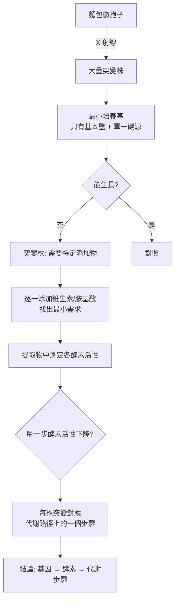
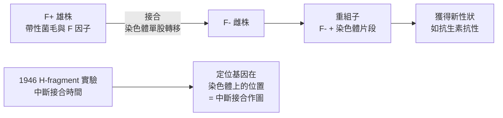

# 1958 · 一基因一酵素與細菌的「性」：貝德爾、塔特姆與萊德伯格把遺傳學接到代謝上

> **1958 諾貝爾生理學 or 醫學獎**（共享三人，皆為美國人）：喬治·威爾斯·貝德爾（George Wells Beadle）— 表彰「發現基因功能受到特定化學過程的調控」；愛德華·勞里·塔特姆（Edward Lawrie Tatum）— 同上；約舒亞·萊德伯格（Joshua Lederberg）— 表彰「發現細菌遺傳物質的基因重組和組織」。

## 懸案（案情提要）

1950 年代的遺傳學已經確立了「基因位於染色體上」（見 [1933-染色體遺傳](1933-染色體遺傳.md)），但**基因做什麼**仍是黑箱。核心疑點：

1. 一個基因的功能單位是什麼——是控制整條代謝路徑，還是控制其中一步？
2. 如果基因控制的是「化學步驟」，那麼**突變應該造成可觀察的化學缺陷**。這個預測可以實驗嗎？
3. 從**染色體**上的基因，到細胞裡實際運轉的酵素，中間的邏輯鏈條是什麼？
4. 細菌有染色體嗎？它們的「基因重組」如何在沒有減數分裂的情況下發生？

貝德爾與塔特姆用一種樸素的生物——**麵包黴（*Neurospora crassa*）**——回答了前兩個問題；萊德伯格則用**大腸桿菌（*E. coli*）**回答了後兩個。

## 前因

| 年份 | 事件 |
| --- | --- |
| 1940–1941 | 貝德爾與塔特姆在**史丹福**（Stanford）相遇，開始合作研究**麵包黴的營養缺陷型突變**。此前 Beadle 在 1941 年已發表「**一個基因一個酵素**」的初步主張。 |
| 1941–1945 | 他們建立篩選系統：先用 X 射線誘發麵包黴突變（見 [1946-X 射線誘發突變](1946-X射線誘發突變.md)），再以**最小培養基**（只含基本鹽、一種碳源、一種氮源與少量維生素）測試每一株突變體能生長的最小營養需求。 |
| 1946 | 他們發現若干突變株需要**特定的營養添加物**（如苯丙胺酸、腺嘌呤、維生素 $\mathrm{B}_{6}$ ）才能生長——**每一個突變株對應代謝路徑上的特定一步受阻**。 |
| 1950–1951 | 他們在《美國國家科學院院刊》發表系統性結果：**在不同突變株中，各有一個酵素活性降低**，並與特定營養需求對應。 |
| 1946 | 萊德伯格在耶魯（與 Lederberg 的妻子 **Esther Lederberg** 共同工作）與 Joshua 的导师 **Joshua Lederberg 的博士導師是 L. S. Luria**（即 Luria），與 **Edward Tatum** 合作研究細菌的「性」。 |
| 1946–1947 | 萊德伯格與 Luria、Tatum 進行了著名的「**H-fragment 實驗**」（「44-Factor」實驗），證明**大腸桿菌能透過性菌毛進行遺傳重組**（接合，conjugation）。 |
| 1958 | 三人共享諾貝爾生理學 or 醫學獎。 |
| 1950s | 貝德爾與塔特姆遷至芝加哥與紐約（1957 年貝德爾任芝加哥大學校長），繼續以微生物進行遺傳研究。 |
| 1960s–1980s | 「一基因一酵素」被修正為「**一基因一多肽（one gene-one polypeptide）**」（因發現基因組蛋白、多酵素複合體等），並最終被「**一基因一蛋白質**」與「一基因—一功能」等概念取代。 |

## 調查

### 第一幕：麵包黴——為什麼選它？

貝德爾與塔特姆的選材極為講究。麵包黴（*Neurospora crassa*）具有幾個「偵查用」的理想特性：

| 特性 | 意義 |
| --- | --- |
| 單倍體 | 突變立即表現，無需純合化 |
| 菌絲體簡單（無分節） | 容易做生長測量與生化分析 |
| 營養簡單（只需 minimal medium） | 突變的營養需求可直接被判定 |
| 繁殖快 | 一週即可完成數代 |
| 容易被 X 射線誘發突變 | 有大量突變株可供篩選 |
| 大量子代（無性生殖產生大量孢子） | 統計上容易建立生長曲線 |

**這正是柯霍選擇細菌、摩根選擇果蠅的同一邏輯**（見 [1905-結核桿菌與柯霍法則](1905-結核桿菌與柯霍法則.md)、[1933-染色體遺傳](1933-染色體遺傳.md)）：**選對生物，問題自己會解開一半**。

### 第二幕：篩選流程

**關鍵在 H–K 步**：他們不只找出「需要什麼營養」，還要**測出哪一種酵素活性降低**。例如：

- 需要**腺嘌呤**的突變株 → **腺嘌呤合成步驟**的酵素活性下降；
- 需要**苯丙胺酸**的突變株 → **苯丙胺酸合成步驟**的酵素活性下降；
- 需要**維生素 $\mathrm{B}_{6}$ （磷酸吡哆醛）**的突變株 → **胺基酸脫羧酶**活性下降。

如此一來，**基因與代謝路徑的對應被一一建立**。

### 第三幕：一基因一酵素的正式表述

1951 年，貝德爾與塔特姆在《美國國家科學院院刊》發表《Enzymatic Adaptation and the One Gene-One Enzyme Hypothesis》，正式提出：

> **每個基因的功能單位是控制一個酵素（或一個多肽鏈）的合成。**

形式化地說，若基因 $G_i$ 對應酵素 $E_i$ ：

$$G_i \xrightarrow{\text{轉錄+轉譯}} E_i \xrightarrow{} \text{代謝步驟}_i$$

他們還提出了一個更精緻的版本：**基因以「串聯（sequential）」方式作用於代謝路徑**——一個突變阻斷某一步，會導致上游中間產物累積、下游產物不足，這在當時被用來推論未知的代謝路徑順序。

### 第四幕：萊德伯格與細菌的「性」

萊德伯格的問題極為大膽：**「細菌這種沒有明顯性別的單細胞生物，能交換基因嗎？」**

他的實驗設計（與 Luria、Tatum 合作）精準到近乎藝術：

1. **篩選突變株**：用不同抗生素抗性與營養需求標記兩株大腸桿菌（一株為「雄」，一株為「雌」）；
2. **混合培養**：將兩株混合，觀察是否出現**既抗 A 又抗 B**、且能在兩株都不能生長的培養基上生長的**重組子**；
3. **排除轉形（transformation）**：必須確保不是 DNA 轉形造成——用 DNA 酶處理以排除；
4. **關鍵證據**：**1936 年大腸桿菌 K-12 品系中有「性因子 F」（fertility factor）**；帶有 F 因子的菌株成為「雄性」（ $F^+$ ），在接合時將染色體的一段轉移給「雌性」（ $F^-$ ）。

**H-fragment 實驗的關鍵意義**：研究者把「交配」在不同的時間點人為中斷，測量受體獲得某標記的機率——**基因轉移的順序即其在染色體上的位置順序**。這是**中斷接合作圖（interrupt mapping）**，1940–50 年代微生物遺傳學的核心技術，也是「**遺傳作圖從果蠅擴展到細菌**」的關鍵一步。

**這樁發現的深遠影響**：它證明了**基因重組並非減數分裂的專利**——只要有基因轉移，兩株細菌就能發生遺傳重組。這顆種子在二十多年後長成了**基因工程**（1973 年 Cohen–Boyer 的重組 DNA，1978 年第一個重組胰島素），並最終開啟了 **2023 年 mRNA 疫苗**的技術路線（見 [2023-mRNA 疫苗](2023-mRNA疫苗.md)）。

### 第五幕：遺傳學與生物化學的合流

本案的歷史意義在於**兩條路線的交會**：

| 路線 | 代表 | 貢獻 |
| --- | --- | --- |
| 遺傳學路線 | 摩根（1933） | 基因在染色體上的位置 |
| 生物化學路線 | 科塞爾（1910）、瓦爾堡（1931）、李普曼/克雷布斯（1953） | 代謝路徑的酵素與步驟 |
| **合流（1958）** | **貝德爾、塔特姆** | **基因 = 代謝步驟的控制者** |

這條合流線延伸出：1962 年的 DNA 雙螺旋（基因的分子身分）、1965 年的乳糖操縱子（基因如何調控酵素的產生，見 [1965-乳糖操縱子](1965-乳糖操縱子.md)）、1995 年的同源異形基因（見 [1995-胚胎發育基因](1995-胚胎發育基因.md)）。

## 理論裁決

1. **基因—酵素對應的數學**：一個突變若使酵素活性降低至原值的比例為 $\alpha$ ，則相應的代謝流 $J$ 依米氏方程下降：

   $$J = \frac{J_{\max}\,[S]}{K_m\left(1+\frac{[I]}{K_i}\right)+[S]}, \qquad \alpha = \frac{E_{\text{mut}}}{E_{\text{WT}}}$$

   對**單步驟**突變而言，酵素活性 $\propto \alpha$ ，因此下游產物的產量呈比例下降——這正是「一個基因一個酵素」在動力學上的推論，也是當年用營養需求來反推突變位置的原理。

2. **基因組大小與營養缺陷數的關係**：若突變率約為每基因每代 $10^{-6}\text{–}10^{-5}$ ，而一個突變株只需要**一個**營養添加物即可恢復生長，則觀察到的營養缺陷型數目即反映**突變可影響的步驟數**。這是「一基因一酵素」最直接的經驗支持。

3. **接合作圖的數學**：在 H-fragment 實驗中，標記 $m$ 的轉移頻率隨接合時間 $t$ 呈指數下降：

   $$P(\text{轉入 } m \mid t) = 1 - e^{-k_m t}$$

   各標記的 $k_m$ 不同，其倒數給出**相對距離**——這是把「時間」轉換為「遺傳距離」的漂亮設計，是細菌遺傳圖譜的數學基礎。

4. **基因重組的普遍性**：萊德伯格的發現宣告**性（sex）在演化上是多樣的**：細菌有接合、真菌有交配、噬菌體有轉導、轉形有轉形——四種**水平基因轉移（HGT）**機制並行，構成「基因體流動」的生態。1990 年代的「染色體超級圈（supercoiling）」與水平轉移在抗藥性傳播中的角色（尤其肺炎鏈球菌與金黃色葡萄球菌的抗藥性基因），就是這條線的現代延伸（見 [1948-DDT](1948-DDT.md) 時代的抗藥性、與 [1952-鏈黴素](1952-鏈黴素.md) 的抗藥性機制）。

## 追查支線（未結之謎）

- 萊德伯格的妻子 **Esther Lederberg** 在接合實驗中承擔了關鍵的大量技術工作（分離重組子、篩選平板、每天處理數千個菌落），卻未被列入諾獎論文；這樁「未具名貢獻」的議題在 2000 年代被重新檢視，Esther 於 2020 年出版回憶錄《The Career of a Lifetime》；
- 「一基因一酵素」在 1960–70 年代被發現的「**基因組蛋白（histone）基因**」「**多酵素複合體**」「**選擇性剪接（alternative splicing）**」逐一挑戰，最終修正為「**一基因一多肽**」與「**一基因一功能**」；
- 萊德伯格是諾貝爾獎史上最年輕的得獎者之一（33 歲），他後來轉入**人工智慧**研究，參與 NASA 的火星生命搜尋計畫，並是 2000 年代的「生物學 x 電腦」跨領域倡議者；
- 貝德爾在 1957–1968 年任芝加哥大學校長，並在 1960 年代因出版《Genetic Destiny》而引發爭議（主張基因決定行為，被當時的社會科學界批評為「生物決定論」）；
- 塔特姆在 1950 年代因研究「細菌的生殖過程」獲諾貝爾獎，但因 1940 年代的**「史普拉明事件（Scopes Trial）」**與田納西州的教學法爭議，生物學與遺傳學在美國南部曾遭禁，遺傳學的公共形象經歷了漫長的修復。

## 證物與數據（偵查卷宗摘錄）

| 證物 | 數值／內容 | 偵查意義 |
| --- | --- | --- |
| 麵包黴單倍體 | 突變立即表現 | 模型選擇的關鍵 |
| 最小培養基篩選 | 逐一添加找出最小營養需求 | 突變定位的方法 |
| 突變株—營養對照 | 腺嘌呤、苯丙胺酸、維生素 $\mathrm{B}_{6}$ | 每株對應一個步驟 |
| 酵素活性測定 | 突變株中特定酵素活性下降 | 分子層級的確認 |
| 一基因一酵素（1951） | 基因控制一個酵素/多肽 | 正式假說 |
| F 因子（性因子） | $F^+$ 與 $F^-$ 的接合 | 細菌的「性」 |
| H-fragment 實驗 | 人為中斷接合時間 | 中斷接合作圖 |
| 轉移機率 | $P = 1 - e^{-k_m t}$ | 時間到遺傳距離的轉換 |
| 三種水平轉移 | 接合、轉導、轉形 | 基因體流動的生態 |

## 後果

| 領域 | 影響 |
| --- | --- |
| 遺傳學 | 遺傳學與生物化學正式合流，遺傳學從「描述表型」進入「解釋機制」。 |
| 微生物遺傳學 | 細菌遺傳學成為分子生物學的練兵場；接合、轉導、轉形三種 HGT 機制確立。 |
| 生物化學 | 營養缺陷型突變成為鑑定代謝路徑與酵素的標準工具（「遺傳學的顯影術」）。 |
| 生物技術 | 水平基因轉移的發現是基因工程的技術前提之一。 |
| 其他諾獎 | 與 [1962-DNA 雙螺旋](1962-DNA雙螺旋.md)、[1965-乳糖操縱子](1965-乳糖操縱子.md)、[1959-核酸生合成](1959-核酸生合成.md) 構成分子遺傳學主線。 |

## 關聯

- [1933-染色體遺傳](1933-染色體遺傳.md) — 基因的座標系由摩根建立，本案補上其功能面。
- [1946-X 射線誘發突變](1946-X射線誘發突變.md) — 麵包黴突變的製造方法來源。
- [1959-核酸生合成](1959-核酸生合成.md) — 基因產物的合成機制被直接捕捉。
- [1965-乳糖操縱子](1965-乳糖操縱子.md) — 「一基因一酵素」如何被調控，答案是操縱子。
- [1969-噬菌體遺傳](1969-噬菌體遺傳.md) — 微生物遺傳學的另一支：病毒遺傳。
