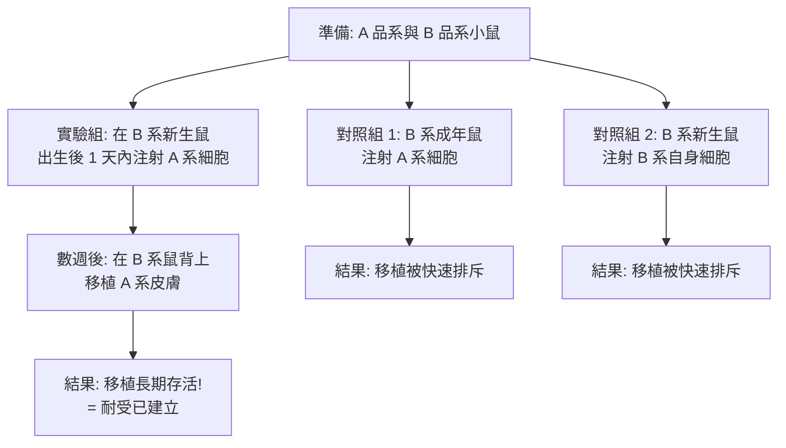

# 1960 · 獲得性免疫耐受：梅達沃的兔子皮膚實驗解答了移植醫學的攔路虎

> **1960 諾貝爾生理學 or 醫學獎**（共享）：弗蘭克·麥克法蘭·伯內特爵士（Sir Frank Macfarlane Burnet，澳洲）— 表彰「發現獲得性免疫耐受」（"for discovery of acquired immunological tolerance"）；彼得·梅達沃爵士（Sir Peter Brian Medawar，英國；巴西出生、黎巴嫩—英國血統）— 同上。

## 懸案（案情提要）

1940–1950 年代，器官移植面臨一道牆：**同種異體的皮膚移植總是被排斥**。即使血型相符、ABO 相同，移植的皮膚仍會在 10–14 天內壞死——先水腫、發炎，然後被宿主免疫系統摧毀。但有一個謎題讓所有人更困惑：

1. 為什麼**自我移植（autograft）**永不排斥——把一塊皮膚從一隻動物移到自己的另一處，它安然無恙？
2. 為什麼**異種移植（xenograft）**幾乎立刻排斥，連初次接觸都撐不過？
3. 為什麼**同種異體移植（allograft）**需要「事先接觸過」才會加速排斥？
4. **最關鍵的問題**：免疫系統既然能辨認「非我」，那麼有沒有可能**教它**把某些東西當成「自己」，從而不予攻擊？

第 4 問就是伯內特在 1950 年代提出的理論預言，而梅達沃用一項極其簡潔的實驗把它變成了事實。

## 前因

| 年份 | 事件 |
| --- | --- |
| 1944–1945 | 梅達沃在牛津（與 **Leslie Brent** 合作）發展出**雞胚的移植與嵌合體（chimerism）**技術：把雞胚的細胞移植到另一胚的卵黃囊血管系統中，觀察細胞的長期存活與功能。 |
| 1949–1953 | 梅達沃在英國的 **NIMR（Mill Hill）** 研究**同種異體皮膚移植的排斥現象**，並提出「**移植反應可能是免疫性的**」的證據；他與同事在 1953 年以定量方法確立「排斥反應的細胞學時間表」。 |
| 1953–1955 | 梅達沃與 **Rupert Billingham** 建立了**同卵雙生的動物實驗系統**，證明同卵雙生之間的皮膚移植**不會被排斥**——這是理解「自我辨識」與「非我辨識」的關鍵。 |
| 1955 | 梅達沃與 Billingham 發現**「異種免疫」的加速現象**：若先用 A 品系的皮膚給 B 品系動物做一次移植（該移植將被排斥），數週後再做第二次移植，**排斥會加速**——這說明第一次移植**建立了免疫記憶**。 |
| 1955–1956 | **喬伊·普爾坦（George Snell）**在美國的 Jackson Laboratory 以**小鼠**研究，發現**在胚胎期注射的外來細胞可以被長期耐受**——「**胚胎期獲得性耐受**」的雛形。 |
| 1956–1959 | 梅達沃在牛津與 Billingham、Brent 進行關鍵實驗：**在新生期注射非己的細胞，可建立對該抗原的耐受**（**acquired immunological tolerance**）。 |
| 1959 | 梅達沃在《自然》雜誌發表《The Induction of Immunological Tolerance》與《Acquired Immunological Tolerance》兩篇論文。 |
| 1960 | 兩人共享諾貝爾生理學 or 醫學獎。 |
| 1960s | **喬伊·普爾坦**以**近交系小鼠（inbred strains）**建立「**遺傳性免疫耐受**（genetic tolerance）」的完美實驗系統，並提出「**免疫學的空白地帶（immunological blind spot）」**概念：某些基因型組合天生互不排斥——這是移植生物學的重要基礎。 |
| 1970s | 伯內特的**克隆選擇學說（clonal selection theory）**成型，成為現代免疫學的總綱。 |

## 調查

### 第一幕：伯內特的理論預言——「胚胎期免疫系統尚未定型」

伯內特在 1950 年代提出的直覺極為清晰：

> 免疫系統的「自我辨識」能力，是**在發育過程中建立的**。若某個抗原在免疫系統「學習」辨認自我的關鍵窗口期就出現，它可能被當作「自己」而被接受。

他並提出一個大膽的預言：**在出生前後的短暫窗口期內接觸某個抗原，可以造成對該抗原的終身耐受**。

### 第二幕：梅達沃的實驗設計——一塊皮膚的三段命運

梅達沃與 Billingham、Brent 的實驗，是本案最漂亮的設計之一：

**關鍵對照的設計意圖極為精到**：

- **對照組 1（成年鼠 + 異己細胞）**：排除「注射本身無害」的可能；
- **對照組 2（新生鼠 + 自身細胞）**：排除「新生期注射任何東西都會造成耐受」的可能——**這是必須排除的混淆因子，因為當時已知「新生期的免疫系統尚未發育成熟，可能無法對抗任何抗原」**；
- **實驗組（新生期 + 異己細胞）**：只有這個組合產生了特異性的耐受。

### 第三幕：耐受是「抗原特異性」的

梅達沃的關鍵驗證是**交叉耐受實驗**：對 A 品系細胞耐受的老鼠，在被移植 **A 品系**皮膚時長期存活，但若移植 **C 品系**皮膚，**仍然被排斥**。

$$\text{耐受} \text{ 是抗原特異的，而非整體性的免疫抑制}$$

這一點極為重要——它排除了「新生期注射只是把免疫系統整體關掉」的解釋，並確立了**特異性免疫耐受**的概念。1956–1959 年，伯內特的團隊（**Fenner** 等）以**病毒抗原**在雞胚與新生小雞身上重複了同樣的結果，把耐受從「細胞抗原」推廣到「病毒抗原」。

### 第四幕：普爾坦的「遺傳性耐受」——完美的實驗系統

普爾坦在 Jackson Laboratory 的工作，提供了耐受現象的另一個維度。他發現某些**近交系小鼠的雜交組合**之間，天生互不排斥：

- 在胚胎期（**異卵異型合子胚胎的聚合與交換**）建立「嵌合體（chimerism）」；
- 某些胚胎之間的**紅血球與細胞會共存**，而某些則互相排斥；
- 這種耐受由**基因型決定**，可遺傳。

普爾坦由此提出**「免疫學的空白地帶」**概念：免疫系統的「自我／非我」判定，在演化上是**由基因決定的遺傳性窗口**，而非純粹後天學習的。這一洞見在 1950–1960 年代最終發展成 **Major Histocompatibility Complex（MHC）** 的概念（見 [1980-MHC 與血型抗原](1980-MHC與血型抗原.md)），是移植免疫學的核心。

### 第五幕：伯內特的克隆選擇學說——理論的收束

1960 年的諾貝爾演講中，伯內特系統闡述了**克隆選擇學說（clonal selection theory）**：

1. 每個抗原專一性的淋巴細胞在發育時**由隨機的基因重組過程產生**（此時他尚不知 V(D)J 重組的存在，該機制由利根川進於 1976 年證實，見 [1987-抗體多樣性](1987-抗體多樣性.md)）；
2. 每個克隆的表面有對應抗原的受體；
3. 抗原的出現**選擇**對應的克隆，使其增殖並分化為效應細胞；
4. **耐受的機制**：若某抗原在淋巴細胞發育的關鍵窗口期出現，則**對應的克隆被消除或失活**——因此日後再遇該抗原時，無clone可被選擇。

$$\text{耐受} = \text{「不應答的克隆」被建立（或被消除）}$$

這套學說把「耐受」與「選擇」統一在一個框架內，成為現代免疫學的總綱。

## 理論裁決

1. **耐受的數學描述**：耐受可用「應答機率隨時間衰減」來描述——耐受建立後，同一抗原再刺激引起的應答強度為：

   $$\text{Response}(t) = R_0 \cdot e^{-t/\tau_{tol}} \quad (\text{在耐受動物中})$$

   相較之下，未耐受動物在再免疫後的二次應答為 $R_2 \gg R_1$ （二次應應更大更快）。**耐受把二次應答曲線「壓平」**——這是實驗判讀的定量標準。

2. **耐受窗口的時間常數**：經典實驗顯示，**新生期的耐受窗口**在小鼠約為出生後 1–2 天（部分研究認為可延至數週，與抗原的性質有關）；而在胎盤傳遞IgG 的作用下，**母體的抗體可保護胎兒免於耐受**——這解釋了母親不會對胎兒產生排斥（因為她在孕期已暴露於胎兒抗原）。

3. **免疫學的「自我」定義**：耐受機制的推出，使「自我」的定義不再只是「基因完全相同」，而是**「在免疫系統發育窗口期出現的抗原」**。這是一個**發育性（developmental）而非純粹遺傳性**的自我定義，也是理解「為何母親不排斥胎兒」「為何角膜等免疫豁免組織不被排斥」的理論框架。

4. **嵌合體的數學**：普爾坦的嵌合體實驗中，兩種基因型的細胞共存的比例，可用**競爭指數（competitive index）**表示：

   $$CI = \frac{\text{測試品系細胞}}{\text{對照品系細胞}}$$

   這套測量方法是移植生物學至今仍在使用的標準工具。

5. **免疫學的應用推廣**：耐受概念一旦成立，其應用前景立即打開：

   - **器官移植**：誘導對捐贈者抗原的耐受（而非抑制整體免疫）；
   - **自體免疫疾病**：打破對自身抗原的耐受（逆向耐受）；
   - **過敏**：消除對過敏原的致敏狀態（今日的「抗原特異性免疫治療」即此路徑）。

   這三條應用方向在 1960–2020 年分別被實現為 **MHC 配對與免疫抑制藥物**、**檢查點抑制劑與 CAR-T**、**過敏原免疫療法（allergen immunotherapy）**。

## 追查支線（未結之謎）

- 梅達沃是巴西出生、父親為黎巴嫩人、母親為英國人的科學家；他在二戰期間因滑雪意外而右臂受到嚴重凍傷，轉而研究組織移植，這段個人遭遇成為他職業轉向的轉捩點；
- 梅達沃以**機智的寫作**聞名（《The Hope of Progress》與自傳《The Art of the Soluble》），理查德·道金斯稱他為「所有科學寫作者中最機智者」，史蒂芬·傑伊·古爾德稱他為「我遇過的最聰明的人」；
- 梅達沃晚年對**生物學的哲學基礎**與**科學家對社會的責任**有深刻反思（他在 1960 年代反對核試驗，並撰寫《The Hope of Progress》批判樂觀主義）；
- 伯內特在 1950 年代還發現了**Q 熱（Q fever）**與**鸚鵡熱（psittacosis）**的病原，並發明了大流行性感冒病毒的**雞胚培養與疫苗生產技術**——他是一位多產的免疫學家；
- 今日「**嵌合體與嵌合現象**」在多重感染（HIV）與移植醫學中的應用，可回溯至普爾坦 1950 年代的嵌合體概念。

## 證物與數據（偵查卷宗摘錄）

| 證物 | 數值／內容 | 偵查意義 |
| --- | --- | --- |
| 同卵雙生皮膚移植 | 不被排斥 | 「自我辨識」的證明 |
| 異種免疫加速 | 第二次移植排斥更快 | 免疫記憶的建立 |
| 胚胎期耐受（Snell） | 小鼠胚胎注射外來細胞後長期耐受 | 耐受的發育窗口 |
| 新生期注射 A 系細胞 | 之後移植 A 系皮膚長期存活 | 獲得性耐受的實現 |
| 對照組 1 | 成年鼠 + 異己細胞 → 排斥 | 排除「注射無害」 |
| 對照組 2 | 新生鼠 + 自身細胞 → 排斥 | 排除「新生期整體無反應」 |
| 交叉耐受實驗 | 對 A 耐受，但排斥 C | 耐受是抗原特異的 |
| 病毒抗原耐受（Fenner） | 雞胚/新生雞 | 耐受不限於細胞抗原 |
| 嵌合體競爭指數 | $CI = \frac{\text{測試}}{\text{對照}}$ | 移植生物學的標準測量 |
| 克隆選擇學說（1960） | 抗原選擇既存克隆 | 現代免疫學的總綱 |

## 後果

| 領域 | 影響 |
| --- | --- |
| 移植醫學 | 耐受機制的認識，是免疫抑制、抗體誘導性耐受與配對策略的理論源頭。 |
| 免疫學 | 克隆選擇學說成為現代免疫學的總綱，統一了抗體生成、排斥與耐受。 |
| 過敏學 | 「致敏」與「耐受」的對立，開啟了過敏原免疫療法的理論。 |
| 自體免疫 | 耐受機制的失衡成為自體免疫病的解釋框架。 |
| 科學學 | 梅達沃把「hypothesis → prediction → experiment → proof」示範為一條完整的方法鏈。 |
| 其他諾獎 | 與 [1912-血管縫合與器官移植](1912-血管縫合與器官移植.md)、[1990-器官與骨髓移植](1990-器官與骨髓移植.md)、[1980-MHC 與血型抗原](1980-MHC與血型抗原.md) 構成移植醫學的完整線。 |

## 關聯

- [1912-血管縫合與器官移植](1912-血管縫合與器官移植.md) — 卡雷爾記錄的「生物學障礙」，即本案解答的問題。
- [1908-免疫雙雄](1908-免疫雙雄.md) — 埃利希的側鏈選擇論，是克隆選擇學說的先聲。
- [1990-器官與骨髓移植](1990-器官與骨髓移植.md) — 移植醫學臨床化的里程碑。
- [1987-抗體多樣性](1987-抗體多樣性.md) — 利根川進解答伯內特預言中「隨機重組」的機制。
- [1980-MHC 與血型抗原](1980-MHC與血型抗原.md) — 普爾坦的遺傳性耐受最終通向 MHC 的發現。
