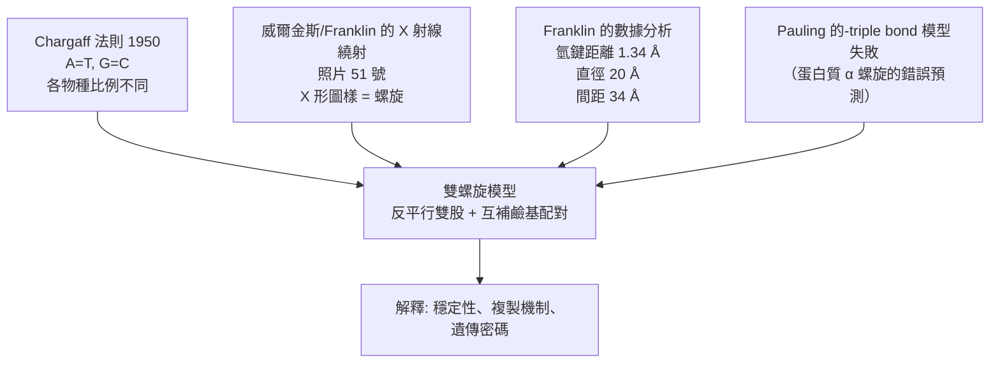

# 1962 · DNA 雙螺旋：克里克、沃森與威爾金斯用一張照片量出遺傳密碼的形狀

> **1962 諾貝爾生理學 or 醫學獎**（共享三人）：佛朗西斯·克里克（Francis Crick，英國）— 表彰「發現核酸的分子結構及其對生物中資訊傳遞的重要性」；詹姆斯·杜威·沃森（James Dewey Watson，美國）與莫里斯·威爾金斯（Maurice Wilkins，英國／紐西蘭）— 同上。

## 懸案（案情提要）

1951 年，DNA 的化學組成已知（見 [1910-細胞核化學](1910-細胞核化學.md)），遺傳學也已知基因在染色體上（見 [1933-染色體遺傳](1933-染色體遺傳.md)），但最根本的問題懸而未決：

1. **DNA 為何能把遺傳訊息儲存在一個穩定的形式裡？** 一個必須複製數十億次的分子，必須**足夠穩定**承受複製誤差，也必須**足夠簡單**能被解讀。
2. **DNA 的結構是什麼？** 它的雙股、螺旋、鹼基配對究竟長什麼樣？
3. **鹼基配對為何是「互補」的？** A 配 T、G 配 C，這個對應規則有什麼結構上的必然性？
4. **DNA 如何複製？** 雙螺旋是否天然提供了一個「模板」機制？

威爾金斯在 1952–1953 年以 X 射線繞射拍下著名的「**照片 51 號**」，克里克與沃森則在劍橋以數學與建模型式推算——兩條線索在 1953 年 2 月於劍橋會合。

## 前因

| 年份 | 事件 |
| --- | --- |
| 1869 | 米歇爾分離「核素」（核酸的第一次現身）。 |
| 1910–1930 | 科塞爾建立核酸的化學目錄；列文（Levene）提出「四核苷酸假說」（錯誤，見 [1910-細胞核化學](1910-細胞核化學.md)）。 |
| 1944 | 艾弗里（Avery）、麥克勞德（McLeod）與麥克卡蒂（McCarty）以肺炎鏈球菌的**轉化實驗**證明 DNA 是遺傳物質——見 [1946-X 射線誘發突變](1946-X射線誘發突變.md) 時期的分子生物學背景。 |
| 1950 | **Chargaff 法則**：以紙層析測得不同物種 DNA 的鹼基組成，發現 **$A = T$ 、 $G = C$**，且 $(A + T)/(G + C)$ 因物種而異——這是結構推理的關鍵線索（見 [1953-檸檬酸循環](1953-檸檬酸循環.md) 的實驗風格）。 |
| 1951 | 劍橋的 **勞勃斯·弗朗克（Lawrence Bragg）** 鼓勵其物理學家 **Francis Crick** 轉向生物學；克里克開始研究 DNA 的結構。 |
| 1951–1953 | 威爾金斯在倫敦 King's College 使用**X 射線繞射（X-ray crystallography）**研究 DNA 纖維，1952 年拍得著名的**「照片 51 號」**——呈現清楚的**X 形（cross）圖樣**。 |
| 1952–1953 | **Rosalind Franklin**（與 **Raymond Gosling**）在 King's College 拍出高解析的 DNA 纖維繞射照片，並以「**模型限制的數據分析**」測得 DNA 的**氫鍵距離（1.34 Å）**與**螺旋直徑（20 Å）**、**螺旋間距（34 Å）**等關鍵參數。 |
| 1953 年 1 月 | 沃森在劍橋的 Cavendish Laboratory 與克里克合作，並以搭車前往倫敦時獲得威爾金斯展示照片 51 號。 |
| 1953 年 2 月 28 日 | 沃森與克里克在劍橋的「**The Eagle**」小酒館提出雙螺旋模型。 |
| 1953 年 4 月 25 日 | 發表《Molecular Structure of Nucleic Acids》（《核酸的分子結構》）。 |
| 1953 年 5 月 | Franklin、Gosling、Wilkins、Stokes、Wilson 合著發表《Molecular Structure of Nucleic Acids》（Nature）。 |
| 1958 | 沃森與克里克因《The Double Helix》而獲 **1962 年諾貝爾生理學 or 醫學獎**（威爾金斯因放棄狀況不佳的健康與科學生涯讓出獎金而與沃森平分）。 |
| 1962–1968 | **鹼基配對與複製機制的物理驗證**：Meselson 與 Stahl 以密度梯度實驗證明**半保留複製**（見 [1959-核酸生合成](1959-核酸生合成.md)）。 |
| 1974 | 沃森在劍橋的演講中對 Franklin 的貢獻提及不足，引發廣泛批評。 |
| 2003 | 倫敦 King's College 與 Wellcome Trust 成立「**Rosalind Franklin Institute**」；同年《Nature》刊出「Errors in the scientific record」系列，正式為 Franklin 平反。 |

## 調查

### 第一幕：四條線索匯聚

DNA 結構的破解依賴四個獨立來源的證據：



**Chargaff 法則的關鍵意義**： $A = T$ 、 $G = C$ 立即暗示「**鹼基是成對出現的**」，且不同物種的 $(A+T)/(G+C)$ 不同，意味著**DNA 的資訊含量隨物種而異**——這正是遺傳物質應有的性質。

**X 射線繞射的關鍵意義**：DNA 纖維的衍射圖樣呈現**X 形**（十字交叉點），這是**螺旋結構的指紋**（螺旋軸沿纖維方向）。而 Franklin 測得的參數，直接給出了模型的硬性規格：

| 參數 | 實測值 | 對模型的要求 |
| --- | --- | --- |
| 氫鍵距離 | $1.34\ \text{Å}$ | 鹼基配對的氫鍵位置 |
| 分子直徑 | $20\ \text{Å}$ | 兩股螺旋的整體寬度 |
| 螺旋間距（每圈） | $34\ \text{Å}$ | 每圈 10 個鹼基對 |
| 相鄰鹼基對間距 | $3.4\ \text{Å}$ | 沿軸的步長 |
| 每圈鹼基對數 | 約 10 | $3.4 \times 10 = 34$ ✓ |

**Pauling 的失敗教訓**：Pauling 曾以模型建構提出 DNA 為**三股螺旋**（他認為氫鍵更穩定），但此模型**不符合繞射數據**（螺旋間距與直徑都不對），且無法解釋 Chargaff 法則。克里克指出：**Pauling 是用錯誤的模型去「解釋」他算錯的數據**——這是科學史上的重要教訓：模型的優雅不能取代數據的檢驗（詳見《The Double Helix》）。

### 第二幕：鹼基配對的化學必然性

沃森與克里克的核心推理是**互補配對的化學合理性**：

1. **A–T**：腺嘌呤（A）與胸腺嘧啶（T）都是嘧啶類單環分子，帶一個可供氫鍵的胺基與一個羰基氧，可形成 **2 個氫鍵**；
2. **G–C**：鳥嘌呤（G）與胞嘧啶（C）互為**互補的水 tautomer（互变异构体）**，可形成 **3 個氫鍵**；
3. 這解釋了 **Chargaff 的 $A = T$ 、 $G = C$**——因為每一對必為一 A-T 或一 G-C；
4. **Watson–Crick 鹼基配對**的意義在於：**它不僅解釋了比例守恆，更解釋了複製機制**。

**特別值得注意的細節**：G–C 配對有 **3 個氫鍵**而非 A–T 的 2 個，這在統計上意味著 **GC -rich 的 DNA 雙螺旋更穩定**——這是今日用於**基因組學的 GC 含量分析**（用於預測基因密度、PCR 引子設計、鑑定物種）的基本原理。

### 第三幕：反平行雙股與大溝小溝

模型最關鍵的特徵是**兩股「反平行」（antiparallel）**：

```mermaid
flowchart LR
    subgraph 上股 5'→3'
      A1[A] --- T1[T]
      G1[G] --- C1[C]
    end
    subgraph 下股 3'→5'
      C2[C] --- G2[G]
      T2[T] --- A2[A]
    end
```

- **反平行**：一股 5'→3'，另一股 3'→5'；
- **大溝（major groove）與小溝（minor groove）**：由兩股螺旋捲繞所形成的兩條螺旋溝，因鹼基對的糖－磷酸骨架在外側，鹼基的**氫鍵結合面朝向溝內**，因此**溝的寬度與化學性質決定了序列的可讀性**——這正是 1963 年後**蛋白質與 DNA 序列特異性結合**（如限制性內切酶、轉錄因子）的物理基礎（見 [1978-限制性內切酶](1978-限制性內切酶.md)）。

### 第四幕：雙螺旋如何解決「複製之謎」

雙螺旋最深刻的生物學意義在於**它自帶複製機制**：

$$\text{雙股解开} \to \text{每股作模板} \to \text{互補新股} \to \text{兩條相同的雙股}$$

這就是**半保留複製**的物理基礎——1958 年 Meselson–Stahl 的密度梯度實驗以數據證實（見 [1959-核酸生合成](1959-核酸生合成.md)）。**1953 年的結構模型直接預測了 1958 年的複製實驗結果**——這是「結構決定功能」最漂亮的一次預測成功。

### 第五幕：遺傳密碼的形狀

雙螺旋模型還暗示了**鹼基序列與胺基酸序列的共線性（colinearity）**：DNA 的鹼基序列以三個為一組（codon）對應一個胺基酸——這條推論在 1961–1968 年被 Nirenberg 與 Matthaei 的無細胞翻譯實驗證實（見 [1968-遺傳密碼](1968-遺傳密碼.md)）。

## 理論裁決

1. **雙螺旋的穩定性**：雙螺旋的穩定來自三個力量之和：

   $$\Delta G_{\text{total}} = \Delta G_{\text{stacking}} + \Delta G_{\text{H-bond}} + \Delta G_{\text{hydration}}$$

   - **鹼基堆疊（stacking）**：事實上這是**最主要的穩定力量**（疏水與 van der Waals 作用），而非氫鍵——這點在 1980–2000 年代才被定量確認（堆疊能約 $2\text{–}3\ \mathrm{kcal/mol}$ per base pair，而單個氫鍵約 $1\text{–}2\ \mathrm{kcal/mol}$ ）；
   - **氫鍵**：提供**專一性**（互補性），而非主要穩定能；
   - **水合**：磷酸骨架的水合層提供靜電穩定。

   這個修正很重要：**若主要靠氫鍵，則單股 DNA 應更穩定**——但實驗恰恰相反。

2. **複製的精確性**：互補配對提供化學選擇性，但**複製的保真度**還需酵素的校讀與修復（見 [1959-核酸生合成](1959-核酸生合成.md)）。**Watson–Crick 鹼基配對是準確度的「化學前提」，酵素機制是「執行與校對」。**

3. **DNA 纖維的 X 形圖樣**：螺旋結構在纖維 X 光圖上的指紋，其数学描述涉及 **Bessel 函數**——這是 1912 年德國物理學家 Debye 與其後 **Franklin 的結構因子計算**所建立的。今日的「X 射線晶體學 + 電子密度圖」的工作流程，直接承接 Franklin 的這條線。

4. **序列的可讀性**：大溝的化學圖案（鹼基對的暴露邊緣）構成了蛋白質讀取 DNA 的「拼圖語言」——這是今日轉錄因子結構生物學的基礎。

5. **物理學與生物學的交會**：本案的科學史意義不只在科學，更在**學科間的重新組合**——一位物理學家（克里克）、一位生物學家（沃森）、一位物理化學家（威爾金斯）、一位物理化學家與其研究員（Franklin）在一張照片前會合。這是 20 世紀科學「跨領域協作」的典範。

## 追查支線（未結之謎）

- **Rosalind Franklin 的命運**：她在 1958 年因黑色素瘤去世（年僅 37 歲），未能分享 1962 年諾獎。1970 年代起，她的貢獻被重新評價；2003 年 King's College 建立 Rosalind Franklin Institute，諾貝爾委員會亦於其官方網站公開更正了「她的工作未獲表彰」的歷史記載；
- **威爾金斯的讓獎**：威爾金斯因擔任諾貝爾委員會委員而依規定不得受獎，他選擇將獎金與沃森平分並退出委員會——此事在當時被視為不公，2000 年代的史家重新評價為「學術紳士的舉動」；
- **Watson 2002 年的醜聞與 2007 年的定性**：沃森在冷泉港的演講與後續報導中被指為種族主義言論，導致《Cold Spring Harbor Perspectives in Biology》與《Nature》與他切割，紐約冷泉港實驗室亦與他切割——這是諾獎得主公共行為規範的重大轉折點；
- 1953–1962 年間，DNA 結構與遺傳密碼之間仍缺一環：**鹼基序列如何決定胺基酸序列**——這由 1961 年的 Nirenberg 實驗補完（見 [1968-遺傳密碼](1968-遺傳密碼.md)）；
- 「**DNA 的語義**」至今仍是不完整的：我們知道鹼基序列決定蛋白質，但我們仍難以解釋**非編碼區（占人類基因組 98% 以上）**的功能——這是 21 世紀遺傳學最大的未解之謎之一。

## 證物與數據（偵查卷宗摘錄）

| 證物 | 數值／內容 | 偵查意義 |
| --- | --- | --- |
| Chargaff 法則（1950） | $A = T$ 、 $G = C$ ； $(A+T)/(G+C)$ 因種而異 | 鹼基成對存在的證據 |
| 照片 51 號（1952） | X 形衍射圖樣 | 螺旋結構的指紋 |
| Franklin 的數據 | 氫鍵 $1.34\ \text{Å}$ 、直徑 $20\ \text{Å}$ 、間距 $34\ \text{Å}$ | 模型的硬規格 |
| 每圈鹼基對 | 約 10 對（ $3.4 \times 10 = 34$ ） | 幾何自洽性檢查 |
| A–T 氫鍵 | 2 個 | 配對規則 |
| G–C 氫鍵 | 3 個 | GC-rich DNA 更穩定 |
| 反平行雙股 | 5'→3' / 3'→5' | 複製機制的幾何前提 |
| 大溝與小溝 | 鹼基對面向溝內 | 序列可讀性的物理基礎 |
| Pauling 的三股模型 | 不符合繞射數據 | 優雅不能取代數據 |
| 穩定力的分解 | 堆疊 > 氫鍵 | 1980s 的定量修正 |

## 後果

| 領域 | 影響 |
| --- | --- |
| 分子生物學 | DNA 結構成為整個領域的座標系；分子生物學正式誕生。 |
| 生物技術 | 重組 DNA、PCR、基因定序、基因編輯全部建立在雙螺旋的互補性之上。 |
| 遺傳學 | 從「基因是抽象因子」變成「基因是鹼基序列」。 |
| 醫學 | 分子遺傳病診斷、腫瘤生物學標記、藥物開發的分子時代。 |
| 科學史與倫理 | Franklin 案的平反引發了對諾獎提名與分配機制的系統性改革討論；Watson 事件則重塑了諾獎得主的公共責任規範。 |
| 其他諾獎 | 與 [1968-遺傳密碼](1968-遺傳密碼.md)、[1978-限制性內切酶](1978-限制性內切酶.md)、[1984-單株抗體](1984-單株抗體.md) 構成分子生物學主線。 |

## 關聯

- [1910-細胞核化學](1910-細胞核化學.md) — 核酸的化學目錄，是雙螺旋的材料清單。
- [1959-核酸生合成](1959-核酸生合成.md) — 複製機制的酵素執行，雙螺旋模型的生化兌現。
- [1968-遺傳密碼](1968-遺傳密碼.md) — 鹼基序列如何變成胺基酸序列，模型的下一問。
- [1978-限制性內切酶](1978-限制性內切酶.md) — 讀取序列的工具，倚賴大溝的化學圖案。
- [1933-染色體遺傳](1933-染色體遺傳.md) — 基因在染色體上的位置，終於與化學結構接軌。
