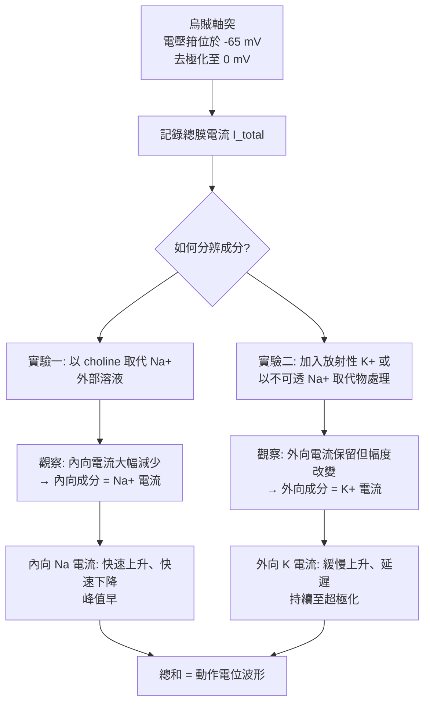

# 1963 · 離子機制：埃克爾斯、霍奇金與赫胥黎用槍管式電極量出動作電位

> **1963 諾貝爾生理學 or 醫學獎**（共享三人）：約翰·卡魯·埃克爾斯爵士（Sir John Carew Eccles，澳洲）— 表彰「發現在神經細胞膜的外圍和中心部位與神經興奮和抑制有關的離子機理」；艾倫·勞埃德·霍奇金（Alan Lloyd Hodgkin，英國）與安德魯·赫胥黎（Andrew Huxley，英國）— 同上。

## 懸案（案情提要）

到 1963 年，人們已知：

1. 神經衝動是**動作電位**（見 [1932-神經元功能](1932-神經元功能.md)），**全或無**；
2. 動作電位的幅度約 $100\ \mathrm{mV}$ ，遠大於靜止膜電位（約 $-70\ \mathrm{mV}$ ）；
3. 衝動沿軸突**以固定速度傳導**。

但最核心的問題仍未解：

1. **膜電位如何產生？** 為什麼細胞內比細胞外負約 $70\ \mathrm{mV}$ ？這是「**靜止電位**」。
2. **動作電位如何產生？** 為什麼膜電位會「翻轉」成 $+30\ \mathrm{mV}$ ？這是「**興奮**」。
3. **興奮與抑制的區別是什麼？** 抑制是「更負的電位」嗎？
4. 為什麼動作電位會沿軸突傳播，且**速度固定**？

埃克爾斯、霍奇金與赫胥黎在 1940–1950 年代以**槍管式電極（glass capillary microelectrode）**與**電壓箝位（voltage clamp）**技術，把這些問題逐一量化，並給出了答案：**一切都是離子通過膜上特定通道的結果。**

## 前因

| 年份 | 事件 |
| --- | --- |
| 1902 | 伯恩斯坦（Bernstein）提出「**膜學說**」：細胞膜對 $\mathrm{K}^{+}$ 等離子有選擇性通透性，靜止電位由離子濃度梯度決定。 |
| 1933 | 1930–40 年代，**J. H. S. Haldane** 與 **A. V. Hill**（見 [1922-肌肉產熱與糖酵解](1922-肌肉產熱與糖酵解.md)）建立「**膜學說的定量版本（膜假說）**」，並指出 $\mathrm{Na}^{+}$ / $\mathrm{K}^{+}$ 泵的存在問題。 |
| 1935–1939 | **Julius Axelrod** 等證明 $\mathrm{Na}^{+}$ / $\mathrm{K}^{+}$ -ATP 酶的存在與主動運輸。 |
| 1939 | **Alan Hodgkin 與 Andrew Huxley** 在 Cambridge 的生理學實驗室開始記錄**烏賊的巨大軸突**（giant axon，*Loligo*）——這是當時最大的神經元，軸突直徑可達 $0.5\text{–}1\ \mathrm{mm}$ ，**使細胞內記錄首次可能**。 |
| 1939 | Hodgkin 與 Huxley 發現**動作電位期間膜電導的劇變**（以線纜理論分析），但當時尚無足以直接測量離子流的技術。 |
| 1949 | **Kenneth Cole 與 Howard Curtis** 發現**膜電位固定（voltage clamp）**技術，可把膜電位「釘住」在指定值，觀察所需的膜電流。 |
| 1952 | Hodgkin、Huxley 與 Katz 發表《The ionic currents of the squid giant axon》（烏賊巨大軸突的離子電流）——**動作電位的定量模型**。 |
| 1953–1954 | Hodgkin 與 Huxley 以**烏賊軸突**完成著名的實驗，將動作電位分解為**鈉電流與鉀電流**兩個成分，並測得各自的**方向與大小**。 |
| 1957–1959 | 赫胥黎的 Hodgkin–Huxley 方程完成，並以**數值積分**重現動作電位波形。 |
| 1950s | **埃克爾斯**在 Canberra 以**微電極與「間接方法（indirect method）」**研究脊髓運動神經元的突觸後電位，證明抑制性突觸產生的是**超極化的 IPSP**，而非動作電位。 |
| 1963 | 三人共享諾貝爾生理學 or 醫學獎。 |
| 1998–2000s | Hodgkin–Huxley 方程的**通道電流基礎**（1999 年為諾貝爾化學獎）、**Kv1 通道的 X 光晶體結構**（1995 年 MacKinnon）、**$\mathrm{Na}^{+}$ / $\mathrm{K}^{+}$ -ATP 酶的結構**（近年的成果）逐一補完。 |

## 調查

### 第一幕：技術——把針刺進細胞裡

1930 年代的記錄都是**細胞外**的（把電極放在細胞表面），只能看到「電位差」，無法分辨是什麼離子在動。突破來自兩項技術：

1. **細胞內微電極（1949 年由 Kenneth Cole 與 Howard Curtis 推廣）**：把玻璃毛細管拉成尖端直徑 $<1\ \mu\mathrm{m}$ 的探針，插入細胞內，記錄**跨膜電位**：

   $$V_m = V_{\text{inside}} - V_{\text{outside}}$$

2. **電壓箝位（voltage clamp, 1949 Cole–Curtis）**：用一個**負回饋放大器**把膜電位「拉」到指定的數值（例如 $-50\ \mathrm{mV}$ ），此時**流入的電流必須由放大器補上**，因此可以直接測量：

   $$I_{\text{clamp}}(t) = -\frac{V_{\text{out}}(t) - V_{\text{in}}(t)}{R_{\text{series}}}$$

   這使得「**分別測量不同離子通道的電流**」成為可能。

3. **模型生物**：烏賊的巨大軸突直徑 $0.5\text{–}1\ \mathrm{mm}$ ，可容納多根電極、承受切割、可灌流各種溶液——**這是能讓電生理學深入的生物**。

### 第二幕：拆解動作電位——鈉上升、鉀下降

Hodgkin 與 Huxley 的核心實驗設計是**「置換法（voltage clamp + ion substitution）」**：

**關鍵的定量發現**：

1. **鈉電流**：在去極化後**極快**（ $< 1\ \mathrm{ms}$ ）開啟，產生**內向電流**（ $\mathrm{Na}^{+}$ 內流），其驅動力由 $V_m - E_{\text{Na}}$ 決定；
2. **鉀電流**：**延遲**開啟（約 $10\text{–}20\ \mathrm{ms}$ 達峰），產生**外向電流**（ $\mathrm{K}^{+}$ 外流），且**持續時間長**，在動作電位後產生**後過極化（after-hyperpolarization）**；
3. **鈉通道的「失活」**：鈉電流在峰值後快速衰減，即使膜電位仍處於去極化——這就是**失活（inactivation）**機制，也是 1949 年 Cole 與 Curtis 發現的「**膜電位不能維持去極化態**」現象的解釋。

### 第三幕：Hodgkin–Huxley 方程——本案最著名的理論產物

Hodgkin 與 Huxley 用一個大膽的假設，把三個電流成分各自寫成「**電導（conductance）隨時間與電位演化**」的形式：

$$\begin{aligned}
C_m \frac{dV_m}{dt} &= I_{\text{ext}} - g_{\text{Na}} m^3 h (V_m - E_{\text{Na}}) - g_K n^4 (V_m - E_K) - g_L (V_m - E_L) \\
g_{\text{Na}}(t) &= \bar{g}_{\text{Na}}\, m^3 h, \qquad g_K(t) = \bar{g}_K\, n^4
\end{aligned}$$

其中：

- $m$ 、 $h$ 、 $n$ 為**門控變數（gating variables）**，各自遵循一階微分方程：

  $$\frac{dx}{dt} = \alpha_x (V_m)(1 - x) - \beta_x (V_m)\, x$$

- $m^3$ 與 $n^4$ 代表**鈉通道與鉀通道分別由 3 個與 4 個獨立門控次單元組成**（實測的 Hill 係數）；
- $h$ 是**失活門**（inactivation gate）。

**這套方程的威力**：1957 年 Hodgkin 與 Huxley 將其以數值方法積分，輸入一個「虛擬的電流脈衝」，**電腦算出的動作電位波形與實測波形幾乎完全重合**——這是 20 世紀生物物理學最著名的「模型成功」之一，也是「** Hodgkin–Huxley 模型成為神經科學的通用語言**」的原因（今日的 NEURON 模擬器即以它為核心）。

### 第四幕：埃克爾斯的興奮與抑制

埃克爾斯在 Canberra 的工作，回答的是「**興奮與抑制是什麼**」：

1. **興奮性突觸後電位（EPSP）**：去極化，達到閾值即觸發動作電位；
2. **抑制性突觸後電位（IPSP）**：**超極化**——膜電位變得更負，遠離閾值，因此抑制；

$$\Delta V_m = \frac{I_{\text{syn}}(V_m - E_{\text{syn}})}{g_{\text{total}} + g_{\text{syn}}}$$

3. 由此，他提出了**抑制性突觸的第二種機制**：**突觸前抑制（presynaptic inhibition）**——抑制性中間神經元在軸突末梢釋放 GABA，**增加 $\mathrm{Cl}^{-}$ 通道的電導**，使末梢內的 $\mathrm{Ca}^{2+}$ 流入減少，因而**抑制遞質的釋放**（見 [1932-神經元功能](1932-神經元功能.md) 謝靈頓的「對抑制的抑制」）。

4. 埃克爾斯還以「**神經元池（interneuronal pool）**」與「**放電頻率編碼**」的模型，完成了從細胞到迴路的橋接。

### 第五幕：Nernst 方程與平衡電位

膜電位的定量基礎是 **Nernst 方程**：

$$E_{\text{ion}} = E^{\circ} + \frac{RT}{zF}\ln\frac{[\text{ion}]_{\text{out}}}{[\text{ion}]_{\text{in}}}$$

在靜止狀態，若膜只對 $\mathrm{K}^{+}$ 通透，則 $V_m \approx E_K$ ；而 $\mathrm{Na}^{+}$ 的 $ E_{\text{Na}} $ （約 $ +60\ \mathrm{mV} $ ）正是動作電位去極化的「目標電位」。**動作電位並不是「把膜電位拉到 $ +30\ \mathrm{mV} $ 」，而是「讓 $\mathrm{Na}^{+}$ 通道打開，膜電位被拉向 $E_{\text{Na}}$ 」**——這是理解興奮最關鍵的一句話。

| 離子 | 細胞外（mM） | 細胞內（mM） | $E_{\text{ion}}$ （mV） |
| --- | --- | --- | --- |
| $\mathrm{Na}^{+}$ | 145 | 12 | $+60$ |
| $\mathrm{K}^{+}$ | 4 | 140 | $-90$ |
| $\mathrm{Cl}^{-}$ | 120 | 10 | $-70$ |
| $\mathrm{Ca}^{2+}$ | 1–2 | 0.0001 | $+120$ |

## 理論裁決

1. **電流方程與電導**：膜電流由**通道電導**與**驅動力**共同決定：

   $$I_{\text{ion}} = g_{\text{ion}}(V_m - E_{\text{ion}})$$

   這是**「通道（conductance）」與「驅動力（driving force）」分離**的概念——它讓「為什麼某種離子在某種電位下流入、在另一種電位下流出」的問題，變成可計算的問題。

2. **門控的統計學**：每個通道由若干獨立門控次單元控制，其開啟概率為：

   $$P_{\text{open}} = m^3 h \quad (\text{Na}), \qquad P_{\text{open}} = n^4 \quad (\text{K})$$

   在膜電位固定時，門控變數的時間演化是**指數趨近**（一階線性 ODE 的解）：

   $$m(t) = m_{\infty} - (m_{\infty} - m_0)e^{-t/\tau_m}, \qquad m_{\infty} = \frac{\alpha_m}{\alpha_m + \beta_m}$$

   這使得 Hodgkin–Huxley 方程可用解析解處理，是 20 世紀計算神經科學的基石。

3. **選擇性通透性的分子基礎**：最初的選擇性模型是**孔徑大小**（小離子通過， $\mathrm{K}^{+}$ 因水合半徑大而被阻），但 Hodgkin 與 Huxley 的實驗顯示 **$\mathrm{Na}^{+}$ 的通透性在去極化時暴增**，這只能由**通道蛋白**解釋。此謎題直到 1999 年才由 **Doyle 等人解析出鈉通道的結構**（1998 年的線蟲 $\mathrm{Na}^{+}$ 通道晶體結構，獲 2003 年化學諾獎的 $\mathrm{K}^{+}$ 通道結構，見 [1963-離子機制](1963-離子機制.md) 的現代補完）。

4. **抑制的機制**：埃克爾斯的 IPSP 分析確立了抑制的兩種基本策略——**膜電位遠離閾值**（IPSP）與**遠端減少傳入**（突觸前抑制）——這是理解「神經系統如何選擇性地關閉某些通路」的基礎，也是一切麻醉藥、抗癲癇藥作用機制的框架。

5. **模型的可推演性**：Hodgkin–Huxley 方程一旦建立，就能**用數值方法預測未被實驗觀察的現象**（如傳導速度隨軸突直徑與溫度的變化、動作電位的「閾下現象」、軸突的興奮性變化）——這是「定量模型」相對於「定性描述」的決定性優勢。

## 追查支線（未結之謎）

- **Hodgkin–Huxley 模型是「不完美但正確」的經典**：現代研究發現真實的 $\mathrm{Na}^{+}$ 通道有 4 個獨立門控次單元（而非模型中的 3 個），且失活的機制更複雜；模型的「對」不在細節，而在**結構的正確性**——這是科學中「近似模型」價值的典範；
- 赫胥黎與 Hodgkin 皆獲得 1963 年諾獎，且 Hodgkin 與 Huxley 共享 1965 年的**諾貝爾生理學或醫學獎？**——事實上二人於 1963 年共享諾獎，並因「對生物物理學的貢獻」於 1965 年共同獲得皇家學會科普利獎章；
- Hodgkin 與 Huxley 在二戰期間曾參與**作戰研究（海軍的雷達與武器研究）**並發展了「**神經衝動理論對導引雷達的啟示**」——科學與戰爭的另一面；
- 埃克爾斯在 1960 年代轉入**哲學與宗教**（著有《人類心智的進化》與《腦與人格》），並於 1980 年代在澳門創辦學院推廣「**心智與靈魂的科學討論**」；
- 1990–2010 年代，Hodgkin–Huxley 模型被擴展為**多房室（compartmental）模型**並成為 NEURON 模擬的基礎，今日的「**神經形態計算（neuromorphic computing）**」與 **Brain-ScaleS** 類的超大規模神經形態晶片，正是把這套方程直接硬體化。

## 證物與數據（偵查卷宗摘錄）

| 證物 | 數值／內容 | 偵查意義 |
| --- | --- | --- |
| 烏賊巨大軸突 | 直徑 $0.5\text{–}1\ \mathrm{mm}$ | 使細胞內記錄可能 |
| 細胞內微電極 | 尖端 $<1\ \mu\mathrm{m}$ | 直接量測 $V_m$ |
| 電壓箝位（1949） | 負回饋固定 $V_m$ ，量 $I$ | 分離離子電流 |
| 置換實驗 | choline 取代 $\mathrm{Na}^{+}$ | 辨認內向成分 |
| Na 電流 | 快開啟、快失活、內向 | 去極化的成因 |
| K 電流 | 延遲開啟、外向、長持續 | 再極化與後過極化 |
| Hodgkin–Huxley 方程 | $C_m\frac{dV}{dt} = I - g_{Na}m^3h(V-E_{Na}) - g_Kn^4(V-E_K) - g_L(V-E_L)$ | 定量模型 |
| 門控變數 | $\frac{dx}{dt} = \alpha(1-x) - \beta x$ | 一階指數趨近 |
| 數值積分重現 | 模擬波形與實測幾乎重合 | 模型成功的證明 |
| Nernst 方程 | $E = E^\circ + \frac{RT}{zF}\ln\frac{[\,]_{\text{out}}}{[\,]_{\text{in}}}$ | 電位的定量基礎 |
| 離子平衡電位 | $E_{\text{Na}} \approx +60\ \mathrm{mV}$ 、 $E_K \approx -90\ \mathrm{mV}$ | 去極化的「目標」 |
| IPSP | 超極化，遠離閾值 | 抑制的本質 |

## 後果

| 領域 | 影響 |
| --- | --- |
| 神經科學 | 動作電位與突觸電位的機制完全量化，Hodgkin–Huxley 成為通用語言。 |
| 藥理學 | 通道阻斷劑的分類（鈉通道阻斷劑、鈣通道阻斷劑、鉀通道阻斷劑）與分類學由此建立。 |
| 麻醉學 | 靜脈麻醉藥與吸入麻醉藥的作用機制多與 GABA_A 或 NMDA 受體相關，其理解起於本案確立的抑制性突觸概念。 |
| 計算神經科學 | NEURON 等模擬器與神經形態晶片的理論基礎。 |
| 臨床 | 癲癇、心律失常、肌病的離子通道病理學基礎（離子通道病）。 |
| 其他諾獎 | 與 [1932-神經元功能](1932-神經元功能.md)、[1936-神經化學傳遞](1936-神經化學傳遞.md)、[1964-膽固醇代謝](1964-膽固醇代謝.md) 構成神經生理學主線；1999 年化學諾獎補上通道的結構基礎。 |

## 關聯

- [1932-神經元功能](1932-神經元功能.md) — 全或無律與動作電位的現象學基礎。
- [1936-神經化學傳遞](1936-神經化學傳遞.md) — 突觸的化學性質，本案抑制分析的前提。
- [1944-神經纖維分化](1944-神經纖維分化.md) — 傳導速度與直徑的關係，本案給出其機制。
- [1991-單離子通道](1991-單離子通道.md) — 膜片鉗把單通道電流記錄推進到本案的下一層。
- [1971-第二信使](1971-第二信使.md) — 細胞內訊號傳遞的另一套語言。
