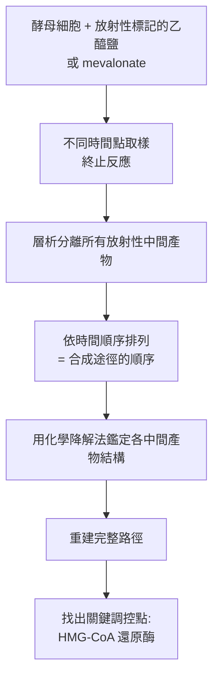

# 1964 · 膽固醇與脂肪酸的代謝：布洛赫與呂嫩補上「脂質代謝」這一整塊拼圖

> **1964 諾貝爾生理學 or 醫學獎**（共享）：康拉德·埃米爾·布洛赫（Konrad Emil Bloch，德國出生、美國籍）— 表彰「發現膽固醇和脂肪酸的代謝機理和調控作用」；費奧多爾·呂嫩（Feodor Felix Konrad Lynen，德國）— 同上。

## 懸案（案情提要）

1950 年代末，脂質代謝有許多零散的發現，卻缺乏一個**統一的框架**。核心疑點：

1. 膽固醇從哪裡來？人體如何合成它？
2. 膽固醇在體內如何「被處置」？既然它是細胞膜與類固醇激素的原料，為什麼不會堵塞血管？
3. 脂肪酸如何被合成？**「脂肪酸的合成」與「脂肪酸的氧化」是否走同一條路**？
4. **最關鍵**：既然吃了高熱量的食物會胖，為什麼肥胖不是「簡單的熱量守恆」？身體在什麼時候選擇「合成」而不是「燃燒」？

布洛赫與呂嫩在 1950–1960 年代回答了這四個問題，並建立了**脂質代謝的完整地圖**——這張地圖是理解動脈粥狀硬化、糖尿病與肥胖的基礎。

## 前因

| 年份 | 事件 |
| --- | --- |
| 1920s | 德國化學家 ** Adolf Windaus** 因膽固醇與維生素 D 的結構研究獲 1928 年諾貝爾化學獎；**Schöller** 等在 1930 年代提出「膽固醇由乙醯輔酶 A 合成」的最初猜測。 |
| 1930–40s | ** Konrad Bloch** 在哥本哈根（Krogh 的實驗室，見 [1920-毛細血管調節](1920-毛細血管調節.md)）開始研究酵母的脂質代謝。 |
| 1940s | **Feodor Lynen** 在慕尼黑的 Reichstag 大廳（Kaiser Wilhelm 研究所）研究酵母的脂質代謝，並於 1947–1951 年證明**乙醯輔酶 A 是一切脂質合成的中心中間物**。 |
| 1950–1953 | Bloch 與團隊以**放射性碳標記的乙醯鹽**追蹤酵母中膽固醇的合成，並**分離出中間產物**——包括一種「**羥甲基戊二烯基輔酶 A（HMG-CoA）**」；但限於當時的技術，他無法完全確定其結構。 |
| 1953 | 布洛赫與塔德烏什·賴希施泰因（見 [1950-腎上腺皮質激素](1950-腎上腺皮質激素.md)）在《美國化學會雜誌》發表 HMG-CoA 的發現。 |
| 1957–1959 | 布洛赫與團隊確定 HMG-CoA 的結構，並證明它可被還原為**甲羥戊酸（mevalonate）**——**膽固醇合成的關鍵中間物**。 |
| 1959 | **呂嫩**在慕尼黑證明**乙醯輔酶 A 在細胞內可被還原為脂肪酸**（還原途徑），並分離出**脂肪合成酶（fatty acid synthetase, FAS）**——這是一個**多酵素的聚合酵素複合體**。 |
| 1964 | 兩人共享諾貝爾生理學 or 醫學獎。 |
| 1970s | **Statin（他汀類）**的發現直接源於布洛赫的路徑研究：Peter Kater 與 Akira Endo 等發現真菌代謝物能抑制 HMG-CoA 還原酶——今日全球最暢銷的藥物類別之一（見 [1988-藥物治療原理](1988-藥物治療原理.md)）。 |

## 調查

### 第一幕：中心中間物的追蹤——乙醯輔酶 A 的地位

呂嫩在 1930–40 年代的關鍵發現是：**乙醯輔酶 A 不只是克雷布斯循環的入口（見 [1953-檸檬酸循環](1953-檸檬酸循環.md)），它也是**脂質合成的中心樞紐**。這就把「糖代謝」與「脂質代謝」連成一片：

$$\text{Glucose} \to \text{Pyruvate} \to \text{Acetyl-CoA} \to \begin{cases} \text{Cholesterol} \\ \text{Fatty acids} \\ \text{Ketones} \\ \text{Acetoacetate} \end{cases}$$

### 第二幕：布洛赫的「放射性追蹤」——把膽固醇合成的每一步揪出來

布洛赫的方法極為典型，是 20 50 年代生物化學的標準武器：

**關鍵的中間產物**：

| 中間產物 | 意義 |
| --- | --- |
| 乙醯乙醯輔酶 A（acetoacetyl-CoA） | 起始的二聚體 |
| **HMG-CoA**（羥甲基戊二烯基輔酶 A） | 分岔點：可走向**酮體生成**（分枝酮酸 CoA 轉移酶）或走向**膽固醇合成**（HMG-CoA 還原酶） |
| **甲羥戊酸（mevalonate）** | 膽固醇合成的**專一性分岔點**——所有細胞都走這條路（這正是他汀的作用點） |
| 甲羥戊酸-5-磷酸 | 往下游磷酸化 |
| 異戊烯基焦磷酸（IPP）、二甲基烯丙基焦磷酸（DMAPP） | 「異戊二烯單位」——膽固醇鏈的構成磚塊 |

**「異戊二烯規則」的發現**：布洛赫證明，許多天然產物（類固醇、萜烯、輔酶 Q 的醌環、維生素 A、D、K）都由**異戊二烯單位**組成——這是一條貫穿整個天然產物化學的通則，被稱為「**Ruzicka's biogenetic isoprene rule**」的生化證實。

### 第三幕：呂嫩的脂肪酸合成——「一個巨大的酵素複合體」

呂嫩在 1959 年完成的一項技術性非凡的工作是**分離出脂肪酸合成酶（FAS）**——一個由**七種酵素功能**組成的多酵素複合體：

$$\text{Acetyl-CoA} + 7\,\mathrm{ATP} + 14\,\mathrm{NADPH} + 14\,H^+ \to \text{Palmitate} + 7\,\mathrm{ADP} + 7\,\mathrm{P_i} + 14\,\mathrm{NADP}^+ + 6\,H_2O$$

這是 20 世紀生物化學最壯觀的酵素複合體之一：**一個巨大的蛋白質組裝體，依次執行縮合、脫羧、還原、脱水、再還原的循環**，每次循環延長 2 個碳。哺乳類的 FAS 是一個 270 kDa 的 $\alpha_2\beta$ 複合物；真菌的則是兩個 210 kDa 的多肽融合體。

**這項工作的意義**：它證明了**「酵素複合體」是細胞提高合成效率的方式**——所有中間產物直接從一個酵素傳到下一個，不需離開酵素，也不需要擴散。

### 第四幕：脂肪酸的兩條路——合成 vs 氧化

呂嫩的另一項關鍵發現，是**脂肪酸的氧化途徑與合成途徑完全不同**（雖然某些步驟是逆反應，但酵素不同）：

| | 合成（cyt cytosol） | 氧化（粒線體基質 + 過氧化體） |
| --- | --- | --- |
| 部位 | 細胞質 | 粒線體 |
| 運輸者 | **丙二醯輔酶 A（malonyl-CoA）** | **肉豆蔻醯輔酶 A（carnitine shuttle）** |
| 電子接受者 | NADPH（還原） | FAD、 $\mathrm{NAD}^{+}$ （氧化） |
| 關鍵酵素 | FAS、ACC（乙醯輔酶 A 羧化酶） | CPT-I、β-氧化酵素系 |
| 方向 | 建造 | 拆解 |

**「丙二醯輔酶 A」是矛盾的樞紐**：它是合成途徑的「啟動者」，卻又**抑制**脂肪酸的氧化（抑制 CPT-I）。這就是「**丙二醯輔酶 A—CPT-I 軸**」，是今日理解「為什麼肥胖的人會同時有高血糖與脂肪肝」的核心，也是**瘦素（leptin）與胰島素**調控能量平衡的關鍵節點。

### 第五幕：從這些發現到今天的兩種應用

1. **他汀類藥物（statins, 1976 年起）**：**紅麴黴（Monascus purpureus）**中的天然化合物能抑制 **HMG-CoA 還原酶**——布洛赫指出的速率限制步驟。他汀因此能降低血漿膽固醇，是全球處方量最大的藥物類別之一，直接降低了心血管疾病的死亡率。**這是「基礎代謝研究 → 藥物 → 公共衛生成果」最完整的一條鏈**。
2. **apoB-100 的發現（1960s–70s）**：布洛赫與團隊發現血漿中運輸膽固醇的脂蛋白顆粒含有一種蛋白質 **apoB-100**，而它的受體（LDL 受體）由 **Brown 與 Goldstein** 在 1985 年發現（見 [1985-膽固醇受體](1985-膽固醇受體.md)）——這條線最終通向下一次諾獎。

## 理論裁決

1. **膽固醇合成的能量學**：合成一分子膽固醇（ $\mathrm{C}_{27}$ ）需要：

   $$\text{消耗} \approx 27\,\mathrm{ATP} + 18\,\mathrm{NADPH}$$

   這個龐大的能量成本，解釋了為什麼身體在能量充足時傾向**合成儲存**而非燃燒，也解釋了為何節食與運動在脂質代謝上有效。

2. **HMG-CoA 分岔點的調控**：**HMG-CoA 還原酶**是整條路徑的速率限制酵素與主要調控點：

   $$\frac{d[\text{Chol}]}{dt}\Big|_{synthesis} = v_{\text{HMG-CoA Red}} \propto f(\text{Chol}, \text{Insulin}, \text{Glucagon})$$

   **膽固醇本身負回饋抑制**該酵素（這是 1970s 由 Brown 與 Goldstein 證實的）；**胰島素活化、升糖素抑制**；**他汀類則是直接抑制該酵素**——一個代謝速率限制點被藥物直接鎖定，是藥理學上最漂亮的靶點之一。

3. **能量平衡的方程式**：現代能量平衡的簡化模型：

   $$\Delta E_{\text{stored}} = E_{\text{intake}} - E_{\text{expenditure}}, \qquad E_{\text{expenditure}} = E_{\text{BMR}} + E_{\text{TEF}} + E_{\text{EA}}$$

   布洛赫與呂嫩的工作，正是這個方程式中**每一項的生化基礎**（BMR 的甲狀腺素調控、TEF 的消化成本、EA 的運動消耗）。

4. **生酮作用的邊界**：HMG-CoA 的「雙重命運」解釋了**酮症的病理**：當肝臟的乙醯輔酶 A 過量（禁食、糖尿病）且草醯乙酸被 TCA 循環佔用（見 [1953-檸檬酸循環](1953-檸檬酸循環.md)）時，乙醯輔酶 A 被迫走向酮體途徑，造成**酮酸中毒**——這是 1 型糖尿病急性併發症的分子機制（見 [1923-胰島素](1923-胰島素.md)）。

## 追查支線（未結之謎）

- 布洛赫在 1937 年被迫離開德國（納粹時期的猶太裔科學家），先在瑞士的 Basel 短期停留，隨後赴美國；他自述曾考慮不再做科學，但最終在哥本哈根獲得博士學位後留在了這條研究線上——**這是 20 世紀科學家流亡的典型軌跡**；
- 布洛赫與呂嫩都在慕尼黑工作過；呂嫩是慕尼黑大學的教授，而布洛赫在戰後曾短暫返回德國，兩人的關係與科學先驅-後輩的張力在科學史上頗受關注；
- 1950–60 年代的「脂質代謝黃金年代」也伴隨著**食品工業的急遽轉型**——氫化植物油的普及（反式脂肪酸，今日已知其增加心血管風險）、以及「膽固醇—冠狀動脈疾病」假說的興起（Ancel Keys 的「七國研究」）——這段歷史是科學證據與公共衛生政策複雜互動的教材；
- **異戊二烯規則**在布洛赫之後被繼續擴展到維生素、輔酶 Q、葉綠素與天然橡膠的生物合成，是「生物合成途徑研究」這一方法論的典範；
- 布洛赫在晚年推動**科學與教育的公共政策**，並發表《《The Imagination of Nature》》等科普與哲學著作。

## 證物與數據（偵查卷宗摘錄）

| 證物 | 數值／內容 | 偵查意義 |
| --- | --- | --- |
| 乙醯輔酶 A 的中心地位 | 糖 → 乙醯輔酶 A → 脂質 | 糖脂代謝的樞紐 |
| 放射性標記追蹤 | 依時間排序中間產物 | 重建合成途徑的方法 |
| HMG-CoA（1953） | 分岔點中間物 | 酮體 vs 膽固醇 |
| 甲羥戊酸（1957–59） | 膽固醇合成的專一性分岔 | 他汀的靶點 |
| 異戊二烯單位 | IPP、DMAPP | 「異戊二烯規則」 |
| 脂肪酸合成酶（1959） | 七種酵素功能的複合體 | $270\ \mathrm{kDa}$ 的 $\alpha_2\beta$ |
| 合成反應式 | 乙醯-CoA + 7 ATP + 14 NADPH → 棕櫚酸 | 能量學的結算 |
| 合成 vs 氧化 | 不同部位、不同酵素 | 兩條獨立路徑 |
| 丙二醯輔酶 A | 抑制 CPT-I | 能量平衡的調控樞紐 |
| 能量成本 | 每分子膽固醇 27 ATP + 18 NADPH | 「合成昂貴」的量化 |

## 後果

| 領域 | 影響 |
| --- | --- |
| 藥理學 | HMG-CoA 還原酶成為他汀類的靶點——全球最暢銷的藥物類別之一。 |
| 心血管醫學 | 膽固醇代謝的生化基礎確立，為 LDL 受體學說與降脂治療鋪路。 |
| 營養學 | 脂質與醣類代謝的相互關係（脂肪過剩、胰島素阻抗）獲得生化解釋。 |
| 內分泌 | 瘦素、胰島素、丙二醯-CoA 軸的能量平衡模型建立。 |
| 天然產物化學 | 生物合成途徑研究成為解釋結構的通用方法。 |
| 其他諾獎 | 與 [1953-檸檬酸循環](1953-檸檬酸循環.md)、[1950-腎上腺皮質激素](1950-腎上腺皮質激素.md)、[1985-膽固醇受體](1985-膽固醇受體.md) 構成脂質代謝主線。 |

## 關聯

- [1953-檸檬酸循環](1953-檸檬酸循環.md) — 乙醯輔酶 A 的來源，脂質代謝的入口。
- [1950-腎上腺皮質激素](1950-腎上腺皮質激素.md) — 類固醇激素的合成起於同一條路徑。
- [1985-膽固醇受體](1985-膽固醇受體.md) — 布洛赫的路徑研究在細胞層級的後續。
- [1988-藥物治療原理](1988-藥物治療原理.md) — 他汀與藥理學的相遇。
- [1920-毛細血管調節](1920-毛細血管調節.md) — 布洛赫的老師 Krogh 與哥本哈根生理學派。
