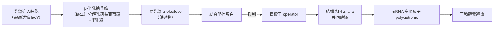
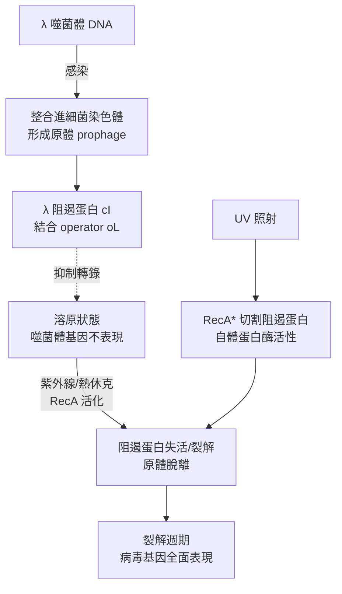

# 1965 · 乳糖操縱子：雅各、莫諾與勒沃夫找到基因開關的機制

> **1965 諾貝爾生理學 or 醫學獎**（共享三人，皆為法國籍）：方斯華·雅各（François Jacob，法國）— 表彰「在酶和病毒合成的遺傳控制中的發現」；安德列·利沃夫（André Michel Lwoff，法國）與賈克·莫諾（Jacques Lucien Monod，法國）— 同上。

## 懸案（案情提要）

1950 年代末，生物化學已確立「**基因控制酵素**」（見 [1958-一基因一酶](1958-一基因一酶.md)），但控制的方式是什麼？

1. 當細胞不需要某個酵素時，是**關掉製造它的機器**，還是**分解已製造的酵素**？
2. 「需要的訊號」（例如乳糖）如何**傳到基因**？
3. 基因的表現能否**成組調控**（多個相關的基因一起開關）？
4. 更根本的問題：**遺傳訊息如何從 DNA 傳到蛋白質**？DNA 與蛋白質之間有沒有「中間人」？

雅各、莫諾與勒沃夫在巴黎的 Pasteur 研究所回答了前 3 問，並由莫諾提出第 4 問的答案——**信使 RNA（mRNA）**。

## 前因

| 年份 | 事件 |
| --- | --- |
| 1952 | **拉什卡（Steven Roseman）** 提出細菌的**乳糖操縱子（lac operon）**模型。 |
| 1953–1956 | **Maia Monod** 在 Pasteur 研究所進行系統的**生長與代謝測定**：以乳糖作為唯一碳源，觀察大腸桿菌的生長曲線，並以「**適應（adaptation）**」概念描述酶誘導。 |
| 1956 | **Jacob 與 Monod** 提出**操縱子模型**：一組結構基因（z、y、a）共同轉錄，由單一的調控基因（i）與操縱子（operator）控制。 |
| 1958–1960 | **Jacob 與 Lwoff** 對**溶原菌（lysogeny）**的研究發現：**λ 噬菌體的 DNA 以「原體（prophage）」形式整合進細菌染色體**，並由一個**阻遏蛋白（repressor）**維持在抑制狀態；這提示了「基因表現可以被關掉」的概念。 |
| 1960–1961 | **Jacob 與 Monod** 以**交配中斷實驗（interrupted mating）**繪出大腸桿菌的**遺傳地圖**（Hfr 品系的轉移順序），建立了細菌的基因定位工具。 |
| 1961 | 莫諾與 Jacob 在《分子生物學雜誌》（*Journal of Molecular Biology*）發表《Genetic regulatory mechanisms in the synthesis of proteins》——**操縱子模型正式發表**。 |
| 1961 | **Brenner、Jacob 與 Meselson（1961）**提出 **mRNA 的存在**：他們以「**短時間脈衝實驗**」在細菌中追蹤放射性標記的胺基酸，發現新合成的蛋白質並非來自原有的蛋白質池，而是與一種**快速更新的 RNA** 相關。 |
| 1963 | **Jacob 與 Brenner** 證明 **RNA 聚合酶**的存在（彌補 RNA 合成酵素的缺口）。 |
| 1965 | 三人共享諾貝爾生理學 or 醫學獎。 |
| 1966 | **Clyde Coombs 與 Arthur Pardee** 的實驗（見 [1959-核酸生合成](1959-核酸生合成.md)）證明阻遏蛋白是**可分離的蛋白質**。 |
| 1967 | **Ptashne** 以**λ 阻遏蛋白的體外純化**最終證實操縱子結合模型。 |

## 調查

### 第一幕：乳糖操縱子——一個能被「量」的調控系統

莫諾與雅各選擇乳糖系統，因為它有**三個可測量的層次**：

1. **基因層**：存在 $lacZ$ （β-半乳糖苷酶）、 $lacY$ （通透酶）、 $lacA$ （轉乙醯酶）三個結構基因；
2. **蛋白質層**：三種蛋白的產量；
3. **代謝層**：乳糖的分解速率與生長速率。

**關鍵的定量事實**（雅各與莫諾的「劑量效應曲線」，被稱為經典的「**Monod 曲線**」）：

1. 加入誘導物（IPTG）後，β-半乳糖苷酶的產量可增加**約 1000 倍**；
2. 產量與誘導物濃度呈**S 型（sigmoidal）**關係，而非線性：

   $$\frac{v}{v_{\max}} = \frac{[I]^n}{K_{0.5}^n + [I]^n}, \qquad n \approx 2$$

   這個 **Hill 係數 $n \approx 2$** 是極其關鍵的證據：它表示**誘導物分子要兩個一起才能結合阻遏蛋白**——即阻遏蛋白是**二聚體**，兩個單體各結合一個誘導物。

3. 三種蛋白的產量**同步上升**，且比例恆定——證明它們是**共同轉錄**的（多順反子 mRNA）。

### 第二幕：操縱子模型的四個要件

雅各與莫諾 1961 年的模型包含四個元素：

| 元素 | 功能 | 實驗證據 |
| --- | --- | --- |
| **結構基因（z, y, a）** | 編碼酵素 | 互補突變分析（complementation test） |
| **操縱子（operator, $o$ ）** | 阻遏蛋白結合處 | $o^c$ 組成型突變 |
| **調控基因（i）** | 編碼阻遏蛋白 | $i^s$ 超級阻遏突變 |
| **啟動子（promoter, $p$ ）** | RNA 聚合酶結合處 | $p$ 突變 |

**「 $o^c$ 組成型突變」的意義**是本案最漂亮的一次推理：操縱子突變（ $o^c$ ）使得阻遏蛋白無法結合——**無論有無乳糖，基因都持續表現**。這個「不能關」的突變，直接證明了操縱子是阻遏蛋白的作用位點；其後**互補試驗（complementation test）**的邏輯，也成為遺傳學分析基因功能的通用工具。

### 第三幕：溶原菌與阻遏蛋白——從乳糖系統推廣到病毒

雅各與勒沃夫對 λ 噬菌體的研究，提供了**基因表現可以被「關掉」的獨立證據**：

**λ 阻遏蛋白的自我維持迴路（autoregulatory loop）**是本案最漂亮的推論之一：阻遏蛋白不只關閉噬菌體基因，也**促進自身的轉錄**——一個正回饋迴路，使溶原狀態得以穩定維持。這預示了現代的**正回饋switch（正回饋開關）**概念，而 Jacob 與 Monod 也正是以「遺傳學 + 生化學」雙重證據確立了**負回饋**與**正回饋**兩種基本調控模式。

### 第四幕：mRNA 的預言與驗證

莫諾最著名的概念預言是 **mRNA 的存在**。在 1961 年之前，人們不知道蛋白質合成是直接讀 DNA 還是通过某種中間物。莫諾、雅各與 Brenner 提出：

1. **假說**：存在一種**短壽命的 RNA**，其序列對應特定基因，並被迅速消耗；
2. **實驗設計（Brenner–Jacob–Meselson 的脈衝實驗）**：以 ${}^{35}\mathrm{S}$ 標記的硫胺素（甲硫胺酸）短時間脈衝餵食細菌，然後用**「核糖核酸酶（RNase）處理」**來追蹤：
   - 若蛋白質是**直接由 DNA 模板合成**（RNA 參與其中），則 RNase 處理不影響；
   - 若蛋白質是**經由 mRNA 中間物合成**，則 RNase 處理會**立即停止新蛋白合成**；
3. **結果**：RNase 處理使標記蛋白的合成**瞬間停止**——**mRNA 存在，獲得證實**。

這是 20 世紀分子生物學最乾淨的一次「預言 → 設計實驗 → 驗證」的循環，也確認了**中心法則**（DNA → RNA → Protein）的路線。

### 第五幕：從操縱子到通用的基因調控詞彙

「操縱子」一詞從一個細菌系統，成為**所有基因表現調控的通用單位**——細菌、真菌（乳糖操縱子式的調控）、人類（細胞激素受體作為「操縱子式的轉錄因子」）都在使用同一套語彙。現代分子生物學的「**可誘導系統（inducible system）與可抑制系統（repressible system）**」二分，也直接來自本案。

## 理論裁決

1. **轉錄調控的開關模型**：阻遏蛋白與操縱子的結合，可寫成質量作用定律：

   $$R + O \rightleftharpoons RO, \qquad K_d = \frac{[RO]}{[R][O]}$$

   誘導物的效應是降低 $K_d$ （藉由改變構形提高對操縱子的親和力），因此：

   $$\frac{[RO]}{[O]} = \frac{[R]}{K_d([I])}$$

   轉錄速率與未結合的操縱子比例成正比：

   $$v_{\text{tx}} = v_{\max}\left(1 - \frac{[RO]}{[O]}\right)$$

   這套簡單的模型即能重現 Monod 曲線的 S 型形態與 Hill 係數 $n \approx 2$ 。

2. **回饋控制的數學分類**：
   - **負回饋**（乳糖系統）：產物或誘導物抑制自身的合成路徑——穩定、經濟；
   - **正回饋**（λ 阻遏蛋白）：阻遏蛋白促進自身合成—— bistable（雙穩態），可在「溶原／裂解」兩個狀態間切換。

   雙穩態的數學基礎：

   $$\frac{dx}{dt} = \alpha \frac{x^n}{K^n + x^n} - \beta x$$

   當 $\alpha > \beta K$ 時，此式具有**兩個穩定定點**與一個不穩定定點——這正是 lac 操縱子的「記憶性」與 λ 噬菌體的「溶原-裂解開關」的共同語言，也是今日**合成生物學中基因電路設計**的標準工具。

3. **基因劑量的定量**：以單順反子與多順反子的差別，提示了**「一個 mRNA 多個蛋白」**的效率優勢——一次轉錄、多次翻譯，是基因組經濟性的基礎：

   $$\text{蛋白產量} \approx \frac{\text{轉錄速率} \times \text{mRNA 壽命}}{\text{翻譯速率}}$$

4. **中心法則的建立**：DNA → mRNA → 蛋白質的路線，配合 1961 年 Brenner 的**「無細胞蛋白質合成系統」**，成為 20 世紀生物學的中心命題（見 [1968-遺傳密碼](1968-遺傳密碼.md)）。

## 追查支線（未結之謎）

- **雅各在二戰中加入了抵抗運動**，因此被諾貝爾委員會暫緩頒獎（委員會的規則是不得獎給在戰時為敵方服務的人），直到 1957 年他獲得「解放十字勳章」等確認後才可受獎——這樁「諾獎與戰時政治」的小插曲與 [1939-磺胺藥物](1939-磺胺藥物.md) 的納粹禁令遥相呼應；
- 雅各在生命後期撰寫了《The Statue Within》（《體內的雕像》，1970）與《The Biology of Belief》，探討「基因是否控制行為」的問題，1970 年代他與左翼知識份子的「生物學與社會」論戰是科學思想史的重要事件；
- 莫諾對**「偶然與必然」**的哲學著作《Chance and Necessity》（1970）是 20 世紀最被廣泛閱讀的科學哲學作品之一；
- 阻遏蛋白的結構（1990s 的晶體結構顯示 L/I 家族阻遏蛋白與「迴旋 DNA」的結合）最終**否定了「操縱基因與阻遏蛋白在同一條 DNA 上」的部分原始模型**——現代模型中，操縱基因與結構基因可位於不同染色體上（由 $i$ 基因的反式作用因子提供阻遏蛋白）——這是「模型被修正」的又一例；
- 莫諾提議的「mRNA」最終由 **Brenner 與 Jacob 在 1961 年的實驗**確認，而 2000 年代的**單細胞轉錄組學**讓「mRNA 存在」從一個發現變成了一種語言。

## 證物與數據（偵查卷宗摘錄）

| 證物 | 數值／內容 | 偵查意義 |
| --- | --- | --- |
| Monod 曲線 | 酵素產量 vs 誘導物濃度，S 型 | 定量的調控曲線 |
| Hill 係數 | $n \approx 2$ | 阻遏蛋白是二聚體 |
| 誘導倍數 | 可達約 1000 倍 | 調控的量級 |
| 三基因同步 | z、y、a 產量比例恆定 | 多順反子轉錄 |
| $o^c$ 組成型突變 | 無法被關閉 | 操縱子的存在 |
| $i^s$ 超級阻遏突變 | 無法被開啟 | 調控基因的存在 |
| 互補試驗 | 判定基因功能的通用工具 | 遺傳學方法論 |
| λ 溶原/裂解開關 | RecA 切割阻遏蛋白 | 正回饋與雙穩態 |
| RNase 脈衝實驗 | 標記蛋白合成瞬間停止 | **mRNA 的證實** |
| 轉錄調控方程 | $v = v_{\max}(1 - [RO]/[O])$ | 開關模型 |

## 後果

| 領域 | 影響 |
| --- | --- |
| 分子生物學 | 轉錄調控成為獨立研究領域；操縱子成為通用概念。 |
| 基因工程 | 「誘導型表現系統」（如 lac/tac 啟動子）成為生物技術的標準工具，是重組蛋白表達與基因治療的基礎。 |
| 合成生物學 | 基因電路設計（toggle switch、repressilator）直接建立在操縱子模型上。 |
| 病毒學 | λ 噬菌體成為研究基因調控與分子生物學的標準系統。 |
| 科學哲學 | 莫諾《偶然與必然》的出版，影響了 20 後半葉的科學思想。 |
| 其他諾獎 | 與 [1958-一基因一酶](1958-一基因一酶.md)、[1959-核酸生合成](1959-核酸生合成.md)、[1968-遺傳密碼](1968-遺傳密碼.md) 構成分子生物學主線。 |

## 關聯

- [1958-一基因一酶](1958-一基因一酶.md) — 調控的對象：基因產物（酵素）的產量。
- [1959-核酸生合成](1959-核酸生合成.md) — RNA 聚合酶與轉錄的化學機制。
- [1968-遺傳密碼](1968-遺傳密碼.md) — mRNA 到蛋白質的下一步。
- [1972-抗體結構](1972-抗體結構.md) — 免疫球蛋白基因的調控是操縱子模型的延伸。
- [1936-神經化學傳遞](1936-神經化學傳遞.md) — 生物學中「開關」概念的生理學先例。
