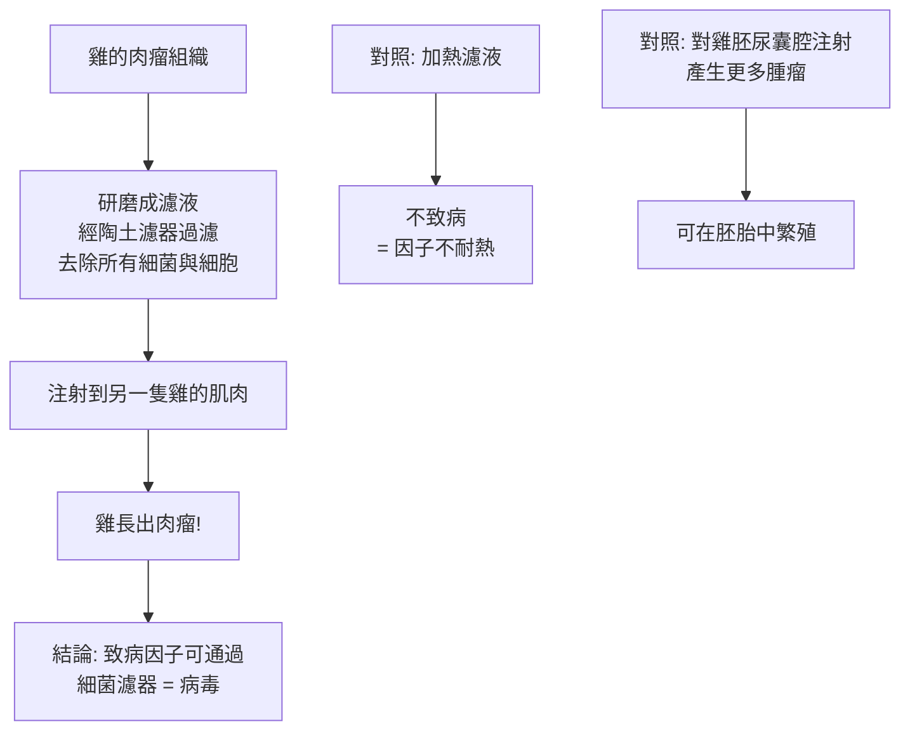
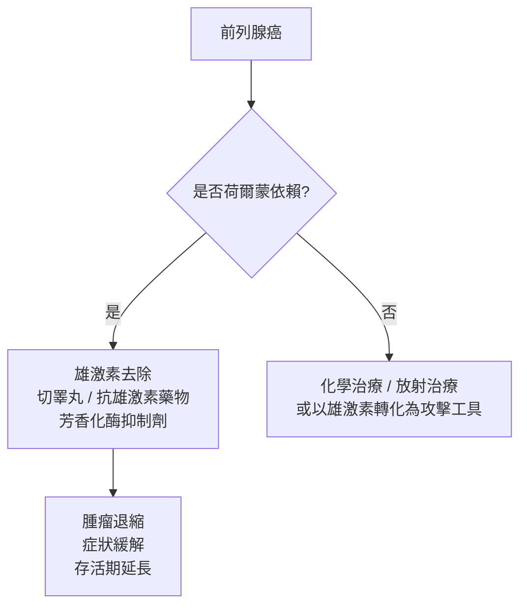

# 1966 · 腫瘤病毒與前列腺癌的激素療法：勞斯的病毒等了 55 年，哈金斯用荷爾蒙對付癌症

> **1966 諾貝爾生理學 or 醫學獎**（共享）：裴頓·勞斯（Francis Peyton Rous，美國）— 表彰「發現誘導腫瘤的病毒」（"for his discovery of tumour-inducing viruses"）；查爾斯·布蘭頓·哈金斯（Charles Brenton Huggins，美國）— 表彰「發現前列腺癌的激素療法」（"for his discoveries concerning hormonal treatment of prostatic cancer"）。

## 懸案（案情提要）

兩樁案子在同一個年份獲獎，一個關於**病毒能致癌**，一個關於**荷爾蒙能治療癌症**。它們共同回答了癌症研究的核心問題：

**案子甲**：癌症有沒有**傳染性**？傳統觀點認為癌症是自發性的（細胞內在的錯誤），不是傳染病。1911 年，勞斯在雞身上做出一個驚人實驗：把某一種雞的肉瘤組織的**無細胞濾液**注射給其他雞，recipient 雞長出了同樣的肉瘤——**這意味著致癌因子可以通過沒有細菌的濾液傳播**，即它是一種病毒。

但這個發現被學界當作「雞的怪病」而擱置了半個多世紀，直到 1960 年代分子生物學的工具才讓它被接受（見 [1975-反轉錄與腫瘤病毒](1975-反轉錄與腫瘤病毒.md)）。

**案子乙**：前列腺癌是老年男性的主要癌症之一，此時的手術（前列腺切除）對晚期病灶無效，且男性荷爾蒙（雄激素）被認為**促進**前列腺的生長——那麼，**切除睪丸讓雄激素歸零，腫瘤會萎縮嗎？**

哈金斯的答案是：**會**。這是 20 世紀第一個「**荷爾蒙依賴性腫瘤的治療**」——它開啟了「腫瘤的依賴性」概念，也開啟了內分泌腫瘤學。

## 前因

| 年份 | 事件 |
| --- | --- |
| 1908–1910 | 佩頓·勞斯在 Johns Hopkins 與 Rockefeller 研究所工作，研究雞的**肉瘤（sarcoma）**。 |
| 1911 | 勞斯發現雞肉瘤可由**無細胞的腫瘤濾液**傳播給其他雞；病原後來被命名為 **Rous sarcoma virus（RSV）**。 |
| 1911–1950s | 勞斯的發現被主流癌症研究**排斥或忽視**（認為是「雞特有的寄生蟲」或實驗誤差）；其他病毒（如兔HPV? 雞的傳染性貧血因子）的發現亦遭冷落。 |
| 1920s | 哈金斯在芝加哥大學建立實驗外科室，開始研究**睪丸切除對前列腺癌的影響**。 |
| 1935–1941 | 哈金斯觀察到：轉移性前列腺癌患者在睪丸切除（或雌激素治療）後，症狀顯著改善——但**腫瘤並未消失，只是退縮**。 |
| 1941 | 哈金斯與其同事讀者（讀者?）發表《**The effect of orchiectomy on the development and treatment of carcinoma of the prostate**》（睪丸切除對前列腺癌發展與治療的影響）——**荷爾蒙療法的奠基論文**。 |
| 1941–1944 | 哈金斯以**雌激素（diethylstilbestrol, DES）**治療晚期前列腺癌，證明可**以藥物達到切睪丸的同樣效果**（DES 即今日廣為人知的「荷爾蒙替代療法藥物」，1960–70 年代被廣泛用於更年期婦女，後被發現有嚴重致癌風險，見下方「追查支線」）。 |
| 1950s | 哈金斯的實驗被 **1960s 的隨機對照試驗方法論**挑戰（前列腺癌治療缺乏對照，且腫瘤「退縮」可能只是荷爾蒙作用的暫時現象），他以更嚴謹的數據與方法重新論證。 |
| 1950s | **Anders Hökland**? 實為 **S. B. (Sune) 等**研究發現前列腺癌的**雌激素受體**，並區分「荷爾蒙依賴型」與「非依賴型」腫瘤——**受體的概念使治療得以精準化**（這條線由 1960s–70s 的 Elwood Jensen 在乳腺癌上發揚光大）。 |
| 1966 | 兩人共享諾貝爾生理學 or 醫學獎。 |

## 調查

### 第一幕：勞斯的濾液實驗——「沒有細菌，卻能傳病」

勞斯的實驗設計極為簡潔：

**這個實驗為何被當時主流排斥？** 三個原因：

1. **分類學的偏見**：當時的癌症研究以「化學致癌」（如煤焦油，見 [1926-鼠癌錯案](1926-鼠癌錯案.md) 的年代背景）為主流，病毒致癌被視為不切實際；
2. **「雞的病」偏見**：勞斯堅持是「雞肉瘤」特有，人類癌症沒有對應物；
3. **方法論的質疑**：懷疑實驗是否因移植過程中的細胞污染或免疫抑制造成；
4. **自身的表述問題**：勞斯在描述中謹慎地稱之為「一個可通過濾器的感染性因子」，並不用「病毒」一詞——這反而讓他的主張在語義上模糊，難以被納入既有分類。

**55 年後的翻案**：1960–70 年代的分子工具（電子顯微鏡、超薄切片、核酸雜交）最終證實 RSV 是**一種病毒**（實為**反轉錄病毒**），其基因組是 RNA，並且**顛覆了中心法則**——詳見 [1975-反轉錄與腫瘤病毒](1975-反轉錄與腫瘤病毒.md)。勞斯以 87 歲高齡獲獎，成為生理學或醫學獎史上最年長的得主（此紀錄保持至今）。

### 第二幕：哈金斯的觀察——「切掉睪丸，腫瘤縮小」

哈金斯的推理極為直接。他知道：

1. 前列腺是**雄激素依賴性**的器官（閹割的動物前列腺萎縮）；
2. 前列腺癌患者的腫瘤組織也含有雄激素受體；
3. 那麼，**移除雄激素來源（睪丸）**，前列腺癌應當受影響。

他設計了人類實驗（這是 1940 年代，尚無 RCT 倫理框架）：

| 治療 | 結果 |
| --- | --- |
| 雙側睪丸切除 | 骨痛緩解、排尿改善、PSA（後來）下降、存活期延長 |
| 雌激素（DES）治療 | 與睪丸切除**相當**的效果 |
| 對照（無治療） | 病情進展迅速 |

**哈金斯的關鍵洞見不是「切掉睪丸」，而是「腫瘤對荷爾蒙的依賴性」**：

$$\text{腫瘤生長} \propto \text{荷爾蒙刺激} \times \text{腫瘤本身的生長傾向}$$

這開啟了**「內分泌依賴性腫瘤」**的概念——它與「 autonomous」的腫瘤形成鮮明對比：

### 第三幕：藥理學的延伸——「把腫瘤當成依賴它的靶細胞」

哈金斯的治療邏輯在 1970 年代被大幅延伸：

1. **DES 與雄激素的對抗**：雌激素抑制睪固酮的產生（負回饋抑制 LH/FSH）並直接作用於受體；
2. **GnRH 類似物（leuprolide）**：1980 年代，藉由「下視丘—腦垂腺—性腺軸」的反跳性抑制，實現了**可逆的、醫學性的「化學去勢」**；
3. **雄激素受體拮抗劑（flutamide、enzalutamide）**：直接阻斷受體；
4. **ADT（雄激素去除治療）**：成為轉移性前列腺癌的標準治療，**從「切一刀」變成「可調控、可逆、可聯合」的策略**；
5. **荷爾蒙依賴性的演變**：前列腺癌在數年後常轉化為**去勢抗性（castration-resistant）**——這是腫瘤生物學的重要課題（見 [2018-免疫檢查點](2018-免疫檢查點.md) 時代的免疫治療）。

### 第四幕：乳腺癌的平行發現

哈金斯的研究把「荷爾蒙依賴」的概念帶到了乳腺癌：1960–70 年代，**Elwood Jensen** 發現**雌激素受體（ER）**，並證明 ER 陽性的乳腺癌對**他莫昔芬（tamoxifen）**反應良好，而 ER 陰性者無效——**這是「生物標記引導治療」的開端**，並使「荷爾蒙受體狀態」成為乳腺癌的標準分類（今日的 ER/PR/HER2 三標記分類）。

## 理論裁決

1. **荷爾蒙依賴性的數學模型**：腫瘤生長可用兩項競爭因子描述：

   $$\frac{dT}{dt} = \underbrace{\alpha \cdot H}_{\text{荷爾蒙刺激}} - \underbrace{\beta \cdot T}_{\text{自發死亡}}$$

   在荷爾蒙依賴型腫瘤中 $\alpha$ 顯著；去除荷爾蒙使 $\alpha \to 0$ ，腫瘤體積按指數衰減：

   $$T(t) = T_0 e^{-\beta t}$$

   這解釋了哈金斯觀察到的「**症狀改善但腫瘤未消失**」——腫瘤只是停止生長並緩慢退化，而非被消滅。

2. **受體作為治療標的**：受體的存在使「藥物—標的」的配對具有**可預測性**：

   $$P(\text{應答}) \approx P(\text{受體陽性}) \times P(\text{藥物可達標的濃度})$$

   這正是今日「生物標記驅動治療（precision medicine）」的原型。

3. **病毒致癌的數學框架**：病毒的致癌需要多步驟（多擊致癌說），可寫為：

   $$P(\text{腫瘤}) = P(\text{感染}) \cdot P(\text{前致癌病毒活化}) \cdot P(\text{突變累積} > n)$$

   這解釋了為何多數帶有致癌病毒的人不發病，也解釋了為何免疫抑制（移植病人、HIV）會提高癌症發生率（見 [1960-後天免疫耐受](1960-後天免疫耐受.md) 的免疫監控概念）。

4. **治療的風險—效益方程式**：DES 的案例顯示，同一藥物在不同族群（前列腺癌男性 vs 更年期女性）中可有完全不同的風險效益比：

   $$NB = P(\text{療效}) \cdot V(\text{療效}) - P(\text{毒性}) \cdot V(\text{毒性})$$

   這是現代藥物風險管理與「適應症分層」的根本邏輯。

## 追查支線（未結之謎）

- **DES 的歷史教訓**：哈金斯用於前列腺癌的**己烯雌酚（DES）**，隨後被廣泛用於孕婦的「流產預防」與更年期雌性素補充，結果在 1970 年代被發現可導致**陰道 clear cell 腺癌**與數代女性的生殖系統異常——這是 20 世紀最著名的「藥物危害」事件之一，也是現代藥品風險管理與妊娠期用藥分級（FDA 字母分級）的推動力量；
- 勞斯在獲獎當年（1966 年）已 87 歲，是諾貝爾生理學 or 醫學獎史上最年長的得主；他於 1970 年去世，享年 90；
- 勞斯與 **Joseph R. Turner** 在一戰期間發展了**血液的酸化-枸櫞酸鹽保存法**，由 **Oswald H. Robertson 於 1917 年**在前線建立**世界上第一個血液銀行**——這是本案得主另一項被低估的醫學貢獻，與血型研究（見 [1930-人類血型](1930-人類血型.md)）同屬輸血醫學譜系；
- 哈金斯的實驗在 1960 年代曾因方法論爭議（無隨機對照、樣本小、終點定義不嚴）而受到質疑——這樁爭議成為 1960–70 年代臨床試驗方法學改革的推動因素之一；
- 哈金斯以「**選擇性雄激素抑制**」開啟的荷爾蒙治療，經由前列腺癌一路延伸到**乳腺癌（他莫昔芬）、甲狀腺癌（放射性碘）、腎上腺皮質癌（mitotane）**等多種腫瘤——「腫瘤的內分泌依賴性」是 20 世紀腫瘤學的基本框架。

## 證物與數據（偵查卷宗摘錄）

| 證物 | 數值／內容 | 偵查意義 |
| --- | --- | --- |
| 勞斯濾液（1911） | 濾液可使雞長肉瘤 | 病毒致癌的首證 |
| 加熱對照 | 不致病 | 因子的不耐熱性 |
| 雞胚尿囊腔傳播 | 產生更多腫瘤 | 可在胚胎繁殖 |
| 睪丸切除（1941） | 骨痛緩解、症狀改善 | 荷爾蒙依賴性的證明 |
| DES 治療 | 與睪丸切除相當 | 「以藥代替刀」 |
| 去勢抗性 | 數年後轉化 | 腫瘤演化的重要課題 |
| ER 與他莫昔芬 | 受體陽性者應答 | 精準治療的原型 |
| 腫瘤生長方程式 | $\frac{dT}{dt} = \alpha H - \beta T$ | 依賴性的量化 |
| 標記驅動治療 | $P(\text{應答}) \approx P(\text{受體陽性}) \times P(\text{可達濃度})$ | 生物標記的邏輯 |
| DES 危害 | 陰道 clear cell 腺癌 | 20 世紀最著名的藥害事件 |

## 後果

| 領域 | 影響 |
| --- | --- |
| 腫瘤生物學 | 「荷爾蒙依賴性」與「去勢抗性」成為腫瘤學的核心概念。 |
| 內分泌學 | 腫瘤的內分泌治療成為四大治療模式之一（與手術、放射、化學並列）。 |
| 藥理學 | GnRH 類似物、雄激素受體拮抗劑、芳香化酶抑制劑構成今日前列腺癌治療的完整工具箱。 |
| 病毒學 | 病毒致癌被接受為癌症病因之一，直接通向 1975 年反轉錄酶與 1980–90 年代的腫瘤病毒研究。 |
| 輸血醫學 | 勞斯的血液保存法與第一個血庫。 |
| 醫學倫理 | DES 事件推動了藥品安全與妊娠用藥監管的現代體制。 |
| 其他諾獎 | 與 [1975-反轉錄與腫瘤病毒](1975-反轉錄與腫瘤病毒.md)、[1976-B肝病毒與庫魯病](1976-B肝病毒與庫魯病.md) 構成病毒致癌主線。 |

## 關聯

- [1975-反轉錄與腫瘤病毒](1975-反轉錄與腫瘤病毒.md) — 勞斯的病毒的分子命運。
- [1976-B肝病毒與庫魯病](1976-B肝病毒與庫魯病.md) — 人類致癌病毒的最早證實。
- [1950-腎上腺皮質激素](1950-腎上腺皮質激素.md) — 類固醇激素藥理學的基礎，哈金斯的治療工具。
- [1930-人類血型](1930-人類血型.md) — 勞斯的血液保存與第一個血庫。
- [1926-鼠癌錯案](1926-鼠癌錯案.md) — 化學致癌與病毒致癌的競爭，本案是後者的勝出。
