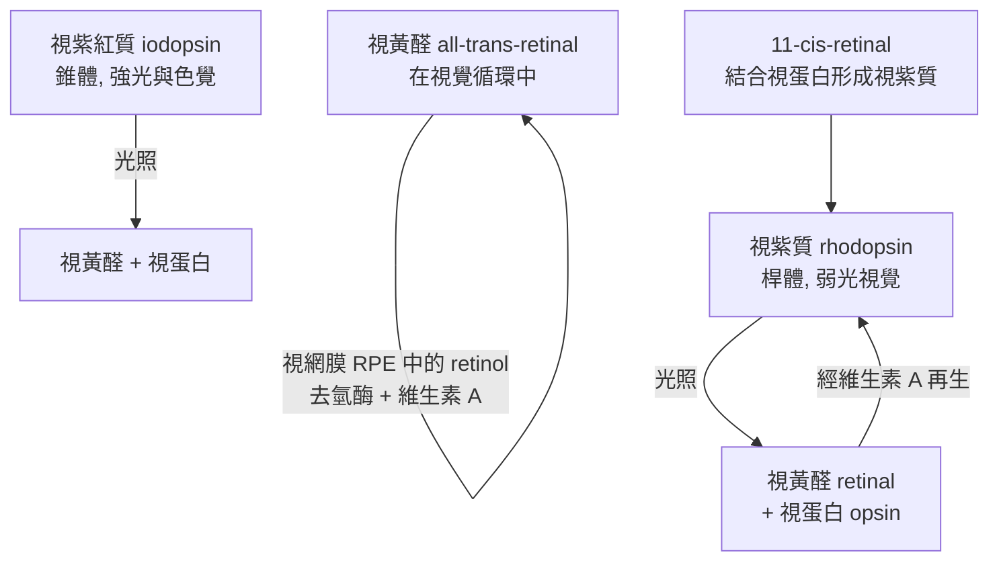
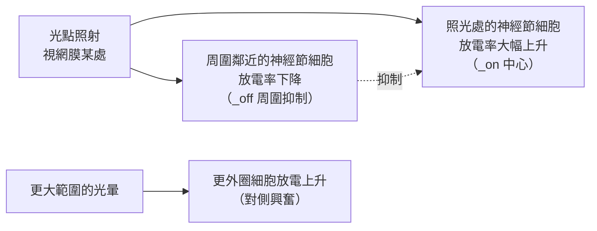
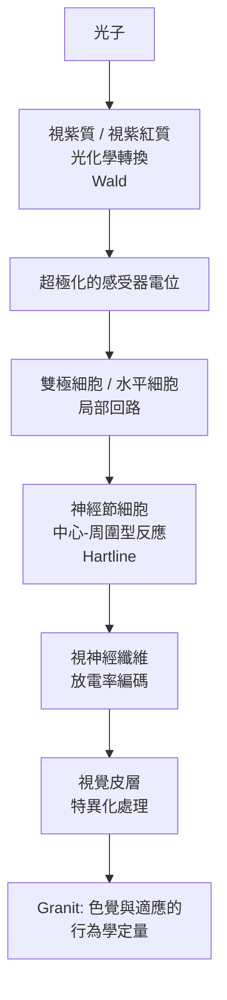

# 1967 · 視覺的初級生理與化學過程：格拉尼特、哈特蘭與沃爾德把「看見」拆成三層

> **1967 諾貝爾生理學 or 醫學獎**（共享三人）：拉格納·格拉尼特（Ragnar Arthur Granit，芬蘭／瑞典）— 表彰「發現眼睛的初級生理及化學視覺過程」；霍爾登·凱弗·哈特蘭（Haldan Keffer Hartline，美國）與喬治·沃爾德（George Wald，美國）— 同上。

## 懸案（案情提要）

視覺研究的核心謎團有兩層：

**表層**：眼睛如何把光子轉成神經訊號？光進入眼睛、被視網膜的感光細胞吸收、轉換成電訊號——但「感光」究竟是指什麼化學反應？

**深層**：我們「看見」的並不是光的世界，而是**神經元活動所建構的世界**。那麼：

1. **並行的處理是怎麼回事？** 人類在同一時刻處理百萬個像素，卻只能意識到其中極少的一部分——**注意力**的生理機制是什麼？
2. 視網膜上的訊號是「原始的」，還是已經被加工過的？
3. 眼睛如何在不同光照下維持恆定的視覺感受（明適應與暗適應）？

這三位得主各自負責一層：**沃爾德**——光化學層；**格拉尼特**——光譜與辨色的生理學；**哈特蘭**——神經迴路與資訊加工。

## 前因

| 年份 | 事件 |
| --- | --- |
| 1850s | **布魯克（Helmholtz）** 測量視網膜的感光性（視紫質 rhodopsin）在不同波長下的漂白效率，發現**其吸收光譜與人類的色覺曲線相對應**——這是色覺生理學的開端。 |
| 1877 | **Kühne** 提取出「**視紫質（rhodopsin）**」並描述其在光下的漂白。 |
| 1878 | Kühne 與 **Brodhan** 在青蛙視網膜上發現**視紫質的再生需要維生素 A**——維生素 A 與視覺的連結。 |
| 1932 | **S. W. G. (George) Wald** 開始研究視紫質的光化學，並在 1930 年代分離出**維生素 A 醛（retinal）**——**光反應的最終產物**。 |
| 1932 | **Ragnar Granit** 在芬蘭開始研究**視網膜的電生理**（暗適應曲線、桿體與錐體的功能分工）。 |
| 1947–1950s | **Haldan Hartline** 在洛克菲勒研究所以**螢光（微光）技術**研究**鯉魚的單細胞視網膜**（鯉魚視網膜的神經節細胞巨大且彼此分離），獲得了神經迴路的完美模型。 |
| 1956 | Hartline 以「**側抑制（lateral inhibition）**」解釋鯉魚視網膜的「中心-周圍」反應型態——**神經迴路的抑制性交互作用**的經典示範。 |
| 1958–1962 | **Wald** 與其團隊以顯微分光光度法（microspectrophotometry）直接量測**單一錐體細胞內視紫質的吸收光譜**，證明錐體中含有三種不同的色素——**三色視覺生理學的直接證據**。 |
| 1964 | Wald 與其合作者（**Brown & Wald**）以「**視紫紅質（iodopsin）**」與「**視紫質（rhodopsin）**」的分離，確立了**桿體與錐體兩套視覺系統**。 |
| 1967 | 三人共享諾貝爾生理學 or 醫學獎。 |

## 調查

### 第一幕：沃爾德——視覺的光化學

沃爾德的偵查起點是一個簡單問題：**光被視紫質吸收後，發生了什麼？**

他的方法是**分光光度法**：在暗紅光下測量視網膜抽取物在不同波長的吸收，觀察光照射後的變化。結果：

**關鍵發現**：

1. **視紫質 = 視蛋白（opsin）＋ 視黃醛（retinal）**——這是一個**蛋白質與維生素 A 衍生物的複合體**；
2. **光照引發的是異構化（isomerization）**：11-cis-視黃醛轉為 all-trans 型，導致它不再能嵌入視蛋白的結合位，於是視紫質解離——**「漂白」的本質是構形改變，不是蛋白質變性**；
3. **視覺循環**：游離的 all-trans 視黃醛在視網膜色素上皮細胞中被還原為視黃醇（維生素 A），再回到視桿細胞並重新異構化為 11-cis 型——**一個跨越兩種細胞的循環反應**；
4. **錐體的三種色素**：Wald 的顯微分光光度法顯示，**不同種類的錐體細胞含有不同的視蛋白**，其吸收光譜分別對應約 450 nm（短波）、530 nm（中波）、570 nm（長波）——**「三色學說」的生理學證實**。

### 第二幕：格拉尼特——桿體與錐體的分工與明暗適應

格拉尼特在芬蘭的生理學實驗室，用**心理物理學方法（psychophysical methods）**結合動物電生理，研究「眼睛在不同光照下的行為」。他的貢獻包括：

1. **暗適應曲線（dark adaptation curve）**：從完全黑暗到光亮，人眼的靈敏度隨時間提升，**呈雙相曲線**——前段快速（錐體適應，約 5–10 分鐘），後段緩慢（桿體適應，可達 30–60 分鐘）。這**雙相性是「兩套視覺系統」的最早行為學證據**；
2. **桿體與錐體的功能分工**（Purkinje 現象）：在弱光下，人眼對藍綠光最敏感（桿體的峰值約 507 nm）；在強光下，紅黃光最敏感（錐體的峰值約 555 nm）——**「視覺的兩套系統」被行為數據定量**；
3. **桿體的單光子偵測**：格拉尼特以極精密的行為實驗證明，**單一桿體吸收單個光子即可產生可被檢測的生理反應**——這是 20 世紀最精密的偵測極限實驗之一（後由 1990 年代的單分子成像技術接續）；
4. **視網膜電生理**：他建立了「**眼球電圖（electroretinogram, ERG）**」與「**視網膜電流（retinal currents）**」的測量，開啟了視網膜的分層電生理研究。

### 第三幕：哈特蘭——鯉魚視網膜與「側抑制」

哈特蘭的偵查方法極為大膽而有效：他選擇**鯉魚（鱸魚）**作為模型，因為其**神經節細胞巨大、彼此分離，且每個細胞可以獨立地以微電極記錄**。

他的實驗揭示了一個簡單卻深刻的現象：

**「側抑制」的三個重要意義**：

1. **對比增強（contrast enhancement）**：抑制周圍的弱訊號，使得物體邊界更銳利——這正是神經網路中「中心-周圍（center-surround）」圖元的通用形式，今日在影像處理與機器視覺中仍被使用；
2. **資訊加工的證明**：視網膜**不是**一個被動的光電轉換器，而是一個**進行計算的神經迴路**——它已經在處理資訊；
3. **功能性的神經迴路（functional circuitry）**：哈特蘭發現鯉魚的視網膜有**三類神經節細胞**（on-center、off-center、on-off），並以**耦合強度（coupling strength）**的測量繪出迴路圖——這是 20 世紀神經迴路分析方法的開端。

### 第四幕：三者拼合的完整視覺模型

## 理論裁決

1. **光化學轉換的量子效率**：桿體的光量子效率極高——**約 25%–30% 的入射光子能引發一次視紫質分子的異構化**。這是生物學中光能轉換效率的最高紀錄之一，與光合作用的光能轉換效率相當。

2. **適應的動態學**：暗適應曲線的雙相性可用兩個時間常數的加權表示：

   $$S(t) = S_0 + A_{\text{cone}}\left(1 - e^{-t/\tau_c}\right) + A_{\text{rod}}\left(1 - e^{-t/\tau_r}\right)$$

   其中 $\tau_c \approx $ 5\text{–}10\ \mathrm{min} $ 、 $ \tau_r \approx $30\text{–}60\ \mathrm{min}$ ，兩者的相對貢獻隨光強度改變——這是「**兩套並行的視覺系統**」在行為數據上的最簡潔表達。

3. **單細胞放電率的編碼**：哈特蘭的神經節細胞以**放電率**編碼局部亮度，而**感受野的空間組織**由抑制性耦合產生。中心-周圍圖元可寫為：

   $$r(x,y) = w_c \cdot I(x,y) - w_s \cdot \bar{I}_{\text{surround}}$$

   這是「**差分算子**」的神經實現——它把恆定亮度的背景濾除，只保留變化，**這正是視覺系統在自然環境中高效工作的原因**（自然界的對比分布近似 $1/f^2$ ）。

4. **色覺的三色學說**：三種視蛋白 × 三種視黃醛（皆由維生素 A 衍生的醛）= 三套吸收光譜的組合。色覺的**三色學說**由此在分子層面成立，並解釋了**色覺異常（色盲）**——它是某一套視蛋白基因的突變或缺失（如男性約 8% 具某型色盲，因其位於 X 染色體上）。

5. **能量與資訊的取捨**：桿體的視紫質數量極多（每個桿體約 $10^8$ 個視紫質分子），但單一桿體只傳一個二元訊號；錐體的視紫質較少但可分三類並能傳遞連續的頻率資訊。**這是「數量」與「類型」資訊理論的取捨**——正是神經科學中「population coding vs labeled line」的經典對立。

## 追查支線（未結之謎）

- **沃爾德是社會行動者**：他在 1970 年代寫下「文明將在 15 或 30 年內終結」的名言（見於 *Science* 1970 年的 "The state of the planet"），是早期全球環境與人口議題的重要發聲者；他的兒子 **Elias Wald** 是生物統計學的重要學者；
- **哈特蘭的研究道統**：他在洛克菲勒研究所建立的視網膜神經迴路分析，培養了整個「**感覺生理學的美式學派**」（Meyer、Kandel、Szentágothai、Hubel、Wiesel 一脈），最終通向 1981 年的視覺皮層諾獎（見 [1981-視覺皮層](1981-視覺皮層.md)）與 2000 年的神經傳遞諾獎（見 [2000-神經訊號傳導](2000-神經訊號傳導.md)）；
- **格拉尼特的「示蹤者學說（tracer theory）」**：他主張視網膜存在多種類型的感光細胞，各自投射出不同類型的訊號到大腦的不同區域——1960–70 年代以**同位素示蹤與微電極映射**方法驗證；
- 桿體的**視紫質再生**需要視網膜色素上皮細胞的參與——這解釋了為什麼視網膜色素上皮病變會造成夜盲症，也解釋了維生素 A 缺乏的眼科表現；
- 今日的**光遺傳學（optogenetics）與超快速成像**技術，使得「單一桿體吸收單光子」這類极限實驗得以在哺乳類視網膜中重做，也讓「中心-周圍圖元」得以在活體全腦範圍成像。

## 證物與數據（偵查卷宗摘錄）

| 證物 | 數值／內容 | 偵查意義 |
| --- | --- | --- |
| 視紫質 | opsin + retinal | 光受體的化學組成 |
| 異構化 | 11-cis → all-trans retinal | 「漂白」的本質 |
| 視覺循環 | RPE 還原 + 桿細胞再異構化 | 跨細胞的循環 |
| 三種錐體色素 | 約 450 / 530 / 570 nm | 三色視覺的生理學證據 |
| 量子效率 | 約 25%–30% 光子引發異構化 | 生物光能轉換的最高效率 |
| 暗適應雙相曲線 | 錐相約 5–10 min、桿相 30–60 min | 兩套系統的存在 |
| Purkinje 位移 | 弱光偏藍綠、強光偏紅黃 | 桿體與錐體的光譜偏好 |
| 鯉魚視網膜 | 巨大分離的神經節細胞 | 單細胞記錄的理想模型 |
| 中心-周圍型 | on-center / off-center / on-off | 側抑制的證據 |
| 差分算子 | $r = w_c I - w_s \bar{I}_{\text{surround}}$ | 視覺計算的本質 |

## 後果

| 領域 | 影響 |
| --- | --- |
| 感覺生理學 | 視覺的三層模型（光化學—迴路—行為）確立。 |
| 神經迴路方法 | 側抑制與功能迴路分析成為整個神經科學的核心方法。 |
| 眼科 | 暗適應測試與色覺測量的臨床標準；維生素 A 缺乏的診斷。 |
| 神經科學 | 「population coding vs labeled line」之爭成為感覺科學的經典辯論。 |
| 訊息處理 | 中心-周圍圖元被廣泛應用於影像處理與機器視覺。 |
| 其他諾獎 | 與 [1981-視覺皮層](1981-視覺皮層.md)、[2000-神經訊號傳導](2000-神經訊號傳導.md)、[1961-耳蝸行波](1961-耳蝸行波.md) 構成感覺生理學主線。 |

## 關聯

- [1961-耳蝸行波](1961-耳蝸行波.md) — 聽覺的機械轉導，與視覺的化學轉導互為對照。
- [1981-視覺皮層](1981-視覺皮層.md) — 哈特蘭的學派在本案的後續。
- [1929-維生素](1929-維生素.md) — 維生素 A 與視覺的關聯。
- [1932-神經元功能](1932-神經元功能.md) — 放電率編碼與感受野概念的生理學根基。
- [2000-神經訊號傳導](2000-神經訊號傳導.md) — 這條譜系的成熟期。
