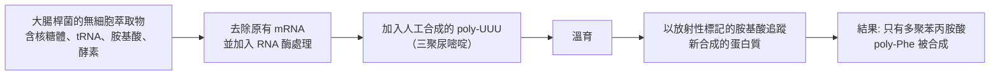

# 1968 · 遺傳密碼：霍利、科拉納與尼倫伯格用「三個字母」破解生命的拼寫法

> **1968 諾貝爾生理學 or 醫學獎**（共享三人，皆為美國籍）：羅伯特·W·霍利（Robert W. Holley，美國）— 表彰「破解遺傳密碼並闡釋其在蛋白質合成中的作用」；哈爾·葛賓·科拉納（Har Gobind Khorana，美國／印度）與馬歇爾·沃倫·尼倫伯格（Marshall Warren Nirenberg，美國）— 同上。

## 懸案（案情提要）

1961 年，賈可布與莫諾確定了 mRNA 的存在與中心法則（見 [1965-乳糖操縱子](1965-乳糖操縱子.md)），但最核心的問題仍未解：

1. DNA 上的鹼基序列（只有四種字母）如何指定蛋白質中的二十種胺基酸？
2. **對應關係的規則是什麼？** 是每三個鹼基指定一個胺基酸嗎？每個胺基酸由好幾組鹼基指定嗎？
3. 這些規則是**普世的**（所有生物通用）嗎？還是有物種差異？
4. 起始與終止訊號是什麼？

尼倫伯格在 1961 年用一個極其簡單的實驗回答了 3 與 4 的大部分，並在隨後數年裡，一組科學家聯手把整張密碼表**讀完整**。

## 前因

| 年份 | 事件 |
| --- | --- |
| 1956 | 物理學家 **Crick 與 Brenner** 提出「**適應子假說（adapter hypothesis）**」：mRNA 上的密碼子需要一個「適應子」（即 tRNA）來辨認並把胺基酸送到核糖體上。 |
| 1957–1960 | **Brenner、Jacob 與 Meselson** 的無細胞實驗系統（見 [1965-乳糖操縱子](1965-乳糖操縱子.md)）提供了翻譯研究的平臺。 |
| 1961 年 5 月 | **尼倫伯格與馬修（Matthew Matthaei）** 使用**大腸桿菌的無細胞翻譯系統**，加入**人工合成的 poly-UUU**（全是尿嘧啶的 RNA），觀察到**多聚苯丙胺酸（poly-Phe）**的合成——**第一個密碼子被破解**：UUU → 苯丙胺酸。 |
| 1961 年 6 月 | 尼倫伯格與馬修以類比方法（**用已知的 mRNA 序列推論新密碼子**）與直接合成法，破解了 3 個密碼子；**Jules、Matthei、Nirenberg 的「翻譯裝置」**廣為流傳。 |
| 1961–1963 | 尼倫伯格團隊以**隨機共聚物（random copolymers）**系統破解密碼子：把不同比例的鹼基混合成隨機 RNA，觀察生成的胺基酸種類與比例，統計推論密碼子組成。 |
| 1963 | **霍利（Holley）** 完成**酵母 tRNA\ᶠᴬˡᵉ 的完整鹼基序列**（1965 年發表，共 76 個核苷酸）——第一個被完全定序的核酸，也是**密碼子理論的直接驗證**。 |
| 1964–1966 | **科拉納（Khorana）** 化學合成**已知序列的重複 RNA**（如 poly-UC、poly-UG、poly-AUC 等），系統地「讀出」大量密碼子；並證明**三核苷酸的排列決定胺基酸**。 |
| 1966 | **科拉納**合成**重複的三核苷酸**（如 AUC AUC AUC…），精確地以「**閱讀框（reading frame）**」的方式指定胺基酸序列——證明了密碼子是**非重疊的（non-overlapping）**。 |
| 1966–1968 | **H. G. Khorana** 與 **R. (L.) Nirenberg** 團隊破解 64 個密碼子中的大部分，1966 年的 Nirenberg–Khoraha 實驗室會議（著名的「Nirenberg–Khoraha 會議」）成為科學史上最著名的「集體攻堅」會議之一。 |
| 1968 | 三人共享諾貝爾生理學 or 醫學獎。 |

## 調查

### 第一幕：尼倫伯格的無細胞系統——「把細胞拆成可以自由加料的試管」

尼倫伯格與馬修 1961 年的實驗，是本案的轉捩點。他們的系統包含：

**這個系統的威力**：它讓研究者可以**自由加入任意的 mRNA**，從而「詢問」遺傳密碼的任何一個問題。

### 第二幕：統計推論法——用比例讀出密碼子

尼倫伯格等的**隨機共聚物法**是統計學的漂亮運用：若以比例 $p_U : p_C : p_G : p_A$ 混合四種鹼基合成隨機 RNA，則特定三聯體出現的機率為：

$$P(i,j,k) = p_i \cdot p_j \cdot p_k$$

例如，若 $p_U = p_C = 0.5$ 、 $p_A = p_G = 0$ ，則只有 UUC、UCU、CUU、UCC 四種三聯體可能出現（各有機率 $0.125$ ），而這四種若都指定**同一個**胺基酸，則觀察到該胺基酸的比例為 $0.5$ ；若其中三種指定同一種、另一種指定另一種，則比例會是 $0.375 : 0.125$ 。**這種「比例指紋」使得統計推論成為可能**——這是統計方法在分子生物學中的首次大顯身手。

### 第三幕：科拉納的「重複序列」——最乾淨的證明

科拉納的化學合成能力，是破解密碼的另一把鑰匙。他合成了**完全重複的三核苷酸序列**：

$$\text{AUC AUC AUC AUC} \xrightarrow{\text{翻譯}} \text{Ile–Ala–Ser–Ile–Ala–Ser} \dots$$

這個實驗同時證明了四件事：

1. **密碼子是三核苷酸**（triplet）；
2. **密碼子是非重疊的（non-overlapping）**——若重疊，序列將被以三種框同時讀取；
3. **閱讀框是從固定的起點開始**（每三個核苷酸一組，起始點決定全部）；
4. **多順反子 mRNA 中，每個 cistron 有自己的閱讀框**。

### 第四幕：霍利的 tRNA——「適應子的實體」

霍利的工作，是從**密碼子的另一端**切入。1965 年，他完成了**酵母 tRNA\ᶠᴬˡᵉ 的完整序列**（77 個核苷酸，含多個修飾鹼基）。這份序列的關鍵之處在於：

1. **它含有一個「反密碼子（anticodon）」序列**——核苷酸 **anticodon 為 5'-GAA-3'**（或 GAA / UUC 方向），恰好與密碼子 **5'-UUU-3'** 互補配對（**方向相反**）；

   $$\text{mRNA 密碼子 } 5'-\text{UUU}-3' \quad \leftrightarrows \quad \text{tRNA 反密碼子 } 3'-\text{AAA}-5'$$

2. 這直接**驗證了 Crick 的適應子假說**：tRNA 就是辨認密碼子並攜帶對應胺基酸的分子；
3. **tRNA 的結構是「三葉草形（cloverleaf）」**，1980 年代的 X 光結構研究完全印證（由 **Robertus W. (R. W.) Holley** 開啟的路線，1970 年代由 **Kim、Alexander、Rich 等**完成結構測定）；
4. **tRNA 是「第二個密碼子」**——今日的遺傳密碼擴展（把特定胺基酸指定給特定 tRNA 的擴展密碼）即建立在此。

### 第五幕：1966 年的「Nirenberg–Khoraha 會議」——科學的集體攻堅

1966 年 1 月，尼倫伯格與科拉納在 NSF 資助下召開了一次歷史性的會議：多位研究者（**Nirenberg、Khoraha、Nirenberg 團隊、Khorana 團隊、Leder?** 等）把自己最好的實驗結果帶到一張桌子上，**逐條核對、爭論、修正**，幾乎在一周之內破解了 64 個密碼子中的 54 個。

**這是科學史上罕見的「集體攻堅」范例**：競爭對手之間在會桌旁共同推進同一張表，僅剩的幾個（終止密碼子 UAA/UAG/UGA，以及部分單密碼子胺基酸）直到 1967–70 年代才被補上（UAG 與 UGA 由科拉納以合成 RNA 破解）。

### 第六幕：遺傳密碼的最終特性

破解完成後，人們得以看清這張表的「設計藍圖」：

1. **64 個密碼子 = $4^3$**，對應 20 種胺基酸 + 3 個終止密碼子；
2. **簡併性（degeneracy）**：多數胺基酸由多個密碼子指定；61 個「有意義」的密碼子中有 **3 個密碼子被指定給同一種胺基酸**（亮胺酸、絲胺酸、精胺酸），**其餘 18 種各佔 2、4 或 6 個**；
3. **無標點性（no punctuation）**：密碼子的界線只能靠**閱讀框**決定，而非特殊符號——這正是科拉納的重複序列實驗所證明的；
4. **近乎普世**：密碼子在幾乎所有生物中相同，例外少見（如粒線體、某些原生生物與細菌）。

## 理論裁決

1. **遺傳密碼的簡併性與錯誤容忍**：簡併性意味著許多胺基酸由多個密碼子指定，這提供**緩衝**：單一點突變常是「同義突變（synonymous）」，不改變胺基酸，因而被自然選擇保留：

   $$P(\text{非義突變}) = 1 - \frac{\text{該胺基酸的密碼子數}}{64}$$

   這解釋了為何許多基因的**第三方密碼子位置高度保守**（即密碼子的簡併模式本身受到進化保護）。

2. **遺傳密碼的起源（freestanding hypothesis）**：1968 年，**Crick** 提出**「自由飄蕩假說（freestanding codon hypothesis）」**——**密碼子本身可能起源於胺基酸的合成路徑**，即原始的 RNA 世界中，某些 tRNA 同時是催化胺（aminoacyl-tRNA synthetase）與攜帶胺基酸的分子。這一假說在 2009 年被 Thomas 與 Söll 透過**定向演化實驗**獲得實證支持——**一種 RNA 可以自我胺醯化並把胺基酸轉移給自己**——是 RNA 世界假說最有力的證據之一（見 [1968-遺傳密碼](1968-遺傳密碼.md) 的後續）。

3. **翻譯的動力學**：核糖體上的翻譯可寫成延長因子驅動的循環：

   $$\text{tRNA}_{\text{aa}} + \text{GTP} + \text{mRNA} \to \text{肽鍵形成} + \text{GDP} + \text{P_i}$$

   每一個胺基酸的加入消耗 1 個 GTP（另加氨醯-tRNA 合成步驟的 ATP），因此合成一個蛋白質的**能量帳**是明確的。

4. **遺傳密碼的解碼算法**：鹼基序列 → 蛋白質的對應，可形式化為一張 $64 \times 20$ 的矩陣；今日的生物資訊學正是把這張矩陣視為基本單位，**並以統計耦合模型（e.g., position-specific scoring matrices）** 改進預測準確率——這是從物理學到資訊科學的延伸。

5. **無細胞系統的方法論**：尼倫伯格的無細胞系統不僅破解了密碼，更開啟了 1960–70 年代的**體外生物化學時代**：今日的**核糖體顯示（ribosome display）**、**定向演化（directed evolution）**、**mRNA 展示（mRNA display）**都用同樣的邏輯——把翻譯機制拆成可自由操控的模組。

## 追查支線（未結之謎）

- **尼倫伯格是諾獎史上最著名的「實驗型諾貝爾獎」得主之一**：他的密碼破解只需一支試管、幾克的細菌萃取物，卻顛覆了整個生物學；他晚年強調「**科學的美在於簡單的實驗能回答最深刻的問題**」；
- **科拉納的化學合成能力**是關鍵：他是 20 世紀少數能手工合成已知序列寡核苷酸的公司（**Marathon 實驗室**）的技術總監；他於 1970 年被授予美國**國家科學獎章**，1980 年獲**艾伯尼西奧圓桌**（World Economic Forum）的「全球合作與貢獻獎」，以表彰其在解決全球性問題上促進跨國科學合作的精神；
- **霍利是諾獎史上最年輕的得主之一**（33 歲），他在 35 歲時因Guess Who唱團車禍失去一位好友而鬱鬱成疾，最終在 44 歲時（1965 年，正是他發表 tRNA 序列的那一年）去世；他是諾獎史上**獲獎後因自殺而去世**的案例之一；
- **遺傳密碼的「例外」**：粒線體密碼、Mycoplasma 的替代起始密碼子、Bouea 等植物的細胞核遺傳密碼變體，至今仍是演化生物學的研究對象；
- **人工擴展遺傳密碼（expanded genetic code）**：2010 年代起，科拉納與其後繼者成功在核糖體中整合**非天然胺基酸**（以改造 tRNA 與胺醯-tRNA 合成酶），這是「遺傳密碼可以被重寫」的實證，也是**生物體外化學（biocontainment）**討論的技術前提。

## 證物與數據（偵查卷宗摘錄）

| 證物 | 數值／內容 | 偵查意義 |
| --- | --- | --- |
| 無細胞翻譯系統 | 核糖體 + tRNA + 胺基酸 + 酵素 | 可自由加料的翻譯平台 |
| poly-UUU（1961） | 只生成多聚苯丙胺酸 | 第一個密碼子：UUU → Phe |
| 隨機共聚物 | $P(i,j,k) = p_i p_j p_k$ | 統計推論法 |
| 重複三核苷酸 | AUC AUC → Ile–Ala–Ser | 三聯性、非重疊、閱讀框 |
| tRNA\ᶠᴬˡᵉ 序列（1965） | 77 個核苷酸 | 反密碼子 GAA ↔ 密碼子 UUU |
| 64 個密碼子 | $4^3 = 64$ | 20 胺基酸 + 3 終止 |
| 簡併模式 | 18 種胺基酸有多個密碼子 | 同義突變與緩衝 |
| 1966 年會議 | 一周內破解 54 個密碼子 | 科學的集體攻堅 |
| 終止密碼子 | UAA、UAG、UGA（1967–70 破解） | 終止訊號的確認 |

## 後果

| 領域 | 影響 |
| --- | --- |
| 分子生物學 | 中心法則完成；分子生物學成為可預測、可設計的學科。 |
| 生物技術 | 密碼子優化（codon optimization）、無細胞蛋白質合成、基因合成產業全部建立在此。 |
| 生物化學 | 胺醯-tRNA 合成酶與 tRNA 的結構生物學（霍利開啟的路線）通往 1970 年代的結構革命。 |
| 演化生物學 | 簡併性與同義突變成為群體遺傳學與蛋白質演化研究的核心變量。 |
| 合成生物學 | 遺傳密碼擴展與人工胺基酸的引入，開啟「重寫生物學」的討論。 |
| 其他諾獎 | 與 [1965-乳糖操縱子](1965-乳糖操縱子.md)、[1959-核酸生合成](1959-核酸生合成.md)、[1972-抗體結構](1972-抗體結構.md) 構成分子生物學主線。 |

## 關聯

- [1965-乳糖操縱子](1965-乳糖操縱子.md) — mRNA 的發現，是密碼翻譯的前提。
- [1959-核酸生合成](1959-核酸生合成.md) — 轉錄與複製的酵素機制。
- [1972-抗體結構](1972-抗體結構.md) — 胺基酸序列如何決定蛋白質的三維結構。
- [1995-胚胎發育基因](1995-胚胎發育基因.md) — 密碼子保守性的實證。
- [2023-mRNA 疫苗](2023-mRNA疫苗.md) — 密碼子最佳化技術在疫苗製造中的應用。
