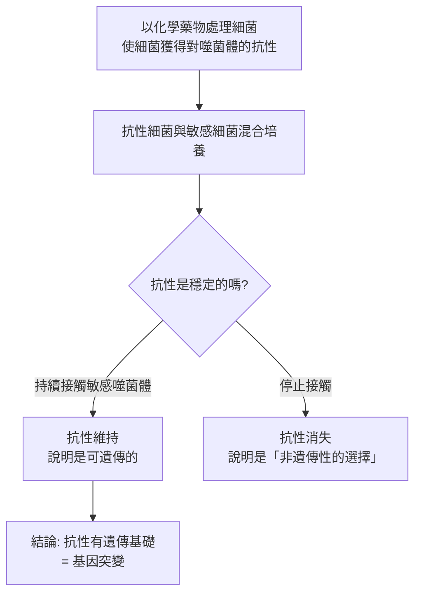
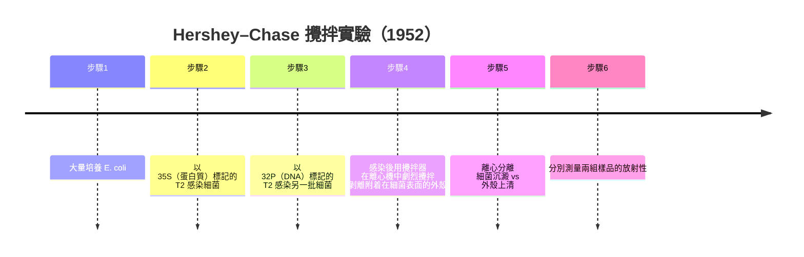

# 1969 · 噬菌體的複製與遺傳結構：德爾布呂克、赫希與盧瑞亞確認「DNA 是遺傳物質」

> **1969 諾貝爾生理學 or 醫學獎**（共享三人，皆為美國籍）：馬克斯·德爾布呂克（Max Delbrück，美國；原籍德國）— 表彰「發現病毒的複製機理和遺傳結構」；阿弗雷德·赫希（Alfred Hershey，美國）與薩爾瓦多·盧瑞亞（Salvador Luria，美國；原籍義大利）— 同上。

## 懸案（案情提要）

1950 年代末，分子生物學已經知道 DNA 是遺傳物質的候選者（見 [1962-DNA 雙螺旋](1962-DNA雙螺旋.md)），但有兩樁案子懸而未決：

**案子甲（病毒的解剖學）**：噬菌體是感染細菌的病毒，極小（ $200\ \mathrm{nm}$ ），結構簡單——一個蛋白質外殼包著一小段核酸。它如何在細菌內「劫持」細菌的機器來製造自己？它的遺傳物質是什麼？

**案子乙（決定性的實驗）**：噬菌體感染細菌時，**蛋白質外殼留在細菌外，核酸進入細菌內**——這個說法流傳已久，卻從未被直接證明。如何用一個無懈可擊的實驗，證明「進入去的」是遺傳物質，「留在外面的」不是？

1968 年的 Hershey–Chase 實驗給出了答案。而這三位得主的貢獻，是建立了一整套**「把病毒當作分子生物學的模型系統」**的方法論。

## 前因

| 年份 | 事件 |
| --- | --- |
| 1911 | 勞斯發現雞肉瘤病毒（見 [1966-腫瘤病毒與激素療法](1966-腫瘤病毒與激素療法.md)）。 |
| 1917 | **Twort** 在英國發現「**噬菌體**」——能裂解細菌的過濾性因子。 |
| 1919 | **d'Herelle** 在巴黎獨立發現噬菌體，並進行了決定性的實驗（**噬菌體滴定法**）：**噬菌體的效價（plaque count）隨宿主菌濃度而變**——這直接支持「噬菌體必須在細菌內繁殖」的複製模式。 |
| 1930s | **Delbrück**、**Luria** 與 **Hershey** 各自在噬菌體研究中獲得關鍵發現（見下）。 |
| 1938–1946 | **Delbrück** 以**噬菌體的「突變」進行遺傳學研究**：他發現噬菌體有**「突變」（mutation）與「選擇」（selection）兩個階段**，並用「**單菌落突變試驗（single-burst experiment）**」測出**突變率約 $10^{-8}\text{–}10^{-9}$**。 |
| 1939 | **Luria** 以 **「單菌落突變試驗（single-burst experiment）」**與 Delbrück **合作**，發展出「**波動試驗（fluctuation test）**」——**統計遺傳學進入病毒生物學**。 |
| 1946 | **Hershey** 與 **Chase** 執行了著名的**「攪拌實驗（blender experiment）」**。 |
| 1952 | **Hershey 與 Chase** 在 1952 年冷泉港的生物學討論會上報告攪拌實驗結果，但當時反應冷淡（多數人仍認為 DNA 只是「營養物質」）。 |
| 1953–1960s | DNA 雙螺旋問世（見 [1962-DNA 雙螺旋](1962-DNA雙螺旋.md)）後，Hershey–Chase 的結果被重新評價，地位陡升。 |
| 1969 | 三人共享諾貝爾生理學 or 醫學獎（Delbrück 1969 年已離世，由 Luria 代領）。 |
| 1970s | Delbrück 的學生 **James Watson**（與 [1962-DNA 雙螺旋](1962-DNA雙螺旋.md)）和 **Francis Crick** 分別說，兩人都給 Delbrück 看了 DNA 結構的模型照片；Delbrück 是 Crick 轉向生物學的關鍵推手之一。 |

## 調查

### 第一幕：Delbrück 的「遺傳學在病毒中」——把噬菌體變成實驗材料

Delbrück 是物理學家出身（他曾在 Bohr 的哥本哈根學派受訓，與 [1920-毛細血管調節](1920-毛細血管調節.md) 的 Krogh 是同門圈），1930 年代初到美國後，他問了一個大膽的問題：**能不能像研究果蠅一樣研究病毒？**

他與 **Luria** 的合作確立了噬菌體遺傳學的基本系統：

1. **噬菌體滴定法（plaque assay）**：以一層細菌菌落為「培養皿」，噬菌體在菌層上形成**透明斑（plaque）**，一個斑即對應一個感染事件——**這是定量病毒學的基礎**；
2. **單菌落突變試驗（single-burst experiment）**：讓一個細菌被單一噬菌體感染，裂解後將釋出的噬菌體感染多個細菌，觀察各菌落是否形成**或不形成**噬菌體斑。
3. **波動試驗（fluctuation test, 1943）**：Delbrück 注意到，同一感染釋出的噬菌體感染多株細菌時，各株的「是否產生突變」呈**「全有或全無」的波動**，而非隨機分布。這意味著：

   $$\text{變異在感染早期發生，而非在感染之後隨機產生}$$

   這是**遺傳學定律在病毒中的驗證**——病毒有基因，基因會突變，選擇作用於突變。

4. **突變率的定量**：由波動試驗可估算噬菌體的突變率約 $10^{-8}\text{–}10^{-9}$ ／複製，與細菌相近。

### 第二幕：Luria 的「噬菌體對宿主菌的化學抗性」——遺傳學的分子基礎

Luria 的 1946 年實驗，證明了**遺傳的化學物質基礎**：

**Luria–Delbrück 試驗（1943）**是現代「**抗藥性是突變而非適應**」概念的最早證明之一——它與後來 **Lederberg 與 Luria 的「劃痕實驗（replica plating）」**共同確立了抗藥性的演化觀念（見 [1958-一基因一酶](1958-一基因一酶.md)）。

### 第三幕：Hershey–Chase 的攪拌實驗——本案最著名的一次實驗

Hershey 與 Chase 的問題極為精準：**噬菌體感染時，究竟什麼進入了細菌？**

設計（針對 **T2 噬菌體**）：

**結果與解讀**：

| 測量對象 | 結果 | 結論 |
| --- | --- | --- |
| ${}^{35}\mathrm{S}$ （蛋白質） | **主要在上清**（外殼） | 蛋白質外殼留在細菌外 |
| ${}^{32}\mathrm{P}$ （DNA） | **主要在沉澱**（細菌） | DNA 進入細菌內 |

**再一步的關鍵實驗**：只讓 ${}^{32}\mathrm{P}$ 標記的噬菌體感染細菌，**不攪拌**，然後在細菌裂解後測量子代噬菌體的放射性——結果**子代噬菌體帶有 ${}^{32}\mathrm{P}$**：

$$\text{親代噬菌體的 DNA} \to \text{進入細菌} \to \text{被複製} \to \text{進入子代噬菌體}$$

**DNA 是遺傳物質，而蛋白質不是**——這個結論以最乾淨的方式得出。

**這個實驗為何長期未被接受？** 關鍵在於 **${}^{35}\mathrm{S}$ 標記的方法**：當時硫（^35S）可用的形式是**放射性硫酸鹽**，用它標記蛋白質時，硫酸鹽會**結合到培養基中的所有含硫分子**（包括細菌本身的蛋白質），使得背景極高、訊號難以判讀。Hershey 與 Chase 花了兩年才解決這個技術問題（改用 ^35S-蛋氨酸並降低濃度）。

### 第四幕：從噬菌體到 DNA 複製——模板的證明

噬菌體研究的另一條重要產物線是**DNA 複製機制**：

- **1948 年 Meselson 與 Stahl** 以密度梯度實驗證明**半保留複製**（見 [1959-核酸生合成](1959-核酸生合成.md)）；
- **1956–1958 年 Lehman、Sims、Barner 與 Kornberg** 以 T4 噬菌體的 DNA 聚合酶證明「**新生鏈的合成需要模板**」；
- **1960–1968 年**的噬菌體研究（尤其 **Denenberg、Meselson、Yarmolinsky 等**）確立了「**DNA 解旋酶、單股結合蛋白、DNA 聚合酶、引發酶、連接酶**」等複製必需蛋白的分工——這些發現後來在細菌與真核生物中被驗證（見 [1959-核酸生合成](1959-核酸生合成.md)）。

### 第五幕：Delbrück 與物理學的橋樑

Delbrück 的貢獻往往被低估。他的科學生涯本身就是「**物理學—生物學」跨界的典範**：

1. 他是 **Niels Bohr** 在哥本哈根的圈子成員（與 Bohr、Heisenberg、Krogh 等人交往），並在 1937 年哥本哈根會議上聽到 **Schrödinger 的「生命是什麼？」（What Is Life?）** 演講——這次演講被 Delbrück 稱為「對自己人生的決定性影響」；
2. 他把**物理學的定量方法**帶進病毒學：波動試驗的統計分析、突變率的測量、噬菌體生長曲線的動力學模型；
3. 他的「**Delbrück 方程**」（1940 年，單菌落突變試驗的數學處理）是遺傳學與物理學交會的經典：

   $$\bar{m} = -\ln\left(1 - \frac{m}{n}\right)$$

   其中 $\bar{m}$ 為突變事件的平均數、 $m$ 為突變菌落數、 $n$ 為總菌落數——這是「**指數分布**」在生物學中的第一次應用，也是 20 世紀生物統計學的開端。

## 理論裁決

1. **感染與複製的模型**：噬菌體的複製可分為「**感染（adsorption + injection）**」與「**複製（replication + assembly）**」兩階段，其動力學可用方程式描述：

   $$\frac{dP}{dt} = \beta P B - k P$$

   其中 $P$ 為噬菌體數、 $B$ 為細菌數、 $\beta$ 為感染率常數、 $k$ 為降解率——這是 1930–40 年代「**化學與生物動力學**」運動的核心模型。

2. **單菌落突變試驗的統計學**：波動試驗的數學結果是：**若變異在感染後隨機發生，則各菌落中突變數的分布近似二項分布（低波動）；若變異在感染早期發生，則分布為指數分布（高波動）**。Delbrück 與 Luria 觀察到的**高波動**，因此是基因遺傳的直接證據。

3. **Hershey–Chase 的邏輯結構**：這是一個**「追蹤標記」實驗**——用兩種不同的放射性標記分別追蹤病毒的兩個成分，觀察它們在感染後的分佈。**這是分子生物學中最經典的「追蹤實驗」範式**，也是今日所有「標記—追跡（label and chase）」實驗的祖型。

4. **DNA 複製的半保留與「回轉」問題**：噬菌體研究曾提出一個悖論——**環狀 DNA 的複製如何解開雙螺旋**？答案在 1960 年代由 **Stahl 的「θ 結構（theta structure）」實驗**（1963）與 **Leggett 的模型**給出：複製起點的解旋形成「眼狀（eye）」結構，隨複製推進形成 Y 形，最終產生兩個子代環狀 DNA。這套模型直接支持半保留複製。

## 追查支線（未結之謎）

- **Delbrück 於 1981 年去世**（享年 89 歲），他於 1975 年自傳《The Greatest Experiment in the History of Biology》中對自己與 Watson 的合作（1937–1938 年的 DNA 結構討論）有詳細回憶，並對 Watson 的後續行為提出批評；
- **Delbrück 的學生群星燦爛**：**Watson**（1962 諾獎）、**Luria 的學生 Nirenberg**（1968 諾獎）、**Lewis、Stahl、Meselson**（Hershey–Chase 的後續），以及 **Marcelle Raymond**（Delbrück 的妻子、數學家）——Delbrück 實驗室是 20 世紀生物物理學的「諾獎培養皿」；
- Delbrück 與 Luria、Hershey 皆在 **冷泉港的生物學討論會**上發表成果——這個由 Delbrück 參與創建的會議制度，是 20 世紀科學傳播的重要機制；
- **Hershey 與 Chase 的實驗在 1952 年發表後冷遇了十年**，1953 年 DNA 雙螺旋問世後其地位才被重新評價——這是科學史上「正確的實驗等待正確的理論」的經典案例；
- **噬菌體在分子生物學中的持續作用**：T4 噬菌體的 DNA 聚合酶與解旋酶是今日分子生物學實驗室的標準工具；T7 噬菌體的 RNA 聚合酶是「無細胞轉錄系統」的骨幹；而 2010 年代的**噬菌體展示（phage display）**技術更是抗體藥物開發的核心平台（見 [1984-單株抗體](1984-單株抗體.md)）。

## 證物與數據（偵查卷宗摘錄）

| 證物 | 數值／內容 | 偵查意義 |
| --- | --- | --- |
| d'Herelle 的滴定法 | 一個噬菌體斑 = 一個感染事件 | 定量病毒學的基礎 |
| 單菌落突變試驗 | 裂解後感染多株細菌 | 遺傳學的病毒模型 |
| 波動試驗（1943） | 「全有或全無」的變異分布 | 遺傳學定律在病毒中成立 |
| 突變率 | 約 $10^{-8}\text{–}10^{-9}$ ／複製 | 與細菌相當 |
| Delbrück 方程 | $\bar{m} = -\ln(1 - m/n)$ | 指數分布的生物統計學 |
| Luria–Delbrück 抗性試驗 | 抗性可遺傳，非接觸所誘導 | 「抗藥性是突變」的證明 |
| ${}^{35}\mathrm{S}$ 標記蛋白質 | 主要在上清 | 外殼留在細菌外 |
| ${}^{32}\mathrm{P}$ 標記 DNA | 主要在沉澱 | DNA 進入細菌內 |
| 子代噬菌體的 ${}^{32}\mathrm{P}$ | 子代帶有親代 DNA 的標記 | DNA 自我複製的證明 |
| θ 複製結構（1963，Stahl） | 眼狀/Y 形中間體 | 環狀 DNA 的複製機制 |

## 後果

| 領域 | 影響 |
| --- | --- |
| 分子生物學 | 「DNA 是遺傳物質」獲得決定性證據，分子生物學的合法性確立。 |
| 生物統計學 | 波動試驗與 Delbrück 方程開啟遺傳學的定量時代。 |
| 實驗方法 | 放射性標記—追蹤法成為分子生物學的標準技術。 |
| 演化生物學 | 抗藥性是突變而非適應的觀念確立，後由 Lederberg 的劃痕法補完。 |
| 科學制度 | 冷泉港生物學討論會成為科學傳播的制度化機制。 |
| 其他諾獎 | 與 [1962-DNA 雙螺旋](1962-DNA雙螺旋.md)、[1959-核酸生合成](1959-核酸生合成.md)、[1958-一基因一酶](1958-一基因一酶.md) 構成 DNA 時代的主線。 |

## 關聯

- [1962-DNA 雙螺旋](1962-DNA雙螺旋.md) — 噬菌體遺傳物質的結構答案。
- [1959-核酸生合成](1959-核酸生合成.md) — 複製的酵素機制，Hershey–Chase 的延伸。
- [1958-一基因一酶](1958-一基因一酶.md) — Luria 的抗性遺傳試驗是同線的另一支。
- [1946-X 射線誘發突變](1946-X射線誘發突變.md) — 馬勒在同一時期對噬菌體的輻射突變研究。
- [1984-單株抗體](1984-單株抗體.md) — 噬菌體展示技術的現代應用。
