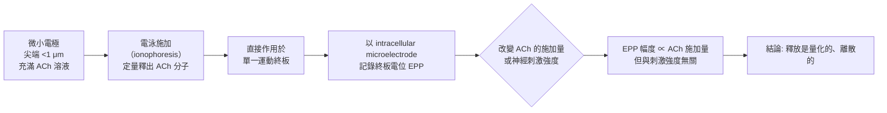

# 1970 · 神經末梢的體液性傳遞物質：卡茨的「微小電極滴定」找出乙醯膽鹼如何釋放

> **1970 諾貝爾生理學 or 醫學獎**（共享三人）：朱利葉斯·阿克塞爾羅德（Julius Axelrod，美國）— 表彰「發現神經末梢中的體液性傳遞物質及其貯存、釋放和抑制機理」；烏爾夫·馮·奧伊勒（Ulf von Euler，瑞典）與伯納德·卡茨爵士（Sir Bernard Katz，英國）— 同上。

## 懸案（案情提要）

1936 年，勒維用雙蛙心實驗證明神經末端釋放化學物質（見 [1936-神經化學傳遞](1936-神經化學傳遞.md)）。但「釋放」這個過程本身仍是黑箱：

1. **釋放的物質是什麼？** ACh 已被證明是候選，但還有別的嗎？
2. **它存在哪裡？** 是游離在細胞質裡，還是**被包裝起來**？
3. **釋放是連續的，還是「一包一包」的？** 如果是分裝的，那麼單次釋放的量必定是**離散且固定的**——這就是一個可以測量的問題。
4. **抑制機理是什麼？** 釋放的物質如何被「回收」？

卡茨在 1950 年代的實驗，回答了第 2 與第 3 問，並由此催生了**囊泡量子釋放假說**——這是 20 世紀神經科學最精確的定量模型之一。

## 前因

| 年份 | 事件 |
| --- | --- |
| 1936 | 勒維證明化學傳遞（見 [1936-神經化學傳遞](1936-神經化學傳遞.md)）；戴爾確立 ACh 的「Dale 效應」。 |
| 1946–1948 | 奧伊勒在斯德哥爾摩的 Rissne 實驗室發現**去甲腎上腺素**是交感神經的傳遞物質，並於 1956 年確認其為「substance P」（**P 來自 substance P**——他稱之為「enkefalin in the gut」?）的來源之一；實為 1956 年他發現**「substance P」**（腸道中的 P 物質，1931 年由 Gaddum 與 Schild 命名）與**神經肽**的存在，是「**神經肽（NEP）**」家族的開端。 |
| 1950 | 奧伊勒發現**去甲腎上腺素**（noradrenaline）與**腎上腺素（adrenaline）**的釋放，並於 1954–1956 年確立它們是**交感神經的傳遞物質**。 |
| 1952–1960 | **卡茨**在倫敦的 UCL 研究**神經肌肉接點**（特別是蛙的運動終板），發展出「**微小電極滴定（microelectrode ionophoresis）**」技術，把微量的 ACh 精確地「滴」到單一的突觸後部位。 |
| 1954–1956 | 卡茨發現：只有在**足夠大的電位（EPP 超過閾值）**時才會產生動作電位，且 EPP 的大小隨刺激強度連續變化——這提示釋放是**分級的**。 |
| 1956 | **del Castillo 與 Katz** 使用「**微小電極滴定**」：直接以微電極將 ACh 施加到單一終板，測得**終板電位（end-plate potential, EPP）**的幅度與「施加的 ACh 量子數」成正比，且**與刺激強度無關**——**即每次神經衝動釋放的 ACh 量是固定的**。 |
| 1957 | Katz 提出**「囊泡假說（vesicle hypothesis）」**：ACh 以固定數目的量子儲存在囊泡中，動作電位觸發囊泡與細胞膜融合，釋出其內容物。 |
| 1960s | **Axelrod** 的工作是「** Catecholamine 的代謝與酵素合成**」：他發現交感神經末梢能**從酪胺酸合成去甲腎上腺素**（而非僅從血中攝取），並以**苯丙胺酸羧化酶的抑制實驗**證明酶的誘導合成（這是「神經末梢能合成自己的傳遞物質」的直接證據）。 |
| 1970 | 三人共享諾貝爾生理學 or 醫學獎。 |

## 調查

### 第一幕：卡茨的「微小電極滴定」——把藥物直接「滴」到一個突觸上

卡茨的技術突破在於**空間與量的雙重精確**：

**關鍵對照設計**極為漂亮：

1. **用 ACh 直接滴加**（不經神經刺激）：EPP 幅度隨施加的 ACh「量子數」成**正比**，且**不論神經刺激強度如何變化，單次釋放的量都不變**；
2. **用神經刺激**（強度可變）：EPP 呈**階梯式**變化——即「全有或全無」的量子數（0、1、2、3…）。

這兩組數據合起來，直接給出「**量子化釋放**」的結論。

### 第二幕：囊泡假說與其定量內容

卡茨 1955–1957 年的工作，把「囊泡」從一個直覺變成一個**可測量的模型**：

1. **每個囊泡儲存固定數目的 ACh 分子**：現代測定約 **7,000–10,000 個 ACH 分子 / 囊泡**；
2. **每個終板含有大量囊泡**（約 100–300 個），因此**每個動作電位可釋放多個囊泡**；
3. **單次釋放的量子數**：一個終板上的平均量子數約 $n \approx 100\text{–}300$ （且**呈高斯分布**，變異係數約 5%）；
4. **小泡假說（small vesicle hypothesis）**：卡茨提出，每個囊泡釋出的**電荷量**應相同。若某囊泡的釋放電荷 $q$ 可測，則：

   $$q = \frac{\text{EPP 增量}}{n} = \frac{I_{\text{peak}} \times dt}{n}$$

   實測的 $q$ 與「囊泡內 ACh 數 × 2（因 $\mathrm{ACh}^{+}$ 為雙價）÷ Faraday 常數」的估算相符——**這是卡茨論證「小囊泡」的定量核心**。

5. **不釋放的囊泡**：他觀察到即使在持續刺激下，囊泡的釋放是**隨機的**（有 Poisson 分布特性），且**永遠不會在同一位置重複釋放**（不釋放的囊泡位置與釋放者無關）——這排除了「釋放點預設存在」的模型。

### 第三幕：卡茨與「神經肌肉接點的生物物理」

卡茨 1952–1956 年在 EPP 上的工作，構成了 Hodgkin–Huxley 模型的**突觸版本**：

1. **EPP 是分級的，動作電位是全或無的**：EPP 達到閾值才觸發動作電位——這是「分級電位 → 全或無反應」轉換的經典實例（也見 [1932-神經元功能](1932-神經元功能.md)）；
2. **EPP 的時間常數**：EPP 的上升與衰減時間常數，反映受體通道的開閉動力學；
3. **藥理學的結合**：卡茨證明**箭毒（curare）**與**阿托品**對 EPP 的影響符合受體競爭性拮抗的動力學——把 1936 年的化學傳遞發現（見 [1936-神經化學傳遞](1936-神經化學傳遞.md)）與 1963 年的離子機制（見 [1963-離子機制](1963-離子機制.md)）接上了。

### 第四幕：Axelrod 的「神經末梢會製造自己的傳遞物質」

Axelrod 的研究方向不同，但結論同樣重要。他證明：

1. **去甲腎上腺素的合成路徑**：

   $$\text{Tyrosine} \xrightarrow{\text{tyrosine hydroxylase}} \text{DOPA} \xrightarrow{\text{DOPA decarboxylase}} \text{Dopamine} \xrightarrow{\text{Dopamine}\ \beta\text{-hydroxylase}} \text{Norepinephrine}$$

2. **軸突末梢能從酪胺酸合成 NE**，並且**這種合成受神經活動的長期調節**（去神經後下降，重新支配後恢復）——這是**「神經活動塑造酵素合成」**的經典證據，開啟了**神經塑形（neural plasticity）**的分子層面研究；
3. **酵素的誘導**：他以**苯丙胺酸羧化酶抑制劑**（如 α-甲基-p-tyrosine）阻斷合成，證明 NE 的釋放量與合成速率相關；
4. **回收機制**：他證明釋放出的 NE 大部分被**再攝取（reuptake）**，這是 1950–60 年代「**神經末梢的回收機制**」的發現，也是今日**三環類抗憂鬱藥與 SSRI 的作用機制**的先聲（1960 年代的 Axelrod 實驗室正是這類藥物機制的發現地）。

### 第五幕：奧伊勒的多肽傳遞物質——「神經肽」家族的開端

奧伊勒的貢獻常被低估。他在 1930–60 年代發現了一系列**神經肽**：

1. **P 物質（substance P）**：1931 年由 Gaddum 與 Schild 在馬的腸道與腦中發現；1960 年代後被確認為**感覺神經末梢的主要傳遞物質**（特別是與痛覺相關）；
2. **血管收縮素/血管擴張素（angiotensin/vasopressin）**：他發現這兩個循環激素其實是**神經傳遞物質**——**神經—內分泌的統一**；
3. 他開創了**「P 物質」命名的傳統**（以功能和來源命名，如 substance P、substance K、substance Y），今日的神經肽命名（substance P、substance K、neuropeptide Y、substance Q）皆承自此。

## 理論裁決

1. **量子化釋放的數學**：若每個囊泡的釋放是獨立且機率為 $p$ 的泊松過程，則一次動作電位釋放的囊泡數 $n$ 服從：

   $$P(n) = \frac{(\lambda)^n e^{-\lambda}}{n!}, \qquad \lambda = N_{\text{vesicle}} \cdot p$$

   而終板電位的平均值與變異為：

   $$\bar{EPP} = n \cdot q, \qquad \sigma_{EPP}^2 = n \cdot q^2$$

   因此**相對變異**為：

   $$\frac{\sigma_{EPP}}{\bar{EPP}} = \frac{1}{\sqrt{n}}$$

   實測值約 5%，對應 $n \approx 400$ ——**與「每個終板有數百個囊泡」的形態學觀察相符**。這是本案最精確的一條定量鏈條。

2. **釋放的隨機性與「沒有預設釋放點」**：實驗顯示釋放位置呈**隨機分布**，且連續兩次刺激的釋放點**不重疊**——這意味著**釋放的觸發機制是隨機的擴散過程**（ $\mathrm{Ca}^{2+}$ 微域的存在），而非「固定的釋放點（active zone）」結構。這個「隨機」問題直到 1970 年代的 **Heidelberger 與 Reese** 以**快速冷凍蝕刻（freeze-fracture）電鏡**觀察到突觸小泡在「釋放點」附近聚集，才被重新修正——**融合事件是隨機的，但融合位置是結構性偏好的**。

3. **受體通道的動力學**：EPP 的上升與衰減可寫為：

   $$I(t) = g_{\text{open}}(t)\,(V_m - E_{\text{ACh}})$$

   其中 $g_{\text{open}}$ 遵循受體的開閉動力學。卡茨的實驗提供了第一份「**受體在單一突觸上的動力學行為**」的證據。

4. **神經傳遞物質的「合成—釋放—回收」循環**：Axelrod 的工作建立了完整的**神經末梢代謝地圖**：

   $$\text{前驅物} \xrightarrow{\text{合成酵素}} \text{傳遞物質} \xrightarrow{\text{囊泡}} \text{突觸間隙} \xrightarrow{\text{酵素降解 + 再攝取}} \text{前驅物/傳遞物質}$$

   這個循環中的每一環，今日都是藥物的靶點：合成酵素（如 COMT、MAO 抑制劑）、囊泡釋放（如 botulinum toxin 阻止 ACh 釋放）、再攝取（如 SSRI 阻斷 5-HT 轉運蛋白）、降解（如 AChE 抑制劑）。

## 追查支線（未結之謎）

- 卡茨於 1970 年獲獎時已退休（他 1952 年因在實驗室跌倒而手臂受傷，被迫離開研究崗位，轉任倫敦大學院系主任），這段被迫轉型的插曲在科學史上頗為人知；
- **Axelrod 與 catecholamine 的發現史**牽涉一樁著名的科學爭議：**S. von Euler、Axelrod 與 Holtzberg 各自獨立發現去甲腎上腺素**；Axelrod 因在藥理學實驗（reserpine 排空 catecholamines）上的貢獻獲獎；他在 1970 年獲獎後仍繼續研究，並於 1990 年代關注**「神經科學家的科學教育」**（他創辦了「Daniel and Florence Guggenheim 基金會」的兒童科學教育計劃）；
- **Axelrod 與妻子 Adele「Berta」Axelrod** 是科學史上少數的夫妻實驗搭檔（她專攻組織化學）；二人在 1950–60 年代共同完成了大部分實驗；
- 卡茨與 **Kuffler**、**Hodgkin**、**Huxley** 同為 1930–50 年代「**神經肌肉接點生理學**」的核心人物，這個研究群體開創了定量神經生理學；
- 今日的**神經傳遞物質研究**已進入「**共同傳遞（cotransmission）**」時代——例如 5-HT 與 ATP、NO 與 VIP 的共同釋放，以及神經肽（催產素、加壓素、內啡肽）的發現，使「一個神經元一種傳遞物質」的古典教條被修正。

## 證物與數據（偵查卷宗摘錄）

| 證物 | 數值／內容 | 偵查意義 |
| --- | --- | --- |
| 微小電極滴定 | 定量施加 ACh 至單一終板 | 空間與量的雙重精確 |
| EPP vs ACh 量子數 | 正比，且與刺激強度無關 | 釋放量固定的證明 |
| 神經刺激的階梯反應 | EPP 呈全有或全無的階梯 | 量子數為整數 |
| 囊泡內容物 | 約 7,000–10,000 個 ACh／囊泡 | 小囊泡假說的定量 |
| 釋放囊泡數 | $\bar{n} \approx 100\text{–} 400$ | 泊松分布參數 |
| 相對變異 | $\sigma/\bar{EPP} \approx 5\%$ | 對應 $n \approx 400$ |
| 釋放位置隨機 | 連續刺激的釋放點不重疊 | 融合的隨機性 |
| NE 合成路徑 | Tyr → DOPA → Dopamine → NE | 末梢自行合成 |
| 再攝取機制 | 釋放的 NE 大部分被回收 | 抗憂鬱藥的靶點 |
| substance P（1931/1960s） | 感覺神經的主要傳遞物質 | 神經肽家族的開端 |

## 後果

| 領域 | 影響 |
| --- | --- |
| 神經科學 | 囊泡量子釋放成為突觸生理學的標準模型，是 20 世紀最精確的神經生物學模型之一。 |
| 藥理學 | 抗精神病藥、抗憂鬱藥、肌肉鬆弛藥、催吐藥的機制被系統化（受體、酵素、轉運蛋白三類靶點）。 |
| 臨床 | 肉毒桿菌毒素（阻斷 ACh 釋放）、阿托品、箭毒、SSRI 的作用機制確立。 |
| 神經內分泌 | 奧伊勒的神經肽工作統一了神經與內分泌系統。 |
| 科學教育 | Axelrod 推動的「科學家—兒童」教育模式影響深遠。 |
| 其他諾獎 | 與 [1936-神經化學傳遞](1936-神經化學傳遞.md)、[1963-離子機制](1963-離子機制.md)、[1970-神經遞質](1970-神經遞質.md) 構成神經傳遞主線。 |

## 關聯

- [1936-神經化學傳遞](1936-神經化學傳遞.md) — 化學傳遞的存在，本案是其機制的定量。
- [1963-離子機制](1963-離子機制.md) — 受體通道的動力學，EPP 的物理基礎。
- [1998-一氧化氮](1998-一氧化氮.md) — 勒維早年的第二個答案，氣體性傳遞物質。
- [1986-生長因子](1986-生長因子.md) — 從神經生長因子到更廣泛的訊號分子世界。
- [2000-神經訊號傳導](2000-神經訊號傳導.md) — 這條線的成熟與總結。
