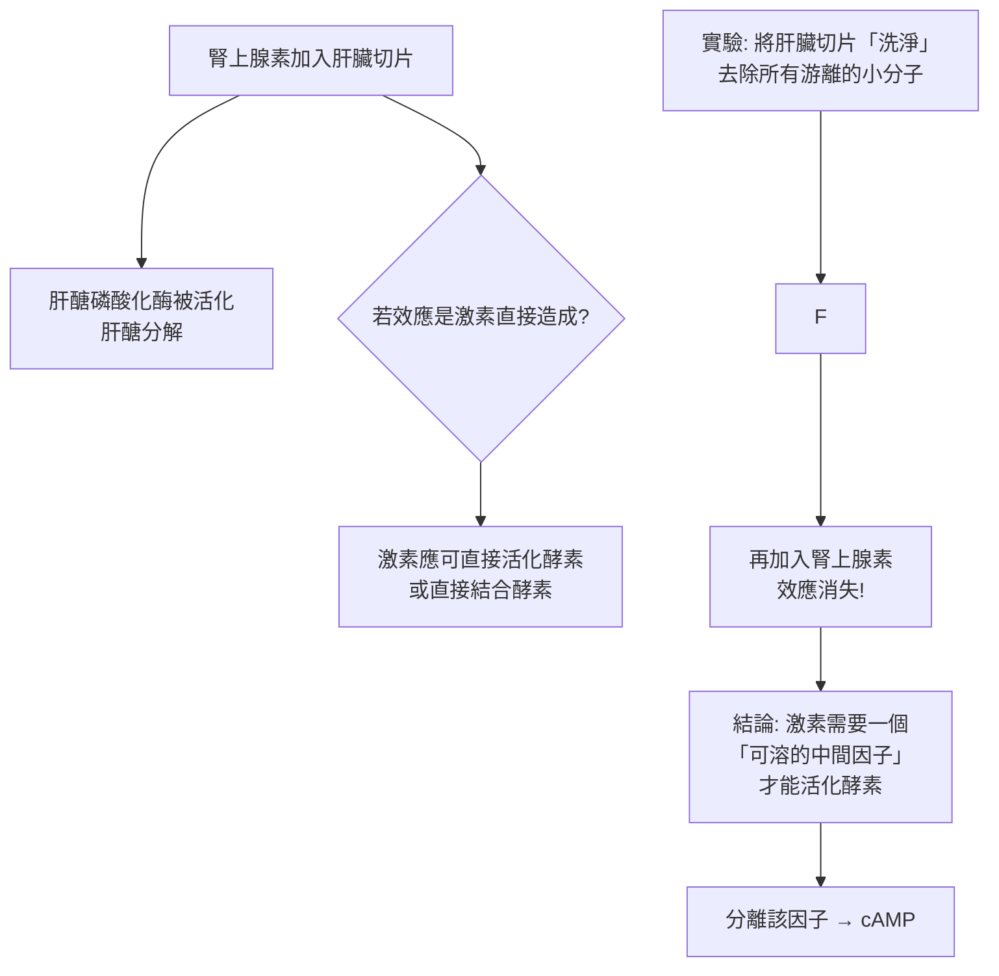

# 1971 · 激素的作用機制：蘇德蘭發現 cAMP，開啟「第二信使」的時代

> **1971 諾貝爾生理學 or 醫學獎**：埃魯·威爾布爾·蘇德蘭（Earl Wilbur Sutherland Jr.，美國）— 表彰「發現激素的作用機理」（"for his discoveries concerning the mechanisms of the action of hormones"）。他於 1972 年 1 月發表諾貝爾演說，但未能出席——1974 年 3 月 9 日因慢粒細胞性白血病去世，得年 58 歲。

## 懸案（案情提要）

1940–1950 年代，內分泌學已確立「激素由腺體分泌、隨血流到達靶器官並產生效應」的基本圖景（見 [1923-胰島素](1923-胰島素.md)、[1950-腎上腺皮質激素](1950-腎上腺皮質激素.md)）。但最核心的問題是：

1. **激素本身不可能直接執行功能**——它是什麼？多肽？胜肽？固醇？它不可能既是「訊號」又是「效應器」。
2. 激素到達細胞後，**如何跨越細胞膜**？（固醇激素可以擴散穿膜，但胜肽激素不行。）
3. **細胞如何把一個化學訊號轉換成生理效應？** 需要一個「轉換器」。
4. 同一種激素在不同細胞中可以產生**不同**效應——那麼「效應的決定者是什麼」？

蘇德蘭的答案是：**cAMP（環腺苷酸）**——一個極小的、能在細胞內迅速產生並擴散的分子，它把激素的「訊號」與細胞的「效應」解耦開來。

## 前因

| 年份 | 事件 |
| --- | --- |
| 1920s | 華利（Harry Hallett Dale）發現**腎上腺素（adrenaline）**的作用；1920–30 年代，「腎上腺素—肝醣分解」系統成為研究激素作用的經典模型（肝醣代謝本身正是科里循環，見 [1947-糖代謝與激素](1947-糖代謝與激素.md)）。 |
| 1940s | 蘇德蘭在華盛頓大學（WashU）研究**腎上腺素**對肝臟切片的作用——他發現腎上腺素並非直接活化磷酸化酶，而是透過某種可溶的因子。 |
| 1950–1951 | 蘇德蘭與 **F. Sutherland 與 T. Rall**（其妻 Theodora Rall 是生化學家）分離出這種因子，證明它是一種**耐熱的、可被陰離子交換樹脂吸附的小分子**，命名為**環腺苷酸（cyclic AMP, cAMP）**。 |
| 1957 | Sutherland 與 Rall 證明：**cAMP 可以模仿腎上腺素的作用**——直接加入 cAMP 就能活化肝醣磷酸化酶，開啟「第二信使」概念。 |
| 1958–1962 | Sutherland 與 Rall 以**生物測定法（bioassay）**確立 cAMP 的活性，並開始測定各種組織中的 cAMP 濃度——發現其濃度極低（ $10^{-9}\text{–}10^{-6}\ \mathrm{M}$ ），但**效應顯著**，這正是「第二信使」的判準。 |
| 1963 | **Sutherland 與 Rall 提出「第二信使假說」**：激素是第一信使，cAMP 是第二信使。 |
| 1965–1970s | cAMP 的**合成酵素（腺苷酸環化酶 adenylate cyclase）**被發現（部分由 Sutherland 團隊、部分由 **Robbins–Pastan** 等人）；**環磷酸鳥苷（cGMP）**亦被發現（但其作為第二信使的地位要晚得多）。 |
| 1970s | 蘇德蘭轉任** Vanderbilt 大學**（納什維爾）教授，1971 年獲獎。 |
| 1972 | 蘇德蘭在諾貝爾演講中系統闡述「**激素的作用機制**」與「**第二信使概念**」，演講稿在他去世後由其遺孀 Theodora 編輯出版（1972）。 |
| 1998–2000s | cAMP 訊號路徑的分子細節補完：Gs 蛋白（GPCR 與腺苷酸環化酶之間的轉接器，1980 年由 **Gilman** 發現，1994 年獲諾獎，見 [1994-G 蛋白](1994-G蛋白.md)）、PKA 的結構（1990s）。 |

## 調查

### 第一幕：「不是激素本身在做事」

蘇德蘭的偵查起點是一個簡單的實驗設計：



**關鍵的實驗對照**：把肝臟切片充分洗滌（去除所有游離的小分子如 ATP、離子），此時**直接加入腎上腺素無效**，但加入 **ATP** 則有效——**ATP 是合成 cAMP 的原料**。這就把線索指向了核苷酸。

### 第二幕：cAMP 的分離與鑑定（1957）

蘇德蘭與 Rall 的分離過程，是 1950 年代生物化學的典型操作：

1. 以**腎上腺素處理肝臟切片**，收集含有活性因子的液體；
2. 以**陰離子交換層析**吸附該因子（因帶負電）；
3. 以**活性炭吸附**與**紙層析**進一步純化；
4. 最終證明：該因子的生物活性與**商業化的 cAMP 樣品**完全一致。

**cAMP 的結構**：

$$\text{3',5'-環腺苷酸（cAMP）}$$

即腺嘌呤核苷酸的核糖部分，其 3' 與 5' 兩個羥基**以磷酸二酯鍵成環**。這個「環狀」結構使其無法被普通的磷酸酶水解，因而**壽命較長（數分鐘）**，適合作為「第二信使」。

### 第三幕：cAMP 效應的「定量門檻」

蘇德蘭與 Rall 的生物測定方法，揭示了第二信使的關鍵性質：

1. **極低濃度即有效**：肝臟切片中 cAMP 濃度只需從約 $10^{-7}$ 升至約 $10^{-5}\ \mathrm{M}$ ，即可顯著活化磷酸化酶；
2. **劑量—反應呈 S 型**：可用下式描述：

   $$\frac{V}{V_{\max}} = \frac{[cAMP]^n}{K_{0.5}^n + [cAMP]^n}$$

   其中 $n \approx 1$ （Hill 係數），說明 cAMP 對其效應器（腺苷酸環化酶/PKA）的作用接近**一比一**；
3. **組織特異性**：不同組織中 cAMP 的效應不同——肝臟是促進肝醣分解，心臟是提高收縮力與心率，腎上腺皮質是促進類固醇合成——**同一個第二信使，效應由細胞內的「效應器系統」決定**。

### 第四幕：完整的訊號路徑模型

蘇德蘭的「第二信使」模型，最終的完整形態如下（許多細節由他人補完）：

```mermaid
flowchart TD
    A[激素/神經傳遞物質<br>第一信使] --> B[細胞膜受體<br>GPCR 或 RTK]
    B --> C[G蛋白 Gs<br>（1994 諾獎）]
    C --> D[腺苷酸環化酶<br>膜上的催化酵素]
    E[ATP] --> D
    D --> F[cAMP<br>第二信使]
    F --> G[蛋白激酶 A (PKA)<br>被磷酸化活化]
    G --> H1[磷酸化肝醣磷酸化酶<br>→ 肝醣分解]
    G --> H2[磷酸化 CREB 等轉錄因子<br>→ 基因表現改變]
    G --> H3[磷酸化離子通道<br>→ 電流改變]
    F --> I[磷酸二酯酶 PDE<br>分解為 5'-AMP]
    I --> J[訊號終止]
```

**這一模型的四個關鍵洞見**：

1. **放大（amplification）**：一個激素分子可活化一個 G 蛋白，而一個腺苷酸環化酶可產生**數千個 cAMP**，每個 cAMP 又可活化一個 PKA，而每個 PKA 可磷酸化**數十至數百個**底物——**總放大倍數可達 $10^6\text{–}10^8$**；
2. **解耦（decoupling）**：訊號分子與效應器分離，使同一訊號可依細胞的「效應器配置」產生不同結果；
3. **可終止**：PDE 將 cAMP 分解為 5'-AMP（無活性），使訊號關閉——**這是藥理學上「磷酸二酯酶抑制劑」（如 PDE5 抑制劑治療陽痿、β2  agonist 支氣管擴張）的作用點**；
4. **膜的意義**：胜肽激素無法穿膜，因此訊號必須由**膜上的受體**接收——這解釋了「為何有那麼多種膜受體」。

### 第五幕：從肝醣到基因表現——延伸與影響

蘇德蘭在諾貝爾演講中特別強調，cAMP 不只調控**快速**的代謝反應（肝醣分解），也調控**緩慢**的**基因表現**（透過 CREB 與 CRE 序列）：

$$\text{cAMP} \to \text{PKA} \to \text{CREB 磷酸化} \to \text{與 CRE 結合} \to \text{轉錄啟動}$$

這一延伸在 30 年後被**CREB 與 CREB 結合蛋白（CREB-binding protein, CBP）**的研究所證實，也開啟了「**訊號傳遞與基因表現的整合**」這一現代生物學主題（並直接通向 1993 年的 CREB 結構諾獎）。

## 理論裁決

1. **第二信使的判準（波特的四項標準）**：蘇德蘭後來（與 John R. Gilbert 共同）提出了判斷一個分子是否為「第二信使」的**四項標準**：

   | 標準 | 說明 |
   | --- | --- |
   | ① 存續 | 訊號分子在細胞內確實存在 |
   | ② 可移除 | 移除該分子可消除效應（如加入其降解酵素） |
   | ③ 可模仿 | 直接加入該分子可重現激素效應 |
   | ④ 可再生 | 刺激激素可使該分子濃度上升 |

   cAMP 完全符合這四項——**這套判準至今仍是生理學中判定第二信使的標準考題**。

2. **訊號的時空解析度**：cAMP 的產生速率極快（酵素反應在毫秒尺度），而其擴散速度在細胞質中約 $10^{-3}\ \mathrm{cm/s}$ ——足夠快，卻又能形成**局部微域**（今日已知 cAMP 可在特定細胞骨架區域形成「微域（microdomain）」），這解釋了為何訊號可以有**空間精確性**。

3. **放大的數學**：若每個受體活化一個 G 蛋白，一個腺苷酸環化酶催化約 $10^{2}\text{–}10^{3}$ 個 cAMP，每個 cAMP 活化一個 PKA，每個 PKA 磷酸化約 $10^{2}$ 個底物分子，則：

   $$\text{總放大} = 1 \times 10^{3} \times 10^{2} = 10^{5}$$

   這解釋了為何極小濃度的激素即可產生巨大的細胞效應。

4. **訊號終止與「反應的關閉」**：cAMP 的半衰期僅數分鐘（由 PDE 分解），這意味著**訊號有內在的時限**——這對生物學至關重要，因為它讓細胞能對持續刺激做出**適應性調整**（受體脫敏、cAMP 依賴性蛋白激酶的調節）。

5. **演化的通用性**：cAMP 訊號系統在細菌、真菌、植物、動物中皆存在（如細菌的 **cAMP–CRP 系統**調控乳糖操縱子，見 [1965-乳糖操縱子](1965-乳糖操縱子.md)）——**這是「第二信使」的古老性與普遍性的證據**。

## 追查支線（未結之謎）

- **蘇德蘭的早逝**：他以 58 歲之齡因慢粒細胞性白血病去世，**未能在諾貝爾演說現場接受祝賀**——他的演說稿由遺孀 Theodora Rall 整理出版，成為生理學的經典文本之一；他曾說過「我認為自己最重要的貢獻，是訓練了許多學生」；
- 蘇德蘭在 Vanderbilt 大學的實驗室成為「**cAMP 學派**」的發源地，培養了包括 **Alfred Gilman**（1994 諾獎）、**Robert Lefkowitz**（2012 諾獎）等在內的一大批科學家；
- **G 蛋白的發現**是蘇德蘭的第二信使模型的關鍵延伸（1994 年諾獎，見 [1994-G 蛋白](1994-G蛋白.md)）——**蘇德蘭提出了問題，G 蛋白給出了受體與酵素之間的「轉接器」**；
- 「**第二信使**」這個詞在 1980 年代被擴展為一個**家族**：cGMP、 $\mathrm{IP_3}$ 、 $\mathrm{DAG}$ 、 $\mathrm{Ca^{2+}}$ 、NO 等都被納入——蘇德蘭的框架成為細胞訊號傳遞的通用語言；
- 今日的**「第二信使」研究**已進入**空間訊號（spatial signaling）**與**訊號osomes（cAMP 傳遞的細胞內微區）**的時代，但基本框架未變。

## 證物與數據（偵查卷宗摘錄）

| 證物 | 數值／內容 | 偵查意義 |
| --- | --- | --- |
| 洗淨肝切片實驗 | 洗淨後腎上腺素無效 | 「需要可溶中間因子」 |
| 加入 ATP 有效 | ATP 是 cAMP 的原料 | 線索指向核苷酸 |
| cAMP 分離（1957） | 陰離子交換＋活性炭＋層析 | 因子的鑑定 |
| cAMP 結構 | $3',5'$ -環腺苷酸 | 環狀結構賦予穩定性 |
| 模仿實驗 | 直接加 cAMP 活化磷酸化酶 | 第二信使的核心證據 |
| 有效濃度 | 約 $10^{-7} \to 10^{-5}\ \mathrm{M}$ | 第二信使的判準 |
| S 型劑量—反應 | $V/V_{\max} = [cAMP]^n/(K_{0.5}^n+[cAMP]^n)$ | Hill 係數約 1 |
| 總放大 | 約 $10^{5}\text{–}10^{8}$ | 微濃度激素的巨大效應 |
| 波特的四標準 | 存續、可移除、可模仿、可再生 | 判定第二信使的標準 |
| cAMP 訊號 | CREB→CRE→轉錄 | 快速效應與慢速效應的統一 |

## 後果

| 領域 | 影響 |
| --- | --- |
| 生理學 | 「第二信使」成為解釋激素、神經傳遞物質與許多藥物作用的通用框架。 |
| 藥理學 | β 腎上腺素受體激动劑、PDE 抑制劑、腺苷酸環化酶激动劑的機制完全清楚。 |
| 分子生物學 | 受體—G 蛋白—效應器的訊號傳遞架構，後由 G 蛋白諾獎與受體結構研究補完。 |
| 內分泌與代謝 | 激素作用機制從「器官層級」精確到「分子層級」。 |
| 醫學史 | 蘇德蘭的病逝與遺孀編輯演講稿的舉動，成為諾獎史上最令人動容的篇章之一。 |
| 其他諾獎 | 與 [1994-G 蛋白](1994-G蛋白.md)、[1950-腎上腺皮質激素](1950-腎上腺皮質激素.md)、[1947-糖代謝與激素](1947-糖代謝與激素.md) 構成訊號傳遞主線。 |

## 關聯

- [1947-糖代謝與激素](1947-糖代謝與激素.md) — 肝醣代謝是本案實驗系統的舞台。
- [1950-腎上腺皮質激素](1950-腎上腺皮質激素.md) — 另一類激素（固醇）的作用途徑：穿膜與核受體。
- [1994-G 蛋白](1994-G蛋白.md) — 受體與酵素之間的轉接器，補完本案的模型。
- [1965-乳糖操縱子](1965-乳糖操縱子.md) — cAMP–CRP 系統，細菌中的同源機制。
- [1972-抗體結構](1972-抗體結構.md) — 受體與配體結合的結構層次。
