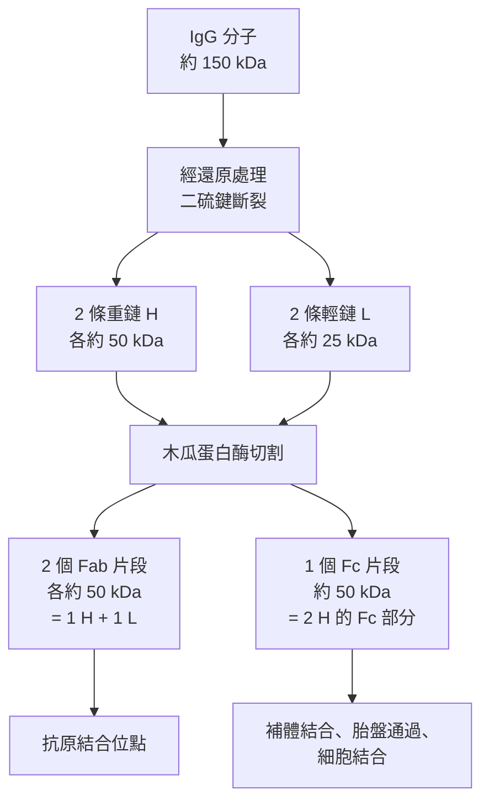

# 1972 · 抗體的化學結構：波特與埃德爾曼把 Y 形的免疫分子拆成兩條重鏈兩條輕鏈

> **1972 諾貝爾生理學 or 醫學獎**（共享）：傑拉爾德·埃德爾曼（Gerald Maurice Edelman，美國）— 表彰「發現抗體的化學結構」；羅德尼·羅伯特·波特（Rodney Robert Porter，英國）— 同上。

## 懸案（案情提要）

抗體是免疫系統的「導引飛彈」，但它的結構在 1950 年代之前仍是黑箱。核心疑點：

1. **抗體的形狀是什麼？** 它必須能同時「辨認抗原」（Fab 端）與「結合補體、與免疫細胞結合」（Fc 端）——這要求一個**分叉的結構**。
2. **抗體是由一條長蛋白鏈還是多條鏈組成的？**
3. **如何解開一條巨大的蛋白質而知道它的組成？** 沒有 X 光晶體結構（抗體難以結晶），序列測定在 1950 年代也不可能（蛋白質定序要等到 1960 年代的 Sanger 才成為可能）。
4. 抗體的**多樣性**從哪裡來？每一種抗體都需要獨特的結合位點——若蛋白質種類有限（當時估計約 $10^4\text{–}10^5$ 種），如何對付數以億計的抗原？

波特的答案是**化學降解法**：用酵素把抗體「切」成片段，從片段的組成反推結構。埃德爾曼的答案是**序列比較**：以 B 型淋巴球腫瘤的**患者個體**為材料（每個患者的抗體都是不同的），比較胺基酸序列的差異，定位抗原結合位。

## 前因

| 年份 | 事件 |
| --- | --- |
| 1930s | **歐里金（Michael Marcein?）**——實為 **Tiselius**（1940s）在電泳中發現抗體是**γ-球蛋白**。 |
| 1937–1940s | 免疫化學家發現抗體有**三種功能區域**：抗原結合、抗體間的結合（補體結合）、以及「穿過胎盤」等功能；**Ouchterlony 與 Wells** 建立**抗原擴散測定法（Ouchterlony double diffusion）**。 |
| 1940s–1950s | **Sanger 的定序方法**（1955 年完成胰島素的序列）成為可能，並提供**N 端定序**（Edman 法，1950s）與**酵素水解**工具。 |
| 1953 | **Marrack（John Marrack）**提出「抗體的「Y」形結構與『格子假說（lattice hypothesis）』」，指出抗原與抗體形成網狀沉澱。 |
| 1958–1959 | **波特**在牛津以**木瓜蛋白酶（papain）**與**胃蛋白酶（pepsin）**消化兔子的免疫球蛋白 G（IgG），得到**Fab 片段**與 **Fc 片段**——**第一次把抗體「切開」並看到功能分離**。 |
| 1959–1963 | 波特以**還原與烷基化（reduction and alkylation）**把抗體拆成**重鏈與輕鏈**，並發現輕鏈有 $k$ （kappa）與 $\lambda$ 兩型。 |
| 1963–1966 | **埃德爾曼**（與 **Richard D. Lyman**）在 Rockefeller 以**骨髓瘤（myeloma）患者的抗體**為材料，進行**序列比較**，確立抗體的**可變區（variable region）與恆定區（constant region）**之分，以及 **V 區的「超變異區（hypervariable region）」**——即抗原結合位點。 |
| 1967 | 埃德爾曼與波特在《美國國家科學院院刊》發表《Antivody Structure and the Function of the Immune System》的系列論文。 |
| 1972 | 兩人共享諾貝爾生理學 or 醫學獎。 |
| 1970s–1980s | 抗體的 X 光晶體結構被解析（**1972 年 Inman 與 Edelman 的 Fab 片段結構**；1986 年 Harris 與 Schleicher's完整 IgG 結構）。 |
| 1984 | **利根川進**證明抗體多樣性源於**基因重排**（見 [1987-抗體多樣性](1987-抗體多樣性.md)），解答了最後一問。 |

## 調查

### 第一幕：波特的「切開抗體」策略

波特的偵查起點是一個實用問題：**抗體的Fab 端與 Fc 端功能不同，它們在分子上的位置與化學組成是否也會不同？**

他選擇的工具是**蛋白酶消化**：

| 酵素 | 切點 | 產物 | 功能 |
| --- | --- | --- | --- |
| 木瓜蛋白酶（papain） | IgG 的 **hinge 區**上方 | **2 個 Fab 片段** + **1 個 Fc 片段** | Fab 結合抗原；Fc 結合補體與細胞 |
| 胃蛋白酶（pepsin） | hinge 區**下方** | **F(ab')\(_2\)** 片段 + 若干小片段 | 仍具抗原結合能力 |
| 胃蛋白酶 + 還原 | 二硫鍵還原 | **Fab** 片段 | 單一抗原結合單位 |

**這組實驗揭示的結構圖景**：



**波特的關鍵推論**：IgG 由 **2 條重鏈 + 2 條輕鏈**組成，四條鏈以**二硫鍵**連接；**抗原結合位點由一條重鏈的可變區與一條輕鏈的可變區共同構成**；**Fc 片段只含重鏈**，因此是效應功能所在的部位。

### 第二幕：埃德爾曼的「序列比較」策略——用腫瘤做「天然實驗」

埃德爾曼的問題是：**要找出抗體中哪些部位負責抗原結合，必須比較「不同的抗體」的序列差異。**

材料從哪裡來？**骨髓瘤（multiple myeloma）**——這種漿細胞腫瘤會把單一種類的抗體大量製造並釋放到血中。因此：

```mermaid
flowchart TD
    A[骨髓瘤患者 A<br>製造抗體 A] --> C[純化抗體 A<br>（均一性高！）]
    B[骨髓瘤患者 B<br>製造抗體 B] --> C
    C --> D[兩條鏈分別用酵素切成片段<br>逐一比較胺基酸序列]
    D --> E{差異集中在哪一段?}
    E --> F[可變區 (V)<br>——差異集中於 N 端約 110 個殘基]
    F --> G[其中 3 小段變化最劇烈<br>= 超變異區 (CDR)]
    G --> H[抗原結合位點的組成]
    D --> I[恆定區 (C)<br>——高度保守, 依同種分為類別]
```

**埃德爾曼方法的三個精妙之處**：

1. **材料來源**：用患者的腫瘤抗體，而非免疫後動物的多克隆抗體——**單一抗體使序列可比**；
2. **對照組**：用**同一患者自己的 B 淋巴球腫瘤（漿細胞）**與正常細胞比較，以排除「腫瘤本身的異常」；
3. **材料量**：骨髓瘤患者可提供**數克**的均一抗體，使當時所需的化學量成為可能。

**埃德爾曼的發現**：

1. **抗體由「可變區」與「恆定區」構成**；
2. **可變區內有三段「超變異區（hypervariable region, CDR1/CDR2/CDR3）**，它們是**唯一在所有抗體中都不相同**的部分——**抗原結合位點**；
3. **恆定區高度保守**，可分為五類（IgG、IgM、IgA、IgD、IgE）——這解釋了抗體的「類別」（異型）；
4. **輕鏈有 $\kappa$ 與 $\lambda$ 兩型**；
5. 序列的「可變」與「恆定」的二分，開啟了**基因體的「重排—剪接—組合」問題**——這是 1980 年代的利根川進所解答的（見 [1987-抗體多樣性](1987-抗體多樣性.md)）。

### 第三幕：X 光結構的補完

1970 年代的 X 光晶體學把化學結果三維化：

1. **Fab 片段的結構（1972，Inman & Edelman）**：Fab 呈**V 形**，每一臂頂端是一個抗原結合面，由 CDR1、CDR2、CDR3 與輕鏈的 CDRs 共同構成**「結合面」**；
2. **完整 IgG 的結構（1986，Harris & Schlicher）**：**Y 形**，兩條 Fab 臂可自由擺動——**這解釋了抗體的「可塑性」**：它能結合形狀多樣的抗原；
3. **1970 年代的結構數學**：**Kabat 對齊序列（Kabat's alignment sequences）**與 **Wu–Wang–Saphire 的 CDR 定義**，成為抗體工程與計算設計的通用語言（今日的抗體人源化改造，直接建立在這些序列定義上）。

## 理論裁決

1. **Y 形結構的幾何學**：IgG 的 Y 形可用兩條 Fab 臂的旋轉自由度描述：

   $$\text{Fab 臂間角} \in [0^\circ, 180^\circ]$$

   這個可變角度就是「**多價性與可塑性**」的幾何基礎——抗體像一把可開合的鉗子，能擁抱不同形狀的抗原決定位。

2. **抗原結合的「鎖鑰—孔穴」與「誘導契合」**：波特的化學結果顯示結合位是三段 CDR 形成的**凹陷**；而 1970–80 年代的結構研究顯示**抗原結合會誘導抗體構形改變**（induced fit）——這是 20 世紀 70 年代生物學的重要命題修正。

3. **多樣性的組合爆炸**：波特的結構與埃德爾曼的序列結果，共同為後來的「**V(D)J 重排**」預設了問題：若抗體由固定數目的基因片段「重組」產生，則可能的組合數為：

   $$N_{\text{重鏈}} = V \times D \times J, \qquad N_{\text{輕鏈}} = V \times J$$

   以人類的約 40–50 個 $V_H$ 、27 個 $D_H$ 、6 個 $J_H$ 計：

   $$N \approx 45 \times 27 \times 6 \times (40 \times 5) \approx 1.5 \times 10^{7}$$

   再乘上輕鏈的 $\kappa/\lambda$ 選擇，即得約 $10^8\text{–}10^{11}$ 的理論上限——**足以覆蓋宇宙中的分子數**。這正是「**體細胞基因重組**」這個答案的準備工作。

4. **輕鏈與重鏈的功能分工**：波特的酵素消化實驗建立了一個至今有效的**功能—結構對應法**：

   | 片段 | 組成 | 功能 |
   | --- | --- | --- |
   | Fab | 1 條輕鏈全鏈 + 重鏈的 VH + CH1 | 抗原結合 |
   | Fc | 重鏈的 CH2–CH4 二聚體 | 補體結合（IgG、IgM）、胎盤通過（IgG）、細胞結合（Fc $\gamma$ 受體） |
   | Fab' | 木瓜蛋白酶切割的重鏈片段 | 抗原結合 |

   這套「以酵素切開以定位功能」的方法，後來被應用於補體（IgM 的 C3b 結合位）、IgE 的 Fc $\varepsilon$ RI 結合位等研究。

## 追查支線（未結之謎）

- 波特在 1985 年去世後，**其同事與後人（Michael Neuberger、Ian IgG 分子的科學家社群）**整理出版他的科學論文集，延續其研究傳統；
- 埃德爾曼在 1970 年代轉向**神經科學與腦的可塑性研究**，並提出「**免疫系統與神經系統的類比**」——他主張「免疫系統的學習與記憶」與「腦的學習與記憶」共享深層的組織原理（這是他 1990 年代《The antibody as a model for the immune system》的主張），並撰寫了廣受閱讀的哲學著作《The Remembered Self》；
- **埃德爾曼的諾貝爾演講（1972）** 是歷史上最動人的演講之一：他在演講中表達了「**我的成果在很大程度上歸功於我的導師 Max Heideloff 的寬容與自由**」，並感謝了技術員；
- 「**抗體多樣性**」的最後一塊拼圖（基因重排）要等到 1984 年利根川進獲得 1987 年諾獎時才補上（見 [1987-抗體多樣性](1987-抗體多樣性.md)）；
- 抗體結構知識帶來了**治療性抗體的現代革命**：1980 年代的嵌合抗體（mAb）、1990 年代的**人源化抗體**、以及 2010 年代的 **Fab 片段、雙特異性抗體、ADC（抗體藥物偶聯物）**——今日癌症治療的支柱（見 [2018-免疫檢查點](2018-免疫檢查點.md) 時代的免疫腫瘤學）。

## 證物與數據（偵查卷宗摘錄）

| 證物 | 數值／內容 | 偵查意義 |
| --- | --- | --- |
| 木瓜蛋白酶消化（1958–59） | 2 Fab + 1 Fc | 功能區域的第一次分離 |
| 胃蛋白酶消化 | F(ab')\(_2\) + 碎片 | 切點位置的功能意義 |
| 還原與烷基化 | 2 條重鏈 + 2 條輕鏈 | 四鏈結構的確立 |
| 輕鏈型 | $\kappa$ 與 $\lambda$ | 兩型輕鏈 |
| Fab / Fc 功能 | 結合抗原 / 結合補體 | 功能—結構對應 |
| 骨髓瘤抗體 | 患者血中的單一抗體 | 序列比較的理想材料 |
| 可變區 / 恆定區 | N 端約 110 殘基可變 | 結構二分 |
| 超變異區 CDR1–3 | 可變區中變化最劇烈的三小段 | 抗原結合位 |
| 恆定區類別 | IgG/M/A/D/E | 抗體的「類別」 |
| 理論多樣性 | 約 $10^{8}\text{–}10^{11}$ | 重組假說的準備 |
| IgG 結構（1986） | Y 形，Fab 臂可擺動 | 可塑性的幾何 |

## 後果

| 領域 | 影響 |
| --- | --- |
| 免疫學 | 抗體結構確立，Fc 效應功能與 Fab 結合功能的分工成為免疫學的基本架構。 |
| 分子生物學 | 「可變—恆定」的二分直接引導了基因重排理論與後來的發現。 |
| 生物技術 | 抗體工程（嵌合、人源化、Fab、雙特異性）的基礎；單株抗體技術（見 [1984-單株抗體](1984-單株抗體.md)）。 |
| 臨床 | 治療性單株抗體（rituximab、trastuzumab 等）、ADC 藥物、診斷抗體試劑。 |
| 結構生物學 | 以「酵素切割＋序列比較＋X 光」破解大分子的方法論典範。 |
| 其他諾獎 | 與 [1984-單株抗體](1984-單株抗體.md)、[1987-抗體多樣性](1987-抗體多樣性.md)、[1908-免疫雙雄](1908-免疫雙雄.md) 構成抗體研究的主線。 |

## 關聯

- [1908-免疫雙雄](1908-免疫雙雄.md) — 抗體的側鏈模型，結構學的先聲。
- [1919-補體與免疫](1919-補體與免疫.md) — Fc 端所結合的補體系統。
- [1984-單株抗體](1984-單株抗體.md) — 把抗體結構知識變成製造技術。
- [1987-抗體多樣性](1987-抗體多樣性.md) — 多樣性的基因層次答案。
- [2018-免疫檢查點](2018-免疫檢查點.md) — 抗體作為治療藥物的現代巔峰。
