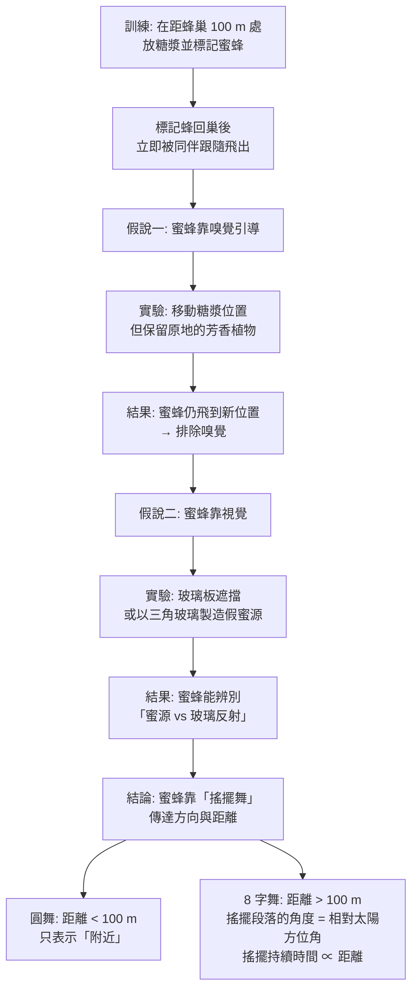
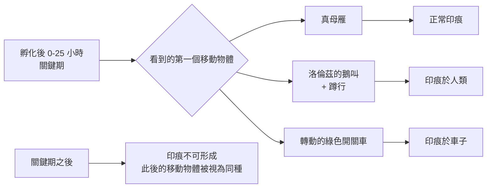

# 1973 · 動物行為的模式：馮·弗希的蜜蜂舞、洛倫茲的印痕與廷伯根的四提問

> **1973 諾貝爾生理學 or 醫學獎**（共享三人）：卡爾·馮·弗希（Karl Ritter von Frisch，奧地利／德國）— 表彰「發現個體與社會性行為模式的組織和引發」；康拉德·洛倫茲（Konrad Zacharias Lorenz，奧地利）與尼可拉斯·庭伯根（Nikolaas Tinbergen，荷蘭）— 同上。**這是諾貝爾生理學或醫學獎史上第一次頒給動物行為學家，也是「動物行為學（ethology）」正式進入主流科學的里程碑。**

## 懸案（案情提要）

1930 年代，動物行為研究分裂成兩派：

1. **實驗心理學派（美國）**：以白鼠與鴿子為模型，在嚴格控制的實驗室裡研究學習、制約與操作反射（Skinner 的操作制約）。
2. **動物行為學派（歐洲）**：在自然與半自然環境中觀察野鳥、魚類與昆蟲的自然行為——主張行為有其「先天」的組織。

核心爭議：

1. 行為是**先天的（instinctive）**還是**後天學習的**？抑或兩者皆是？
2. 如果有先天行為，它的**組織方式**是什麼？是被某個「中樞模式」控制，還是逐步被學習所改寫？
3. **社會性行為**（如蜜蜂的舞蹈、鳥類的求偶與育幼）如何被組織與引發？
4. 動物如何用**訊號（signals）**溝通？

三位得主各自以一種「決定性的觀察」回答了這些問題。

## 前因

| 年份 | 事件 |
| --- | --- |
| 1904–1908 | 廷伯根在荷蘭的 Leyden 實驗室以紅腹松雞雛做實驗，證明「**最不適當的刺激也會引發本能反應**」——例如以假母雞模型引發雛鳥的「逃匿反應」，這奠定了他「**比較功能主義（comparative functionalism）**」的方法論。 |
| 1910s | 廷伯根提出**刺激釋放（stimulus release）**與「**符號刺激（sign stimulus）**」概念，並開始系統描述鳥類的**固定行為模式（fixed action pattern, FAP）**。 |
| 1920s | **馮·弗希**在慕尼黑的動物行為研究所研究**蜜蜂**，以「紙上模型」與「顏色標記」實驗，發現蜜蜂能記住蜜源的位置並以「**8 字舞（waggle dance）**」傳達。 |
| 1927 | 馮·弗希出版《蜜蜂的生活》（Aus dem Leben der Bienen），把舞蹈語言完整記錄下來——但**被主流科學界視為異說**。 |
| 1928–1936 | **洛倫茲**在維也納的阿爾滕堡（Altenburg）以**灰雁（greylag geese）**研究「**印痕（imprinting）**」與「**孵卵反應**」。 |
| 1931 | 洛倫茲出版《Der Kumpan in der Umwelt des Vogels》（《鳥類環境中的伴侶》），提出「**印痕」**概念。 |
| 1936 | 洛倫茲與廷伯根相識，共同發展了**動物行為學**作為獨立學科；他們定義了**四個提問**（見下文）。 |
| 1938 | **丁伯根（Niko Tinbergen）**在《動物行為的科學目標》（*On aims and methods of ethology*）中明確提出「**四個提問**」框架。 |
| 1940s | 廷伯根以**海鷗（gull）的「紅色斑點」實驗**展示「**關鍵刺激（key stimulus）**」與「**釋放機制（sign stimuli）**」；他的工作使行為學獲得方法論上的嚴格性。 |
| 1973 | 三人共享諾貝爾生理學 or 醫學獎。 |
| 1970s | 廷伯根與電影導演 **Hugh Falkus** 合作製作的野生動物影片（*Signals for Survival*, 1969；*The Riddle of the Rook*, 1972）獲意大利獎與美國藍絲帶獎，讓動物行為學進入大眾視野。 |
| 1980s | 廷伯根的學生 **Desmond Morris** 的《The Naked Ape》（1967）與 **Konrad Lorenz** 的《On Aggression》（1966）讓行為學進入公共討論。 |

## 調查

### 第一幕：馮·弗希的蜜蜂——一場資訊的「通訊實驗」

馮·弗希面對的謎題是：數百隻蜜蜂在蜂巢中飛進飛出，**如何讓同伴知道蜜源在哪裡？**

他的偵查方法極為漂亮：用**標記實驗**追蹤個體。

**8 字舞的「資訊編碼」**是自然界的資訊理論奇蹟：

- **方向**：搖擺段落的中線相對於**垂直方向**的偏角，即蜜源相對太陽的方位角（以逆時針為正）；
- **距離**：**搖擺持續時間**與距離成正比（約每 $0.1\ \mathrm{s}$ 對應數十米）；
- **時間資訊**：舞蹈的重複頻率還能傳達「多遠」之外的資訊，使同伴能依太陽位置補償時間流逝。

**馮·弗希的科學史困境**：他的發現在 1927 年出版後，**被主流動物心理學家斥為「不可能」**——因為美國實驗心理學家主張動物無法透過符號溝通，認為馮·弗希的實驗有「人的投射」之嫌。整整二十多年後，1960 年代的實驗（如 **W. F. (R. A.) Hinde** 的重複實驗與 1970 年代的行為生態學轉向）才確認馮·弗希的正確性。這樁「被主流拒斥的正確發現」，是 1973 年諾獎最值得記取的一面。

### 第二幕：洛倫茲的印痕——「關鍵期」的發現

洛倫茲以灰雁雛鳥做了一個極其簡單但影響深遠的觀察：

1. 灰雁雛鳥在孵化後**約 4–25 小時**的關鍵期內，會把**它第一個看到的移動物體**當作母親並跟隨之；
2. 洛倫茲讓自己扮演「母雞」——他蹲在地上發出鵝叫的叫聲並慢慢走開，雛鳥就會**排成一列跟著他走**；
3. 若換成一隻**轉動的綠色開關車**（烏爾姆大學的學生用玩具車做的實驗），雛鳥同樣會跟著車走；
4. 關鍵期過後，**這種跟隨行為就不可逆地消失**。

**印痕的三個性質**：

1. **關鍵期（sensitive period）**：有嚴格的時間窗口，錯過即不可逆；
2. **不可逆性**：一旦形成，難以被新經驗覆寫（這與「學習」不同——學習可被改寫）；
3. **選擇性**：不是任何刺激都可以，而是**特定類型**的刺激（會動、有類似叫聲的）——這正是廷伯根的「關鍵刺激」概念。

**印痕的深遠影響**：它把「本能與學習」的二分法徹底打破——印痕既非純粹先天（因為須有個體經驗），也非純粹學習（因為有嚴格關鍵期與不可逆性）。今日的**早期生命經驗對社會性與依附行為**（人類的依附型態、孤兒院研究、育嬰政策）都以印痕為概念源頭。

### 第三幕：廷伯根的四個提問——行為學的方法論革命

廷伯根最大的貢獻是**把行為研究問題化為四類可獨立研究的提問**：

| 提問 | 內容 | 典型方法 | 廷伯根的例證 |
| --- | --- | --- | --- |
| **① 因果（causation）** | 什麼刺激引發這個行為？ | 實驗操弄（實驗法） | 海鷗的「紅色斑點」——只要在灰鷗頭頂有紅色標記，雛鳥就會啄擊 |
| **② 發育（development）** | 這個行為如何隨個體發展而出？ | 縱向比較不同年齡 | 雛鳥啄擊反應的出現時程 |
| **③ 功能（function）** | 這個行為的適應意義是什麼？ | 比較不同情境下的行為效果 | 海鷗的「乞食叫聲」對親鳥覓食行為的影響 |
| **④ 演化（evolution）** | 這個行為在演化歷史中如何發展？ | 比較親緣相近的物種 | 各物種間「乞食叫聲」的同源性 |

**這四個提問的威力**：它把「行為是先天還是後天」這種**錯誤的二分**徹底廢除，因為**同一個行為可以有不同的答案**——例如「海鷗的啄擊反應」在①上是因為紅色刺激，在③上是因為能引發親鳥餵食，在④上是因為在演化中提高了雛鳥存活率。

**廷伯根的實驗方法論**是「**實驗法與觀察法並重**」：

- **實驗法（experiments）**：干涉刺激、比較不同處理，尋找「關鍵刺激」；
- **觀察法（observations）**：在自然環境中系統記錄行為的自然發生（描述「自然史」）。

**廷伯根與洛倫茲的另一項重要貢獻**是**「符號刺激」與「超常刺激（supernormal stimulus）」**的發現：

- 許多本能行為由**特定的「符號刺激」**引發（海鷗的紅斑、雄蠶蛾的氣味）；
- 而且**超常刺激**（如更鮮紅的塑料斑點、或多配偶的「歌聲」）能引發比天然刺激更強的反應——這是動物行為研究中「自然選擇的節奏」最有趣的實證之一。

### 第四幕：洛倫茲的「攻擊行為」與「同伴關係」的科學化

洛倫茲在戰後（他曾被蘇聯俘虜四年）以「**本能與個體經驗的交互作用**」解釋許多社會行為：

1. **灰雁的「同伴印痕」與「群體秩序」**：攻擊與臣服的姿態序列、勝者的「稻草人攻擊」現象（把對手當成鵝的玩具稻草人時攻擊反應減弱，證明「抑制機制」依賴對同伴的特定刺激）；
2. **魚類的攻擊等級**：慈鯛的「攻擊排序」實驗（放入不同大小的個體，觀察攻擊是否停止）——這是 20 世紀最著名的「群體社會結構」實驗；
3. **Lorenz 的「水之鏡」**：1940 年代的模型顯示攻擊行為可由**刺激—反應的累積**解釋，後被批評為過度簡化。

### 第五幕：三大流派的整合與學科命名

三人共同建立的方法論，被稱為**「四個提問」的行為學（ Tinbergen's four questions）**，並在 1970 年代成為「**行為生態學（behavioural ecology）**」的基礎。1973 年的諾獎，意味著動物行為學從「描述性觀察」升級為「**可提問、可實驗、可解釋的科學**」。

## 理論裁決

1. **印痕的時間窗模型**：印痕可用「敏感期窗口」函數描述：

   $$P(\text{印痕形成}) = f(t - t_0), \qquad f(t) = 0 \ (t<0), \quad f(t) \text{ 在 } [t_1,t_2] \text{ 內高}, \quad f(t)=0 \ (t>t_2)$$

   這是一個「**窗函數**」，與感覺適應曲線（見 [1967-視覺過程](1967-視覺過程.md)）在數學形式上同源——**時間上的可塑性窗口**是生物學的通用結構。

2. **蜜蜂舞蹈的資訊量**：8 字舞編碼的資訊量可估算：方向（連續變數，約需 $\log_2 360 \approx 8.5$ bits）＋距離（ $\log_2 100 \approx 6.6$ bits），單次舞蹈約可傳遞 **15 bits** 的資訊——在當時的生物通訊研究中，這是一個惊人的數字（與人類語言的資訊密度相當）。

3. **關鍵刺激的「刺激—反應鏈」**：廷伯根的「符號刺激」概念建立了一種**離散的觸發模型**：

   $$\text{關鍵刺激} \xrightarrow{\ \text{中樞模式}\ } \text{固定行為模式（FAP）}$$

   這與當時正在興起的「中樞模式生成器（central pattern generator, CPG）」概念相呼應——行為的產生未必需要感覺回饋的逐 moment 指導。

4. **演化比較的邏輯**：廷伯根的第④個提問——**以親緣關係相近的物種作比較**——是達爾文式比較法的現代版：

   $$\text{行為的同源性} \Rightarrow \text{共同祖先的行為} \Rightarrow \text{演化變異}$$

   這種邏輯在 1980 年代的「**行為的系統發育學（behavioral phylogeny）**」中，被分子系統學工具全面強化。

5. **攻擊行為的抑制模型**：洛倫茲的「攻擊抑制」概念可寫為：

   $$P(\text{攻擊反應}) = g(A, R, S) \cdot \left(1 - \frac{\text{抑制訊號}}{\text{閾值}}\right)$$

   其中 $A$ 為攻擊驅力、 $R$ 為對手的攻擊強度、 $S$ 為同伴／抑制訊號的存在——這是「**社會性調節**」的第一個定量模型。

## 追查支線（未結之謎）

- **洛倫茲的納粹歷史**：他於 1938 年加入納粹黨，戰時在維也納的「心理研究所」任職，研究被宣稱為精神治療的鳥類研究；戰後他曾被同盟國視為「前納粹」，使他失去了教職與研究條件五年；他晚年屢次為自己的過去辯護，並在《我與洗腦》（1973）等書中引述該書以佐證其觀點——**這樁案例至今是科學家公共責任的教材**；
- 廷伯根於 1988 年去世後，其遺孀 **Luuk Tinbergen** 整理出版了他的《動物行為學四提問與其他 essays》，成為行為學教科書；
- 馮·弗希的蜜蜂舞蹈被**諾貝爾委員會以「認可其卓越貢獻」的方式修正**——1964 年他曾因「與其他諾獎得主共享發現的榮譽」而未被頒獎（與 M. Lindhard 共同發現舞蹈語言），委員會最終決定單獨頒給馮·弗希；
- **廷伯根的學生Desmond Morris** 後來成為著名的動物行為學科普作家（《裸猿》、《人類之後》），是行為學大眾化的重要推手；
- 今日的**比較認知科學**（Chimpaz、Alex）、**動物福利科學**（farm animal welfare）與**保育生物學**（behavioral conservation）皆承接三位得主的傳統；廷伯根的第②③④個提問則仍是生態學論文寫作的標準結構。

## 證物與數據（偵查卷宗摘錄）

| 證物 | 數值／內容 | 偵查意義 |
| --- | --- | --- |
| 蜜蜂標記實驗 | 標記蜂回巢後同伴跟隨 | 資訊傳遞的存在 |
| 排除嗅覺實驗 | 移動糖漿、保留香味 | 排除替代解釋 |
| 圓舞 vs 8 字舞 | $<$ 100\ \mathrm{m} $ vs $ > $100\ \mathrm{m}$ | 距離的編碼 |
| 舞蹈方向 | 角度 = 相對太陽方位角 | 方向的地形編碼 |
| 舞蹈時間 | 搖擺時長 ∝ 距離 | 距離的時間編碼 |
| 印痕關鍵期 | 灰雁雛鳥約 4–25 小時 | 敏感期窗口 |
| 開關車實驗 | 雛鳥跟隨綠色轉動車 | 印痕的選擇性 |
| 超常刺激 | 更鮮紅的海鷗斑點 | 刺激—反應鏈的離散性 |
| 慈鯛攻擊實驗 | 攻擊直到對手逃跑或躲藏 | 群體社會結構的實驗 |
| 廷伯根四提問 | 因果、發育、功能、演化 | 方法論革命 |
| 舞蹈資訊量 | 約 15 bits／次 | 生物通訊的定量 |

## 後果

| 領域 | 影響 |
| --- | --- |
| 動物行為學 | 從描述性學科成為實驗科學；「動物行為學四提問」成為生態論文的標準結構。 |
| 演化生物學 | 比較行為學把行為納入演化分析框架。 |
| 心理學 | 印痕概念影響了人類發展心理學與依附理論。 |
| 保育生物學 | 行為生態學的原理用於瀕危物種的圈養繁殖與野放。 |
| 公共科學 | 洛倫茲的科普著作把行為學帶入公共討論，同時也帶來其納西斯歷史的爭議。 |
| 其他諾獎 | 與 [1949-間腦與白質切除](1949-間腦與白質切除.md)（整體行為概念）、[1932-神經元功能](1932-神經元功能.md)（反射與整合）構成行為神經學的長線。 |

## 關聯

- [1949-間腦與白質切除](1949-間腦與白質切除.md) — 赫斯的「整體行為」概念，與廷伯根的固定行為模式同源。
- [1932-神經元功能](1932-神經元功能.md) — 謝靈頓的反射整合，是行為的神經學基礎。
- [1935-胚胎組織者](1935-胚胎組織者.md) — 「關鍵期」概念在發育生物學中的對應。
- [1967-視覺過程](1967-視覺過程.md) — 刺激釋放與感覺恆定的比較。
- [1972-抗體結構](1972-抗體結構.md) — 同為「把生物學問題化為可實驗提問」的典範。
