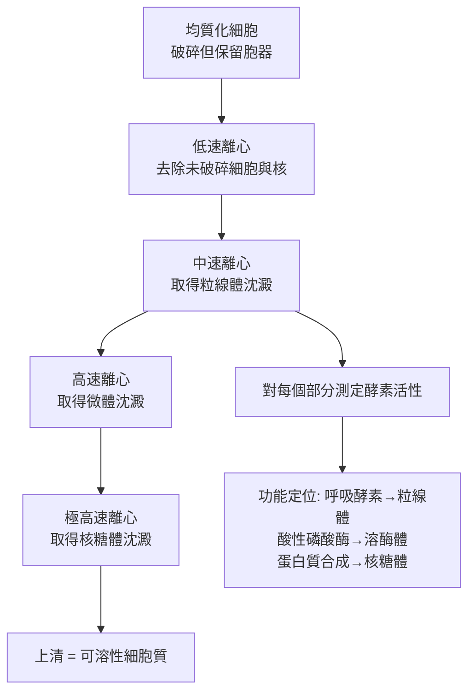
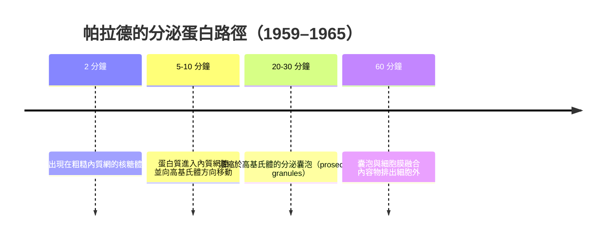

# 1974 · 細胞的結構與功能組織：克勞德、戴迪夫與帕拉德用「細胞分級」打開細胞內部

> **1974 諾貝爾生理學 or 醫學獎**（共享三人）：阿爾伯特·克勞德（Albert Claude，比利時）— 表彰「細胞的結構和功能組織方面的發現」；克里斯汀·德·迪夫（Christian de Duve，比利時）與喬治·埃米爾·帕拉德（George Emil Palade，羅馬尼亞出生、美國籍）— 同上。**這是諾貝爾生理學 or 醫學獎史上第一次頒給細胞生物學家。**

## 懸案（案情提要）

1950 年代，細胞學的核心矛盾是：**光學顯微鏡已經到了極限**。在光學下，一個細胞看起來是一團模糊的顆粒與纖維；而電子顯微鏡雖有千倍的解析力，卻只能處理**死掉的、脫水的、用重金屬染色的**細胞——**一切活體的動態資訊都消失了**。

問題是：

1. 細胞裡那些顆粒狀的結構（粒線體、核糖體、高基氏體）**各自在做什麼**？
2. 能否**把細胞拆開**，把不同的結構分離出來，然後**分別研究它們的功能**？
3. 細胞如何把蛋白質從製造處送到使用處？分泌的蛋白質經過哪些車站？
4. 溶酶體為何能消化掉細胞自己的成分？它是「消化室」嗎？

克勞德的答案是**細胞分級（cell fractionation）**：把細胞打碎，用**差速離心**把不同大小的胞器分開，再**在試管裡測試每個部分的酵素活性**。

## 前因

| 年份 | 事件 |
| --- | --- |
| 1930s | **Claude** 在 Rockefeller研究所引入**電子顯微鏡**到生物學，並發展**超薄切片技術**（與 **Keith Porter** 合作），首次看見細胞內部的超微結構。 |
| 1938 | Claude 用差速離心把細胞分成**可溶的細胞質（cell sap）**與**顆粒狀部分（particulate fraction）**，並發現：**只有顆粒部分能進行氧化磷酸化**——這是第一個「胞器功能」的分離實驗。 |
| 1945 | Claude 出版《細胞的結構與功能》（*The Cell: A Molecular Approach*），第一部以超微結構為框架的細胞學專著。 |
| 1945–1950s | **Palade** 在 Rockefeller 以**「palade granules」**（小型核糖體顆粒）研究分泌過程，並以**放射自顯影（autoradiography）**追蹤蛋白質的合成與運輸（1959 年他以 ${}^{3}\mathrm{H}$ -亮胺酸脈衝標記細胞，觀察到「**粗糙內質網 → 高基氏體 → 分泌囊泡 → 細胞外**」的完整路徑）。 |
| 1953–1955 | **de Duve** 以**細胞分級 + 酵素測定**發現**溶酶體（lysosome）**：他注意到細胞分級中有一個部分的酵素活性異常高，且其酵素在**酸性 pH**下活性最高——這暗示它是一個「**酸性區室的酵素庫**」。 |
| 1955 | Palade 描述**粗糙內質網上的核糖體（ribosomes）**與**「分泌途徑（secretory pathway）」**的結構基礎。 |
| 1957–1960s | **de Duve** 以密度梯度離心（**Nycodenz 梯度**）改進分級技術，發現**過氧化體（peroxisome）**、並闡明溶酶體的酵素譜（酸性磷酸酶、β-葡萄糖苷酸酶、蛋白酶等）。 |
| 1964–1965 | **Palade** 與 **Sabatini** 等以 Palade 小體與「信號肽（signal peptide）」模型，說明分泌蛋白如何被引導進入內質網（**信號假說（signal hypothesis）**，Blobel 與 Sabatini，1971 確認，1989 年獲諾獎，見 [1999-蛋白質分選訊號](1999-蛋白質分選訊號.md)）。 |
| 1974 | 三人共享諾貝爾生理學 or 醫學獎。 |

## 調查

### 第一幕：克勞德的「差速離心」——把細胞按大小拆開

差速離心的原理極為簡單：**在特定轉速下，特定時間內，不同大小的顆粒沉降不同距離**。

| 結構 | 沉降常數 | 需要的離心力（典型） |
| --- | --- | --- |
| 細胞核 | 最大 | 很低速（數百 × g） |
| 粒線體 | 中 | 中速（數千 × g） |
| 微體（溶酶體、過氧化體） | 小 | 較高速（約 10,000–20,000 × g） |
| 核糖體（微小體） | 最小 | 極高速（約 100,000 × g） |
| 可溶性細胞質（細胞溶膠） | 不沉澱 | 留在上清 |

**細胞分級的流程**：

**關鍵的方法論**：**「分級 + 酵素測定」**的結合。純粹的形態學（看見了什麼）必須加上**生化功能測定**（它能做什麼），才能真正認識胞器。

### 第二幕：德·迪夫的「酵素庫」推理——溶酶體的發現

德·迪夫的推理過程，是「**從酵素活性反推胞器**」的經典：

1. 他測量細胞分級各部分的**酸性磷酸酶**活性，發現它**隨分級純度的提高而增加**——即活性集中在某一特定部分；
2. 該部分的酵素活性在 **pH 5 左右**最高；
3. **推理**：細胞中必定有一個**內部維持酸性 pH 的區室**，其中儲存著在酸性下才有活性的酵素；
4. **電子顯微鏡驗證**（與 **Novikoff 與 de Duve** 合作，1956）：在特定細胞（腎小管細胞）中看到密集的顆粒，其外形與分級所得的顆粒一致；
5. **命名**：**溶酶體（lysosome）**——「溶解酵素的細胞器」。

**溶酶體的酵素譜（酸性 pH 下的活性）**：

| 酵素 | 底物 | 功能 |
| --- | --- | --- |
| 酸性磷酸酶 | 磷酸單酯 | 磷酸化合物分解 |
| 蛋白酶（組織蛋白酶） | 蛋白質 | 蛋白質分解 |
| 核苷酸酶 | 核苷酸 | 核酸降解 |
| β-葡萄糖苷酸酶 | 醣苷 | 醣類降解 |
| 脂肪酶 | 脂質 | 脂質降解 |

**德·迪夫還發現了「過氧化酶體（peroxisome）」**——一種含**氧化酵素（catalase）**與氧化酶的微小體，其酵素能以 $\mathrm{H_2O_2}$ 為底物：

$$2\,\mathrm{H_2O_2} \xrightarrow{\ \text{catalase}\ } 2\,\mathrm{H_2O} + \mathrm{O_2}$$

這解釋了極長鏈脂肪酸的 $\beta$ -氧化（**第一次被發現的氧化途徑**）與過氧化氫的分解——並直接連到後來 Zellweger 綜合症的發現（過氧化體生物發育障礙）。

### 第三幕：帕拉德的「分泌途徑」——蛋白質的旅行日誌

帕拉德的最大貢獻是**用放射性自顯影把蛋白質的合成與運輸過程「拍成電影」**。

**實驗設計**：

1. 在培養的細胞中加入**放射性的 ${}^{3}\mathrm{H}$ -亮胺酸**（脈衝標記）；
2. 在不同時間點**固定細胞**，用**放射自顯影**技術（以感光乳劑覆蓋超薄切片，曝光後顯影）觀察放射性銀粒的位置；
3. 結果是一條清晰的**時間序列**：

**這條「**粗糙內質網 → 高基氏體 → 分泌囊泡 → 胞外**」的路徑，是 20 世紀細胞生物學最經典的示意圖**，也是今日「**分泌途徑（secretory pathway）**」概念的源頭。

**帕拉德還建立了兩個關鍵概念**：

1. **粗糙內質網（RER）vs 平滑內質網（SER）**：RER 上附著核糖體，是蛋白質合成與初步修飾（訊號肽切除、二硫鍵形成、寡糖化）之處；SER 負責脂質合成與解毒——**同一套膜系統的兩種功能分化**；
2. **核糖體的兩種形態**：游離核糖體與附著於 RER 的核糖體，其差異不是核糖體本身，而是**所合成的蛋白質的命運**（訊號肽決定它是否進入內質網）。

### 第四幕：信號假說——「郵遞區碼」

帕拉德的高基（Blobel）提出的**信號假說（signal hypothesis, 1971）**，把上述觀察提升為可推廣的分子機制：

1. 所有分泌蛋白與膜蛋白的 N 端都帶有一段**疏水性訊號序列（signal peptide）**；
2. 轉譯開始時，核糖體與內質網膜上的**訊號辨識顆粒（SRP）**結合，將核糖體「停泊」到 RER 上；
3. 訊號序列被 SRP 受體引導穿過膜孔，轉譯在膜上繼續進行；
4. 訊號肽被**訊號肽酶**切除，蛋白質進入內質網腔；
5. 之後經高基氏體修飾並由囊泡運送至最終目的地。

**「郵遞區碼」的現代延伸**（1989 諾獎，見 [1999-蛋白質分選訊號](1999-蛋白質分選訊號.md)）：

| 訊號 | 導向 |
| --- | --- |
| 訊號肽（signal peptide） | 內質網腔 |
| 核定位訊號（NLS） | 細胞核 |
| 核輸出訊號（NES） | 由核輸出至細胞質 |
| 線粒體靶向序列 | 粒線體基質 |
| KDEL / HDEL（C 端） | 內質網腔（回收訊號） |
| 過氧化體靶向序列（PTS1） | 過氧化體 |

### 第五幕：細胞分級之後——「細胞生物學」成為獨立學科

三人的工作共同建立了一門以**結構—功能對應**為方法論的學科：

- **Claude**：技術（EM、分級）與觀念（細胞的複雜性）；
- **de Duve**：胞器的**酵素學定義**（溶酶體、過氧化體）；
- **Palade**：**動態的分子 trafficking**（分泌途徑）。

1974 年的諾獎，等於宣告「**細胞不是一團黏稠物，而是由分工明確的區室組成的工廠**」——這個觀念，之後被分子生物學與遺傳學完全接納。

## 理論裁決

1. **沉降係數與分離的物理**：顆粒在離心場中的沉降速率：

   $$v = \frac{2}{9}\frac{r^2(\rho_p - \rho_m) a}{\eta}$$

   由此可知**分離的解析度取決於顆粒大小與密度差**——這解釋了為何粒線體（大小與密度差大）易分離，而各種微體（溶酶體與過氧化體大小相近）需用**密度梯度**才能分開（de Duve 的方法學貢獻）。

2. **區室化（compartmentation）的效率**：細胞把反應限制在特定區室，可**避免副產物的有害反應**，並**提高局部濃度**：

   $$\text{區室化的收益} = \underbrace{\text{提高局部底物濃度}}_{\text{速率}} - \underbrace{\text{跨膜運輸成本}}_{\text{能量}}$$

   溶酶體的酸性 pH（由 V 型 ATP 幫浦維持，消耗約 1/3 的 ATP）確保其酵素只在正確條件下作用——這是「**區室是酵素活性的開關**」的第一個實例。

3. **分泌途徑的物流模型**：帕拉德的路徑可寫成一個有向的流程圖，其「站點」與「載體」為：

   $$\text{核糖體} \to \text{RER} \to \text{高基氏體 cis 面} \to \text{反式面} \to \text{分泌囊泡} \to \text{胞外}$$

   每一站的運輸皆由**包被小泡與 Rab GTP 酶**協調（1980–90 年代被闡明）——這套「物流網絡」在 2013 年的諾獎中再次獲獎（見 [2013-囊泡運輸](2013-囊泡運輸.md)）。

4. **細胞生物學的「可測性」**：分級把「看不見的功能」轉化為「可測的酵素活性」——這是本案的方法論核心，也是 20 世紀生物學「**從形態到功能**」的轉型標誌。

## 追查支線（未結之謎）

- **Claude 的戰時與科學良知的議題**：二戰期間 Claude 曾在德國參與研究，戰後他加入了**共產黨與「正義與自由」的運動**，並因美國的「回溯審查」（loyalty program）在 1950 年代一度被 Rockefeller 研究所解職——這樁「科學家的政治忠誠審查」是美國科學史的重要篇章；
- **de Duve 的科學行政生涯**：他於 1970 年代成為歐洲分子生物學實驗室（EMBL）的首任主任科學家，並推動了歐洲的分子生物學制度建設；
- **Palade 的羅馬尼亞出身與科學外交**：他於 1974 年後回到羅馬尼亞協助推動科學院改革，並以「Rockefeller University 與羅馬尼亞科學院」的對應關係，開啟了冷戰時期科學家跨越鐵幕的對話；
- **溶酶體病的臨床**：溶酶體貯積症（如**龐貝症、Tay–Sachs 病**）是 1960–70 年代被發現的遺傳性代謝病群，直接來自本案對溶酶體的理解；**Hurler 綜合症**的命名者 **Charles Hunter** 在 1950 年代即以溶酶體酵素的組織化學研究確立了這些病的生化基礎；
- **過氧化體的發現最終通向了 Zellweger 綜合症**與「過氧化體生物發育障礙」的整套疾病譜，以及今日 **PEX 基因**的鑑定。

## 證物與數據（偵查卷宗摘錄）

| 證物 | 數值／內容 | 偵查意義 |
| --- | --- | --- |
| 差速離心分級 | 各胞器按沉降速度分離 | 「拆開細胞」的方法 |
| 氧化磷酸化定位 | 只在顆粒部分 | 第一個胞器功能分離實驗 |
| 酸性磷酸酶活性 | 隨純度增加，且 pH 5 最高 | 溶酶體的酵素學推論 |
| 溶酶體命名 | lysosome | 酸性區室的發現 |
| 過氧化體 | 含 catalase 與氧化酵素 | 極長鏈脂肪酸的 $\beta$ -氧化 |
| catalase 反應 | $2H_2O_2 \to 2H_2O + O_2$ | 過氧化氫的清除 |
| 放射自顯影 | ${}^{3}\mathrm{H}$ -亮胺酸脈衝標記 | 分泌蛋白的時間序列 |
| 分泌路徑 | RER → 高基氏體 → 囊泡 → 胞外 | 20 世紀最經典的示意圖 |
| 信號假說（1971） | N 端疏水訊號序列 | 蛋白質分選的分子機制 |
| 沉降速率式 | $v = \frac{2}{9}\frac{r^2(\rho_p-\rho_m)a}{\eta}$ | 分離解析度的物理 |

## 後果

| 領域 | 影響 |
| --- | --- |
| 細胞生物學 | 成為獨立學科；胞器分工與分泌途徑成為基礎知識。 |
| 分子生物學 | 蛋白質分選（訊號假說）成為分子生物學的支柱，並在 1999 年獲諾獎。 |
| 遺傳疾病 | 溶酶體貯積症與過氧化體病的生化診斷基礎。 |
| 分泌與免疫 | 抗體與激素的分泌機制被理解，連結免疫學與細胞生物學。 |
| 藥理學 | 影響分泌的藥物（如類固醇的非基因作用）與訊號傳遞的藥物靶點。 |
| 其他諾獎 | 與 [1999-蛋白質分選訊號](1999-蛋白質分選訊號.md)、[2013-囊泡運輸](2013-囊泡運輸.md)、[1962-DNA 雙螺旋](1962-DNA雙螺旋.md) 構成細胞與分子生物學主線。 |

## 關聯

- [1999-蛋白質分選訊號](1999-蛋白質分選訊號.md) — 信號假說的諾獎答案。
- [2013-囊泡運輸](2013-囊泡運輸.md) — 帕拉德路徑的現代運輸機制。
- [1906-神經元學說](1906-神經元學說.md) — 卡哈爾的高基氏體描繪，帕拉德工作的先驅。
- [1931-呼吸酶](1931-呼吸酶.md) — 粒線體定位的酵素學證據。
- [1947-糖代謝與激素](1947-糖代謝與激素.md) — 內分泌的分泌途徑與激素合成。
