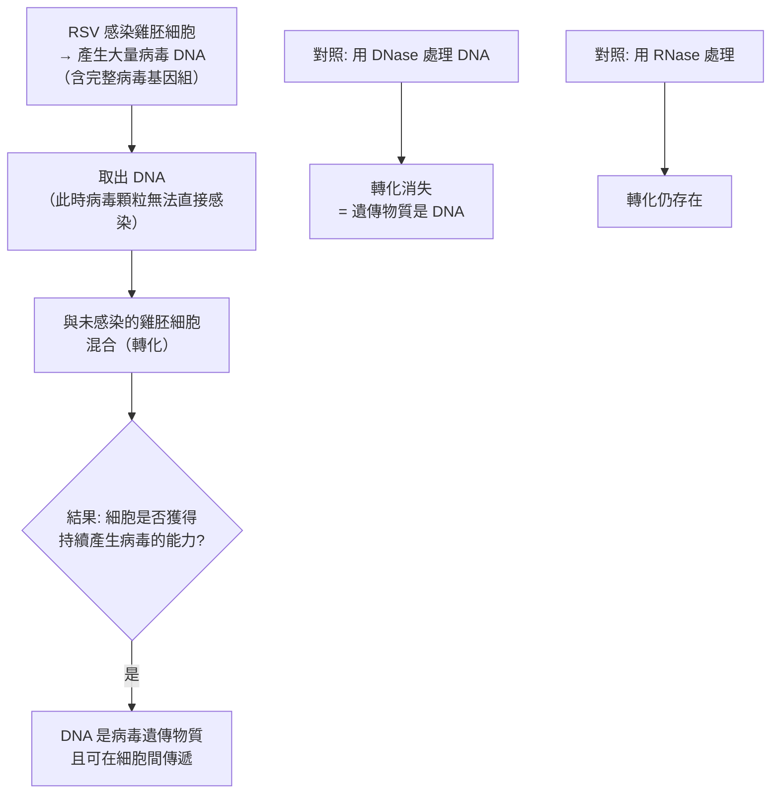

# 1975 · 腫瘤病毒與細胞遺傳物質的相互作用：巴爾的摩與特明找到「反轉錄」這個逆向定理

> **1975 諾貝爾生理學 or 醫學獎**（共享三人，皆為美國籍）：戴維·巴爾的摩（David Baltimore，美國）— 表彰「發現腫瘤病毒和細胞的遺傳物質之間的相互作用」；羅納托·杜爾貝科（Renato Dulbecco，美國；原籍義大利）與霍華德·馬丁·特明（Howard Martin Temin，美國）— 同上。

## 懸案（案情提要）

1960 年代末，分子生物學已經確立了**中心法則**（DNA → RNA → 蛋白質，見 [1968-遺傳密碼](1968-遺傳密碼.md)）。但有一個問題越來越尖銳：

1. **勞斯的肉瘤病毒（RSV）**的遺傳物質是 **RNA**（見 [1966-腫瘤病毒與激素療法](1966-腫瘤病毒與激素療法.md)）；
2. 病毒進入細胞後，必須把自己的遺傳物質變成**能被轉錄的 DNA 形式**，才能指揮細胞製造病毒蛋白；
3. **但中心法則說 DNA 只能流向 RNA**——那麼 **RNA 怎麼變回 DNA？** 這違反了當時的基本教條！

疑點本質是：**中心法則是否完整？** 還是有什麼東西被漏掉了？

## 前因

| 年份 | 事件 |
| --- | --- |
| 1960–1964 | **Howard Temin** 在 Wisconsin 以**雞胚成纖維細胞**研究 RSV，提出「**RSV 的遺傳物質可能是 DNA 而非 RNA**」的假說——當時被視為離經叛道。 |
| 1963 | **Renato Dulbecco**（與 **J. F. Dexter**）提出「**轉化（transformation）**」概念：以**沒有病毒的細胞**為受體、以**含病毒的 DNA 為給體**的混合，可使細胞獲得持續產生病毒的「**轉化性**（transforming principle）」——這是 DNA 為遺傳物質的直接證據（與 Avery 的肺炎鏈球菌實驗同型，見 [1946-X 射線誘發突變](1946-X射線誘發突變.md) 時代的分子生物學背景）。 |
| 1964 | **J. F. Dexter** 與 Temin、Dulbecco 發現：**用化學藥物處理 RSV 使其失去感染力後，失去感染力的病毒無法轉化細胞**——提示需要**某種酵素**參與逆轉錄。 |
| 1965–1970 | **Baltimore 與 Temin 分別獨立地尋找那個酵素**。 |
| 1970 年 6 月 | **Baltimore** 發表《**依賴 RNA 的 DNA 聚合酶**》（*RNA-dependent DNA polymerase in virions of Rous sarcoma virus*）——**在 RSV 病毒顆粒中發現了逆轉錄酶（reverse transcriptase, RT）**。 |
| 1970 年 7 月 | **Temin**（在 Madison）獨立發表《**RSV 的 RNA 依賴 DNA 聚合酶**》，並以**藥物抑制實驗**（用**放線菌素 D**抑制 RNA 轉錄，病毒仍能複製）證明病毒複製**不需要**宿主 RNA 聚合酶，必須使用**病毒自帶的 RT**。 |
| 1970–1971 | Baltimore 與 Temin 的結果被確認並整合；1971 年即有研究者提出 **「中心法則的修訂版」**（Crick 1970 年已公開表示將中心法則擴展以容納 RNA → DNA）。 |
| 1975 | 三人共享諾貝爾生理學 or 醫學獎。 |
| 1976 | **Baltimore 與 Howard Martin Temin 的老師 Harry Rubin** 的發現，確認 RSV 是**急性轉化病毒**（acute transforming virus）。 |
| 1970s–1980s | RT 被用於**cDNA 合成**（1970 年代的 Salk 與 Salk 的實驗）、**PCR**（PCR 使用 DNA 聚合酶，但 **RNA 的 RT-PCR** 同樣依賴 RT），並成為 **HIV 治療**的靶點（見 [2008-HPV 與 HIV](2008-HPV與HIV.md)）。 |
| 1993 | **PCR 專利與諾獎**頒給 Kary Mullis（見 [1959-核酸生合成](1959-核酸生合成.md)）。 |

## 調查

### 第一幕：Dulbecco 的「轉化實驗」——病毒遺傳物質的定性

Dulbecco 的貢獻，是把「病毒遺傳物質是什麼」的問題變成一個**可操作的實驗**。

**原理**：若病毒的遺傳物質是 DNA，則應能將「病毒性狀」從給體轉移到受體細胞，且此轉移**對 DNA 破壞性處理（DNase）敏感、對 RNA 破壞性處理（RNase）不敏感**。



**這套「**DNase/RNase 敏感性試驗**」是 20 世紀微生物學最常用的判定工具之一**，其原理正是「核酸的化學特異性可被酵素的底物專一性區分」。

Dulbecco 更以此提出了**「轉化原理（transforming principle）」**在病毒世界的對應物，並確立了**動物細胞的病毒轉化系統**——這個系統在往後四十年成為癌基因研究的標準平台（見 [1989-原癌基因](1989-原癌基因.md)）。

### 第二幕：Temin 的「異議」與藥物抑制實驗

Temin 的推理鏈極為漂亮：

1. **RSV 是 RNA 病毒**（已知）；
2. 病毒的遺傳物質必須進入細胞並被轉錄成 mRNA 才有功能；
3. **若病毒利用宿主的 RNA 聚合酶（依賴 DNA 的）來轉錄，則抑制宿主的 RNA 轉錄，病毒就無法複製**；
4. **實驗**：以**放線菌素 D（actinomycin D）**處理被 RSV 感染的細胞——該藥**抑制宿主的 RNA 轉錄**（但不抑制病毒的 RT）；
5. **結果**：**病毒仍然複製！**

這個結果在當時極為震撼——它意味著病毒**自帶**了一種能以 RNA 為模板合成 DNA 的酵素。

### 第三幕：Baltimore 的「酵素獵捕」

Baltimore 的搜尋策略極為系統化。他知道：

1. 病毒顆粒必須**攜帶**這個酵素（否則感染時無處取得）；
2. 因此可以**直接從純化的病毒顆粒中尋找**具有該活性的酵素。

**實驗流程**：

```mermaid
flowchart TD
    A[大量純化 RSV 病毒顆粒] --> B[裂解病毒外殼<br>釋出內部酵素]
    B --> C[加入四種 dNTP<br>dATP dTTP dGTP dCTP]
    C --> D[加入模板: 已知序列的 RNA<br>（RSV 的 RNA 或 poly(A)）]
    D --> E{有無新合成 DNA?}
    E -- 有 --> F[結果: 新生 DNA 的序列<br>與模板 RNA 互補]
    F --> G[結論: 病毒顆粒中含<br>RNA 依賴的 DNA 聚合酶<br>= 逆轉錄酶 RT]
    H[對照: 加入 RNase 處理模板] --> I[無 DNA 合成<br>= 需要 RNA 作模板]
```

**關鍵的對照實驗**：

1. **新生 DNA 與模板 RNA 互補**（這證明它是以 RNA 為模板的合成，而非 RNA 聚合）；
2. **用 RNase 破壞模板後反應停止**（證明模板必須是 RNA）；
3. **產物對 RNase 敏感**（新生的是 DNA 而非 RNA）；
4. **需要 dNTP（去氧核苷三磷酸）而非 NTP**。

### 第四幕：逆轉錄酶的特性與其餘波

Baltimore 與 Temin 的發現，隨即被其他實驗室追踪與擴充：

1. **逆轉錄酶不是專一的**——它可以以**多種 RNA** 為模板（mRNA、tRNA、rRNA、RNA 病毒基因組），因此被稱為**「逆轉錄的酵素是 RNA 依賴的 DNA 聚合酶」**；
2. **它有 Rnase H 活性**（降解 RNA 模板的 RNA–DNA 雜合體中的 RNA 鏈）——這是逆轉錄過程中「模板切換」的機制；
3. **它需要引子（primer）**——這正是 RT-PCR 與 **cDNA 合成**能成為常規技術的原因；
4. **它偏愛 $\mathrm{Mn}^{2+}$ 而非 $\mathrm{Mg}^{2+}$**（與 DNA 聚合酶 I 不同），且其 $3' \to 5'$ 外切酶校讀活性弱——這解釋了為何 RT 合成 DNA 的保真度較低（錯誤率高達每 $10^4\text{–}10^5$ 個鹼基），而這正是 HIV 高突變率的分子基礎（見 [2008-HPV 與 HIV](2008-HPV與HIV.md)）。

### 第五幕：修訂後的中心法則

Crick 在 1970 年公開表示，他的「中心法則」需要擴充以容納 RNA → DNA：

$$\text{DNA} \xrightarrow{\ \text{transcription}\ } \text{RNA} \xrightarrow{\ \text{translation}\ } \text{Protein}$$

$$\text{（允許的額外方向）} \quad \text{RNA} \xrightarrow{\ \text{reverse transcription}\ } \text{DNA}$$

**這是 20 世紀生物學少數需要「修正基本法則」的時刻之一**，其意義遠大於修正本身——它顯示科學理論在面對經驗事實時可以自我修正，而這正是本案被諾貝爾委員會表彰的深意。

**更宏觀的後果**：逆轉錄酶的存在，把**「生命起源於 RNA 世界（RNA world）」**的假說從「熱門假設」推向主流——因為 RNA 可以**自我複製**（藉由核糖核酸酵素），也可以**反轉錄成 DNA** 保留遺傳物質，DNA 則成為穩定的長期儲存形式。今日**「RNA 世界假說」**的證據鏈（見 [1968-遺傳密碼](1968-遺傳密碼.md) 的自由飄蕩假說、Crick 的起源假說）正是以本案為關鍵一環。

## 理論裁決

1. **逆轉錄的動力學**：逆轉錄酶催化反應：

   $$\text{RNA 模板} + \mathrm{dNTP} \xrightarrow{\text{RT}} \text{DNA{-}RNA 雜合體} \xrightarrow{\text{Rnase H}} \text{DNA} + \text{RNA 片段}$$

   與 DNA 聚合酶的差異有三：**模板是 RNA、產物是 DNA、引子可以是 RNA**。這三點解釋了它作為體外工具的價值（cDNA 合成、RT-PCR）。

2. **逆轉錄酶的生化學**：與其他 DNA 聚合酶共享同一個「**手掌—手指—拇指（palm-fingers-thumb）**」結構域，分為：

   | 酵素 | 來源 | 3'→5' 校讀 | 用途 |
   | --- | --- | --- | --- |
   | M-MLV RT | 莫洛尼鼠白血病病毒 | 有 | cDNA 合成（低錯誤率） |
   | AMV RT | 禽成髓細胞白血病病毒 | 弱 | 體外轉錄（mRNA 疫苗的來源） |
   | HIV-1 RT | HIV | 幾乎無 | 抗病毒藥物靶點 |

   這解釋了為何 **RT-PCR 用的 RT 與 mRNA 疫苗用的轉錄酶來自不同的病毒**——見 [2023-mRNA 疫苗](2023-mRNA疫苗.md)。

3. **癌基因的激活機制**：RSV 的基因組帶有 **v-src 致癌基因**，而它之所以能表達，正是因為病毒提供了 **逆轉錄酶**（將 RNA 轉成 DNA 並整合進宿主基因組），並在宿主啟動子（promoter）的驅動下被過度表達——**這是「病毒如何致癌」的第一個分子機制**。Baltimore 的**「轉化」技術**（focus assay）隨後被用於逐一鑑定**每一個癌基因**（見 [1989-原癌基因](1989-原癌基因.md)）。

4. **複製多樣性的數學**：病毒的複製策略可分為：

   | 策略 | 病毒 | 說明 |
   | --- | --- | --- |
   | RNA → RNA | 流感、正黏病毒 | RNA 依賴的 RNA 聚合酶 |
   | RNA → DNA → RNA | 逆轉錄病毒 | **本案** |
   | DNA → RNA | 疱疹病毒、腺病毒 | DNA 病毒 |
   | DNA → DNA | 痘病毒、噬菌體 | DNA 病毒 |

   **逆轉錄病毒獨有的「proviral（前病毒）」階段**（RNA → DNA → 整合進宿主基因組）是其「慢病程、終身感染」特性的根源——HIV 潛伏在 T 細胞的基因組中，可靜默數年。

## 追查支線（未結之謎）

- **Baltimore 的兩段人生**：他於 1975 年在 Rockefeller 與 MIT 獲得諾獎，1984 年因**HIV 的 mRNA 剪接與轉錄機制**的研究而進入愛滋病領域；1990 年代末，他因在 **1986 年的《華盛頓郵報》文章**中錯誤地推定 HIV 疫苗策略而遭到尖銳批評——其後他轉向基礎研究，並於 2006 年離開 MIT，**但這段科學誤判與其後果是科學責任討論的重要案例**；
- **Temin 的最終命運**：他於 1994 年因肺癌去世（54 歲）；1983 年，他與 **Temin 的同事 Janet Baltimore?** 共同獲得了 Gairdner 獎；他曾獲得 1972 年的**拉斯克基礎醫學研究獎**（與 Baltimore、Dulbeco 共享）；
- **Dulbecco 的科學政策影響**：他是「**向癌症宣戰（War on Cancer）**」計畫的主要倡議者之一，1971 年他在《科學》發表的文章是該運動的理論奠基；他亦倡議**基礎研究與臨床研究的整合**（今日的「轉化醫學」）；
- **中心法則的正式修訂**：Crick 在 1970 年撰寫的短文〈DNA 的中心法則之外〉（《Nature》1970 年 8 月）中明確表示 RT 的發現「迫使我們對中心法則的敘述做某種修改」——這是 20 世紀生物學理論自我修正的著名時刻；
- **RT 的應用已經改變世界**：cDNA 與 RT-PCR 使「從 RNA 到基因」的研究路徑成為常規；**HIV 診斷（RT-PCR 病毒載量）**、**COVID-19 的 RNA 疫苗平台**（2020–2023，見 [2023-mRNA 疫苗](2023-mRNA疫苗.md)）、**癌症的融合基因檢測**（例如 BCR-ABL）都直接依賴本案。

## 證物與數據（偵查卷宗摘錄）

| 證物 | 數值／內容 | 偵查意義 |
| --- | --- | --- |
| DNase/RNase 敏感性 | DNase 使轉化消失、RNase 無效 | 病毒遺傳物質是 DNA |
| 放線菌素 D 實驗 | 抑制宿主轉錄，病毒仍複製 | 病毒自帶轉錄酵素 |
| 病毒顆粒裂解液 | 加入 RNA 模板 + 4 種 dNTP | 產生新 DNA |
| 新生 DNA 序列 | 與 RNA 模板互補 | 以 RNA 為模板 |
| RNase 對照 | 破壞模板則反應停止 | 模板必須是 RNA |
| 產物對 RNase 敏感 | 新生物是 DNA | 產物身分 |
| RT 的錯誤率 | 約 $10^{-4}\text{–}10^{-5}$ ／鹼基 | HIV 高突變率的根源 |
| RT 的結構域 | palm–fingers–thumb | 與 DNA 聚合酶同源 |
| 修訂的中心法則 | 允許 RNA → DNA | 理論的自我修正 |

## 後果

| 領域 | 影響 |
| --- | --- |
| 分子生物學 | 中心法則被擴充；逆轉錄酶成為分子生物學的基本工具酵素。 |
| 病毒學 | 逆轉錄病毒的複製策略被確立；HIV 的治療與檢測技術由此而生。 |
| 癌症研究 | 病毒致癌機制的第一個分子解釋，並提供了癌基因鑑定的技術平台。 |
| 生物技術 | cDNA 合成、RT-PCR、基因體轉錄組分析、mRNA 疫苗技術平台。 |
| 生命起源 | RNA 世界假說獲得關鍵支持。 |
| 其他諾獎 | 與 [1966-腫瘤病毒與激素療法](1966-腫瘤病毒與激素療法.md)、[1989-原癌基因](1989-原癌基因.md)、[2008-HPV 與 HIV](2008-HPV與HIV.md) 構成病毒與腫瘤的主線。 |

## 關聯

- [1966-腫瘤病毒與激素療法](1966-腫瘤病毒與激素療法.md) — 勞斯的病毒在 55 年後被讀懂。
- [1989-原癌基因](1989-原癌基因.md) — 逆轉錄病毒提供的線索，通向原癌基因的發現。
- [1968-遺傳密碼](1968-遺傳密碼.md) — 中心法則的原始表述與本案對它的修正。
- [2008-HPV 與 HIV](2008-HPV與HIV.md) — 逆轉錄病毒在 21 世紀的全球性議題。
- [2023-mRNA 疫苗](2023-mRNA疫苗.md) — 逆轉錄／轉錄技術的現代應用。
