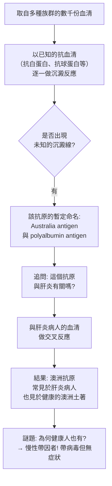
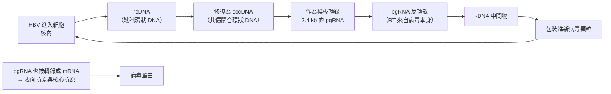

# 1976 · B 型肝炎與庫魯病：布倫伯格找到病毒性肝炎的源頭，加杜謝克遇到「非典型感染因子」

> **1976 諾貝爾生理學 or 醫學獎**（共享）：巴魯克·塞繆爾·布倫伯格（Baruch Samuel Blumberg，美國）— 表彰「發現傳染病產生和傳播的新機理」；丹尼爾·卡爾頓·蓋杜謝克（Daniel Carleton Gajdusek，美國）— 同上。

## 懸案（案情提要）

1970 年代，兩樁在臨床上迥異、在科學上卻同源的謎案：

**案子甲（肝炎）**：1950–60 年代，肝炎分為「甲型」（傳染性肝炎）與「乙型」（血清性肝炎）。但有一個巨大的漏洞：

1. 1960 年代，醫學界已能用**射線照射過的病人血清**來研究肝炎——但那需要** HBV 疫苗尚未存在、且病人來源有限**；
2. **為什麼只有一小部分感染 HBV 的人會變成慢性肝炎？** 感染者中只有約 $5\%\text{–}10\%$ 發展為慢性感染——這個比例低得不像典型的病毒感染（通常 $50\%$ 以上）。
3. 更怪的線索：1970 年代初，布倫伯格在**澳洲土著的血液中**發現一種**抗原**（後命名為 **Australia antigen，澳洲抗原**），它與乙肝表面抗原（ $\mathrm{HBsAg}$ ）**完全相同**——**為什麼健康、未患病的土著身上會有乙肝病毒的表面抗原？**

**案子乙（庫魯病）**：1960 年代，美國維吉尼亞的 Fore 部落出現一種怪病：患者**手指與腳趾會逐漸掉落**、之後無法行走、無法說話，最後死亡。病因不明，且**有部分患者在死前或死後把病「傳」給了其他人**。

## 前因

| 年份 | 事件 |
| --- | --- |
| 1885–1900 | 勒韋（Leuckart）提出「**寄生物（parasite）**」的廣義概念，包含不可見的病原體。 |
| 1930–1950 | 對**病毒**的認識仍以「可通過細菌濾器、不能在無細胞培養基生長、對紫外線敏感」為操作定義。 |
| 1953 | **Michael Shearer** 與其他人注意到：在**多次輸入污染了肝炎的血漿**的病人中，會出現一種**與典型肝炎不同**的疾病（潛伏期長、黃疸少見、預後差），且**用普通肝炎病人的血清無法傳染它**——暗示存在第二種病原。 |
| 1961 | **Blumberg** 在費城（Fox Chase）與 **Irving Millman** 等人研究**澳洲抗原**：他們以**已知有多種血型的人群**血清，尋找「**新抗原**」（new antigen），方法是把待測血清與多種已知抗血清做**沉澱反應**。 |
| 1963 | Blumberg 團隊在**澳洲原住民血清**中發現了一種新抗原——「**Australia antigen**」；後來發現它與**_polyalbumin 抗原_「肝炎相關抗原」**的關係，以及它與**德國血清學家與病毒學家**在 1960 年代發現的 **「肝炎相關抗原（HAA）」**是同一物質。 |
| 1967 | **Blumberg** 在**費城」的第三次國際肝病會議**上報告澳洲抗原，其**病毒學性質尚不明**，但已可用於**篩檢獻血者、防止 HBV 傳播**。 |
| 1968–1969 | **Dane 顆粒**的發現（**David Dane** 等人）在 HBV 感染者血清中發現完整的病毒顆粒；**Australia antigen 被證實為 HBV 的表面抗原（ $\mathrm{HBsAg}$ ）**，並且其內部含有**核心抗原（ $\mathrm{HBcAg}$ ）**。 |
| 1970s | **Gajdusek** 與 **Clarence Gibbs**（關鍵人物）在 Fore 部落進行流行病學研究，證明庫魯病**可由人傳人**（包括在食人族葬禮中接觸腦組織的傳播方式），且**傳播需要極長的潛伏期（數年至數十年）**。 |
| 1972 | Gajdusek 與 **Michael Alpers** 等證明：庫魯病的傳播因子能通過**能阻止細菌與病毒的濾器**（0.2 μm 濾器），且對**紫外線與甲醛高度敏感**——它既不是細菌也不是病毒。 |
| 1973 | Gajdusek 將這個病原命名為**「非常规病毒（unconventional virus）」**。 |
| 1976 | 兩人共享諾貝爾生理學 or 醫學獎。 |
| 1977 | **Daniel Gajdusek** 因研究 Fore 部落的食人习俗而在學界引發了極大的倫理爭議（他曾將受感染者的腦組織帶回美國研究，涉及可能的「食人」活體組織運輸爭議）。 |
| 1982 | **Prusiner** 發現**朊毒體（prion）**並提出「**蛋白質傳染因子**」的概念（見 [1997-朊毒體](1997-朊毒體.md)），Gajdusek 的「非常规病毒」被重新詮釋。 |
| 1981–1982 | ** HBV 疫苗**（美國 Merck 的 Maurice Hilleman 團隊）上市，是**第一個人類疫苗是從病毒本身（而非減毒或殺毒）的成分製成**的（取自 HBsAg 表面抗原）。 |

## 調查

### 第一幕：布倫伯格的「抗原搜索」——用血液找線索

布倫伯格的方法極為巧妙。他意識到：**人類血清含有數千種蛋白質，若要找到「未知的」抗原，最有效的方法是「用已知的抗血清去篩未知的血清」**。

**澳洲抗原的發現，是「以人群為樣本、以血清為探針」的流行病學與免疫學結合的典範**。

### 第二幕：HBV 的完整分子拼圖

布倫伯格的發現經過十餘年的接力才完整：

1. **Australia antigen = $\mathrm{HBsAg}$ （表面抗原）**（1969–1970）；
2. **核心抗原 $\mathrm{HBcAg}$** 與其基因（1970 年代中）；
3. **HBV 的 DNA**（1970 年代，**Dane 顆粒**內含環狀 DNA 與 RNA 聚合酶——這是**唯一一種 DNA 病毒帶有 RNA 聚合酶**，因其基因組必須先轉錄出前驅 mRNA 才能複製）；
4. **X 基因**（編碼 HBx 蛋白，與致癌相關）。

**HBV 的複製策略（獨一無二）**：

**這是唯一的「反轉錄病毒之外，仍使用反轉錄酶複製」的病毒**——其複製策略介於逆轉錄病毒與 DNA 病毒之間，是演化學上的獨特案例（HBV 的 RT 與 HIV 的 RT 同源，暗示它們有共同祖先）。

### 第三幕：HBsAg 的流行病學意義——「帶因者」的發現

HBV 的流行病學，給出了本案最深刻的臨床洞見：

1. **帶因者（carrier）**：全球約有 **2.5–3 億**人（1970 年代估計）為 HBsAg 陽性，多數終生帶有病毒；
2. **傳播途徑**：**水平傳播**（血液、性接觸、母子垂直傳播）——垂直傳播是主要途徑之一；
3. **後果**：慢性 HBV 感染者有 $20\%\text{–}30\%$ 會發展為肝硬化，**約 20%– $25\%$ 的肝硬化會進展為肝癌**——**HBV 是全球最主要的人類致癌因子之一**；
4. **疫苗**：1981 年的第一代疫苗是**血源性**（從帶因者血漿中純化的 $\mathrm{HBsAg}$ ）；1986 年的**重組疫苗**（酵母或哺乳動物細胞表現的 $\mathrm{HBsAg}$ ）則更安全、並成為全球兒童免疫的一部分——**這是世界上最成功的疫苗之一**（全球數十億劑）。

### 第四幕：加杜謝克的「非常规病毒」——打破病毒定義

加杜謝克的調查分兩步：

**第一步：證明可傳播。** 他與 Gibbs 在 Fore 部落的流行病學調查：

1. 記錄所有病例與其親屬關係、接觸史；
2. 證明庫魯病**可由人到人傳播**，且**潛伏期長達數年甚至數十年**；
3. 記錄了極其特殊的傳播場景：**在 Fore 部落的葬禮上，處理受感染親屬的腦部（以吃人方式處理）**，是傳播的高危場景；
4. 這些流行病學證據確立了「**這是感染性而非遺傳性疾病**」。

**第二步：鑑定病原的性質。**

| 測試 | 結果 | 排除／確立 |
| --- | --- | --- |
| 通過 0.2 μm 濾器 | 可以 | 排除細菌（多數） |
| 對紫外線照射 | 高度敏感 | 與病毒一致（核酸被破壞） |
| 對甲醛 | 高度敏感 | 與病毒一致 |
| 對高溫（60 °C） | **耐受** | **與病毒不符**（病毒多不耐熱） |
| 在電子顯微鏡下 | **看不見任何粒子** | **無病毒形態** |
| 在細胞培養中 | 無法培養 | 病毒可以 |
| 傳染力 | 可經口、鼻腔與傷口傳播 | 需大量暴露 |

**結論：這個病原既不是細菌，也不是病毒，更不是原生生物。** 加杜謝克於 1973 年將其命名為「**非常规病毒（unconventional virus）**」——一個刻意保留的、定義模糊的名稱。

### 第五幕：從「非常规病毒」到朊毒體——修正的完成

1982 年，**Stanley Prusiner**（見 [1997-朊毒體](1997-朊毒體.md)）從感染腦中分離出一種**蛋白質**，並證明：

1. 它**能耐受能破壞核酸的處理**（紫外線、DNase、RNase）；
2. 它**能耐受蛋白質變性的高溫**（這解釋了加杜謝克觀察到的「耐熱性」）；
3. 它**能抵抗蛋白質酵素的分解**（這解釋了它為何無法被免疫系統識別、也解釋了庫魯病有極長的潛伏期）；
4. **純化的這種蛋白質能傳染疾病**——這是 20 世紀最戲劇性的科學證明之一。

**加杜謝克的「非常规病毒」因此被重新命名為「朊毒體（prion）」**，他本人獲得了 1997 年的諾貝爾獎——**同一個病原體，使兩位得主相隔 21 年先後獲獎**。

## 理論裁決

1. **傳染病的「必要充分條件」框架被重新定義**：加杜謝克的實驗顯示，過去用來定義病毒的判準（可濾過性、對紫外線與甲醛敏感、無細菌形態）是**必要但非充分**的——病原還可以沒有核酸。這迫使生物學家重新思考「什麼是生命的信息載體」。

2. **HBV 複製的數學**：HBV 的複製速率極低（每日約產生 $10^{10}\text{–}10^{11}$ 個病毒顆粒，但複製僅約 $10^{-5}$ 次/細胞/日），這解釋了 HBV 的**高環境負荷**（感染者血液中病毒量極高）與**低複製速率**（病毒變異慢、抗病毒藥物有效）的並存。

3. **帶因者流行率的數學**：在流行率為 $p$ 的族群中，慢性帶因率可寫成：

   $$p_{\infty} \approx \frac{\text{出生時感染率} \times \text{發展為慢性的比例}}{1 - \text{康復率}}$$

   在高流行區（如非洲與東亞），此式預測帶因率可達 $5\%\text{–}20\%$ ——**這正是「多數感染者為無症狀帶因者」的流行病學解釋**，也是公共衛生政策（嬰兒疫苗、孕婦篩檢、血液篩檢）的量化基礎。

4. **免疫逃逸與慢性化的關聯**：HBsAg 大量分泌形成**抗原血症**，這引發**免疫耐受**（對 HBsAg 的無應答），使病毒無法被清除——這是 HBV 慢性化的免疫學機制，也是「慢性化率僅 $5\%\text{–}10\%$ 」的免疫學基礎。這條線直接連到 [1960-後天免疫耐受](1960-後天免疫耐受.md) 的理論。

## 追查支線（未結之謎）

- **加杜謝克的科學與倫理**：加杜謝克在 Fore 部落的研究涉及嚴格的倫理爭議（他在 1960 年代將受感染者的腦組織帶回美國研究，並曾拍攝受感染者的腦組織照片；這些影像的保存與使用方式在 1990 年代引發了公共衛生與人類受試者權利的激烈爭議）。1996 年，加杜謝克因兒童性侵害罪被定罪並入獄一年，之後自我流放於歐洲，2008 年在巴黎附近去世。諾貝爾委員會至今未撤銷其 1976 年獎項，但這樁案例成為科學家倫理責任的長期討論素材。
- **加杜謝克的隔離與科學的代價**：他因研究庫魯病而在 NIH 建立了罕見的**長期田野研究站點**（Field Station at Bethesda），並曾以「**IgA 缺乏症（selective IgA deficiency）**」等免疫缺陷疾病作為人類模型（這種「以自然缺陷做實驗」的策略在科學史上是有爭議的）。
- **布倫伯格的多重貢獻**：他除了發現澳洲抗原，還發現了 **HL 抗原系統（主要組織相容性複合體相關）**與 **np 血型抗原**，並研究 **Ph 血型**——他是 20 世紀少數在免疫遺傳學多個分支都有重要貢獻的科學家；他也是美國哲學學會的主席（2005–2006）。
- **HBV 的疫苗史**：第一代血源性疫苗因有傳播 HIV 的風險（1980 年代的恐慌）而被停用，催生重組疫苗——這是疫苗安全史的重要事件。
- **庫魯病的分布**：類似的朊毒體疾病包括**羊搔癢症（scrapie）、牛狂牛症（BSE / mad cow disease）與慢性消耗病（CWD）**——1990 年代的 BSE 危機使朊毒體從實驗室走向公共衛生議程。

## 證物與數據（偵查卷宗摘錄）

| 證物 | 數值／內容 | 偵查意義 |
| --- | --- | --- |
| 澳洲抗原（1963） | 澳洲土著血清中的新抗原 | 以血清搜尋未知抗原 |
| 交叉反應 | 澳洲抗原 = 乙肝表面抗原 | 兩條線索會合 |
| 帶因者現象 | 健康土著也帶 HBsAg | 慢性帶因的發現 |
| 慢性化率 | 感染者中僅 $5\%\text{–}10\%$ | 免疫耐受的流行病學 |
| 全球帶因人數 | 約 2.5–3 億 | 公共衛生的規模 |
| 肝癌風險 | 慢性感染者 $20\%\text{–}25\%$ 進展為肝癌 | 病毒致癌的量化 |
| Dane 顆粒 | 含 HBV DNA 與 RNA 聚合酶 | 病毒顆粒的完整定義 |
| HBV 的 RT | 病毒自帶反轉錄酶 | 獨特的複製策略 |
| 濾過性測試 | 通過 0.2 μm 濾器 | 排除細菌 |
| 耐熱性 | 耐 60 °C | **與病毒不符** |
| 電鏡觀察 | 看不到任何粒子 | 無病毒形態 |
| 命名 | unconventional virus（1973） | 定義的暫時真空 |

## 後果

| 領域 | 影響 |
| --- | --- |
| 病毒學 | HBV 被定義為獨立病毒科（Hepadnaviridae）；「非常规病毒」概念最終由朊毒體取代。 |
| 公共衛生 | HBV 疫苗成為全球最成功的疫苗之一；血製品篩檢成為常規。 |
| 癌症預防 | HBV 疫苗使肝癌預防成為全球性策略，是「疫苗防癌」最成功的案例。 |
| 神經科學 | 朊毒體學說推翻「所有感染性病原都有核酸」的教條。 |
| 醫學倫理 | 罕見病田野研究的倫理框架、長效儲存樣本的同意問題。 |
| 其他諾獎 | 與 [1997-朊毒體](1997-朊毒體.md)（加杜謝克的病原的最終身分）、[2018-免疫檢查點](2018-免疫檢查點.md)（HBV 與肝癌的免疫治療）構成傳染病與腫瘤的長線。 |

## 關聯

- [1966-腫瘤病毒與激素療法](1966-腫瘤病毒與激素療法.md) — 病毒致癌的另兩條線。
- [1997-朊毒體](1997-朊毒體.md) — 加杜謝克的病原在 21 年後的最終身分。
- [1960-後天免疫耐受](1960-後天免疫耐受.md) — HBV 慢性化的免疫學機制。
- [2018-免疫檢查點](2018-免疫檢查點.md) — HBV 與肝癌的免疫治療。
- [1954-脊髓灰質炎病毒](1954-脊髓灰質炎病毒.md) — 病毒疫苗技術的另一條脈絡。
