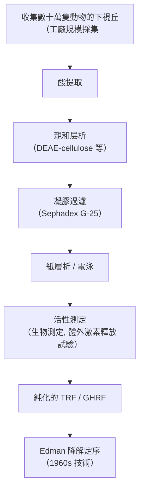
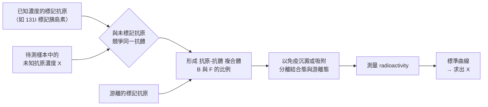
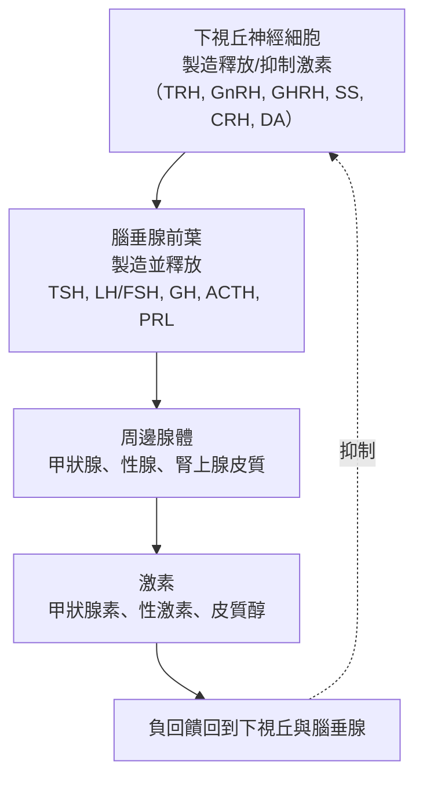

# 1977 · 腦的肽類激素與放射免疫分析法：吉耶曼、沙利與耶洛開啟內分泌的「量測時代」

> **1977 諾貝爾生理學 or 醫學獎**（共享三人，其中耶洛為史上第二位獲此獎的女性）：羅歇·吉耶曼（Roger Charles Louis Guillemin，法國出生、美國籍）— 表彰「發現大腦分泌的肽類激素」；安德烈·沙利（Andrzej Viktor "Andrew" V. Schally，波蘭出生、美國籍）— 同上；羅莎琳·薩斯曼·耶洛（Rosalyn Sussman Yalow，美國）— 表彰「開發肽類激素的放射免疫分析法」。

## 懸案（案情提要）

1970 年代的內分泌學有兩樁旗鼓相當的案子：

**案子甲（腦是製造激素的工廠嗎？）**：醫學界已知下視丘控制腦垂腺、腦垂腺控制周邊腺體，但**下視丘本身製造什麼？** 它不是神經細胞嗎？神經細胞怎麼會製造激素？

**案子乙（微量激素怎麼量？）**：即使知道有某種激素存在，若濃度只有 $10^{-12}\ \mathrm{M}$ 量級（每升血中僅數個皮克），**傳統的生物測定既不靈敏、也不精確**，更無法同時測量多種激素。

吉耶曼與沙利解決了甲（找出肽類激素並確定其序列），耶洛解決了乙（發明放射免疫分析，RIA）。

## 前因

| 年份 | 事件 |
| --- | --- |
| 1930s | ** Geoffrey Harris** 提出「**下視丘是激素的製造者**」的假說，並證明下視丘提取物能促進腦垂腺生長激素的釋放。 |
| 1950s | Harris 的實驗方法極為粗糙（用「母馬」的體重與子宮測量來推斷生長激素活性），因為當時沒有可信的定量方法。 |
| 1955–1958 | **Andrew Schally** 在 Tulane 與 **Roger Guillemin** 在 Baylor 各自嘗試分離下視丘的「促腎上腺皮質激素釋放因子（CRF）」與「促生長激素釋放因子（GHRF）」，但**屢試不成**——因為產物量太少。 |
| 1960s | 學界普遍認為下視丘釋放因子可能是**神經傳遞物質（多巴胺、5-HT 等）**，而非肽類。 |
| 1959–1971 | **Yalow 與 Solomon Berson**（NYU）在**放射性示蹤**與**免疫學沉澱**的交叉点上取得突破：他們發現，把**胰島素**用 ${}^{131}\mathrm{I}$ 標記後與血清抗體混合，**兩者結合後仍可被抗體沉澱**——這證明**標記抗原與抗體的結合是可行且可測量的**。 |
| 1971 | Yalow 與 Berson 建立了第一個**放射免疫分析（RIA）**方法，測出**人體內正常胰島素濃度僅約 $10^{-10}\ \mathrm{M}$**——這在當時是難以想像的靈敏度。 |
| 1969–1970 | **Schally** 團隊獲得突破：使用**數十萬隻羊的下視丘**（工廠級的原料量），並採用****亲和层析**與**Sephadex 凝胶過濾**等新分離技術，成功分離出**促甲狀腺激素釋放因子（TRF）**，並於 1969 年確定其**三肽結構**（pyroGlu-His-Pro- $\mathrm{NH}_{2}$ ）。 |
| 1970–1973 | Guillemin 團隊（與 **Andrew Schally 為競爭對手但亦互相刺激**）分離出**促生長激素釋放因子（GHRF）**，並於 1973 年確定其序列；Guillemin 另於 1973 年發現**腦啡肽（enkephalin）**（內源性鴉片類胜肽）。 |
| 1977 | 三人共享諾貝爾生理學 or 醫學獎。 |

## 調查

### 第一幕：吉耶曼與沙利的「工廠級生物材料」策略

兩位競爭者的偵查之所以成功，靠的是**規模**。在下視丘激素的含量極低（每隻羊的下視丘只有數毫克的活性物質），因此：

**兩項關鍵技術的引進**：

1. **Edman 降解**（1960 年代）：可以逐一從蛋白質 N 端切下胺基酸並鑑定——這是 1960 年代蛋白質化學的突破（使 Sanger 能定序胰島素，見 [1934-惡性貧血肝療法](1934-惡性貧血肝療法.md)）。
2. **質譜（mass spectrometry）**：1960 年代的質譜技術讓幾個胺基酸的胜肽可以被鑑定。

**TRF 的發現意義**：

$$\text{TRF} = \text{pyroGlu}-\text{His}-\text{Pro}-\text{NH}_2$$

**三肽就能執行激素功能**——這顛覆了「激素必須是大分子蛋白質」的直覺，也是「**下視丘釋放因子是胜肽**」的直接證明。多年後（1990 年代）才發現 TRF 只是許多下視丘激素之一，而「下視丘釋放因子」這個概念本身已被「下視丘神經激素」取代。

### 第二幕：吉耶曼的另一項發現——腦啡肽

1973 年，吉耶曼與 **Hugh Patrick**（後為 **John Hughes**）從豬腦中分離出兩種胜肽，命名為**腦啡肽（enkephalin）**：

$$\text{Leu-enkephalin}: \text{Tyr}-\text{Gly}-\text{Gly}-\text{Phe}-\text{Leu}$$
$$\text{Met-enkephalin}: \text{Tyr}-\text{Gly}-\text{Gly}-\text{Phe}-\text{Met}$$

其序列與**鴉片（opium）的成分嗎啡**相似——這是**內源性鴉片系統**被發現的起點，也是**「神經傳遞物質也可以是胜肽」**這一觀念的來源。

**意義**：

1. 內源性鴉片受體（ $\mu$ 、 $\delta$ 、 $\kappa$ ）的發現，開啟了**阿片類藥物的鎮痛機制**研究，也直接導致 1980–90 年代**阿片受體的內啡肽（opioid peptides）**發現；
2. 這條線最終通向 2018 年的**免疫檢查點抑制劑**（因為阿片與免疫系統有交互作用）與 2023 年的**迷幻藥研究**（迷幻藥的機制正是 5- $\mathrm{HT}_{2}$ A 受體）；
3. Guillemin 團隊在 1970 年代還發現了 **somatostatin（生長抑素）** 與 **TRH** 的完整序列。

### 第三幕：耶洛與伯森的放射免疫分析——「量測時代」的到來

耶洛與 Berson 的突破，是**把免疫學的特異性與放射性示蹤的靈敏度結合**。

**原理**：

**關鍵的技術改進**：

1. **Berson 的「雙抗體 sandwich」與「第二抗體沉澱法」**：用抗兔血清的抗體（第二抗體）來沉澱第一抗體的複合體，從而把**結合態與游離態分離**；
2. **靈敏度的數量級躍升**：傳統生物測定（如 Harris 的母馬實驗）可測到約 $10^{-3}\text{–}10^{-6}$ 量級，RIA 可測到約 $10^{-12}\text{–}10^{-15}\ \mathrm{M}$ ——**提升 $10^{6}\text{–}10^{9}$ 倍**；
3. **專一性**：抗體的專一性使得多種激素可在一份樣本中**同時測定**（今日的「多重激素檢測面板」）。

**RIA 的歷史意義**：

- 它使**微量生物活性物質的定量**成為常規——今日的**所有激素檢驗**（甲狀腺素、胰島素、皮質醇、性激素、BNP、發炎標記如 CRP、腫瘤標記如 PSA、**D-二聚體**用於血栓診斷）都用同一原理；
- **Yalow 與 Berson 的合作是科學史上最著名的「夫妻—老師—學生」三人組之一**——Yalow 是 Berson 的指導教授與長期合作者（也是他的導師 **Solomon Berson** 1969 年早逝後，Yalow 延續並推廣了他們的工作）；
- Berson 於 **1972 年因抗膽鹼藥物過量與糖尿病的治療而自殺**（他患 Addison 病，且研究涉及自身疾病的免疫學）——這樁悲劇使 RIA 的應用價值更被後世強調。

### 第四幕：下視丘—腦垂腺軸的完整圖景

三人的工作合起來，完成了內分泌學的「中央控制系統」的解析：

**同時**，Guillemin 的腦啡肽發現，補上了另一個維度——**神經系統與內分泌系統的界限並不像想像中清晰**：

| 傳統分類 | 分子 | 例子 |
| --- | --- | --- |
| 神經傳遞物質 | 小分子胺 | 多巴胺、5-HT、GABA |
| 神經胜肽（神經激素） | 胜肽 | TRH、SS、GHRF、脑啡肽、催產素、加壓素、CCK、-substance P |
| 周邊激素 | 胜肽或固醇 | TSH、胰島素、皮質醇、性激素 |

**現代的分類依據是「合成部位」而非「作用部位」**——這是本案帶來的概念變革。

## 理論裁決

1. **RIA 的偵測極限**：RIA 的靈敏度受限於**放射性活度**與**抗體親和力**：

   $$\mathrm{Sensitivity} \sim \frac{1}{\varepsilon \cdot A \cdot K_a}$$

   這解釋了為何 1970 年代的 RIA 靈敏度約 $10^{-12}\ \mathrm{M}$ ，而 1980 年代的**免疫螢光法**、1990 年代的**化學發光法**、以及 2010 年代的**質譜（LC-MS/MS）**逐漸取代它——今日的激素檢測多已改用質譜或化學發光。

2. **激素的「門檻效應」與放大**：下視丘釋放激素以極低濃度作用，但經由「下視丘 → 腦垂腺 → 周邊腺體」的級聯，效應被逐級放大：

   $$\text{TRH} \sim 10^{-10}\ \mathrm{M} \;\Rightarrow\; \text{TSH} \sim 10^{-9}\ \mathrm{M} \;\Rightarrow\; \text{甲狀腺素} \sim 10^{-8}\ \mathrm{M}$$

   這解釋了為何「測腦垂腺的激素」比「測周邊激素」更敏感，也解釋了臨床上的**「中樞性 vs 周邊性」鑑別診斷**。

3. **負回饋的量化模型**：三種主要軸的負回饋可寫成：

   $$\dot{x} = S(-(y - y_0)) - k x, \qquad y = f(x)$$

   負回饋的增益 $|S f' / k| < 1$ 決定系統穩定性——這是今日內分泌學與藥理學（受體刺激與負回饋藥物）的共同語言。

4. **多肽的合成**：下視腦肽是**核糖體合成的前驅物**再經酵素切割而成——這解釋了為什麼 TRF 是三肽（由前驅物切割而來），也解釋了為何「前驅物」在診斷上具有意義（**proinsulin** 的檢測即是今日糖尿病診斷的重要項目）。

## 追查支線（未結之謎）

- **Guillemin 與 Schally 的競爭史**：兩人曾是同一導師（**Maurice Huggins**）的學生，在 Baylor 展開了一場激烈但互相成就的競爭——Schally 在 1960 年代初離開 Baylor 到 Tulane，才得以用**自己的**材料（數十萬隻羊的下視丘）完成 TRF 的分離。他們在 1970 年代重逢於紐約的 Rockefeller 與 Baylor，共享了 1977 年的諾獎——**科學史上少見的「良性競爭」典範**；
- **Guillemin 於 2024 年 2 月 21 日去世**（享年 100 歲），是當時最年長的諾貝爾生理學 or 醫學獎得主（這一紀錄保持至今）；
- **Schally 於 2024 年 10 月 17 日去世**（享年 98 歲），是 2024 年辭世的第二位本案得主；
- **Guillemin 是 "Peptide Revolution" 的推動者**：他主張「多肽作為藥物」的時代，並推動了 GnRH 類似物（fertility 治療）、生長激素抑制素（肢端肥大症治療）、CCK 拮抗劑等藥物的開發；
- **Guillemin 與 Yalow 皆移民自歐洲**（法國、義大利/波蘭），**Schally** 來自波蘭且在德國佔領波蘭期間流亡——他們三人都是 20 世紀科學流動的見證；
- Yalow 與 Berson 的 RIA 技術在 **1959–1977** 年間被廣泛應用於** dozens 種激素**的測定，並在 1977 年諾貝爾演講中，Yalow 以「**科學是一種共同冒險**」為題，回顧了這段歷程。

## 證物與數據（偵查卷宗摘錄）

| 證物 | 數值／內容 | 偵查意義 |
| --- | --- | --- |
| 數十萬隻羊的下視丘 | 工廠規模採集 | 微量物質的分離策略 |
| TRF 的結構 | pyroGlu-His-Pro- $\mathrm{NH}_{2}$ （三肽） | 下視腦肽的證明 |
| 腦啡肽（1973） | Tyr-Gly-Gly-Phe-Leu / Met | 內源性鴉片系統 |
| 標記抗原 + 抗體 | 結合後仍可被沉澱 | RIA 的原理 |
| 第二抗體沉澱法 | 分離結合態與游離態 | RIA 的關鍵技術 |
| RIA 靈敏度 | 約 $10^{-12}\ \mathrm{M}$ | 較生物測定提升 $10^{6}\text{–}10^{9}$ 倍 |
| 傳統生物測定 | 約 $10^{-3}\text{–}10^{-6}$ | 對比的基準 |
| 級聯放大 | TRH $10^{-10}$ → TSH $10^{-9}$ → $T_4$ $10^{-8}$ | 內分泌的放大 |
| 負回饋增益 | $|S f'/k| < 1$ | 軸穩定的條件 |
| 微量檢測 | $10^{-10}\ \mathrm{M}$ 胰島素 | 「量測時代」的到來 |

## 後果

| 領域 | 影響 |
| --- | --- |
| 內分泌學 | 下視丘—腦垂腺—周邊腺體軸的完整解析；多肽激素成為獨立學科。 |
| 臨床檢驗 | RIA 成為全球激素檢驗的標準數十年，直接催生今日的內分泌疾病篩檢（甲狀腺、腎上腺、性腺）。 |
| 藥理學 | GnRH 類、somatostatin 類似物、CCK 拮抗劑等藥物的開發。 |
| 神經科學 | 腦啡肽與內源性鴉片系統的發現。 |
| 醫學史 | 三位得主中有兩位在 2024 年辭世，其中 Guillemin 享年 100 歲。 |
| 其他諾獎 | 與 [1994-G 蛋白](1994-G蛋白.md)、[1971-第二信使](1971-第二信使.md)、[1950-腎上腺皮質激素](1950-腎上腺皮質激素.md) 構成內分泌與訊號主線。 |

## 關聯

- [1950-腎上腺皮質激素](1950-腎上腺皮質激素.md) — 激素發現的早期典範。
- [1971-第二信使](1971-第二信使.md) — 下視腦肽作用的細胞內訊號機制。
- [1994-G 蛋白](1994-G蛋白.md) — 多肽激素受體的訊號傳遞。
- [2000-神經訊號傳導](2000-神經訊號傳導.md) — 神經與內分泌的交會。
- [1923-胰島素](1923-胰島素.md) — 激素檢測的另一個里程碑。
