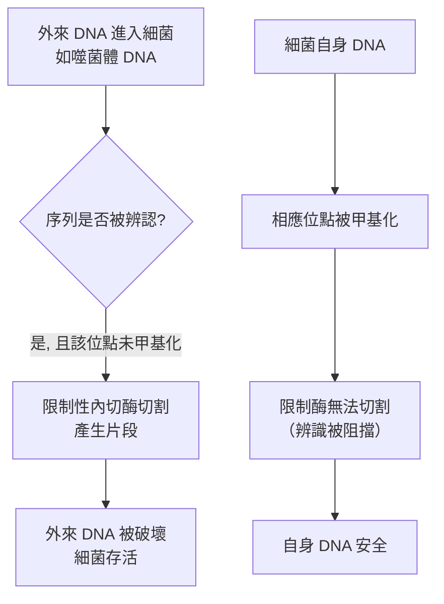
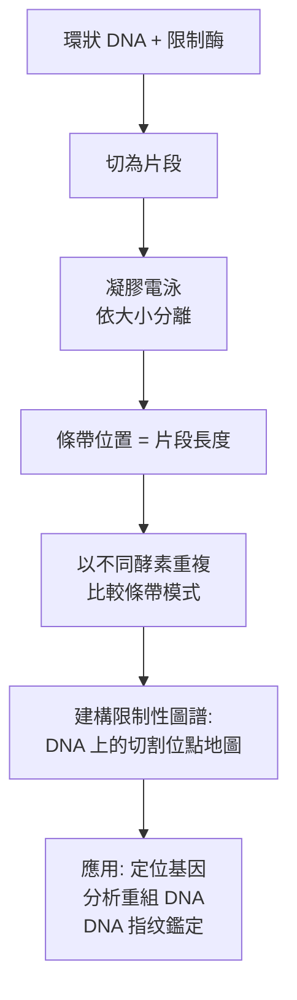

# 1978 · 限制性內切酶：亞伯、那森與史密斯給遺傳學裝上了一把分子剪刀

> **1978 諾貝爾生理學 or 醫學獎**（共享三人）：沃納·亞伯（Werner Arber，瑞士）— 表彰「發現限制性酶及其在分子遺傳學方面的應用」；丹尼爾·那森（Daniel Nathans，美國）與漢彌爾頓·史密斯（Hamilton O. Smith，美國）— 同上。

## 懸案（案情提要）

1970 年代的分子遺傳學，幾乎所有精密操作都受限於一個瓶頸：

1. **如何「切割」DNA？** 化學試劑會隨機斷裂（剪切強度難以控制），酵素則需要特定序列的識別；
2. **如何把 DNA 片段「排序」？** 若沒有一個已知座標的「尺」，就無法知道某個基因位於 DNA 的哪裡；
3. **如何「插入」外來 DNA？** 需要能切開、又能接合的工具；
4. **如何複製特定的 DNA 片段？** 沒有工具，就只能複製整個基因組。

1970 年代的答案是笨拙的：**用傳統的遺傳學方法做「剪接」**——例如以「選擇性標記 + 轉染 + 篩選」來找出能穩定維持的片段，但效率極低，且要建構一個重組 DNA 需要數月。

那森在 1974 年提出的問題極為精準：

> **細菌有沒有能辨認特定 DNA 序列並在那裡切斷的酵素？**

史密的答案是：**有**——而且它們是**細菌用來抵禦外來 DNA（噬菌體）的防禦系統**的一部分。

## 前因

| 年份 | 事件 |
| --- | --- |
| 1960–1965 | **Jacob 與 Monod** 的乳糖操縱子模型中提出「**限制性酶（restriction enzyme）**」的概念：細菌可能含有能辨認並切割「外來」DNA 的酵素，以保護自身基因組（見 [1965-乳糖操縱子](1965-乳糖操縱子.md)）。 |
| 1968–1970 | **Werner Arber** 在瑞士 Basel 以**流感嗜血桿菌（Haemophilus influenzae）**研究 DNA 的限制性修飾系統，發現細菌 DNA 受**甲基化保護**，而外來 DNA 未被甲基化，會被切割。 |
| 1970 | Arber 與 **M. (S.) Meselson 與 R. Yuan** 發表初步證據：**限制性修飾系統**的存在。 |
| 1974 | **Hamilton O. Smith** 在 Johns Hopkins 以**流感嗜血桿菌 Rd** 的酵素處理噬菌體 DNA，觀察到**在特定位置被切割並產生黏性末端**，並測定出**限制性 DNA 的鹼基序列**——這是「第一把分子剪刀」的誕生。 |
| 1974–1976 | **Daniel Nathans** 在 Johns Hopkins 以 Smith 發現的酵素（後稱 **HindII**）切割**SV40 病毒 DNA**（一個 $5,243$ bp 的環狀 DNA），首次完成了**限制性圖譜（restriction map）**的建立——把 DNA 的切割位點標示在圖上。 |
| 1978 | 三人共享諾貝爾生理學 or 醫學獎。 |
| 1973–1974 | **Stanley Cohen 與 Herbert Boyer** 在史丹福與華盛頓大學，已用類似的限制性酵素完成了**重組 DNA（recombinant DNA）**的實作。 |
| 1976 | **Asilomar 會議**（1976 年 2 月）召開，科學家們共同制定了**重組 DNA 研究的生物安全指引**——本案是這項會議的直接催化劑。 |
| 1980s | 限制性酵素成為分子生物學的基礎工具；**基因文庫（genomic library）**、**Southern blot**、**基因定序**（Sanger，1977）皆以此為前提。 |

## 調查

### 第一幕：亞伯的「限制—修飾系統」——細菌的免疫與 CRISPR 的先驅

亞伯的偵查起點是一個演化生物學的問題：**細菌如何區分「自己的 DNA」與「外來的 DNA」？**

他發現：

1. 細菌 DNA 的某些鹼基被**甲基化**（特定位置的 $N^{6}$ -甲基腺嘌呤）；
2. **限制性核酸內切酶**能辨認那些「未被甲基化的特定序列」並切割之；
3. 因此：**自身的 DNA 因被甲基化而安全，外來 DNA 因未甲基化而被切**。

**亞伯還證明了更精細的一點**：限制酶並非辨認「外來性」，而是辨認**特定鹼基序列**；甲基化只是「自我標記」。這區分了當時流行的兩種假說（Wolff–Stokes 的「外來性假說」vs Arber 的「序列假說」）。

**這套「限制—修飾系統」今日的直系後代是 CRISPR-Cas**（2020 年諾獎，見 [2020-C 肝病毒](2020-C肝病毒.md) 時代的基因編輯革命）——細菌以 CRISPR 序列辨認並切割入侵 DNA，機制與限制酶同源而更精密。

### 第二幕：史密的「精確切割」——找出第一把剪刀

史密的偵查方法極為簡潔：

1. 以**瓊脂糖凝膠電泳（gel electrophoresis）**分析切割產物——DNA 片段依大小分離後染色成條帶（1970 年代的 DNA 電泳技術是關鍵工具）；
2. 以**流感嗜血桿菌 Rd 的酵素**處理 $\lambda$ 噬菌體 DNA；
3. 觀察到**清晰的、位置固定的條帶**——這意味著切割是**在特定序列上**，而非隨機的；
4. **更關鍵的一步**：他以**有限水解（partial digestion）**與**同位素標記 + 測序**（當時用 Maxam–Gilbert 化學測序法）測出切點的鹼基序列。

**史密的結論**：該酵素辨認一個**短的、迴文的（palindromic）**序列：

$$\text{5'-G A A T T C-3'}$$
$$\text{3'-C T T A A G-5'}$$

這就是**迴文序列（palindromic sequence）**的定義——**從任一端讀起來都一樣**的 DNA 序列。今日的「迴文」概念已擴展到更一般的「反向重複（inverted repeat）」，且回文結構在 CRISPR 與基因編輯中扮演核心角色。

### 第三幕：那森的「限制性圖譜」——給 DNA 畫一張地圖

那森的工作是把工具轉化為**資訊**。他用 HindII 切割 SV40 病毒 DNA（ $5,243$ bp，環狀）與噬菌體 DNA（ $\lambda$ ，約 $48,502$ bp）：

**限制性圖譜的實用性**：

1. **基因定位**：以限制性片段作為「物理座標」，把遺傳標記（基因）與 DNA 片段對應——這是**物理圖譜（physical map）**的開端；
2. **DNA 指紋（RFLP）**：多個切點的組合產生幾乎唯一的片段長度模式——1980 年代成為**親子鑑定與法醫鑑定**的主流方法（今日的 STR 與 SNP 分型是其後代），1990 年代的 **CODIS 資料庫**即以 RFLP 為基礎；
3. **重組 DNA 的篩選**：一個外來片段是否連接成功，可由其「兩端限制位點是否維持」來判斷。

### 第四幕：從剪刀到膠水——重組 DNA 技術

限制酶的另一面是**DNA 連接酶（ligase）**。當限制酶產生的**黏性末端（cohesive ends）**互補時：

$$\text{5'-G A A T T C-3'} + \text{3'-C T T A A G-5'} \rightleftharpoons \text{雙股連接產物}$$

**「黏性末端」是本案最實用的概念**——它讓 DNA 片段能以**可預測的方式**互相接合。1964 年**霍利（H. G. Khorana? 實為 **S. Cohen** 與 **H. Boyer**）**在 1973 年 11 月首次完成**重組 DNA 的實作（見 [1968-遺傳密碼](1968-遺傳密碼.md) 的分子生物學背景），並在 1974 年發表。

**1976 年 2 月的 Asilomar 會議**是科學史上最重要的自我管制會議之一：**300 位科學家**（包括 Paul Berg、Francis Crick、Sydney Brenner 等）聚在加州 Monterey 的 Asilomar Conference Center，共同制定了重組 DNA 研究的生物安全指引，並建立了**NIH  recombinant DNA Advisory Committee**。會議的催化劑，正是限制酶與重組 DNA 技術的出現。

### 第五幕：限制酶的分類

依切割方式與底物要求，限制酶分為四類：

| 類型 | 切割模式 | 識別序列 | 代表例子 | 應用 |
| --- | --- | --- | --- | --- |
| **I 型** | 隨機切割，切點距識別位點數千 bp | 複雜（非回文） | EcoR I（其原型） | 幾乎不用於克隆 |
| **II 型** | **在識別位點內或固定的位點切割** | 通常為回文 | HindIII、**EcoRI**、**BamHI** | 分子克隆的主要工具 |
| **III 型** | 在識別位點外約 25 bp 切割 | 短非回文 | Bgl II | 基因組分析 |
| **IV 型** | 識別並切割甲基化 DNA | 甲基化專一 | McrBC | 基因組重測序 |

**II 型酵素的分類命名法**（以發現者與菌株命名）：**EcoRI**（*Escherichia coli* R 株第 I 型）、**HindIII**（*Haemophilus influenzae* d 株第 III 型）、**BamHI**（*Bacillus amyyloliquefaciens* H 株第 I 型）——這套命名法沿用至今。

## 理論裁決

1. **限制酶的生物學意義（選擇壓力的數學）**：限制—修飾系統為細菌提供了一種**群體免疫**：一個個體攜帶的特異限制酶，只能保護少數同型細菌，但當外來 DNA 進入並被切割後，細菌獲得抗性，可在群體中擴散。這是「**群體免疫**」概念在細菌尺度的原型——今日的**抗 CRISPR 蛋白**是這場軍備競賽的現代延伸。

2. **迴文序列與核酸二聚體的結構**：回文序列之所以能被辨認，是因為限制酶的辨識部位具有** twofold symmetry**——這使得蛋白質只需**一個結合位點**即可同時辨認兩股 DNA 上的對稱序列。這是「**蛋白質如何讀取序列**」的第一個結構性解答，也是今日轉錄因子以「迴文/反向重複」為結合位點的根本原因。

3. **DNA 指紋的統計學**：RFLP 的辨識力來自多個獨立位點的組合：

   $$P(\text{兩個個體基因型相同}) = \prod_{i} \left[\left(\frac{p_i^2 + (1-p_i)^2}{2}\right)^{2}\right]$$

   隨機位點數增加，辨識力呈**指數上升**——這是多個獨立標記的統計學基礎（今日的 **STR 與 SNP 分型**沿用同樣邏輯）。

4. **限制性圖譜與物理圖譜的關係**：限制性圖譜把「DNA 長度」轉化為「座標」：

   $$x_{\text{gene}} = \sum_{\text{fragments}} \ell_i \quad (\text{以 bp 為單位})$$

   今日的**物理圖譜與遺傳圖譜的整合**（Human Genome Project, 1990–2003）即建立在此。

5. **限制酶的「剪接邏輯」與重組 DNA 的模組化**：因為每一種限制酶產生**特定的黏性末端**，只要設計好接合方案，就能把任意 DNA 片段組裝成construct——**「遺傳工程的模組化」**由此開始，也是今日合成生物學「基因迴路設計」的直系祖先。

## 追查支線（未結之謎）

- **限制酶的命名權爭與商業化**：Smith 將發現的酵素命名為 **HindII**（因其來自 *Haemophilus influenzae* d 株），但由於 HindII 切割的序列其實只有 6 個鹼基且非標準回文，1970 年代末被重新歸類為 **HinP1 I** 類。**HindIII** 則是另一種酵素。命名與分類的混亂，是限制酶歷史上的一個著名小插曲。
- **Arber 的科學與宗教**：亞伯是瑞士的天主教徒與物理學家，在 Basel 的實驗室工作，並曾撰文論述科學與宗教的關係（他以 DNA 的「信息」與生物的「設計」語言作類比，試圖在兩者之間建立橋樑）。
- **Asilomar 會議的遺產**：1976 年的會議建立了重組 DNA 研究的監管框架，但 1980 年代美國的監管逐步鬆動、2000 年代起商業化基因改造作物大幅推進——**「科學自我管制」的效力**至今仍是科技治理的討論議題。
- **限制酶在法醫學的黃金年代**：RFLP 曾是 1980–90 年代親子鑑定與犯罪鑑識的主流；1990 年代末被 STR 取代，但 RFLP 仍是**古代 DNA 與考古學**（如 **Neandertal 基因組**，見 [2022-古人類基因組](2022-古人類基因組.md)）的常用工具。
- **限制酶的「幽靈限制酶」**：今日的** CRISPR-Cas9** 被稱為「**幽靈限制酶（ghost enzyme）**」——它不是天然的限制酶，而是**由基因工程設計出來的**限制酶系統；2020 年諾獎（見 [2020-C 肝病毒](2020-C肝病毒.md) 時代的基因編輯革命）正是這一技術路線的頂點。

## 證物與數據（偵查卷宗摘錄）

| 證物 | 數值／內容 | 偵查意義 |
| --- | --- | --- |
| 限制—修飾系統 | 自身 DNA 甲基化保護 | 細菌的「自我／非我」辨識 |
| 序列假說 | 限制酶辨認特定序列而非「外來性」 | 亞伯的關鍵修正 |
| HindII 切割 | 固定位置切割 → 清晰條帶 | 精確切割的證明 |
| 迴文序列 | $5'-\text{GAA TTC}-3'$ | 蛋白質讀取序列的結構原理 |
| 黏性末端 | 5' 突出的 GATC 等 | 重組 DNA 的接合基礎 |
| SV40 限制性圖譜 | $5,243$ bp 環狀 DNA | 第一張限制性圖譜 |
| λ DNA | 約 $48,502$ bp | 大型 DNA 的圖譜 |
| 凝膠電泳 | 依片段大小分離 | 分子的可視化技術 |
| RFLP 統計 | 多位點組合，指數級辨識力 | DNA 指紋的數學 |
| Asilomar 1976 | 300 位科學家訂定準則 | 生物安全的自我管制 |
| 四類限制酶 | I/II/III/IV 型 | 工具的分類學 |

## 後果

| 領域 | 影響 |
| --- | --- |
| 分子生物學 | 分子克隆、重組 DNA、基因文庫、定序、Southern blot 的技術前提。 |
| 生物技術 | 基因工程產業（胰島素重組、基因治療、基改作物、mRNA 疫苗）的起點。 |
| 法醫學 | DNA 指紋與親子鑑定。 |
| 基因組學 | 物理圖譜與後來的人類基因組計畫。 |
| 生物安全 | Asilomar 會議與生物安全準則的建立。 |
| 其他諾獎 | 與 [1968-遺傳密碼](1968-遺傳密碼.md)、[1984-單株抗體](1984-單株抗體.md)、[2020-C 肝病毒](2020-C肝病毒.md)（基因編輯）構成分子生物學主線。 |

## 關聯

- [1965-乳糖操縱子](1965-乳糖操縱子.md) — 限制酶概念的最初提出。
- [1968-遺傳密碼](1968-遺傳密碼.md) — 分子生物學方法論的成熟，與限制酶的發明同代。
- [1984-單株抗體](1984-單株抗體.md) — 重組 DNA 技術的第一個重大產業應用。
- [2022-古人類基因組](2022-古人類基因組.md) — 限制酶在古 DNA 研究中的現代應用。
- [2023-mRNA 疫苗](2023-mRNA疫苗.md) — 重組 DNA 技術譜系的當代終點之一。
