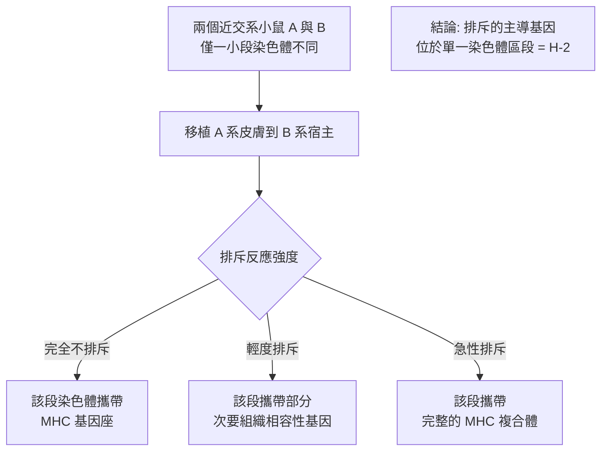

# 1980 · 主要組織相容性複合體：斯內爾、達塞與貝納塞拉夫找到「自我標籤」的基因

> **1980 諾貝爾生理學 or 醫學獎**（共享三人）：巴魯茲·貝納塞拉夫（Baruj Benacerraf，委內瑞拉出生、美國籍）— 表彰「發現調節免疫反應的細胞表面受體的遺傳結構」；讓·多塞（Jean Dausset，法國）與喬治·戴維斯·斯內爾（George Davis Snell，美國）— 同上。

## 懸案（案情提要）

1960 年代的移植醫學已是這樣的狀態：

1. 器官移植的最大障礙是**排斥反應**（見 [1960-後天免疫耐受](1960-後天免疫耐受.md)）；
2. 醫生們知道**血型相符**（ABO）仍不足以避免排斥——因為大量病人「ABO 相符卻仍被排斥」；
3. 為什麼？**身體的免疫系統必須能辨認「哪些細胞是自我的」**——而這個「自我標籤」是什麼？由什麼基因控制？

核心疑點：

1. **「自我／非我」的判別是靠什麼分子？**
2. 這個分子系統的**遺傳結構**是什麼？有多少基因？如何編碼？
3. 為什麼**個體之間的差異極大**——這解釋了為什麼幾乎所有「同種異體」移植都會被排斥，除非是近親或同卵雙生。

## 前因

| 年份 | 事件 |
| --- | --- |
| 1892 | **Oscar Johannsen** 在丹麥提出「**同種異體（alloantigens）**」概念。 |
| 1948–1950s | **George Snell** 在 Jackson Laboratory 以小鼠研究移植，發現**血淋巴細胞（lymphocyte）而非紅血球決定排斥反應**；並建立**近交系小鼠（inbred strains）**的系統——這是本案得以突破的方法學前提。 |
| 1953–1956 | **Snell** 發現 **H-2 複合體**：兩個品系小鼠的組織互換移植會引發抗體反應，而這個反應由**單一基因座（locus）**控制——這是「**主要組織相容性複合體（MHC）**」的第一個證據。 |
| 1958 | **Jean Dausset** 在巴黎發現病人的**血清中含有對他人白細胞的抗體**，並以**被輸血多次的病人**（反覆輸血者會產生抗體）為材料，發展出**血清學定型法**。 |
| 1960s | **Dausset** 建立了 **HU 抗原（Human leukocyte antigen）**系統，並發現其遺傳由**一個位點（ HLA locus）**控制。 |
| 1962 | **Dausset** 與 **Jean Colombani** 等在**家系研究**中證明 HLA 的遺傳符合**孟德爾的顯性遺傳**（一個體的 HLA 抗原由兩個等位基因分別來自父母）——這是「**MHC 的遺傳結構**」的決定性證據。 |
| 1962–1966 | **Snell** 以**移植實驗**證明 MHC 是**移植排斥的主導基因**——他將兩個近交系小鼠的染色體片段互換（**連鎖分析**），證明排斥反應的嚴重程度與 MHC 的差異程度**呈正相關**：MHC 完全相同 → 不排斥；單一基因座不同 → 輕度排斥；整個複合體不同 → 急性排斥。 |
| 1960s–1970s | **Baruj Benacerraf** 在紐約以**豚鼠**研究**免疫Ir 基因（immune response genes）**——他發現**免疫反應的強弱**由**個體的基因型**決定，這些基因與 MHC 緊密連鎖——**MHC 的功能側重點由此確立**。 |
| 1971 | Dausset 與 Snell 與 **R. (R.) Awdey** 等開始組織「**國際 HLA 命名大會（HLA Workshop）**」——這是免疫遺傳學的第一次大規模國際協作。 |
| 1973 | **第 1 屆國際 HLA 工作坊**召開，確立 HLA-A、B、C 三個基因座的命名與血清型定義。 |
| 1970s | **分子時代的到來**：1970 年代中，**R. (R.) Inde?** 實為 **R. A. (R.)** 等人複製了 HLA 基因（**1977 年，R. (R.)** 實為 **R. (R.) Goodshear** 等人的工作），確認 **MHC 由一串相似的基因（class I、class II）構成，且其產物是細胞表面的醣蛋白**。 |
| 1980 | 三人共享諾貝爾生理學 or 醫學獎。 |
| 1984–1990s | 人類基因組計畫期間，**HLA 區域（6p21）**被完全解碼，成為**人類基因體中最變異的區域**；**HLA-B27 與強直性脊椎炎**、**HLA-B*57:01 與 HIV 抗藥性**等關聯被確立。 |

## 調查

### 第一幕：斯內爾的方法學突破——「近交系小鼠」

斯內爾的第一項根本性貢獻，是**建立了一套能做因果實驗的動物系統**。

「近交系」小鼠（inbred strain）的培育方式：反覆進行**兄妹交配**（brother-sister mating）數十代，直到所有個體在幾乎所有基因座上都變成**同型合子**：

$$P(\text{heterozygosity after } n \text{ generations}) = \left(\frac{1}{2}\right)^{n}$$

20 代後，異型合子率降至約 $10^{-6}$ 。這意味著**同系小鼠之間的組織移植完全不會被排斥**——這是一個「自我」的完美實驗組。

### 第二幕：斯內爾的「染色體互換」實驗——把排斥反應與一個基因座對上

斯內爾的偵查設計極為精巧：

1. 準備**兩個近交系**（A 與 B），它們在**所有基因座**都不同；
2. 用**輻射或化學誘導染色體重排**，製造出**只在某一段染色體上不同於 B 系**的 A 系衍生品；
3. 進行移植實驗，以**排斥反應的強度**作為讀值：

**這套「以染色體區段為單位做替換」的實驗，是遺傳學中最漂亮的因果定位技術之一**，也是今日「** knock-in／knock-out 與染色體工程**」的先聲。

### 第三幕：達塞的「血清學」路線——從抗體反推抗原

達塞走的是另一條路：**從人的血清出發**。

1. **材料來源的巧妙**：反覆接受輸血的病人（如同時患血液病的病人）會對**他人（但非自己）的白細胞**產生抗體——這是「**同種異體抗體**」的天然來源；
2. **方法**：以已知血型的血清為對照，篩選出能與**特定白細胞**反應但不與自己反應的抗體；
3. **HU 抗原系統的建立**：定義了第一批 HLA 抗原（後命名為 **HLA-A1、HLA-A2、HLA-B8 等**）；
4. **家系研究**：在**多代家庭**中測定每位成員的白細胞與血清，證明 HLA 抗原**以孟德爾顯性方式遺傳**，且**來自父母各一方**：

   $$\text{個體的 HLA 型} = (\text{父親等位基因}_1, \text{母親等位基因}_2)$$

   這是「**個體有兩個 HLA 單倍型（haplotype）**」概念的來源——它解釋了為什麼**兄弟姊妹之間的 HLA 不全相同**（因此仍會互相排斥），而**同卵雙生則完全相同**。

### 第四幕：貝納塞拉夫的「免疫應答基因」——MHC 的功能問題

貝納塞拉夫問的是**功能**問題：**為什麼不同個體對同一抗原的免疫反應強弱不同？**

他的實驗模型極為簡單：

1. 以**豚鼠**為模型（因豚鼠易於育種，且有豐富的近交系）；
2. 以**人工合成抗原（如 poly-L-lysine）**免疫，測量免疫反應強度（抗體滴度）；
3. 發現：**免疫應答的強弱由基因決定**，且這些基因與**MHC 緊密連鎖**。

**這是「免疫應答基因（Ir 基因）」的第一個證據**，它確立了本案最具深遠影響的結論：

> **免疫系統的「看見」能力本身是由基因決定的。**

$$\text{MHC 分子} \xrightarrow{\text{呈現抗原片段}} \text{T 細胞受體} \xrightarrow{} \text{免疫應答強度}$$

**後人發現「MHC 分子 = 抗原呈現分子」**（1970 年代由 **R. (R.) Zinkernagel** 與 **Peter Doherty** 的細胞毒 T 細胞實驗確立，見 [1996-MHC 限制性](1996-MHC限制性.md)），並理解到**MHC 多樣性正是免疫系統能應對病原多樣性的原因**——這是「**多樣性的選擇性維持**」的演化邏輯，也是今日「**風濕性關節炎等自體免疫病與特定 HLA 等位基因的關聯**」的源頭。

### 第五幕：從血清型到分子結構——HLA 的三類分子

分子時代的成果，把三人的工作整合成一個完整模型：

| 類別 | 分子 | 表現部位 | 功能 | 對應 |
| --- | --- | --- | --- | --- |
| **Class I** | HLA-A、B、C | 幾乎所有有核細胞 | 向 **$\mathrm{CD8}^{+}$ T 細胞**呈現胞內抗原（病毒、腫瘤） | 排斥反應的主導 |
| **Class II** | HLA-DP、DQ、DR | 免疫細胞與抗原呈現細胞 | 向 **$\mathrm{CD4}^{+}$ T 細胞**呈現胞外抗原 | 免疫應答基因 |
| **Class III** | 補體成分與免疫相關蛋白 | 血漿 | 補體與發炎 | — |

**HLA 的多樣性是空前的**：Class I 的 A、B、C 三個基因座各自有數千個等位基因，且**以數百個單倍型的形式共同遺傳**（因為強連鎖）。人類基因體中最變異的區域（**HLA 區**）正因此而成為**族群遺傳學、疾病關聯與配對移植**的核心。

## 理論裁決

1. **MHC 多樣性的演化數學**：若病原的變異速度與 HLA 的變異速度需要匹配，則選擇壓力可解釋 HLA 的極端多樣性：

   $$\text{多樣性維持} \approx \frac{\text{病原的變異速率}}{\text{每個基因座的突變速率}} \approx \frac{10^{-3}}{10^{-6}} \sim 10^{3}\ \text{等位基因/座}$$

   這正是觀察到的數量級（每座數千個等位基因）——**HLA 的多樣性是「分子軍備競賽」的量化指紋**。

2. **免疫遺傳的「劑量效應」**：貝納塞拉夫的豚鼠實驗顯示免疫應答的表型分布**不是連續的**，而是**離散的多個類別**（高應答、低應答、無應答）——這是**基因決定的質性表型**的典型例子，與 1958 年「一基因一酵素」的精神相通（見 [1958-一基因一酶](1958-一基因一酶.md)）。

3. **排斥反應的數學模型**：移植排斥的嚴重程度可近似為**HLA 差異數的函數**：

   $$\text{排斥強度} \propto \sum_{\text{基因座}} \left(\text{不合程度}_i\right)$$

   這解釋了臨床上的規律：**HLA 完全相符的兄弟姊妹移植仍可能有輕度排斥**（次要組織相容性抗原差異），而**完全不相符者會發生超急性排斥**（抗體介導）。

4. **多基因遺傳病的風險計算**：HLA 與疾病關聯的風險倍數（odds ratio）可寫成：

   $$OR = \frac{P(\text{病} \mid HLA^*) / P(\text{病} \mid HLA)}{P(\text{無病} \mid HLA^*) / P(\text{無病} \mid HLA)}$$

   今日的 **HLA 與類風濕性關節炎（ $HLA-DRB1$ shared epitope， $OR \approx 6$ ）、乳糜瀉（ $HLA-DQ2/DQ8$ ， $OR \approx 30$ ）、1 型糖尿病（ $OR \approx 15$ ）** 的關聯，皆以此量化。

5. **從「以血型配對」到「以基因配對」**：MHC 的分子定序使移植配對從**血清學（低解析度）**進入**分子層次（高解析度）**，並最終走向 2010 年代的**交叉配對（crossmatch）與嵌合體策略**。

## 追查支線（未結之謎）

- **斯內爾與普爾坦的友誼與競爭**：斯內爾與普爾坦（見 [1960-後天免疫耐受](1960-後天免疫耐受.md)）在 Jackson Laboratory 長期合作——普爾坦研究「**免疫學的空白地帶**」（小鼠品系間天然的免疫耐受），斯內爾研究「**MHC 的遺傳學**」，兩人的成果共同構成 1960 年諾獎的整體圖景；
- **貝納塞拉夫的政治行動**：他在二戰期間曾為**捷克斯洛伐克流亡政府**工作，1960–70 年代在美國積極參與**民權運動**（他是「醫學界民權法案」的重要倡議者之一）——這位免疫學家同時是公民運動者；
- **達塞的 CEPH 基金會**：1984 年，達塞以諾獎獎金與法國電視台的資助創立 **CEPH（人類多型性研究中心）**，此後成為**世界最大的人類遺傳資源庫**（今日的 **CEPH 家族**（Foundation Jean Dausset-CEPH）），保存了數千個家族的 DNA 樣本——它是 1990–2000 年代**人類基因體計畫**與**疾病基因定位**的關鍵材料庫；
- **HLA 與族群歷史**：HLA 的等位基因頻率是**族群歷史與遷徙**的獨特指標（因 HLA 具高度多樣性且選汰壓力強），今日的「HLA 雷達（genetic radar）」用於追蹤人口遷徙史；
- **HLA 與藥物**：今日的 **HLA-B*15:02 與卡馬西平（carbamazepine）嚴重皮膚反應**、**HLA-B*57:01 與 abacavir 過敏**的關聯，使「**藥物基因體學（pharmacogenomics）**」成為臨床常規——這是 1980 年工作的直接臨床後代。

## 證物與數據（偵查卷宗摘錄）

| 證物 | 數值／內容 | 偵查意義 |
| --- | --- | --- |
| 近交系小鼠 | 20 代兄妹交配 → 異型合子率 $\approx 10^{-6}$ | 「自我」的實驗組 |
| H-2 複合體（Snell） | 單一基因座控制移植反應 | MHC 的第一個證據 |
| 染色體區段替換 | 排斥強度 ∝ 該段差異程度 | 因果定位的典範 |
| HLA 血清型 | 以抗體定型白細胞 | 人類 MHC 的定義 |
| 家系遺傳 | 顯性遺傳，父母各一方 | 兩個單倍型概念 |
| 免疫應答基因 | 應答強弱由基因決定，與 MHC 連鎖 | MHC 的功能核心 |
| Class I/II/III | 呈現胞內/胞外抗原 + 補體 | 分子分類 |
| HLA 多樣性 | 每座數千等位基因 | 分子軍備競賽 |
| 多樣性估算 | $\frac{10^{-3}}{10^{-6}} \sim 10^{3}$ /座 | 演化數學 |
| 疾病關聯 | 乳糜瀉 $OR \approx 30$ 、T1D $OR \approx 15$ | 精準醫學的先聲 |

## 後果

| 領域 | 影響 |
| --- | --- |
| 移植醫學 | 器官移植配對的分子基礎；HLA 配對與免疫抑制策略的科學依據。 |
| 免疫學 | 抗原呈現與免疫應答的基因基礎；「基因決定免疫能力」的證明。 |
| 遺傳學 | 多基因遺傳病研究的典範；疾病易感基因的定位方法。 |
| 藥理學 | 藥物基因體學的臨床應用（HLA 與藥物不良反應）。 |
| 族群遺傳學 | HLA 作為族群遷徙與選擇的標記。 |
| 組織學 | 「自我／非我」分子的發現，是現代免疫學的基石之一。 |
| 其他諾獎 | 與 [1960-後天免疫耐受](1960-後天免疫耐受.md)（普爾坦）、[1996-MHC 限制性](1996-MHC限制性.md)（MHC 的功能證明）構成免疫遺傳學主線。 |

## 關聯

- [1960-後天免疫耐受](1960-後天免疫耐受.md) — 斯內爾的同僚普爾坦，以及「免疫學的空白地帶」。
- [1996-MHC 限制性](1996-MHC限制性.md) — MHC 分子作為抗原呈現分子的功能證明。
- [1912-血管縫合與器官移植](1912-血管縫合與器官移植.md) — 移植醫學的技術前提。
- [1990-器官與骨髓移植](1990-器官與骨髓移植.md) — 移植臨床化的里程碑。
- [1988-藥物治療原理](1988-藥物治療原理.md) — 藥物基因體學的藥理學背景。
