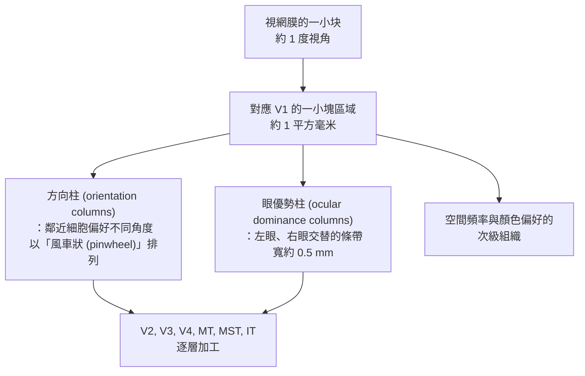
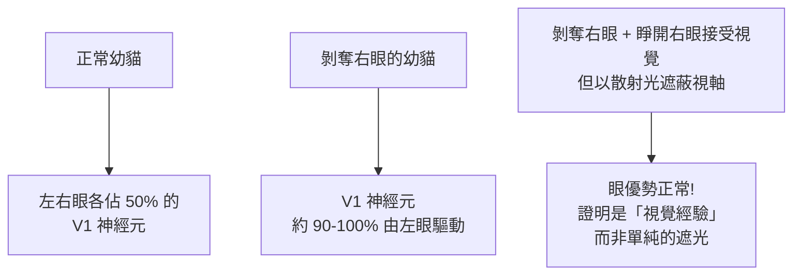

# 1981 · 裂腦與視覺皮層：斯佩里的胼胝體切斷與休伯爾—維厄瑟爾的「特徵偵測器」

> **1981 諾貝爾生理學 or 醫學獎**（共享三人）：羅傑·沃爾科特·斯佩里（Roger Wolcott Sperry，美國）— 表彰「發現大腦半球的功能性分工」；大衛·亨特·休伯爾（David Hunter Hubel，美國／加拿大）與托斯坦·維厄瑟爾（Torsten Nils Wiesel，瑞典）— 表彰「發現視覺系統的資訊加工」。

## 懸案（案情提要）

1981 年的諾獎表彰了兩件看似不相干、實則共享同一核心問題的事：**大腦如何處理資訊？**

**案子甲（左右分工）**：
1. 為什麼左腦控制右側身體、右腦控制左側？這是解剖學已知的事實。
2. 那麼**胼胝體（corpus callosum）**——連結兩半腦的巨大纖維束——做什麼？若切斷它，會發生什麼？
3. 一個更根本的問題：**「意識」是在哪裡的？** 是單一的中央處理器，還是分布式的？

**案子乙（視覺如何被分析）**：
1. 視網膜把光轉成神經訊號（見 [1967-視覺過程](1967-視覺過程.md)），但視覺皮層**如何**從這些訊號中抽取出「形狀、方向、速度」？
2. 既然每個神經元只記錄一個「特徵」，那麼「一張完整的臉」是如何被組合出來的？
3. **特徵是先天就有的，還是經驗塑造的？**

## 前因

| 年份 | 事件 |
| --- | --- |
| 1940s–1950s | **羅傑·斯佩里**在 Chicago 與 Caltech 研究**胼胝體切斷（split-brain）**的動物（猴）——他發現切斷後的猴子能「同時」表現互相矛盾的行為（左右手給予不同的訓練）。 |
| 1950–1960 | 斯佩里完成**胼胝體切斷的人類病例研究**——為治療癲癇而切斷胼胝體的病人（**J. W. 與 V. A.**）成為科學史上最著名的「裂腦病人」個案（見 [1950-腎上腺皮質激素](1950-腎上腺皮質激素.md) 時代的外科技術）。 |
| 1960s | 斯佩里的學生 **Jerome Levy** 以**「異裂腦（split-brain）」的「腦內傳訊（interhemispheric transfer）」實驗**（在病人的左視野投射一個詞語，觀察右腦是否能知道）建立了一整套實驗範式。 |
| 1958–1962 | **大衛·休伯爾與托斯坦·維厄瑟爾**在 Harvard（後為 Johns Hopkins）以**貓**為模型研究視覺皮層（V1）。 |
| 1959 | 他們把**微電極**插入貓的視覺皮層，發現對**特定角度的條紋（bar of light）**有反應的細胞——首次發現**特徵偵測器（feature detector）**。 |
| 1962 | 休伯爾與維厄瑟爾發現**「複雜細胞（complex cell）」**，它對條紋的移動方向有反應——**方向選擇性**的發現。 |
| 1965–1970s | 他們發明**柱狀體皮層的「適應測試法」**，並證明**視覺皮層的結構具有經驗依賴性**——剝奪貓的視覺經驗，會使皮層的**眼睛支配（ocular dominance）柱狀體**分佈異常，且「超常細胞」的正常型態不出現。 |
| 1970s | **休伯爾與維厄瑟爾的「青綠塊實驗（binocular deprivation）」**成為神經科學史上最著名的實驗之一。 |
| 1981 | 三人共享諾貝爾生理學 or 醫學獎。 |

## 調查

### 第一幕：斯佩里的裂腦實驗——「同一個身體裡有兩個意識」

斯佩里的實驗設計，是神經科學史上最精妙的操作之一。

**材料**：因嚴重癲癇而接受胼胝體切斷的病人（**J. W.** 與 **V. A.**，後來成為「**PG（patient G）**」與「**VB**」）。切斷胼胝體後，左右兩半腦無法交換資訊。

**實驗范式（Levy 的「 tachistoscope 展示」）**：

```mermaid
flowchart TD
    A[向左視野投射影像<br>→ 右腦] --> B{右腦能說出嗎?}
    B -- 能 --> C[異常: 右半球通常無語言能力<br>但右腦知道 "COW"]
    D[向右視野投射影像<br>→ 左腦] --> E[左腦能說出並用左手畫出]
    F[同時向兩側投射<br>不同影像] --> G[左手畫出其中一張<br>嘴巴說出另一張<br>= 兩個意識並行!]
    H[切斷前<br>胼胝體傳遞] --> I[左腦知道右眼看到的<br>右腦知道左眼看到的]
```

**三項關鍵發現**：

1. **左腦是語言的所在地，右腦在某些方面更優越**：
   - 讓病人用**左手**（右腦控制）畫出一幅圖或挑出卡片，表現常比右手（左腦）**更好**；
   - 右腦能理解**指令**（如「畫一隻鳥」並畫出來），卻**無法用語言說出**自己畫了什麼；
2. **裂腦病人出現「異裂腦現象（interhemispheric conflict）」**：兩隻手同時做互相矛盾的事（如左手選圓形、右手選方形；左手畫貓、右手畫狗）——這是**兩個獨立意識在同一個身體裡並行的直接證據**；
3. **「統一意識」是胼胝體的功能**：切斷前，兩半腦的資訊被強制整合為**單一的連續經驗**；切斷後，整合消失。

**「心靈問題（mind-body problem）」的實驗轉移**：斯佩里的工作把哲學上的**心靈二元論**轉化為可實驗的神經科學問題：

- 意識是**在哪裡**？——不在單一點，而在**資訊整合**；
- 斯佩里提出了著名的「**協同心理學（neurology of integration）**」與「**意識的離散性（discreteness）與集合性（unity）」**的對立。

### 第二幕：休伯爾與維厄瑟爾的「特徵偵測器」

他們的偵查起點是一個簡單問題：**視覺皮層的細胞，究竟對什麼有反應？**

**方法**：把微電極插入貓的 V1（初級視覺皮層），以**光柵（a grating of light）**刺激眼睛，同時用投影螢幕顯示條紋的**角度與方向**。

**發現的細胞類型**：

| 細胞類型 | 對什麼有反應 | 首次發現 |
| --- | --- | --- |
| **簡單細胞（simple cell）** | 特定**位置**上、**特定方向**的條紋 | 1959 |
| **複合細胞（complex cell）** | 特定方向的條紋，**不論位置** | 1962 |
| **超常細胞（hypercomplex cell）** | 特定方向的條紋，且**長度受限** | 1962–65 |
| **方向選擇性（orientation selectivity）** | 0°–180° 的偏好方向 | 1962 |
| **眼優勢（ocular dominance）** | 偏好左眼或右眼 | 1962 |
| **方向眼（direction of motion）** | 對條紋移動方向敏感 | 1960s |

**「特徵偵測器」的數學**：休伯爾與維厄瑟爾以一個簡單的**Gabor 濾波器模型**描述其反應：

$$R(\theta, \phi) = A \cdot e^{-\left(\frac{\theta - \theta_0}{\sigma_\theta}\right)^2} \cdot \left(1 + \cos 2(\phi - \phi_0)\right)$$

其中 $\theta$ 為條紋角度、 $\phi$ 為移動方向、 $\theta_0$ 與 $\phi_0$ 為偏好值——這正是**一個方向選擇性濾波器**。

### 第三幕：視覺皮層的「功能地圖」

他們在 V1 中發現了系統性的**組織**：



**「風車狀偏振（pinwheel）」是 1970–80 年代的重大發現**（由 Hubel 與 Wiesel 與其同事在 1980 年代以光學顯微鏡直接觀察到）——這是**皮層功能組織的第一個直接視覺證據**。

### 第四幕：經驗如何塑造皮層——「剝奪實驗」

這是休伯爾與維厄瑟爾最具深遠影響的實驗（1970 年代的「**麻省理工的 Adrian 的姊妹實驗**」）。

**實驗設計**：

1. 出生後立即封閉一隻貓的一隻眼睛（**單眼剝奪**），持續數月至一年；
2. 另一隻眼正常；
3. 之後測量 V1 中神經元的**眼優勢**：



**三項結論**：

1. **V1 的眼優勢柱是經驗塑造的**——基因只給出粗略的線索，經驗負責精細修剪；
2. **關鍵期（critical period）**：這種塑形發生在出生後的特定窗口，成年後即難以改變；
3. **「光線經驗」才是關鍵，而非單純的遮光**——這排除了「機械性遮擋」的替代解釋（對照組）。

**科學意義**：這是**「經驗塑造大腦」的第一個分子級證據**，並確立了**神經可塑性與敏感期**的概念（與洛倫茲的印痕概念在神經系統中遙相呼應，見 [1973-動物行為](1973-動物行為.md)）。

### 第五幕：斯佩里的另一面——「**(split-brain) 的自由意志實驗」

1980 年（諾獎前一年），斯佩里與 **Gazzaniga** 進行了一項更戲劇化的實驗：

1. 在裂腦病人的**右腦**（無語言能力）呈現一個指令：「**右腳走動**」；
2. 病人照做了（腳真的動了）；
3. 當問「**為什麼你要走？**」，**左腦**（語言所在地）無法解釋，於是編造了一個理由：「我想去喝水」；
4. **右腦的「決定」被左腦「合理化」**。

這項實驗提出了著名的「**分裂腦的合理化（confabulation / rationalization）**」概念——**意識不只在於「知道」，還在於「能編出一致的解釋」**。這對後來的認知科學與哲學影響深遠。

## 理論裁決

1. **特徵偵測器與線性濾波**：休伯爾與維厄瑟爾的模型可推廣為一個**多層濾波器架構**：

   $$\text{影像} \to \text{Gabor 濾波器群} \to \text{複合單元} \to \text{不變性物體表征} \to \text{認知}$$

   這個架構正是 1980 年代**神經網路計算模型**（Rumelhart、Hinton、Williams 的 PDP 模型）的靈感來源——今日的**卷積神經網路（CNN）**在結構上是它的後裔。

2. **資訊理論的應用**：皮層的資訊處理可以用**熵與冗餘**來量化：

   $$H(X) = -\sum p(x)\log_2 p(x)$$

   休伯爾與維厄瑟爾強調**皮層是「冗餘減少（redundancy reduction）」的裝置**——這是 1990 年代 **Barlow 的冗餘理論**的直接源頭，也是 2016 年 AlphaGo 背後的深度學習理論對照。

3. **裂腦的資訊論解讀**：胼胝體切斷後，兩半腦各自成為**獨立的資訊處理系統**，其間只有極少量（透過次級通路如 **前聯合**）的傳遞——這使得「**意識的統一性**」在數學上成為一個「**資訊整合問題**」。

4. **可塑性的時間常數**：剝奪實驗中的眼優勢轉變可用一個**指數趨近模型**描述：

   $$\Delta_{\text{ocular}}(t) = \Delta_{\max}\left(1 - e^{-t/\tau}\right)$$

   在敏感期內 $\tau$ 較小（塑形快），成年後 $\tau$ 趨近無窮大（塑形幾乎停止）——**時間常數本身隨發育改變**，這是理解學習窗與治療窗的核心。

5. **不等於「整體主義」**：休伯爾與維厄瑟爾特別強調，**皮層的特徵偵測器是「從極簡特徵逐步組合成複雜表征」**（1992 年他們提出「**特徵與分層理論（feature and hierarchy theory）**」）——這是現代深度學習「層級特徵學習」的思想源流。

## 追查支線（未結之謎）

- **休伯爾與維厄瑟爾的 40 年合作**：他們在 Harvard 共事 24 年，之後一起轉到 Johns Hopkins 繼續合作 40 年，**共同獲得 1981 年諾獎、1989 年 Louisa Gross Horwitz 獎與 1990 年京都獎**，2011 年獲**Gruber 獎**；2014 年維厄瑟爾出版回憶錄《The Brain: A Very Short Introduction》與合著的《Vision and Art》（2018），探討藝術與視覺腦科學的關係；休伯爾於 2013 年去世，維厄瑟爾繼續在 Johns Hopkins 教學至今；
- **斯佩里的科學生涯與與 F. (F.)** 斯佩里曾長期在 Caltech，1964 年因 NIH 的研究經費衝突而辭職，隨後以「行为與神經科學」計畫在美國繼續研究；他晚年關注「**意識的統一性**」與「**心靈的科學（science of the mind）**」；
- **1970 年代的「社會科學的裂腦」**：Gazzaniga 的「裂腦」實驗（1980s）曾被用來論證「左腦負責理性、右腦負責情緒」的說法，但這一大眾化的說法**後來被嚴格的研究所修正**（真正的左右差異遠比通俗說法複雜）；
- **視覺科學的「Grand Challenge」**：休伯爾與維厄瑟爾在 1982 年出版《Perception》時，列出了視覺科學的十項「大挑戰」，其中包括「**物體辨識**」「**視覺與語言的整合**」「**顏色的機制**」「**立體視覺**」——這些挑戰在 2010–2020 年代隨深度學習的進展而被逐步逼近，是「生物學與工程相互啟發」的精彩案例；
- **移植與裂腦的倫理**：裂腦病人研究涉及對病人的長期跟蹤與訪談，斯佩里的「心靈科學」計畫曾因研究者與病人的關係問題而引發倫理討論（Levy 與斯佩里之間的爭議）。

## 證物與數據（偵查卷宗摘錄）

| 證物 | 數值／內容 | 偵查意義 |
| --- | --- | --- |
| 裂腦病人 J.W. 與 V.A. | 胼胝體切斷後的語言側化 | 兩半腦的獨立性 |
| 異裂腦現象 | 左手與右手做互相矛盾的事 | 兩個意識並行 |
| 右腦的「COW」 | 右半球能辨識但無法說出 | 語言的側化 |
| 合理化實驗 | 右腳走動 → 左腦編出理由 | 意識的「敘事整合」 |
| 簡單細胞 | 特定位置＋特定角度 | 特徵偵測器的發現 |
| 複合細胞 | 特定方向，不論位置 | 方向選擇性 |
| 超常細胞 | 方向＋長度受限 | 更高階的特徵 |
| Gabor 濾波模型 | $R = A e^{-((\theta-\theta_0)/\sigma)^2}(1+\cos 2(\phi-\phi_0))$ | 濾波器理論 |
| 眼優勢 | 正常貓各佔 50%；剝奪後約 90–100% | 經驗塑造皮層 |
| 對照實驗 | 散射光遮蔽（散光眼）→ 正常 | 證明是視覺經驗 |
| 風車狀偏振 | 方向柱的 pinwheel 排列 | 皮層功能組織的直接證據 |
| 塑形時間常數 | $\Delta(t) = \Delta_{\max}(1-e^{-t/\tau})$ | 敏感期的量化 |

## 後果

| 領域 | 影響 |
| --- | --- |
| 神經科學 | 特徵偵測器與皮層功能地圖成為視覺科學與神經科學的基礎概念。 |
| 認知科學 | 裂腦研究確立「語言側化」與「意識的統一性」的實驗基礎。 |
| 發展神經科學 | 敏感期與經驗依賴性塑形的概念，影響教育與兒童發展政策。 |
| 人工智慧 | 從特徵偵測器到卷積神經網路、從冗餘理論到深度學習的思想源流。 |
| 臨床 | 胼胝體病變與失用症（apraxia）、裂腦病人的神經心理學評估。 |
| 藝術與美學 | 維厄瑟爾的《Vision and Art》把視覺科學與藝術欣賞連結。 |
| 其他諾獎 | 與 [1967-視覺過程](1967-視覺過程.md)、[1973-動物行為](1973-動物行為.md)、[2000-神經訊號傳導](2000-神經訊號傳導.md) 構成神經科學主線。 |

## 關聯

- [1967-視覺過程](1967-視覺過程.md) — 視網膜的化學轉換與側抑制，是皮層加工的上游。
- [1932-神經元功能](1932-神經元功能.md) — 全或無律與感覺編碼的基礎。
- [2000-神經訊號傳導](2000-神經訊號傳導.md) — 這條線在 2000 年的成熟。
- [1973-動物行為](1973-動物行為.md) — 印痕的關鍵期與本案的敏感期遙相呼應。
- [1986-生長因子](1986-生長因子.md) — 神經生長與可塑性的分子層次。
