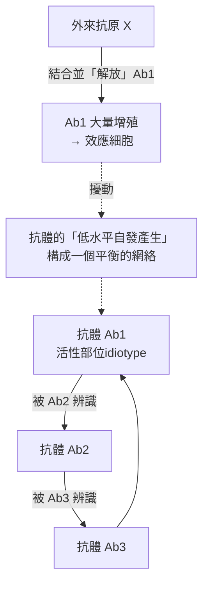
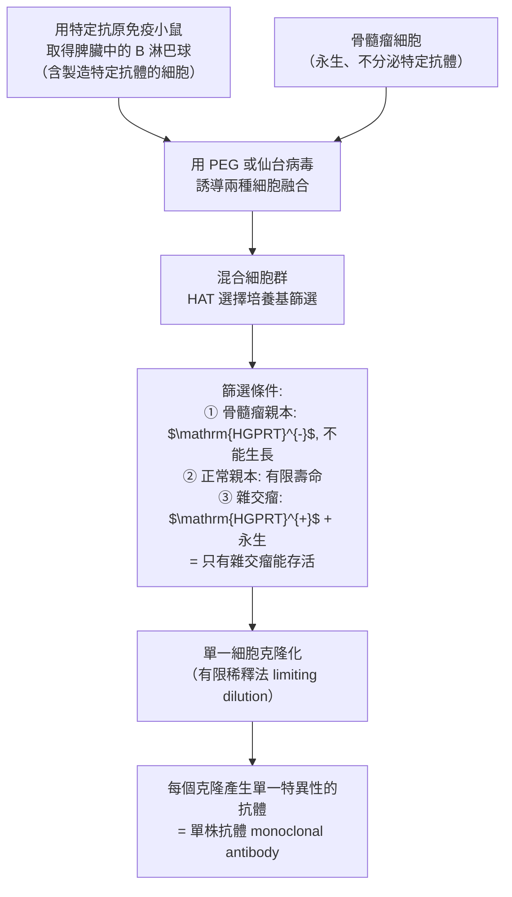

# 1984 · 免疫特異性理論與單株抗體：杰恩的選擇說、克勒與米爾斯坦的雜交瘤

> **1984 諾貝爾生理學 or 醫學獎**（共享三人）：尼爾斯·卡伊·杰恩（Niels Kaj Jerne，丹麥）— 表彰「關於免疫系統的發育和控制特異性的理論」；喬治斯·約恩·弗蘭茨·克勒（Georges J. F. Köhler，德國）與色薩·米爾斯坦（César Milstein，阿根廷／英國）— 表彰「發現單株抗體產生的原理」。

## 懸案（案情提要）

1980 年代的免疫學有兩樁並肩的難題：

**案子甲（特異性的來源）**：一個人類免疫系統面對數以億計的抗原分子，卻只有約 $10^{6}\text{–}10^{7}$ 種不同的抗體受體。那麼——

1. 是**抗原教會**免疫系統製造新抗體（**指令說**），還是免疫系統**本來就備有**所有可能的抗體、由抗原**挑選**（**選擇說**）？
2. 免疫系統如何學會「不攻擊自己」？在哪裡學？
3. 若抗體之間也互相辨識，免疫系統會不會失控？

**案子乙（藥物的供應問題）**：1970 年代的生物技術產業急需「**單一化**」的抗體作為診斷與治療工具。但當時能取得的抗體都是**動物免疫後的多克隆抗體（polyclonal）**——同一隻動物內含成千上萬種不同的抗體，**每一批之間的濃度與親和力都不同**，根本無法作為可重複的藥品。

答案：**雜交瘤技術（hybridoma）**——把「會製造特定抗體的 B 細胞」與「永生不死的骨髓瘤細胞」融合，得到既能專一製造某種抗體、又能無限增殖的細胞株。

## 前因

| 年份 | 事件 |
| --- | --- |
| 1957 | **Jerne** 提出「**自然選擇說（natural selection theory）**」：抗體的樣式並非由抗原決定，而是**先天存在的多樣性**，抗原只負責「挑選」。 |
| 1960 | Jerne 提出「**免疫網 theory（免疫網絡說）**」：抗體的活性部位（idiotype）可被其他抗體辨識，形成一個「**免疫網絡**」，免疫反應是網絡平衡被打破的結果。 |
| 1962 | **Burnet** 與 **Medawar** 的**免疫耐受**實驗確立「自我／非我」的辨識（見 [1960-後天免疫耐受](1960-後天免疫耐受.md)）。 |
| 1963–1971 | **Edelman 與 Porter** 的抗體結構研究（見 [1972-抗體結構](1972-抗體結構.md)）證明抗體的**多樣性是有限的**——蛋白質種類有限，但抗體種類近乎無限，這個矛盾正是杰恩理論要解決的核心。 |
| 1971 | Jerne 提出「**胸腺的免疫耐受學說」**：T 細胞在胸腺中發育時，會遇到體內所有的「自己」抗原，**凡能辨識自體抗原者被消除（負向選擇）**——這解釋了中樞耐受。 |
| 1973 | Jerne 發表「**選擇性免疫系統理論（The Immune System: A Learning Network）**」，把免疫系統描述為「**以抗體為基本單位的學習網絡**」——這在概念上與 1960 年代的**人工神經網絡**思想平行（他本人亦受惠於神經科學的啟發）。 |
| 1973 | **César Milstein 與 Georges Köhler** 在 Cambridge 的 MRC 實驗室開始研究如何「融合」兩種細胞。 |
| 1974 | Milstein 與 Köhler 成功將**骨髓瘤細胞與正常 B 淋巴球融合**，得到能持續產生抗體的**雜交瘤（hybridoma）**細胞。 |
| 1975 | 他們發表《Continuous production of monoclonal antibodies》（《單株抗體的持續生產》），描述了以**多克隆抗體**為「選拔劑」、篩選出**單一抗體**雜交瘤的方法——**單株抗體技術正式誕生**。 |
| 1978 | **Herzenberg** 與 **Mishell** 發展出 **FACS（螢光活化細胞分選）**，使「單株」的分選更精確高效——這是單株抗體技術的配套工具。 |
| 1984 | 三人共享諾貝爾生理學 or 醫學獎。 |
| 1980s–1990s | 單株抗體成為**診斷试剂（如懷孕試劑、HIV 檢驗）、研究工具、與治療性抗體（1982 年的 muromonab-CD3，1997 年的 rituximab）**的核心技術。 |
| 1990s | **噬菌體展示（phage display）**（見 [1969-噬菌體遺傳](1969-噬菌體遺傳.md)）成為更高效的「單株抗體」筛选平台，取代了雜交瘤在许多应用中的地位。 |

## 調查

### 第一幕：杰恩的三個理論——「免疫系統是一個學習網絡」

杰恩的第一項貢獻，是對「特異性從何而來」這個二元問題的**破解**：

**問題的量化**：若抗體多樣性是「先天存在」的，免疫系統必須預先備有約 $10^8$ 種不同的抗體受體；若抗體是「被教出來的」，則每個抗原都要從零開始教。**兩者都不合理**——但杰恩指出，這是錯誤的提問。

**杰恩的「選擇說」核心**：

$$\text{抗體多樣性} \text{ 是先天產生的；抗原的作用只是「挑選」已有的抗體}$$

**但這裡有個統計學難題**：若所有抗體都已存在，那麼免疫系統如何在海量自體反應性抗體中「找到」外來抗原對應的那一個？杰恩的答案是——**「免疫網絡」**：

**免疫網絡的深層洞見**：

1. **免疫系統的「靜態」不是無，而是低水平的自發活動**——抗體之間互相抑制，維持平衡；
2. **抗原的「作案」其實是「解放」某個抗體**——它解除該抗體受到的抑制，使其大量增殖；
3. **免疫反應的終止也由網絡自動完成**——當 Ab2、Ab3 累積到足以抑制 Ab1 時，反應自然消退（這是免疫調節與「免疫網絡」的現代解讀）；
4. **這套邏輯與神經系統極為相似**（聯想、抑制、競爭、恆定 homeostasis）——杰恩明言受到神經科學的啟發，而 1960 年代的**人工神經網絡**（Rosenblatt 的感知機、1969 年的 Minsky–Papert《Perceptrons》）也正建立在同一套數學上。

**杰恩的第二項貢獻**：**「胸腺是耐受的學習場所」**。

他與 **Avrion Mitchison**（1969 年提出的「選擇性免疫調節理論」）共同主張：

- T 細胞在胸腺中發育時，其受體會**被暴露於體內所有的自體抗原**（以耐受濃度）；
- **能強烈辨識自體抗原的 T 細胞被消除**（克隆消除）；
- 存活的 T 細胞即為**對自體耐受、對外來抗原有反應**的細胞。

這是**中樞耐受的第一個完整機制模型**，並與骨髓瘤（B 細胞在骨髓中發育）形成對稱的解釋。**Jerne 的理論預測被 1980–90 年代的實驗大量證實**（如 Ratner 的 T 細胞受體基因在胸腺中的重組與篩選實驗）。

### 第二幕：克勒與米爾斯坦的「雜交瘤」——把「專一」與「無限」嫁接在一起

**問題的拆解**：製造抗體需要兩種性質，而它們原本分屬兩種細胞：

| 需要的性質 | 由哪種細胞提供 | 問題 |
| --- | --- | --- |
| **專一性**（產生特定一種抗體） | **B 淋巴球** | 會死亡，且產量有限 |
| **無限增殖** | **骨髓瘤細胞** | 不產生特定抗體 |

**解法：細胞融合**。

Milstein 與 Köhler 的實驗設計：

**三項關鍵技術**：

1. **HAT 選擇培養基**（**Hypoxanthine-Aminopterin-Thymidine**）：這是本案最精妙的設計。
   - 親代骨髓瘤細胞：HGPRT 缺陷（不能利用次黃嘌呤），在含氨蝶呤的培養基中**被殺死**；
   - 正常 B 細胞：雖有 HGPRT，但**分裂次數有限**，在培養基中**自然死亡**；
   - **只有雜交瘤**同時擁有 HGPRT（能利用次黃嘌呤繞過氨蝶呤的阻斷）與骨髓瘤的永生性 → **只有它能持續生長**。
2. **有限稀釋法（limiting dilution）**：把細胞稀釋到每孔約 0.5–1 個細胞，確保每個克隆源自**單一** B 細胞 → **單一特異性**。
3. **篩選（screening）**：以抗原包被的板檢測各克隆的培養液，找出產生目標抗體的克隆。

**雜交瘤的性質**：

$$\text{雜交瘤} = \underbrace{\text{B 細胞的染色體}}_{\text{產生特定抗體}} + \underbrace{\text{骨髓瘤的染色體}}_{\text{無限增殖}}$$

**實測數據**：一個雜交瘤克隆可在培養中持續數月產生**單一抗體**，濃度可達每升數克級——**這在生物藥品的歷史上是數量級的躍升**（傳統的多克隆抗體來自動物血清，每隻動物僅數毫克，且批次間變異極大）。

### 第三幕：從「技術」到「產業」

雜交瘤技術的產業化極為迅速：

1. **1975–1980s**：商業化單株抗體問世——**診斷試劑**（懷孕試劑、肝炎檢驗、HIV 檢驗）、**研究試劑**（流式細胞術的抗體面板）、**免疫層析**；
2. **治療性抗體的先驅**：1982 年 **muromonab-CD3（OKT3）** 獲准用於器官移植抗排斥（首個單株抗體藥物）；1997 年 **rituximab（抗 CD20）** 用於淋巴瘤；
3. **「人源化」的必要性**：小鼠單株抗體在人体內會**被人類抗鼠抗體中和**（HAMA 反應），且**誘發過敏**——因此 1980 年代發展出**嵌合抗體**（小鼠 Fab + 人類 Fc）與**人源化抗體**（CDR 移植）技術；
4. **基因工程抗體**：1990 年代，**噬菌體展示**與**重組 DNA 技術**提供了完全human的替代方案（見 [1978-限制性內切酶](1978-限制性內切酶.md)），單株抗體從此可以用**基因序列**而非動物來定義。

## 理論裁決

1. **選擇說 vs 指令說的統計學對比**：若抗體為「教出來的」，每種抗原需要一次隨機基因重組 + 篩選的過程，時間成本極高（且需後天選擇）；若為「先天存在」，則只需**一次**成本很高的多樣性生成（胚胎期），之後**每次**應答都只是**放大既有的正確答案**：

   $$\text{成本}_{\text{選擇說}} = \text{生成多樣性（一次性）} + n \times \text{選擇（每次）}$$

   這解釋了免疫應答的**速度**（初次應答需數天建立克隆，二次應答只需數小時）——二次應答快，正因為**答案早已備妥**。

2. **免疫網絡的數學模型**：免疫網絡可用一個「**互相抑制的耦合系統**」描述：

   $$\frac{d x_i}{dt} = f(x_i) + \sum_j J_{ij}\, x_j x_k - d\,x_i$$

   外來抗原 $X$ 使某個 $x_i$ 的抑制解除 → $x_i$ 上升 → 引發更多抑制性反應 → 最終回到平衡。這解釋了**免疫應應的自限性**（不需外來訊號即可終止），也解釋了**免疫網絡的多層級放大與調節**。

3. **單株抗體的「統計學純度」**：雜交瘤技術的數學本質是**把分布轉為單點**：

   $$\text{多克隆抗體：}\ \text{濃度分佈} \ p(c) \quad\Longrightarrow\quad \text{單株抗體：}\ \delta(c - c_0)$$

   這使「親和力、交叉反應、濃度」成為可精確標定的參數——**這是所有基於抗體的診斷與治療能夠被監管與量產的前提**。

4. **HAT 選擇的邏輯**：選擇培養基的設計是一個**邏輯閘門**：只有「具備 A 且具備 B」的細胞能通過。它是 20 世紀生物學中「**選擇性篩選（selective screen）」的典範**，與 1940 年代 Lederberg–Luria 的**劃痕培養皿法**（用抗生素抗性篩選突變株，見 [1958-一基因一酶](1958-一基因一酶.md)）屬同一族。

5. **「選擇說」在分子層級的兌現**：杰恩在 1960 年代預言「抗體多樣性是先天產生的」——**1987 年利根川進證明了 V(D)J 重排**（見 [1987-抗體多樣性](1987-抗體多樣性.md)）。**這是一個明確的、提前二十年的科學預言被證實**，是諾獎史上最漂亮的預言—兌現之一。

## 追查支線（未結之謎）

- **杰恩的科學與哲學**：他晚年寫了《The Science of Thinking》（1992）與《The Seductive Idea》（1994），主張免疫系統是「**以抗原為環境、以抗體為神經元**的學習網絡」——這是把免疫學與認知科學、與人工智慧對話的早期嘗試；
- **Jerne 於 1994 年在瑞士 dies**，享年 82 歲；他曾說自己的最大遺憾是「免疫系統仍然沒有被完全理解」；
- **Milstein 與 Köhler 的合作僅持續了約兩年**：Milstein 移居 Cambridge 並於 1984 年離英赴美國（因英國的科學資助環境與移民政策，Milstein 稱英國「不支持科學」），兩人於 1984 年同獲諾獎，但**從未再次合作**；Milstein 曾自嘲是「諾貝爾獎最不開心的獲獎者」，因為他的核心貢獻（雜交瘤）只被寫成「Köhler 與 Milstein」而實際主力是 Köhler；
- **「雜交瘤之父」的稱號之爭**：Köhler 與 Milstein 共同獲得諾獎，但 Milstein 晚年公開表示**技術的構想來自 Köhler**，並把自己描述為「提供酵母菌的廚師」——這樁坦率的歸屬說明是科學界少見的君子之舉；
- **Köhler 的離世**：他於 1995 年因肺病去世，是諾獎得主中年紀最輕者之一；他在 Freiburg 的 Max Planck 免疫生物學研究所留下了綜述性巨著《Immunology of the Self》；
- **單株抗體的副作用史**：從 OKT3（引起發熱、淋巴球減少、**血清病**與**細胞因子釋放症候群**）到 rituximab（**B 細胞耗竭與再補充期間的感染風險**），單株抗體的治療史也是免疫學認識史的鏡子。

## 證物與數據（偵查卷宗摘錄）

| 證物 | 數值／內容 | 偵查意義 |
| --- | --- | --- |
| 選擇說（1957） | 抗體多樣性先天存在，抗原只負責挑選 | 免疫學的第一個選擇模型 |
| 免疫網絡說（1960） | 抗體互相辨識、互相抑制 | 「平衡—擾動」模型 |
| 胸腺耐受說（1971） | 自體反應性 T 細胞在胸腺被消除 | 中樞耐受的機制 |
| 「學習網絡」（1973） | 免疫系統 ≅ 神經網絡 | 跨領域的結構同構 |
| 多樣性難題 | 受體種類 $10^6\text{–}10^7$ vs 抗原無限 | 兩說皆不足的關鍵矛盾 |
| 融合方法 | PEG 或仙台病毒誘導 | 雜交瘤技術的第一步 |
| HAT 選擇培養基 | $\mathrm{HGPRT}^{-}$ 親本被殺 + 有限壽命親本自然死 | 只有雜交瘤存活 |
| 有限稀釋法 | 每孔 0.5–1 個細胞 | 單一 B 細胞來源 → 單株 |
| 產量 | 數克／升、持續數月 | 相對多克隆抗體的數量級躍升 |
| V(D)J 重排（1987） | 利根川進證實 | 杰恩預言的兌現 |

## 後果

| 領域 | 影響 |
| --- | --- |
| 免疫學 | 選擇說、網絡說與中樞耐受成為現代免疫學的核心框架。 |
| 生物技術 | 雜交瘤開啟單株抗體產業：診斷試劑、影像試劑、治療性抗體。 |
| 臨床 | 首個單株抗體藥物（OKT3）、rituximab、herceptin 等系列，讓「精準打擊」成為可能。 |
| 分子生物學 | 篩選技術的典範，與基因工程抗體、噬菌體展示共同構成「抗體發現平台」。 |
| 神經科學 | 「學習網絡」的概念對照，也促成 2000 年諾獎的神經可塑性主題。 |
| 其他諾獎 | 與 [1972-抗體結構](1972-抗體結構.md)、[1987-抗體多樣性](1987-抗體多樣性.md)、[1960-後天免疫耐受](1960-後天免疫耐受.md) 構成免疫學主線。 |

## 關聯

- [1972-抗體結構](1972-抗體結構.md) — 抗體結構的化學基礎，是「多樣性有限」難題的前提。
- [1987-抗體多樣性](1987-抗體多樣性.md) — 杰恩預言的分子答案。
- [1960-後天免疫耐受](1960-後天免疫耐受.md) — 胸腺耐受理論的實驗基礎。
- [1988-藥物治療原理](1988-藥物治療原理.md) — 受體理論與合理藥物設計，同一時代的另一條線。
- [1969-噬菌體遺傳](1969-噬菌體遺傳.md) — 噬菌體展示技術的源頭。
