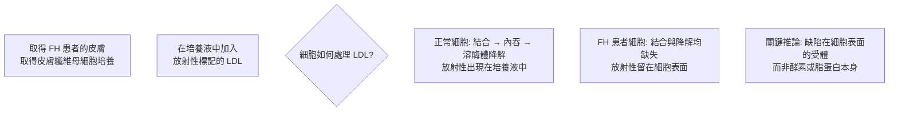
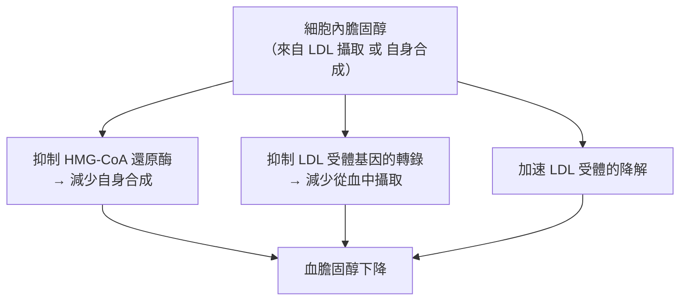

# 1985 · 膽固醇代謝的調控：布朗與戈爾茨坦找到「LDL 受體」這個清除閥門

> **1985 諾貝爾生理學 or 醫學獎**（共享）：麥可·布朗（Michael S. Brown，美國）與約瑟夫·里歐納德·戈爾茨坦（Joseph L. Goldstein，美國）— 表彰「在膽固醇代謝的調控方面的發現」（"for their discoveries concerning the regulation of cholesterol metabolism"）。兩人自 1970 年代起合作逾 40 年，共享諾獎與 numerous 醫學獎項。

## 懸案（案情提要）

1960–70 年代，膽固醇研究有兩塊互相不相干卻同時迫切的拼圖：

**拼圖甲（化學）**：膽固醇從哪來、如何被分解？這方面，**布洛赫與呂嫩已畫出完整的合成路徑**（見 [1964-膽固醇代謝](1964-膽固醇代謝.md)）。

**拼圖乙（生理與疾病）**：但醫學界面對的現實是：

1. **冠心病是西方工業化國家最大的殺手**，而其主要危險因子是**血漿膽固醇升高**；
2. 為什麼有人血膽固醇只有約 $150\ \mathrm{mg/dL}$ ，健康；有人卻有 $300\ \mathrm{mg/dL}$ ，血管嚴重粥狀硬化？
3. 既然合成路徑已經清楚，**為什麼有些人合成得多、有些人少**？血中膽固醇的濃度到底由什麼決定？
4. 若能找到控制點，**就有可能造出藥物**。

布朗與戈爾茨坦的答案：**LDL 受體（low-density lipoprotein receptor）**——細胞表面的一個「**清除閥門**」，它決定血中膽固醇的壽命。

## 前因

| 年份 | 事件 |
| --- | --- |
| 1950s–60s | 膽固醇的**合成路徑**被布洛赫與呂嫩釐清（見 [1964-膽固醇代謝](1964-膽固醇代謝.md)）。 |
| 1964–1965 | **Fredrickson** 提出**脂蛋白分類**：以密度分為界，把血漿脂蛋白分為乳糜微粒、**LDL（低密度脂蛋白）**、HDL（高密度脂蛋白）、VLDL；並以**家族性高膽固醇血症（familial hypercholesterolemia, FH）**為遺傳性代謝病的原型。 |
| 1968 | 研究者發現家族性高膽固醇血症患者的**培養皮膚纖維母細胞**無法攝取 LDL——**這是本案最關鍵的「線索物證」**。 |
| 1972–1973 | **布朗與戈爾茨坦**建立了「患者體細胞的 LDL 代謝缺陷」模型：以放射性標記的 LDL 追蹤，發現 FH 患者的細胞**無法結合、內吞並分解 LDL**。 |
| 1973–1974 | 兩人發現缺陷在於**細胞表面缺少一個受體**，並以**放射性標記的 LDL 與正常細胞競爭結合**來證明受體的存在（**受體結合實驗**：正常細胞結合的放射性 LDL 可被過量未標記 LDL 競爭掉）。 |
| 1975–1977 | **LDL 受體的純化與克隆**（Brown 的實驗室與 **Robert Schekman** 等人合作）——受體被純化，其**基因被克隆**（1985 年），**cDNA 序列**隨後被揭曉。 |
| 1983–1985 | **Brown 與 Goldstein 的「LDL 受體–HMG-CoA 還原酶」的雙重回饋模型**完成：細胞內膽固醇同時抑制（a）HMG-CoA 還原酶（合成端）與（b）LDL 受體的表現（攝取端）。 |
| 1985 | 兩人共享諾貝爾生理學 or 醫學獎。 |
| 1987 | **Simvastatin（辛伐他汀）**上市（此前 1976 年已有 lovastatin）——**第一個(statins)**，直接作用於布洛赫指出的速率限制酵素。 |
| 1990s | **PCSK9 與「低密度脂蛋白受體的降解」**被發現，成為降脂的新靶點；2020–2020 年代的 **inclisiran**（siRNA）上市。 |

## 調查

### 第一幕：FH 病人——「人體自帶的實驗」

布朗與戈爾茨坦的偵查起點極為幸運：**家族性高膽固醇血症（FH）** 是一種罕見的**單基因遺傳病**，患者從胎兒期就有極高的血膽固醇，常在 30–50 歲死於心肌梗塞或腦卒中。

**偵查的關鍵設計**：



**兩項排除性實驗**（科學偵查的標準動作）：

1. **受體的存在性**：加入**過量未標記的 LDL**，會**競爭性地抑制**放射性 LDL 的結合 → 存在**可飽和的結合位點**（即受體）；
2. **缺陷的定位**：以**螯合細胞內鈣的藥物（EGTA）**處理，細胞表面受體會**內吞**——證明受體負責將 LDL 帶入細胞並送至**溶酶體**（這也把本案與 [1974-細胞結構與功能組織](1974-細胞結構與功能組織.md) 的溶酶體研究接上了）。

### 第二幕：受體的分子解剖

1970 年代末至 1980 年代初，兩人的實驗室完成受體的完整解剖：

1. **LDL 受體是「受體介導的內吞（receptor-mediated endocytosis）」的典範**：

```mermaid
flowchart LR
    A[LDL 結合受體<br>在細胞膜的「-coated pit」<br>（網格包覆小窩）] --> B[內吞形成囊泡]
    B --> C[與內體(endosome)融合<br>酸性 pH 使 LDL 與受體分離]
    C --> D1[LDL → 溶酶體 → 膽固醇<br>→ 抑制 HMG-CoA 還原酶]
    C --> D2[受體 → 回歸細胞膜<br>（受體再循環）]
```

2. **受體的結構域**（由 Brown 與 Schekman 合作，結合序列與結構研究）：

| 結構域 | 功能 |
| --- | --- |
| **LDL 結合區（EGF 前驅物型）** | 結合 ApoB-100 |
| **EGF 樣區** | 與受體再循環有關；**PCSK9 結合此區** |
| **含硫酸化半胱氨酸的「補體控制蛋白（CCP）」區** | 結合 **PCSK9** → 受體被導向降解 |
| **細胞質內尾部** | 與 **ARH（adaptor protein）** 結合 → 內吞訊號；突變導致**家族性高膽固醇血症** |

3. **FH 的分子病因**：FH 患者帶有 LDL 受體基因的突變，最常見的是**受體的合成缺陷（null allele）**或**受體在細胞表面的「保留缺陷」（receptor-negative vs receptor-defective）**——受體能合成但**無法從內體回歸細胞膜**，因而被降解，使受體數量降至正常的 $1\%$ 以下。

**這解釋了臨床的分型**：

| 型別 | 受體數量 | 治療反應 |
| --- | --- | --- |
| **同型合子 FH（HoFH）** | 幾乎為零 | 對 statin 反應差；需 **PCSK9 抑制劑、lomitapide、基因治療** |
| **異型合子 FH（HeFH）** | 約正常的一半 | statin 有效 |

### 第三幕：雙重負回饋——本案最深刻的理論貢獻

布朗與戈爾茨坦發現，**細胞內膽固醇同時控制兩個點**：



**這個「雙重負回饋」的數學表達**：

$$\dot{C}_{\text{cell}} = v_{\text{synth}}(C) - v_{\text{uptake}}(C), \qquad \frac{\partial v_{\text{synth}}}{\partial C} < 0, \quad \frac{\partial v_{\text{uptake}}}{\partial C} < 0$$

這是一個**穩定的負回饋系統**，其行為可用 Homeostatic 平衡描述：

$$C_{\text{steady}} \text{ 由 } v_{\text{synth}}(C_{\text{steady}}) = v_{\text{uptake}}(C_{\text{steady}}) \text{ 決定}$$

**關鍵的臨床推論**：

1. 若**合成端**被 statin 抑制 → 細胞內膽固醇下降 → **受體表現上升** → 攝取增加 → **雙重打擊**（這正是 statin 效果優越的原因）；
2. 若**攝取端**的受體有缺陷（FH） → 細胞內膽固醇升高 → **回饋抑制合成** → 這是細胞的**代償機制**，也解釋了為何 FH 患者仍有藥物可用；
3. 「**降低一個端點會自動加強另一個端點的調節**」——這是「回饋系統的增益」概念在醫學上的直接應用。

### 第四幕：從受體到藥物——「**合理設計**」的第一次成功

布朗與戈爾茨坦的研究，直接導致了**他汀類藥物**的開發邏輯：

1. **布洛赫的貢獻**：HMG-CoA 還原酶是合成路徑的速率限制步驟（見 [1964-膽固醇代謝](1964-膽固醇代謝.md)）；
2. **布朗與戈爾茨坦的貢獻**：抑制此酵素會**解除回饋抑制**，使受體數量上升，雙重降低血膽固醇；
3. **結果**：**1987 年辛伐他汀（simvastatin）上市**——第一個 statin，開啟了全球最大的心血管藥物類別之一（他汀類今日是全球處方量最大的藥物之一）；
4. **後續**：**依折衷醇（ezetimibe）**（抑制 NPC1L1，阻斷 LDL 的腸道吸收）、**PCSK9 抑制劑**（evolocumab、alirocumab 單抗；2021 年 **inclisiran** siRNA）——**這條線一路延伸到 2020 年代的「降脂療法」新紀元**。

## 理論裁決

1. **受體介導內吞的動力學**：LDL 的清除率可用受體數目與親和力描述：

   $$v_{\text{uptake}} = \frac{V_{\max}[S]}{K_d + [S]}, \qquad V_{\max} = N_{\text{receptor}} \cdot k_{\text{internalization}}$$

   對 FH 異型合子患者， $N_{\text{receptor}}$ 減半 → **清除率下降一半** → 血中 LDL 濃度倍增——**這解釋了 FH 的遺傳性孟德爾式高膽固醇血症**。

2. **血漿 LDL 濃度的穩態模型**：LDL 由肝臟分泌、由受體清除，其穩態濃度為：

   $$[\text{LDL}]_{\text{ss}} = \frac{R_{\text{secretion}}}{k_{\text{clearance}}}$$

   這解釋了為何「**增加分泌**」或「**減少清除**」都會升高血中 LDL——**前者是高爾茨坦與布朗在 1990 年代用「基因過度表現」實驗製造的「FH 模型」**，後者則是受體突變的 FH。

3. **LDL 顆粒大小與致病性**：布朗與戈爾茨坦在 1990 年代提出的**「回應性假說（response-to-retention hypothesis）」**：

   $$\text{致病性} \propto \text{血中濃度} \times \text{顆粒在動脈壁的滯留傾向}$$

   這解釋了為何**高 LDL 膽固醇**與**小而密 LDL 顽粒**（有 apoB-100 的高危顆粒）更具動脈粥樣硬化風險——這是今日「** LDL-C / apoB 比值**」臨床判讀的依據。

4. **回饋系統的增益與藥理學**：細胞內膽固醇對兩個端點的抑制構成負回饋迴路，其總增益 $G = |G_1 + G_2| < 1$ 決定穩定性；抑制任一端點都會**降低迴路增益**並放大另一端點的作用——這是「**statin 的雙重效應**」的定量表達。

## 追查支線（未結之謎）

- **布朗與戈爾茨坦的科學搭檔**：兩人自 1972 年起在德州達拉斯（UT Southwestern）合作，發表了 200 多篇論文，並共同獲得了 **1985 年諾貝爾獎、Lasker 獎（1985）、Gairdner 獎（1987）、Wolf 醫學獎（1997）、Albany 醫學獎（2000）與美國國家科學獎章（1994）**——這是 20 世紀醫學界最長、最有影響力的合作之一；
- **戈爾茨坦的政治角色**：他於 2009–2010 年擔任**美國國家衛生研究院（NIH）院長**（在沃爾特·科恩伯格與 Francis Collins 之後），並在任內推動了**基因組學與精準醫學**的政策；
- **1970 年代的科學政治**：布朗與戈爾茨坦在 1970 年代末期受到保守派對「社會 Darwinism」的攻擊（因其研究顯示「教育程度高的人膽固醇較低」的統計相關，被解讀為支持能力遺傳）；兩人發表了《The Cholesterol Facts》（1979 年，《New England Journal of Medicine》）與《Beyond Cholesterol》（1995 年）反擊，並指出**吸菸、肥胖、缺乏運動才是可改變的主要因素**；
- **PCSK9 的發現**：2003 年，**Norrbom 等人**發現apoB-100 的「LDLR 弱化因子」，隨後於 2007 年被命名為 PCSK9——**它與布朗與戈爾茨坦 1980 年代的受體回收研究直接相連**，因為它結合在受體的 CCP 區，阻斷其回收；
- **「LDL 受體」的醫學遺產**：布朗與戈爾茨坦的受體學，開啟了 statin、ezetimibe、PCSK9 抑制劑、inclisiran 四代降脂藥的接力，也讓「**以受體為靶的藥理學**」成為心血管醫學的主軸——這條線在 2023 年的**「心臟病學史上的重大發現」**評選中仍被列為典範。

## 證物與數據（偵查卷宗摘錄）

| 證物 | 數值／內容 | 偵查意義 |
| --- | --- | --- |
| FH 患者纖維母細胞 | 無法結合與降解 LDL | 缺陷在細胞表面 |
| 放射性標記 LDL | 結合可被過量未標記 LDL 競爭 | 受體存在的證明 |
| EGTA 處理 | 受體內吞 | 受體介導內吞的證明 |
| LDL 受體的運輸 | 內體酸化 → 受體與 LDL 分離 → 受體再循環 | 分子路徑 |
| FH 分型 | HoFH 受體 ≈ 0；HeFH ≈ 50% | 治療反應的差異 |
| 雙重負回饋 | 抑制 HMG-CoA 還原酶 + 抑制受體轉錄 | 本案最深的理論 |
| LDL 穩態式 | $[\text{LDL}] = R_{\text{secretion}}/k_{\text{clearance}}$ | 高膽固醇血症的定量 |
| 回應性假說 | 致病性 ∝ 濃度 × 滯留傾向 | apoB 的臨床意義 |
| statin（1987） | 抑制 HMG-CoA 還原酶 | 合理設計的第一個成功 |
| PCSK9（2007） | 結合受體 CCP 區 → 受體降解 | 受體學的現代延伸 |

## 後果

| 領域 | 影響 |
| --- | --- |
| 心血管醫學 | 降脂治療從「飲食建議」變為「藥物管理」；血 LDL-C 目標值寫入所有指南。 |
| 藥理學 | 受體介導內吞成為藥理學的經典機制；statin 類成為全球最大的藥物類別之一。 |
| 遺傳學 | FH 成為「單基因遺傳病 + 受體缺陷」的典範，並示範了「基因型—表型」的完整推理。 |
| 公共衛生 | 「膽固醇假說」的確立，改变了多國膳食指南與食品標示政策。 |
| 生物化學 | 與布洛赫的合成路徑、與 Fredrickson 的脂蛋白分類匯流，完成膽固醇代謝的三維圖景。 |
| 其他諾獎 | 與 [1964-膽固醇代謝](1964-膽固醇代謝.md)（布洛赫、呂嫩）、[1988-藥物治療原理](1988-藥物治療原理.md)（合理藥物設計）、[2019-氧氣感知](2019-氧氣感知.md)（HIF 與脂質代謝）構成脂質與藥理主線。 |

## 關聯

- [1964-膽固醇代謝](1964-膽固醇代謝.md) — 布洛赫的合成路徑，本案的另一半拼圖。
- [1988-藥物治療原理](1988-藥物治療原理.md) — 埃利恩與希廷斯的「合理藥物設計」，與本案的受體靶點策略同源。
- [1974-細胞結構與功能組織](1974-細胞結構與功能組織.md) — 受體介導內吞的溶酶體步驟。
- [1972-抗體結構](1972-抗體結構.md) — 受體藥理學的另一條示範路徑。
- [2019-氧氣感知](2019-氧氣感知.md) — 缺氧下 HIF 調控脂質代謝的延伸。
