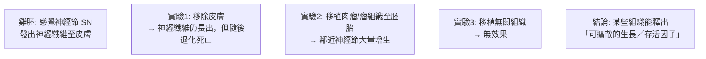
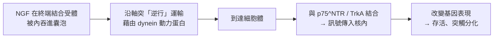

# 1986 · 生長因子：科恩的 EGF 與列維-蒙塔爾奇尼的 NGF——神經科學的「生長信號」被找到

> **1986 諾貝爾生理學 or 醫學獎**（共享）：斯坦利·科恩（Stanley Cohen，美國）— 表彰「發現生長因子」；麗塔·列維-蒙塔爾奇尼（Rita Levi-Montalcini，義大利）— 同上。

## 懸案（案情提要）

神經科學在 1950 年代有一個極大的不解：

1. **神經元是終身不分裂的細胞**（此觀點要到 1990 年代才被修正）——那麼，胎兒與嬰兒的**神經系統是如何長出來的**？一個成年人的腦有約 1000 億個神經元，每一個都要長出**軸突**（可長達 1 米）並**找到正確的目標**並形成突觸。這需要什麼「指令」？
2. 更令人吃驚的是：**把某種組織「 extract」注入雞胚，就能在沒有任何完整細胞的情況下，讓神經纖維長出來**——這意味著存在**可溶的化學訊號**。
3. 而**組織再生**呢？肝臟能再生、表皮能更新——這些生長的「驅動器」是什麼？

維托·列維-蒙塔爾奇尼與斯坦利·科恩的答案是：**生長因子（growth factors）**——並且他們分別找到了兩個：**神經生長因子（NGF）** 與 **表皮生長因子（EGF）**。

## 前因

| 年份 | 事件 |
| --- | --- |
| 1900s | **Ramon y Cajal**（見 [1906-神經元學說](1906-神經元學說.md)）提出「**神經營養假說（neuronal trophic hypothesis）」**：神經元要存活、生長，必須從目標組織獲得**化學滋養物**——否則會退化死亡。 |
| 1920s–1930s | **Vittorio Levi-Montalcini** 在義大利的 Torino 研究雞胚的**感覺神經節**發育，並注意到一個怪異現象：若把**細胞體**（感覺神經節）移走，神經纖維仍會長向原目標（皮膚）——**長出來了卻會死亡**。她由此提出「目標組織提供某種存活因子」的假說。 |
| 1938–1940 | 由於義大利法西斯政權的「種族純化」法律，列維-蒙塔爾奇尼的教授職位被剝奪、實驗室被沒收，她被迫在私人研究室（後遷到瑞典）繼續工作，並於 1948 年移居美國。 |
| 1948–1952 | 她在 Washington University（與 **Viktor Hamburger** 合作）以**雞胚**做實驗：將**異源的組織（肉瘤、瘤組織）**移植到雞胚，即可誘導**鄰近的神經節大量增生**——**物質（而非接觸）能誘導神經生長**。 |
| 1951–1953 | **Berta (B.) Scharrer** 與 ** Viktor Hamburger** 提出「**神經營養假說」正式化**：目標組織釋出可溶的營養因子，供神經元存活與生長。 |
| 1952 | Hamburger 將雞胚實驗**推廣到哺乳類**（小鼠），確立了「外來組織誘導神經節增生」的現象。 |
| 1959 | **Stanley Cohen** 在 Vanderbilt 開始研究**小鼠的唾液腺**——他發現**小鼠下頜下腺的提取物**能促進**牙齒萌出**與**上皮細胞增殖**；後來發現其活性成分是一種**耐熱的蛋白質**。 |
| 1960–1962 | 列維-蒙塔爾奇尼與 **Sandro (S.) Cohen** 合作（是的，兩位 Cohen——**Stanley Cohen** 與義大利的 **Sandro Cohen**）建立**雞胚的「無血清培養 + 移走組織」實驗系統**，把生長因子從組織中分離的過程極其精細化。 |
| 1962 | **Stanley Cohen** 證明**下頜下腺提取物**能刺激**上皮細胞的分裂與分化**（在角膜或植入的「微型細胞塊」中誘導血管生成與表皮形成）——**EGF 效应的确立**。 |
| 1962 | 兩位 Cohen（Stanley 與 Sandro）**分離並命名了神經生長因子（NGF）**：以「**神經組織的巨噬細胞與其他組織中的 Schwann 細胞所產生的蛋白質**」為來源，並建立**生物測定法（bioassay）**。 |
| 1970s | **NGF 的生化純化**完成（Snouwaert 與 Cohen），並證明其**受體**位於**神經元的終端（膜上）**，其訊號需**逆行運輸（retrograde transport）**至細胞體才產生效應（這項發現後來成為「**核內受體（nuclear receptor）**」概念的先聲，見 [1994-G 蛋白](1994-G蛋白.md) 與今日的 **p75^NTR** 研究）。 |
| 1980s | **NGF 的基因被克隆**（1987 年，確認其為「**神經生長因子家族**」的成員）；**EGF 的 X 光結構**於 1970 年代被確定（1972 年，Brandl 等人），開啟了「**生長因子與其受體的結構研究**」時代。 |
| 1986 | 兩人共享諾貝爾生理學 or 醫學獎。 |

## 調查

### 第一幕：列維-蒙塔爾奇尼的「神經營養假說」與實驗證明

**問題的重新表述**：神經元若失去與目標組織的聯繫，就會**退化並死亡**。這是發育生物學家 **Hamburger** 在 1920 年代發現的「神經細胞的「自然死亡」（natural cell death）」現象——**約一半的神經元在發育中被消除**。

**列維-蒙塔爾奇尼的實驗系統（1950 年代）：**



**關鍵的控制實驗（排除「移植手術本身的刺激」）**：移植**無關組織（如雞胚的心臟肌肉）**無效果，而移植**肉瘤與瘤組織**有效果——這排除了「任何移植都會刺激」的可能。

**1960 年代的決定性實驗**：把神經節與目標組織**分開培養**，再以**「半透膜」（Millipore filter）隔開**——濾膜的孔徑允許**蛋白質**通過但阻擋**細胞**。

```mermaid
flowchart LR
    A[神經節] -- 半透膜 -- B[目標組織]
    C[結果: 神經纖維仍能生長<br>且能存活!]
    D[證明: 因子是可擴散的化學物質<br>不是接觸性訊號]
```

**這個實驗的價值**：它把「必須直接接觸」的模型徹底排除，確立了**可溶性營養因子**的存在——這是 NGF 存在的直接證明。

### 第二幕：科恩的「牙齒與唾液腺」線索——EGF 的誕生

科恩的偵查起點極為獨特：**他不是從神經系統開始，而是從「小鼠的下頜下腺」開始**。

**關鍵觀察**：

1. 小鼠的**下頜下腺（submandibular gland）**提取物，能使**切除下頜下腺的幼鼠**重新長出腺體；
2. 把它注入**幼鼠的角膜**，會誘發**血管生成與上皮細胞增殖**（形成一片「誘導的組織」）；
3. 這種活性**耐熱**（說明是蛋白質而非小分子）；
4. 後來證實：這種蛋白質主要來自**下頜下腺**，但在**唾液腺與中樞神經系統**中也有——這正是 **EGF**。

**EGF 的受體與作用機制（1980 年代確立）**：

$$\text{EGF} + \text{EGFR} \xrightarrow{} \text{受體二聚化} \to \text{酪胺酸激酶活化} \to \text{Ras–MAPK} , \ \text{PI3K–Akt} , \ \text{PLC}\gamma$$

**「受體酪胺酸激酶（RTK）」這個蛋白質家族由此被開創**——它後來成為 2010 年代的「標靶治療」最核心的分子家族（見 [2018-免疫檢查點](2018-免疫檢查點.md) 與 [2020-C 肝病毒](2020-C肝病毒.md) 時代的精準醫療）。

### 第三幕：NGF 的生化純化與「受體在終端」的悖論

NGF 純化後，一個深刻的悖論浮現：

1. **NGF 的受體位於神經元的膜上**——但主要在**軸突的末端（terminal）**（與終末的目標組織相鄰）；
2. 然而 NGF 的作用卻表現在**細胞體**（基因表現改變、存活）；
3. 這意味著：**NGF 必須從終端被「逆行運輸」回細胞體**。

**逆行運輸的機制（1970–80 年代）**：



**這項發現的深遠影響**：

1. **「逆行訊號」的概念**：它挑戰了神經科學「順行（從體到端）」的單向觀念，並解釋了為何**受體位於膜上卻影響核內表現**；
2. **它是「受體—核內訊號傳遞」的先聲**：今日的 **p75^NTR** 被證明是一個**核內受體**，這正是「膜受體 → 核內受體」這條信號傳遞路徑的開端；
3. 現代的「**神經退行性疾病的逆行崩壞（dying-back）現象**」（ALS、阿茲海默、亨頓舞蹈症）——受體位於軸突末端而軸突退化 → 缺乏 NGF 訊號 → 這是「神經營養假說」最直接的臨床應用。

### 第四幕：生長因子家族的爆炸——本案最大的後果

NGF 與 EGF 的發現，開啟了「**生長因子／細胞因子家族**」的黃金時代。**截至今日，已知的生長因子超過 200 種**：

| 家族 | 代表 | 主要作用 |
| --- | --- | --- |
| **NGF 家族** | NGF、BDNF、NT-3、NT-4 | 神經元存活、突觸可塑性 |
| **EGF 家族** | EGF、TGF- $\alpha$ 、HB-EGF | 上皮細胞增殖 |
| **FGF 家族** | FGF1–FGF23 | 發育、修復、骨形成 |
| **PDGF 家族** | PDGF | 成纖維細胞與平滑肌增殖 |
| **VEGF 家族** | VEGF | 血管生成（腫瘤血管化的核心） |
| **TGF-β 家族** | TGF-β、骨形成蛋白 | 免疫調節、纖維化 |
| **細胞激素（cytokine）** | IL-1–IL-18、IFN、TNF | 免疫訊號 |

**最戲劇性的實例**：**VEGF 與腫瘤**——腫瘤生長需要血管供應（超過 $1\text{–}2\ \mathrm{mm}$ 的腫瘤無法擴散），而 VEGF 正是血管生成的主導因子。**抗 VEGF 抗體（bevacizumab）** 與 **VEGF 受體抑制劑（sunitinib、 pazopanib）** 是今日癌症治療的重要類別——**這是「生長因子」概念最直接的臨床後代**。

## 理論裁決

1. **生長因子的「化學計數」**：神經系統的建構需要多少生長因子？以**競爭性結合的平衡**描述軸突的導引：

   $$\text{軸突終端的遷移速度} \propto \nabla(\text{靶組織濃度})$$

   軸突沿著 NGF 的濃度梯度「爬行」（chemotropism），這是「**形態素（morphogen）梯度導引**」的早期實例——與斯佩曼的組織者（見 [1935-胚胎組織者](1935-胚胎組織者.md)）共享同一套原理。

2. **「數量」與「時間」的雙重調控**：神經元的生存取決於**競爭**：同一時期的過量神經元，只有獲得足量 NGF 者能存活，其餘凋亡（程式性死亡，見 [2002-程式性死亡](2002-程式性死亡.md)）。這解釋了發育中的「**神經元數目的自我調整**」：

   $$\text{存活神經元數} \approx \frac{\text{可用的 NGF 總量}}{\text{每個神經元所需量}}$$

3. **生長因子的訊號模式**：受體酪胺酸激酶（RTK）的訊號傳遞模式與其配對是**二聚化依賴**的：

   $$\text{配體結合} \to \text{受體二聚化} \to \text{胞內激酶互磷酸化} \to \text{下游級聯}$$

   這解釋了為何 **Herceptin（抗 HER2）**、**imatinib（Bcr-Abl 抑制劑）** 等單抗與小分子靶向藥能如此有效——它們阻斷的正是這條級聯的起點。

4. **生長因子與疾病的多器官關聯**：同一生長因子在不同組織可有不同效應（組織上下文 dependent），這解釋了為何**同一個訊號在不同細胞中引發不同命運**——這與 [1965-乳糖操縱子](1965-乳糖操縱子.md) 的「效應器配置」概念遙相呼應。

## 追查支線（未結之謎）

- **列維-蒙塔爾奇尼的傳記性**：她的自傳《每日的奇蹟》（*L'"Ogni giorno, col mio "Miracolo"*）描述了她在法西斯時代的隱匿生活、以及移民美國後的學術旅程；**1986 年她成為義大利國會的終身參議員**（2001–2012），是義大利公共生活中的重要人物；
- **2009 年她成為史上第一位滿 100 歲的諾貝爾獎得主**（4 月 22 日，羅馬市政廳為她舉辦慶祝會），2012 年 12 月 30 日去世；
- **1938 年的「種族純化」法令**：義大利法西斯政權在 1938 年頒布反猶太法令，剝奪了她的實驗室與教職，她與家人藏匿於山區——這段經歷是 20 世紀科學史上女性科學家的典型困境，也是科學自由的嚴峻見證；
- **科恩與「表皮生長因子」的產業化**：EGF 是人類第一個被基因工程大量製造並用於臨床的生長因子（實際上臨床使用的是其受體的抗體），也是化妝品工業（EGF 保養品）與**「細胞培養肉」技術**的重要線索；
- **NGF 與神經退化性疾病的臨床應用**：NGF 曾被試用於阿茲海默病，但**未能通過臨床試驗**——這提醒我們「神經營養假說」的臨床轉譯遠比實驗艱難；
- **「神經營養假說」的現代延伸**：BDNF（腦源性神經生長因子）在**記憶鞏固與情緒**中的角色，是 2000 年諾獎（Kandel）所關注的主題之一（見 [2000-神經訊號傳導](2000-神經訊號傳導.md)）。

## 證物與數據（偵查卷宗摘錄）

| 證物 | 數值／內容 | 偵查意義 |
| --- | --- | --- |
| 移除皮膚的雞胚 | 纖維長出但退化死亡 | 「自然死亡」現象 |
| 異源組織移植 | 肉瘤/瘤組織 → 神經節增生 | 可溶因子的存在 |
| 對照移植 | 無關組織 → 無效果 | 排除移植刺激 |
| 半透膜隔離實驗 | 蛋白質可通過 → 仍生長存活 | 可溶性因子的決定性證明 |
| 下頜下腺提取物 | 誘導牙齒萌出、上皮增殖、血管生成 | EGF 的發現 |
| NGF 的來源 | 巨噬細胞與 Schwann 細胞 | 組織來源的確認 |
| NGF 受體位置 | 主要在軸突末端 | 逆行運輸的悖論 |
| 逆行運輸 | 藉 dynein 動力蛋白沿軸突回細胞體 | 「逆行訊號」概念 |
| p75^NTR | 核內受體 | 「核受體」概念的先聲 |
| 生長因子家族 | 逾 200 種 | 細胞訊號的龐大體系 |
| VEGF 與腫瘤 | 腫瘤 > 1–2 mm 需血管 | 抗血管生成的分子靶點 |

## 後果

| 領域 | 影響 |
| --- | --- |
| 神經科學 | 神經營養假說與逆行運輸；NGF 對神經元存活、突觸發育與再生的調控。 |
| 細胞生物學 | 受體酪胺酸激酶（RTK）家族的發現與藥理學。 |
| 腫瘤學 | VEGF 與血管生成；抗血管生成治療成為腫瘤治療的第四支柱。 |
| 再生醫學 | EGF 與生長因子在細胞培養、幹細胞維持與組織工程中的應用。 |
| 藥理學 | 「以生長因子受體為靶」的藥物家族（imatinib、trastuzumab、bevacizumab 等）。 |
| 其他諾獎 | 與 [2002-程式性死亡](2002-程式性死亡.md)、[2018-免疫檢查點](2018-免疫檢查點.md)、[1935-胚胎組織者](1935-胚胎組織者.md) 構成細胞訊號與發育主線。 |

## 關聯

- [1906-神經元學說](1906-神經元學說.md) — 卡哈爾的形態學背景與「神經元不分裂」的舊信條。
- [2002-程式性死亡](2002-程式性死亡.md) — NGF 競爭所決定的「自然死亡」的分子機制。
- [1935-胚胎組織者](1935-胚胎組織者.md) — 誘導與形態素梯度的發育生物學譜系。
- [2018-免疫檢查點](2018-免疫檢查點.md) — 受體靶向治療的當代巔峰。
- [1994-G 蛋白](1994-G蛋白.md) — 膜受體訊號傳遞的另一套系統。
