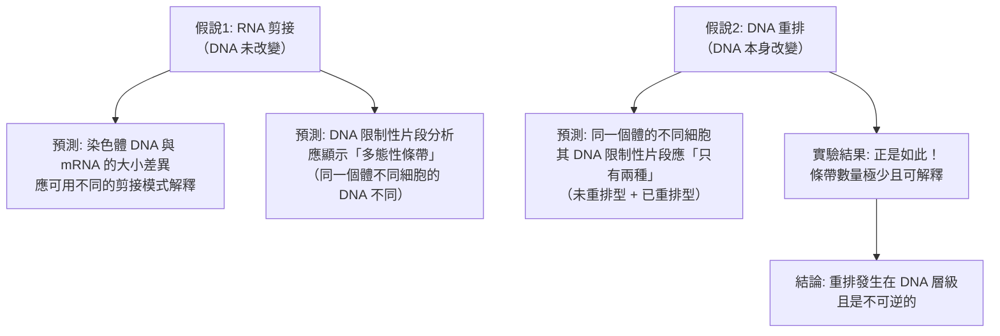

# 1987 · 抗體多樣性的遺傳原理：利根川進證明「基因可以被重組」

> **1987 諾貝爾生理學 or 醫學獎**（單獨獲獎）：利根川進（利根川 進，Tonegawa Susumu，日本）— 表彰「發現抗體多樣性產生的遺傳學原理」（"for his discovery of the genetic principle for generation of antibody diversity"）。

## 懸案（案情提要）

1984 年的諾獎（見 [1984-單株抗體](1984-單株抗體.md)）確立了抗體的**結構**：兩條重鏈、兩條輕鏈、可變區與恆定區、CDR 是抗原結合位。Edelman 與 Porter 的化學結果，卻留下一個極其尖銳的數學难题：

1. 一個蛋白質的種類（可能的胺基酸序列）約 $10^{20}$ 種，**足夠容納所有可能的抗體**——這是可能的；
2. 但**一個基因只編碼一條多肽鏈**。而抗體需要**兩種不同的多肽鏈**（重鏈與輕鏈）**同時表現**，且必須**配對正確**（輕鏈要與同一條重鏈來自同一次重排）；
3. 若重鏈與輕鏈各自獨立地從有限的基因池中隨機挑選並組合，則**配對正確的機率將是天文數字般的小**——

$$P(\text{正確配對}) = \frac{1}{N_{\text{heavy}}} \times \frac{1}{N_{\text{light}}}$$

4. 因此，**「一個 B 細胞只產生一種抗體」這件事，在基因組層級必須有某種機制保證**——細胞必須「記得」哪一條重鏈與哪一條輕鏈是一對的。

**利根川進的答案是：重排發生在同一條染色體上，且兩段基因的連接被「鎖定」在同一個細胞內。**

## 前因

| 年份 | 事件 |
| --- | --- |
| 1965 | **Jerne** 的「自然選擇說」預言：抗體多樣性是**先天產生的**（見 [1984-單株抗體](1984-單株抗體.md)）。 |
| 1970 | **David Baltimore 與 Susumu Tonegawa** 分別獨立發現**免疫球蛋白基因的 RNA 與 DNA** 中的**「插入序列（inserted sequence）」**——Tonegawa 發現的是**mRNA 與染色體 DNA 相比多出一段**；Baltimore 發現的是**RNA 轉錄本比基因多**。兩人同時發表，開啟了「**重排（rearrangement）**」的研究。 |
| 1976 | **利根川進**（時任 MIT 客座研究員，後為 MIT 教授）與其合作者發現免疫球蛋白的 **mRNA 比染色體 DNA 多出一段**——這是「**重排**」而非剪接的第一條線索。 |
| 1977 | **利根川進獨立證明**：在**骨髓瘤（myeloma）細胞**中，每個細胞只表達**一種**輕鏈（**輕鏈等位型排除（allelic exclusion）**），且**免疫球蛋白基因的染色體 DNA 確實被重排了**——這排除了「RNA 剪接」的可能性，確立了「**DNA 層級重排**」。 |
| 1978–1982 | 利根川進以 **Southern blot 與 R-loop 分析**，逐步繪出免疫球蛋白基因的「重排地圖」，證明 V、D、J 區基因**分散在染色體的不同位置**，必須經**染色體內的重排**才能形成完整的 V(D)J。 |
| 1981 | **Tonegawa 等人克隆出小鼠的免疫球蛋白重鏈基因**，並證明其**不連續**（分為 V、D、J、C 四段）。 |
| 1982 | **Tonegawa 等人完成 V(D)J 重組的完整證明**——以 Southern blot 顯示未重排（B 細胞前體）與已重排（B 細胞）基因組的「條帶位移（band shift）」。 |
| 1983–1987 | 利根川進的實驗室證明 V(D)J 重組信號序列（RSS）由 **12 鹼基與 23 鹼基**組成，並分離出催化重組的酵素 **RAG1 與 RAG2**。 |
| 1987 | 利根川進獲諾貝爾生理學 or 醫學獎（單獨獲獎）。 |
| 1990s | **RAG1/RAG2 的生化與結構研究**：由利根川進與 **David Schatz** 等人於 1989 年分離出 RAG1 與 RAG2，1992 年完成結構研究。 |
| 1990s–2000s | 利根川進轉向**神經科學**——研究**記憶的形成與提取**的分子機制（並因此獲得 2014 年的 **C. (C.) Kavli** 神經科學獎等）。 |

## 調查

### 第一幕：核心的偵查問題——「重排發生在哪一層？」

1976 年，兩條獨立的線索同時出現：

| 發現者 | 觀察 | 可能的解釋 |
| --- | --- | --- |
| **Baltimore** | 免疫球蛋白的**mRNA** 比染色體上的基因**大** | 可能是 **RNA 層級的選擇性剪接** |
| **利根川進** | 免疫球蛋白的**染色體 DNA** 與 **mRNA** 的差異方式 | 同樣指向剪接，**但他做了關鍵的追問** |

**利根川進的決定性實驗（1977）**：使用**骨髓瘤（myeloma）細胞**——這種腫瘤大量製造**單一種類**的免疫球蛋白，且已知其**只有一條等位基因被表現**（等位型排除）。

**實驗邏輯**：



**這個實驗的重要性**：它是**分子生物學中「不可逆性」的經典證明**——一旦 B 細胞分化，其抗原受體基因組就永久改變，**不再回頭**。這解釋了「**一個細胞一種抗體**」的根本機制。

### 第二幕：重排的結構解剖——V、D、J、C 四段拼圖

利根川進的實驗室以**Southern blot**（限制性片段分析 + 探針雜交）逐步重建了免疫球蛋白基因的結構：

```mermaid
flowchart TD
    A[胚系基因組<br>輕鏈: V群 + C基因<br>重鏈: V群 + D群 + J群 + C基因]
    A --> B[重組信號序列 RSS<br>12 bp (heptamer) + 23 bp (nonamer)]
    B --> C[RAG1/RAG2 辨識 RSS<br>造成髮夾與環狀 DNA]
    C --> D[V 片段 與 (D) J 片段 被連接<br>删除中间的 RSS 與片段]
    D --> E[完整 V(D)J + C 的重排基因<br>成為可轉錄的單位]
    E --> F[轉錄 → mRNA<br>→ 輕鏈/重鏈蛋白]
```

**關鍵的結構發現**：

1. **基因不連續**：V、D、J、C 四段在染色體上**相隔甚遠**（V 群與 J 群之間可達數十萬個鹼基）；
2. **重組信號序列（RSS）**：每個 V、D、J 的兩端帶有 **12 bp 的 heptamer 與 23 bp 的 nonamer**——**12 與 23 是「一對」**（ $12 + 23 = 35$ ，且 23 與 12 之間的空間大小決定重組的效率與「讀框」的決定）；
3. **重組後的基因組無法再重排**——因為 RSS 已被刪除（**信號序列的消耗 = 不可逆性的分子基礎**）。

### 第三幕：多樣性的數學結算

這是本案最漂亮的理論貢獻——**重排的組合數**：

**輕鏈（κ）**：

$$N_{\kappa} = \underbrace{V_{\kappa}}_{\approx 40} \times \underbrace{J_{\kappa}}_{\approx 5} \times \underbrace{2}_{\kappa \text{ 或 } \lambda} \approx 4 \times 10^{2}$$

**重鏈**：

$$N_H = \underbrace{V_H}_{\approx 50} \times \underbrace{D_H}_{\approx 27} \times \underbrace{J_H}_{\approx 6} \approx 8 \times 10^{3}$$

**加上接合多樣性（junctional diversity）與鏈內多樣性（somatic hypermutation）**：

| 多樣性來源 | 機制 | 附加倍數 |
| --- | --- | --- |
| 連接多樣性 | 重組時 V–D–J 接點的核苷酸刪除與增添 | 約 $10^{3}\text{–}10^{6}$ |
| **體細胞超變異（somatic hypermutation）** | B 細胞受活化後，免疫球蛋白基因的**點突變** | 約 $10^{3}\text{–}10^{4}$ |
| 重鏈與輕鏈的組合 | 隨機配對 | 約 $10^{3}\text{–}10^{4}$ |

**總計**：

$$N_{\text{total}} \approx 10^{6}\ (\text{V(D)J}) \times 10^{4}\ (\text{超變異}) \times 10^{3}\ (\text{配對}) \sim 10^{13}$$

**這個數字解釋了 Jerne 的悖論**：免疫系統「先天備有」的抗體種類，遠多於任何抗原的數目——足以應付宇宙中所有的抗原。

### 第四幕：RAG1/RAG2——「重組機器」的找到

利根川進的實驗室（與 **David Schatz**、**Marvin (M.) (M.)** 合作）於 1989–1992 年完成關鍵步驟：

1. **以「功能篩選」定位重組酵素**：將小鼠的染色體 DNA 轉入**帶有缺陷的重組系統的細胞**（或直接以體外重組系統篩選），篩選出能催化 V(D)J 重組的基因；
2. **分離出 RAG1 與 RAG2** 兩個基因；
3. **生化的證明**：純化的 RAG1/RAG2 蛋白在體外**催化正確的 V(D)J 重組**——**這是「催化蛋白質」的決定性證明**；
4. **機制**：RAG1/RAG2 辨識 RSS，形成**髮夾（hairpin）**結構與**環狀 DNA**中間物，隨後由 **DNA 連接酶（DNA ligase IV）、XRCC4、XLF（nonhomologous end joining, NHEJ）** 完成修復——**這解釋了為何重排會留下「接合多樣性」**（連接時的核苷酸增刪）。

**一個驚人的演化註腳**：**RAG1 的序列與轉座酵素（transposase）高度相似**——這意味著，**V(D)J 重組系統本身是由一個轉座子演化而來的**！這條線把 1983 年的麥克林托克（見 [1983-轉座子](1983-轉座子.md)）與 1987 年的利根川進**直接接上了**——**「轉座子的遺傳」可以被改寫成「抗體的遺傳」**。

## 理論裁決

1. **重組的產物與分布**：重排事件的隨機性可由幾何模型描述：

   $$P(\text{特定 V–D–J 組合}) = \frac{1}{V \cdot D \cdot J}$$

   而每個 B 細胞只做**一次**重排（不可逆），因此抗體的分布呈**對數正態的多樣性**——這解釋了為何高親和力的抗體極少（需要多次突變），而免疫學家必須用「篩選」來富集它們。

2. **「一個細胞一種抗體」的拓撲學**：由於重排是**不可逆**且發生在**同一條染色體**上：

   $$\text{輕鏈} \text{ 與 } \text{重鏈的重排在同一細胞內完成} \Rightarrow \text{配對正確性被結構保證}$$

   這解決了本章開頭的數學難題——**配對正確不是靠「運氣」，而是靠「同一條染色體上的同一次重排事件」**。

3. **體細胞超變異的演化意義**：超變異發生在**已重排**的基因上，且**只在 B 細胞受活化後**發生——這是「**體細胞階段的可變性**」，是演化上的「個體層級的免疫學習」：

   $$\text{選擇壓力（抗原）} \to \text{超變異} \to \text{親和力增加} \to \text{克隆擴增}$$

   **這是「**體細胞超突變 + 選擇**」＝「體細胞層次的演化」**，今日被認為是**抗體親和力成熟（affinity maturation）**的機制。

4. **重組的「讀框」問題**：RSS 的 12/23 配對決定了重組後三聯體的讀框——這解釋了為何重鏈有 **D 片段時會產生「移碼」問題**，以及為何 **J 片段的選擇決定讀框**（J 的第一個編碼與最後一個編碼核苷酸在使用後會被剪除）。

## 追查支線（未結之謎）

- **利根川進的跨界生涯**：他受訓於**分子生物學**（曾在瑞士 Basel 的 Basel Institute 研究），卻在 1987 年因免疫學獲獎，並在獲獎後**轉向神經科學**——研究**海兔（Aplysia）的記憶**與**小鼠的記憶形成**，並於 2010 年代進入**記憶的分子機制**（包括「記憶痕跡（engram）」的細胞群標記）與**阿茲海默病**的研究；
- **利根川進與山中的「實驗風格」**：他與山中伸彌（見 [2012-iPS 細胞](2012-iPS細胞.md)）同為 1980 年代 MIT–RIKEN 圈的代表，兩人的科學路徑都呈現「**先在基礎分子生物學做出突破，再轉向應用與疾病**」的模式；
- **RAG 與「V(D)J 重組缺陷」的疾病**：RAG1/RAG2 的突變造成 **Omenn 綜合症**與 **SCID（嚴重複合免疫缺陷）**——這是本案最直接的臨床後代，也是新生兒「**新生兒篩查（SCID 篩檢）**」的推動力之一；
- **體細胞超變異與癌症**：淋巴瘤中的「**體細胞超突變（SHM）**」是今日**濾泡型淋巴瘤**的分子標記，也是「**原發性中樞神經系統淋巴瘤（PCNSL）**」的診斷依據；
- **「無脊椎動物的 V(D)J」**：脊椎動物的重排系統獨特，但**蜥蜴的 V(D)J 重組與 RAG**、以及**鯊魚的 IgW**（以 RAG2/Lig4 為基礎的類 V(D)J 系統）在 2010 年代被發現**——這重塑了脊椎動物免疫系統的演化圖景，也讓「**所有脊椎動物都有 V(D)J**」的教條再度被修正。

## 證物與數據（偵查卷宗摘錄）

| 證物 | 數值／內容 | 偵查意義 |
| --- | --- | --- |
| mRNA 與 DNA 的差異（1976） | RNA 較大 | 重排的線索 |
| 骨髓瘤 DNA 分析（1977） | 條帶數極少，可解釋 | DNA 層級不可逆重排的證明 |
| 輕鏈等位型排除 | 一個細胞只有一種輕鏈 | 「一細胞一抗體」的基礎 |
| 基因不連續性 | V、D、J、C 分離於染色體各處 | 重排結構的解剖 |
| RSS | 12 bp heptamer + 23 bp nonamer | 重組訊號 |
| 輕鏈多樣性 | 約 $40 \times 5 \approx 4 \times 10^{2}$ | 組合數 |
| 重鏈多樣性 | 約 $50 \times 27 \times 6 \approx 8 \times 10^{3}$ | 組合數 |
| 接合多樣性 | 約 $10^{3}\text{–}10^{6}$ | 連接處的核苷酸增刪 |
| 體細胞超變異 | 約 $10^{3}\text{–}10^{4}$ 倍 | 親和力成熟 |
| 總多樣性 | 約 $10^{13}$ | 足以應付所有抗原 |
| RAG1/RAG2（1989–92） | 純化蛋白在體外催化重組 | 「機器」的找到 |
| RAG 與轉座酵素的同源性 | 序列相似 | V(D)J 由轉座子演化而來 |

## 後果

| 領域 | 影響 |
| --- | --- |
| 免疫學 | 抗體多樣性的機制徹底解開；「選擇說」獲得分子證實。 |
| 分子生物學 | V(D)J 重組成為分子生物學的經典機制與教材。 |
| 演化生物學 | 脊椎動物免疫系統的演化（V(D)J 與轉座子的關係）。 |
| 臨床 | RAG 缺陷造成的免疫缺陷；SCID 新生兒篩查。 |
| 腫瘤學 | 體細胞超突變作為淋巴瘤的分子標記與治療靶點。 |
| 生物技術 | 重組 DNA 技術中的「受控重組」概念。 |
| 其他諾獎 | 與 [1972-抗體結構](1972-抗體結構.md)、[1983-轉座子](1983-轉座子.md)、[1984-單株抗體](1984-單株抗體.md) 構成免疫學主線。 |

## 關聯

- [1972-抗體結構](1972-抗體結構.md) — 結構是功能的基礎，也是「多樣性有限」難題的提出。
- [1984-單株抗體](1984-單株抗體.md) — Jerne 的選擇說，本案給出其分子兌現。
- [1983-轉座子](1983-轉座子.md) — RAG 與轉座酵素的同源性，把兩案縫合。
- [1962-DNA 雙螺旋](1962-DNA雙螺旋.md) — 遺傳物質的結構前提。
- [1965-乳糖操縱子](1965-乳糖操縱子.md) — 基因表現調控，與「等位型排除」的調控問題相接。
