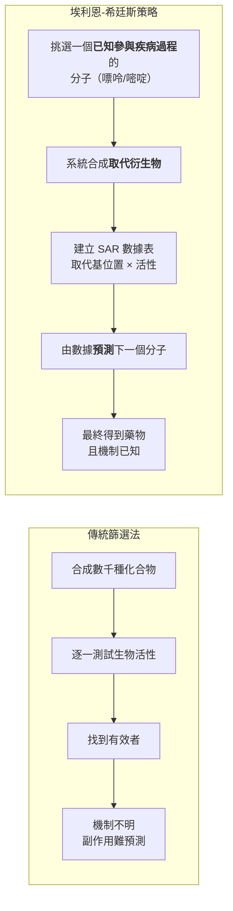
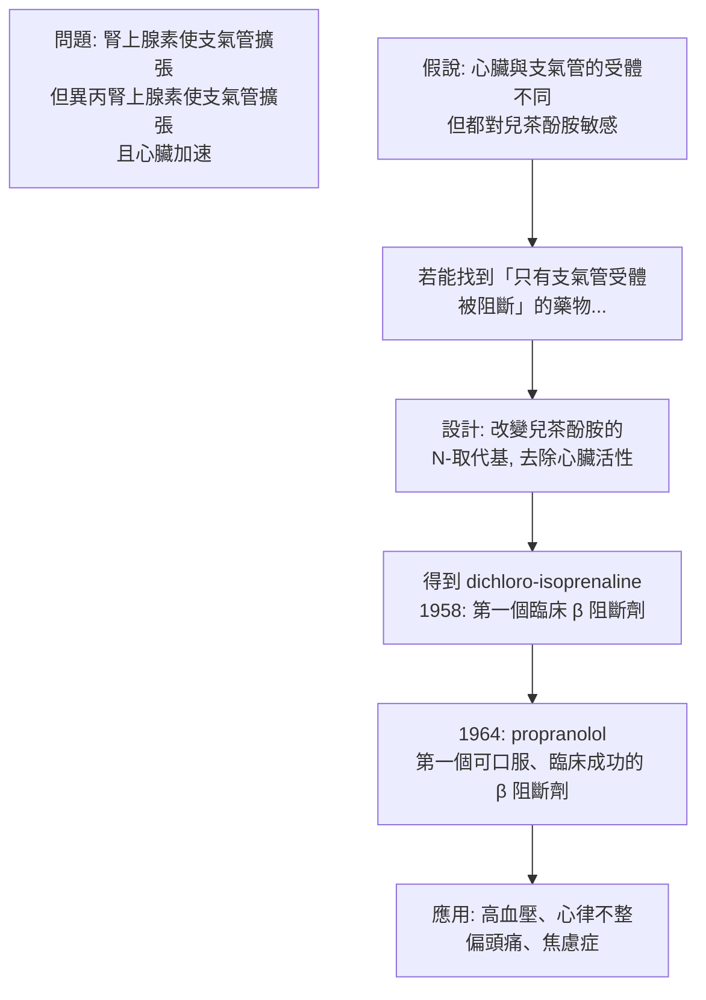
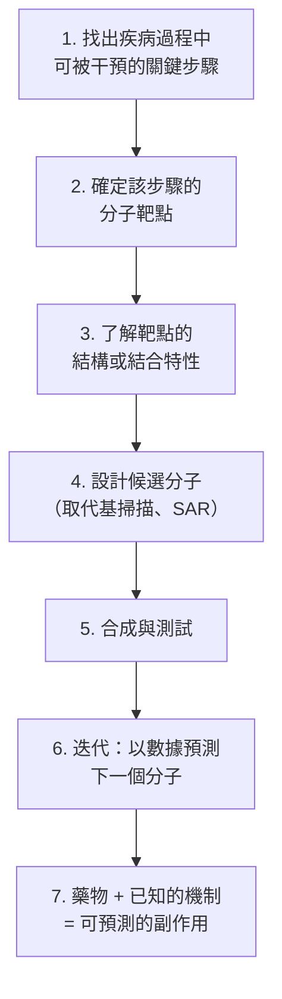

# 1988 · 藥物治療的重要原理：埃利恩、希廷斯與布萊克的「合理藥物設計」

> **1988 諾貝爾生理學 or 醫學獎**（共享三人）：詹姆斯·布萊克爵士（Sir James W. Black，英國）— 表彰「發現藥物治療的重要原理」；格特魯德·B·埃利恩（Gertrude B. Elion，美國）與喬治·H·希廷斯（George H. Hitchings，美國）— 同上。

## 懸案（案情提要）

1970 年代的藥物開發，幾乎完全靠**「篩選」**：

1. 藥廠合成數千種化合物，逐一測試其對某個目標的作用，找到「有效」的那一個；
2. 這是愛利華的**「組合」策略**（combinatorial chemistry）：產量巨大，但**命中率低**（數千種化合物中可能只有一種有效）；
3. 更麻煩的是：找到有效的化合物之後，**它為什麼有效？** 多數時候並不清楚——於是副作用無法預測，藥物開發的後半段全靠「試錯」。

埃利恩與希廷斯在 Burroughs Wellcome 實驗室提出的替代方案，是革命性的：

> **不要先找藥。先弄清楚「疾病的靶點是什麼」，然後設計能作用於該靶點的分子。**

這就是**「合理藥物設計（rational drug design）」**。

## 前因

| 年份 | 事件 |
| --- | --- |
| 1938–1940 | **Gertrude Elion** 與 **George Hitchings** 在 Burroughs Wellcome 開始合作研究**嘌呤的代謝**（為什麼人需要核酸？哪些藥物能干擾它？）。 |
| 1940s–1950s | 他們建立了一個關鍵的**「結構—活性關係（structure-activity relationship, SAR）」數據庫**：系統地合成一系列**取代的嘌呤（purine）**與**取代的嘧啶（pyrimidine）**，記錄每個分子的生物活性——**這是「合理設計」的第一塊磚：先建立數據，再用數據預測。** |
| 1950s | 他們以這套方法找到了 **6-巰基嘌呤（6-mercaptopurine, 6-MP）**，第一個**有效治療白血病（急性淋巴細胞白血病，ALL）**的藥物——並證實其作用機制是**被轉運成核苷酸後，抑制嘌呤的从头合成**（「**抗代謝物**」的概念）。 |
| 1957 | **James Black**（在英國的 ICI 公司）開始研究**β 受體阻斷劑**——他提出一個大膽的問題：**「為什麼過敏性哮喘在用腎上腺素後會支氣管擴張，但用異丙腎上腺素（isoprenaline）卻支氣管擴張而心臟也加速？」** 他猜測**心臟與支氣管有「不同的受體」——這直接導致了 **propranolol（普萘洛爾）**，第一個 β 阻斷劑，也是 1988 年諾獎的核心工作之一。 |
| 1964 | **赫希廷斯與埃利恩**發現 **azathioprine（硫唑嘌呤）**——**第一個免疫抑制藥**，用於器官移植（見 [1960-後天免疫耐受](1960-後天免疫耐受.md)）。 |
| 1970s | 埃利恩與希廷斯發展了**acyclovir（無環鳥苷）**——第一個**選擇性抗病毒藥**（它專一作用於病毒的 **胸苷激酶**）。 |
| 1977 | **James Black 與團隊**發現了 **cimetidine（西咪替丁）**——第一個 **$\mathrm{H}_{2}$ 受體拮抗劑**（阻斷胃酸分泌），開啟了「**質子幫浦抑制劑**」的後續革命。 |
| 1981 | **AZT（zidovudine）**在臨床上證明可治療 AIDS——這是埃利恩團隊從 1960 年代篩選的數百個核苷類似物中找到的（**她們在 1984 年退休後，AZT 才被驗證**，這段歷史值得玩味）。 |
| 1988 | 三人共享諾貝爾生理學 or 醫學獎。 |
| 1980s–1990s | **計算機輔助藥物設計（CADD）**、**結構導向的藥物設計**、**片段基於的方法（fragment-based drug discovery）**成為主流。 |

## 調查

### 第一幕：埃利恩與希廷斯的「反覆合成」策略

兩人的第一項根本性貢獻，是**把藥物研究從「篩選」改為「系統性合成 + 數據建模」**。

**傳統篩選 vs 埃利恩—希廷斯策略**：

**SAR 數據表的樣貌**（埃利恩與希廷斯對 6-取代嘌呤的系統測試）：

| 取代基於 C6 | 活性 | 說明 |
| --- | --- | --- |
| H（嘌呤本身） | 極低 | 正常代謝物 |
| **SH（6-巰基嘌呤）** | **極高** | 成為 DNA 合成誤配的「高速公路」 |
| $\mathrm{NH}_{2}$ （鳥嘌呤） | 中 | 天然鹼基 |
| Cl、Br、I | 低 | 鹵素取代 |
| $\mathrm{CH}_{3}$ | 中 |  |

**從這張表裡能讀出藥理學的結構規則**：巰基（—SH）提供了一個**能被酶轉運的「把手」**，使藥物被代謝成核苷酸而摻入 DNA，但因結構不同而造成** DNA 合成的錯誤配對** → 細胞死亡（對快速分裂的癌细胞殺傷最大）。**「結構—活性」的機制解釋，讓藥物的副作用（骨髓抑制）也變得可預測**。

### 第二幕：三個「合理設計」的典範作品

**（1）6-巰基嘌呤與硫唑嘌呤（抗代謝物）**：

$$\text{6-MP} \xrightarrow{\text{HPRT}} \text{6-MP 核苷酸} \xrightarrow{} \text{抑制 amidophosphoribosyl transferase}$$

- **6-MP**：第一個有效的白血病化療藥（1948 年用於 ALL）；
- **硫唑嘌呤（azathioprine）**：是 6-MP 的「前藥（prodrug）」——在體內被分解為 6-MP，**提高選擇性**並減少肝毒性；1960 年代成為**器官移植的標準免疫抑制藥**；
- **後續**：methotrexate（1950 年代合成，抑制 dihydrofolate reductase）、5-FU（抑制胸苷酸合成酶）、cytarabine、gemcitabine——**整個腫瘤化學治療的藥理骨架**。

**（2）propranolol（β 阻斷劑）——布萊克的「受體異質性」洞察**：

布萊克的推理鏈極為漂亮：

**布萊克的洞見的力量**：他不是從「篩選」得到 propranolol，而是**先提出「受體異質性」的理論預測**，再去驗證——**這正是「合理設計」的定義**。

**（3）cimetidine（ $\mathrm{H}_{2}$ 拮抗劑）**：

布萊克的另一個大膽之舉：1970 年初，他提出一個在當時被認為「荒謬」的想法——**既然刺激胃酸分泌的途徑是「組織胺 → $\mathrm{H}_{2}$ 受體 → 胃壁細胞」，那麼只要設計一個能占據 $\mathrm{H}_{2}$ 受體但不起刺激作用的分子，就能抑制胃酸**。

他組建了一支團隊，**從「組胺的結構出發」逐一修改**（這是「**先有靶點結構，再設計配體**」的原型），經歷大量失敗（早期化合物無活性），最終在 1972 年得到 cimetidine——**第一個 $\mathrm{H}_{2}$ 受體拮抗劑**。

**cimetidine 的歷史意義**：

- 它是**第一個能治療「非器質性消化性潰瘍」的藥物**（在此之前，潰瘍只能靠手術或長期抗酸藥）；
- 它的成功**直接刺激了「受體亞型」的全線研究**（ $\mathrm{H}_{1}$ 、 $\mathrm{H}_{2}$ 、 $\mathrm{H}_{3}$ 陸續被發現），並最終導致 **omeprazole（質子幫浦抑制劑）**——**今日消化性潰瘍治療的主力**。

### 第三幕：「先找靶點」的決策框架

把三人的工作抽象成一個可推廣的流程，這是 1988 年諾獎最持久的遺產：

**埃利恩的三項「原則」（她 1988 年諾貝爾演講的總結）**：

1. **找出疾病過程中的關鍵化學步驟**（"find the key enzyme"）；
2. **設計能利用該步驟的藥物**；
3. **副作用可預測**，因為機制已知。

### 第四幕：數據與藥效的定量（Hill 方程）

藥物與靶點的結合可用受體藥理學的標準模型描述：

$$\frac{E}{E_{\max}} = \frac{[A]^n}{K_A^n + [A]^n}$$

其中 $n$ 為 **Hill 係數**——**它是「協同性」的量度**：

| $n$ 值 | 意義 |
| --- | --- |
| $n = 1$ | 兩個結合位點獨立作用（無協同） |
| $n > 1$ | **正協同**（如胰島素的受體 pre-aggregation） |
| $n < 1$ | **負協同**（如氧的血紅素結合——這是波爾效應，見 [1961-耳蝸行波](1961-耳蝸行波.md) 的相關生理學） |

**埃利恩與希廷斯的 SAR 數據，正是第一套大規模的「結構—親和力」定量資料庫**——這是今日**藥物資料庫（ChEMBL、PubChem）**與**藥效學（pharmacometrics）**的先聲。

## 追查支線（未結之謎）

- **埃利恩的科學與制度影響**：她長期擔任 Burroughs Wellcome 研發主管，**改變了藥廠對女性科學家的對待**（她自己在訪談中說過，自己剛入職時被要求「不要讓人知道你是女性，因為病人會拒絕女醫生」）；她於 1984 年退休後，**將全部版稅捐給了基礎研究與教育**；
- **埃利恩的個人悲劇**：她的丈夫 James（也是科學家）因過敏性休克去世（當時尚無有效的過敏治療），她的兒子 亦因此——這使她後來全力投入免疫學與藥理學研究；
- **埃利恩與希廷斯都是「藥理學的應用主義者」**：他們的著名實驗室文化被記為「**藥理學的黃金年代**」——以**「能否治療特定疾病」**作為研究問題的起點，這在當時的學術界（重視機制純粹性）是異數；
- **布萊克的「受體異質性」論爭**：他的 β 受體假說在 1960 年代曾遭到強烈質疑（當時認為「只有一種腎上腺素受體」）；他本人形容那幾年是「**我職業生涯中最孤獨的時期**」；
- **布萊克在諾貝爾演講中提到「藥物發現的機率隨著受體生物學的進步而提升」**——這是 1990–2010 年代「**從表型到靶點**」典範轉移的先聲，也是 2020 年代的**「從機制到藥物」**（如 RIPK1、SIRPα、補體等新型靶點）的源頭。

## 證物與數據（偵查卷宗摘錄）

| 證物 | 數值／內容 | 偵查意義 |
| --- | --- | --- |
| 取代嘌呤 SAR 表 | C6 取代基 × 活性 | 第一套系統性結構—活性數據 |
| 6-巰基嘌呤（1948） | 第一個有效的白血病化療藥 | 抗代謝物策略 |
| 硫唑嘌呤（1964） | 6-MP 的前藥 | 移植免疫抑制 |
| AZT（1984 臨床驗證） | 第一個抗 HIV 藥物 | 核苷類似物策略 |
| acyclovir（1977） | 專一作用於病毒胸苷激酶 | 選擇性抗病毒 |
| propranolol（1964） | 第一個臨床成功的 β 阻斷劑 | 受體異質性的預測 |
| cimetidine（1972） | 第一個 $\mathrm{H}_{2}$ 拮抗劑 | 從靶點結構出發的設計 |
| omeprazole（1988–89） | 第一個 PPI | $\mathrm{H}_{2}$ 拮抗劑的後續革命 |
| Hill 方程 | $E/E_{\max} = [A]^n/(K_A^n+[A]^n)$ | 藥效與協同的定量 |
| 命中率對比 | 篩選約 $10^{-4}\text{–}10^{-5}$ ；合理設計顯著提升 | 效率的數學 |

## 理論裁決

1. **「先找靶點」的決策框架**：合理藥物設計的數學本質，是把藥物發現從「大海撈針」變成「定向搜索」：

$$	ext{命中率} = \frac{\text{有活性的化合物數}}{\text{測試的化合物數}}$$

**傳統篩選的命中率約 $10^{-4}\text{–}10^{-5}$**；而以靶點結構為出發點的合理設計，可把命中率提升數個數量級——**這正是埃利恩與希廷斯「系統性合成取代隨機篩選」的量化意義**。

2. **SAR 表的數學**：結構—活性關係可寫成一個多項式模型：

$$\log(1/\mathrm{IC}_{50}) = \beta_0 + \sum_i \beta_i x_i + \sum_{i<j} \beta_{ij} x_i x_j$$

**取代基的「貢獻」與「交互作用」都可量化**——這正是埃利恩與希廷斯逐代建立 SAR 表的理論骨架，也是今日**配體基礎的配體效率（ligand-based drug design）計算**的直接前身。

3. **競爭性拮抗的親和力指標**：藥物的效價可用 pA2（對抗半數有效濃度）表徵：

$$\mathrm{pA}_2 = -\log_{10} ([B]_2 / [A]_2)\Big|_{50\%\text{ effect}}$$

其中 $[A]_2$ 、 $[B]_2$ 為產生相同效應（50%）時兩藥的濃度。**pA2 是受體親和力的標準度量**，且**與效價（potency）不同**——**藥理學區分「效價」與「效力（efficacy）」的經典區分，正是本案的方法論遺產**。

4. **藥效學的 Hill 方程**：藥物效應與濃度的關係：

$$\frac{E}{E_{\max}} = \frac{[A]^n}{K_A^n + [A]^n}$$

其中 **Hill 係數 $n$** 揭示了**協同性**： $n = 1$ 為獨立結合； $n > 1$ 為正協同（如胰島素的受體 pre-aggregation）； $n < 1$ 為負協同。**這是 1950–60 年代藥效學的核心工具**，也是「受體存在」的行為學證據。

5. **「選擇性毒性」的量化**：藥物的治療窗由兩條劑量—反應曲線的距離決定：

$$\text{治療窗} = \frac{\mathrm{ED}_{50\text{therapeutic}}}{\mathrm{ED}_{50\text{toxic}}} \quad \text{或以 } \frac{\mathrm{TD}_{50}}{\mathrm{ED}_{50}} \text{（治療指數）}$$

**埃利恩的硫唑嘌呤（以 6-MP 為前藥提高選擇性）**正是「用藥代動力學改善治療窗」的早期範例——**這是本案最實用的理論貢獻之一**。

## 後果

| 領域 | 影響 |
| --- | --- |
| 藥理學 | 「合理藥物設計」成為藥物發現的核心方法論。 |
| 臨床 | β 阻斷劑（高血壓、心律不整）、 $\mathrm{H}_{2}$ 拮抗劑與 PPI（潰瘍）、免疫抑制藥（移植）、抗病毒藥（herpes、HIV）、抗癌化療藥四大類。 |
| 藥業 | 靶點導向的研發取代純粹篩選；藥效學與 SAR 資料庫成為產業基礎。 |
| 分子生物學 | 「先找靶點」成為疾病研究的戰略，改變了基礎與臨床研究的關係。 |
| 科學文化 | 埃利恩與希廷斯的「以治療為綱」的實驗室文化成為藥理學傳統。 |
| 其他諾獎 | 與 [1957-抗組織胺藥物](1957-抗組織胺藥物.md)（受體亞型的起源）、[1984-單株抗體](1984-單株抗體.md)（抗體作為藥）、[2018-免疫檢查點](2018-免疫檢查點.md)（靶向治療的當代巔峰）構成藥理學主線。 |

## 關聯

- [1957-抗組織胺藥物](1957-抗組織胺藥物.md) — 受體亞型與選擇性毒性的先驅。
- [1985-膽固醇受體](1985-膽固醇受體.md) — 受體靶點驅動藥物開發的另一條線（statin）。
- [1960-後天免疫耐受](1960-後天免疫耐受.md) — 硫唑嘌呤的臨床應用場景。
- [2018-免疫檢查點](2018-免疫檢查點.md) — 合理設計在免疫腫瘤學的巔峰應用。
- [1984-單株抗體](1984-單株抗體.md) — 單株抗體作為藥物的技術前提。
